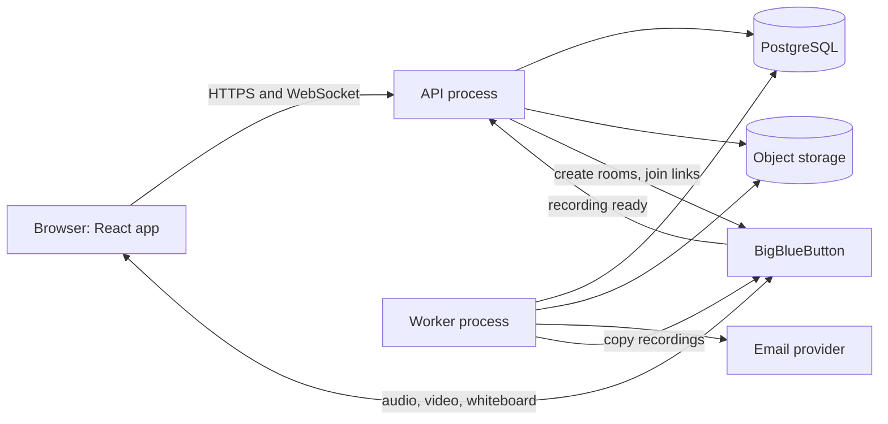

# Technical introduction

Status: rewritten 2026-10-20 for the tutor-centric product; pending line-by-line owner review.

OVC (Online Virtual Classroom) is a workspace for private tutors teaching adult students: video lessons with a whiteboard and recordings, chats, a schedule, and homework built from self-checking tests and tasks the tutor checks. This page explains the parts of the system, what they exchange, and why the boundaries sit where they do. What the product does for its users is in the [product overview](product.md); the detailed maps are in [knowledge/architecture/detailed.md](../knowledge/architecture/detailed.md); the behavior contracts are in [knowledge/specs/](../knowledge/README.md).

## The parts

- **The browser app** is a React application in Russian and English. It shows each user what they may do and holds no rules of its own.
- **The API process** (FastAPI) owns every rule: who may see a student, a lesson, an assignment or a chat. It serves a REST API and one WebSocket for live chat and updates.
- **The worker process** performs everything that happens outside a request:
  - emails and reminders;
  - creating lessons of weekly series;
  - copying recordings;
  - deleting expired data.

  It takes its work from an outbox table that the API writes in the same transaction as each change.
- **PostgreSQL** is the system of record and the worker's queue.
- **Object storage** holds files and recordings; browsers download through short-lived signed links issued after authorization.
- **BigBlueButton** carries audio, video, the whiteboard and presentations, and records lessons. OVC creates rooms and join links and keeps its own copies of recordings.
- **The email provider** delivers invitations, confirmations, reminders and notifications.
- **Everything runs in Russia**, because the users' personal data must stay there.

## One week of tutoring through the system

1. Maria, a language tutor, signs up and confirms her email. She invites Anna with a link and shares her tutor code with Boris, whose request she accepts.
2. She schedules a weekly lesson with Anna. The API stores the series in Maria's timezone and creates the lessons; the worker will email reminders the day before and an hour before.
3. At lesson time Maria joins. The API creates the BigBlueButton room and gives her a moderator link; Anna's page updates live and she joins as a viewer. Maria records part of the lesson. When BigBlueButton finishes processing, it calls the API; the worker copies the recording into OVC storage, and Anna finds it on the lesson page.
4. Maria builds a test in her library and issues it to her group. Each student gets their own copy. Answers save as they type; on submission the API scores the automatic questions, and Maria's review queue shows the file answers to check. She attaches a corrected file and marks the work checked; the student is notified and, as Maria allowed, sees the correct answers.
5. Throughout the week they talk in the private chat and the group chat. Messages are saved before they are delivered, and someone who was away gets one digest email.

## Why the boundaries are here

- **Video is delegated, recordings are not.** Running real-time media is the hardest part of a video product, so BigBlueButton does it. Its recordings are public to anyone holding a link, so OVC copies them and serves them only to the lesson's participants ([ADR-0004](decisions/0004-bigbluebutton-primary-provider.md)).
- **Everything is scoped by the tutor–student relationship.** One student can study with several tutors, and each tutor's work stays separate. Every rule is written once around that relationship ([ADR-0005](decisions/0005-tutor-centric-domain.md)).
- **The API is the only implementation of the rules.** Answer keys, permissions and scores are decided on the server; the browser receives only what the user may see.
- **Slow and fallible work goes through the outbox.** An email provider outage or a restart never loses an invitation, a reminder or a recording ([ADR-0006](decisions/0006-background-worker-and-email.md)).
- **External systems sit behind adapters.** Storage, conferencing, email and the clock each have a production implementation and a fake, so the whole system is tested without patching code or calling real services.

## Further reading

- [Product overview](product.md), [functional requirements](requirements/functional.md) and [non-functional requirements](requirements/non-functional.md)
- [Threat model](threat-model.md) and [decision records](decisions/README.md)
- [Roadmap](roadmap.md) and [development guide](development.md)
