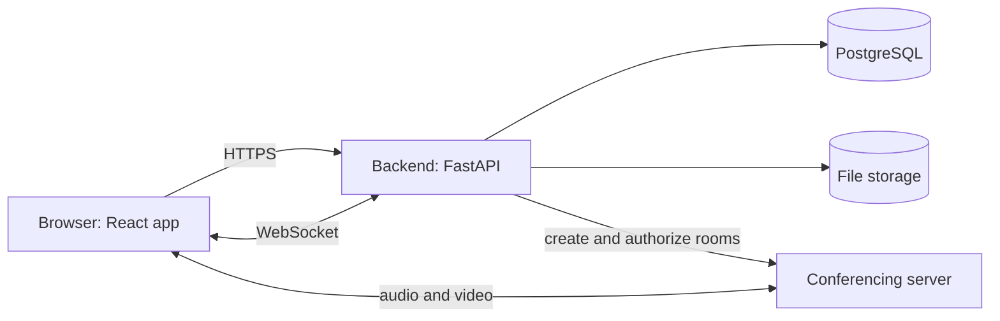

# Technical introduction

Status: draft written 2026-10-20; pending line-by-line owner review.

OVC (Online Virtual Classroom) lets any teacher run online courses: live video lessons, a course chat, a lesson calendar and homework that students submit and teachers grade. This page explains the parts of the system, what they exchange, and why the boundaries sit where they do. The detailed maps are in [knowledge/architecture/detailed.md](../knowledge/architecture/detailed.md); the behavior contracts are in [knowledge/specs/](../knowledge/README.md).

## The parts

- **The browser app** is a React single-page application. It shows each user what they may do and talks only to the backend's API and to the conferencing server's embed. It makes no authorization decisions of its own.
- **The backend** is one FastAPI service. It owns every rule: who may see a course, who may submit, who may grade, who may join a lesson. It exposes a REST API for reading and changing state and one WebSocket for live chat and notifications.
- **PostgreSQL** is the system of record for users, courses, lessons, messages, assignments, submissions and grades.
- **File storage** holds homework attachments and avatars: a local directory in development, S3-compatible storage later.
- **The conferencing server** (Jitsi Meet, or BigBlueButton) carries the audio and video. The backend tells it which room a lesson uses and who may enter as a moderator; the media flows directly between the browser and the conferencing server.

## One lesson through the system

1. A teacher creates a course and shares its join code; students enrol.
2. The teacher schedules a lesson on the calendar. The backend stores it and creates a meeting with a random room name.
3. At lesson time, each participant presses Join. The backend checks that they teach or are enrolled in the course and returns join details; the browser embeds the room. The teacher joins as moderator.
4. During and after the lesson, the course chat delivers messages live over the WebSocket; each message is saved before it is delivered, so anyone who was offline sees it when they return.
5. The teacher posts homework with attached files. Students upload their answers and submit. The teacher grades each submission with points and feedback, or returns it for revision. The student is notified and sees the result.

## Why the boundaries are here

- **Video is delegated.** Building and operating real-time media is the hardest and most expensive part of a video product. Embedding an open-source conferencing server removes that work while keeping the option to self-host ([ADR-0003](decisions/0003-embedded-video-provider.md)).
- **The API is the only implementation of the rules.** Because the browser holds no rules, every check lives in one place and is tested once, and any future client (a mobile app, an integration) gets the same behavior.
- **The database is the truth for chat.** The WebSocket only delivers; reconnecting clients recover from the database, so a dropped connection never loses a message.
- **External systems sit behind adapters.** Storage, conferencing and notifications each have a small interface with a production implementation and a fake. The fakes make the whole system testable without patching code or calling real services.
- **One backend process first.** Live delivery runs inside one process until load requires more; the delivery mechanism is an interface, so moving to several processes changes one adapter.

## Further reading

- [Functional requirements](requirements/functional.md) and [non-functional requirements](requirements/non-functional.md)
- [Threat model](threat-model.md)
- [Decision records](decisions/README.md)
- [Roadmap](roadmap.md) and [development guide](development.md)
