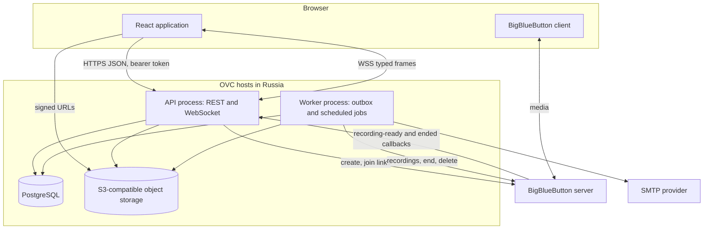

# OVC detailed architecture

The reference map behind the [technical introduction](../../docs/technical-introduction.md): where each component lives, which package may import which, what each component is built with, how it is configured, and which mechanics are still open. Behavior contracts live in [`knowledge/specs/`](../README.md); decisions live in [`docs/decisions/`](../../docs/decisions/README.md) and win when this file disagrees with them.

## Component diagram

Media never passes through OVC. Every external effect that must not be lost goes through the outbox and the worker ([ADR-0006](../../docs/decisions/0006-background-worker-and-email.md)).

## Module and contract map

### Backend (`backend/`)

One Go module ([ADR-0012](../../docs/decisions/0012-go-backend.md)). Executables live in `cmd/`, shared packages in `internal/`, SQL migrations in `migrations/` and SQL queries in `queries/`.

| Package | Owns | Contract |
|---|---|---|
| `internal/api` | REST handlers registered with huma, request middleware (current user, relationship and group guards), error mapping | [API](../specs/api.md) |
| `internal/realtime` | WebSocket gateway, connection registry and its goroutine lifetimes, delivery of broadcast signals to local sockets | [Realtime](../specs/realtime-and-video.md#connection) |
| `internal/services/accounts` | Registration, verification, sessions, passwords, deletion | [Accounts](../specs/accounts.md) |
| `internal/services/tutoring` | Relationships, invitations, join requests, groups | [Accounts](../specs/accounts.md#tutorstudent-relationships) |
| `internal/services/schedule` | Lessons, series, recurrence, status | [Schedule](../specs/schedule.md) |
| `internal/services/meetings` | Meetings, joins, callbacks, recordings | [Video](../specs/realtime-and-video.md#video) |
| `internal/services/library` | Folders, materials, templates | [Homework](../specs/homework.md#library) |
| `internal/services/homework` | Issues, submissions, scoring, reviews, analytics | [Homework](../specs/homework.md) |
| `internal/services/chat` | Channels, messages, read markers | [Chat](../specs/realtime-and-video.md#chat) |
| `internal/services/notifications` | Notification rows, email composition, preferences, outbox writes | [Notifications](../specs/notifications.md) |
| `internal/services/files` | Uploads, binding, downloads, quotas | [Files](../specs/files.md) |
| `internal/repositories` | All business-data access, one repository per aggregate, wrapping the generated queries | [Data model](../specs/data-model.md) |
| `internal/dbgen` | Query functions and row types generated by sqlc from `queries/` and `migrations/`; never edited by hand | [Data model](../specs/data-model.md) |
| `internal/schemas` | Request, response and frame structs that huma validates and publishes as OpenAPI; separate student and tutor variants | [API](../specs/api.md#conventions) |
| `internal/adapters` | Storage (S3, in-memory fake), meeting provider (BigBlueButton, fake), mail (SMTP, database sink), clock (system, shared fake), broadcaster (PostgreSQL `NOTIFY`, in-process fake) | [Video](../specs/realtime-and-video.md#provider-interface), [files](../specs/files.md), [notifications](../specs/notifications.md#email) |
| `internal/domain` | Named types and enumerations, value types and pure rules: normalisation, scoring, recurrence expansion, state transitions | domain specifications |
| `internal/core` | Settings, security primitives, the `pgx` connection pool, logging bootstrap, i18n of emails | [Configuration](#configuration), [observability](../specs/observability.md) |
| `internal/worker` | Outbox dispatcher and scheduled jobs, the `Tick(now)` entry point | [Outbox and worker](../specs/notifications.md#outbox-and-worker) |
| `internal/admin` | The `ovc-admin` command | [Administration command](../specs/accounts.md#administration-command) |
| `internal/testcontrol` | The end-to-end test control routes, present only with `OVC_TEST_CONTROL=1` | [Test harness](../../docs/development.md#end-to-end-test-harness) |
| `internal/testdb` | Test-only helper: one migrated PostgreSQL database per test, created from `OVC_TEST_DATABASE_ADMIN_URL` and dropped afterwards | [Development guide](../../docs/development.md#backend-checks) |
| `internal/conventions` | Test-only package: the no-comments and no-`any` check and the package-layer architecture test, which parses the table below | [AGENTS.md](../../AGENTS.md#code) |
| `migrations` | goose SQL migrations, embedded with `//go:embed` | [Data model](../specs/data-model.md) |
| `cmd/api`, `cmd/worker`, `cmd/ovc-admin` | Composition roots: the API server (with the `migrate` and `openapi` subcommands), the worker process and, from slice 2, the operator command; `cmd/internal/startup` holds their shared migration helpers | — |

### Frontend (`frontend/src/`)

| Area | Owns |
|---|---|
| `features/auth` | Sign in, sign up, confirmation, password reset, invitation acceptance, session refresh, route guards |
| `features/home` | Tutor Today, student Home, first-run checklist |
| `features/schedule` | Calendar views, lesson dialog, series scope choice, overlap confirmation |
| `features/lessons` | Lesson page, join flow, embedded room lifecycle, recordings player |
| `features/students` | Students list, student card, join requests, invitations, tutor code |
| `features/groups` | Groups list and page |
| `features/library` | Library browser, materials, folders |
| `features/builder` | Assignment builder and preview |
| `features/homework` | Issue dialog, issued work, analytics, review queue and review screen, student assignment page and results |
| `features/chat` | Channel list, conversation, composer, presence, typing |
| `features/notifications` | Sidebar notifications entry with unread count, notifications panel and list |
| `features/settings` | Profile, account, notifications, teaching settings |
| `lib/api` | Typed API client generated from OpenAPI, error type, token handling |
| `lib/realtime` | One reconnecting WebSocket client and typed subscriptions |
| `lib/i18n` | i18next setup, ICU formatting, error-code messages, `ru` and `en` resources |
| `components/ui` | Shared primitives built on the [tokens](../design/web/tokens.md) |
| `routes` | Thin route components and role guards ([navigation](../design/web/navigation.md)) |

## Package layers

A package may import only the packages in its row (all paths under `backend/`; the standard library is always allowed, and a third-party library only in the packages that own its concern: `pgx` in `internal/core`, `internal/dbgen`, `internal/repositories`, `internal/adapters` (only for the adapters' own tables and `LISTEN`) and `internal/testdb`; goose in `cmd/*`, which apply the embedded migrations, and in `internal/testdb`; huma in `internal/api` and `internal/schemas`; `coder/websocket` in `internal/realtime`; storage and mail clients in `internal/adapters`; each recorded in the [stack table](#stack-per-component)); packages under `internal/services` follow the `internal/services` row and may import each other only through their exported service interfaces. The architecture test that enforces this table lands with the backend scaffold ([roadmap slice 1](../../docs/roadmap.md#slice-1-scaffold-and-local-loop)) and checks the Go imports of non-test files (test files may also import `internal/testdb` and the packages they exercise); a new package enters the table in the change that creates it.

Infrastructure adapters that keep their own state in PostgreSQL, namely the `NOTIFY` broadcaster, the database mail sink and the shared test clock, use the connection pool from `internal/core` for their own tables only. This is the single exception to "only repositories touch the database" in AGENTS.md. Business data is never read or written outside `internal/repositories`.

| Package | May import |
|---|---|
| `internal/domain` | standard library only |
| `migrations` | standard library only |
| `internal/core` | `internal/domain` |
| `internal/dbgen` | `internal/domain` (for sqlc type overrides) |
| `internal/schemas` | `internal/domain` |
| `internal/repositories` | `internal/domain`, `internal/core`, `internal/dbgen` |
| `internal/adapters` | `internal/domain`, `internal/core` |
| `internal/services` | `internal/domain`, `internal/core`, `internal/repositories`, `internal/adapters`, `internal/schemas` |
| `internal/realtime` | `internal/domain`, `internal/core`, `internal/schemas`, `internal/services`, `internal/adapters` (the broadcaster interface) |
| `internal/api` | `internal/domain`, `internal/core`, `internal/schemas`, `internal/services`, `internal/realtime` |
| `internal/worker` | `internal/domain`, `internal/core`, `internal/services`, `internal/adapters` |
| `internal/admin` | `internal/domain`, `internal/core`, `internal/services` |
| `internal/testcontrol` | `internal/domain`, `internal/core`, `internal/schemas`, `internal/services`, `internal/adapters`, `internal/worker` |
| `internal/testdb` | `internal/core`, `migrations` (test helper; never imported by production code) |
| `cmd/*` | every package |

## Stack per component

Exact versions are pinned in the lockfiles and recorded with check dates in `knowledge/research/` when adopted. [ADR-0002](../../docs/decisions/0002-implementation-stack.md) owns the decided rows; libraries marked "chosen in slice" are selected with a recorded reason in the slice that first needs them.

| Component | Choice | Reason |
|---|---|---|
| Backend language | Go, latest stable when slice 1 starts, pinned in `go.mod` | Compile-time checks, goroutines for WebSockets, single-binary deployment ([ADR-0012](../../docs/decisions/0012-go-backend.md)) |
| HTTP and API contract | huma 2.39.1 on `net/http` | Typed handlers, input validation and OpenAPI 3.1 generated from code; defaults reviewed in [research](../research/toolchain-2026-10-21.md) |
| WebSockets | `coder/websocket` (added in slice 4) | Context-aware, maintained, standard `net/http` integration |
| Database access and migrations | `pgx` 5.10.0 and `goose` 3.28.0 with embedded SQL files; `sqlc` from slice 2 | Visible SQL compiled to typed functions; reviewed plain-SQL migrations with a session lock |
| Database and queue | PostgreSQL 18 | Relational data, keyset pagination, leased `SKIP LOCKED` outbox, `LISTEN/NOTIFY` broadcaster |
| Timezones | Standard library `time` with the embedded `time/tzdata` database | IANA rules without a dependency, independent of the host's zone files |
| Logging | Standard library `log/slog`, JSON | Structured, leveled diagnostics without a dependency |
| Password hashing | Argon2id (library chosen in slice 2) | Current recommended password hash |
| Tokens | Signed JWT access tokens (library chosen in slice 2); opaque hashed refresh, email and invitation tokens | Stateless requests with revocable sessions |
| Object storage | S3-compatible service in Russia; S3 client chosen in slice 2; local S3-compatible server in development | Quotas, recordings, signed URLs ([ADR-0008](../../docs/decisions/0008-hosting-and-data-residency.md)) |
| Email | SMTP through a Russian provider; SMTP client chosen in slice 2 | Transactional email from the worker |
| Conferencing | BigBlueButton 4.0, self-hosted | Whiteboard and recordings ([ADR-0004](../../docs/decisions/0004-bigbluebutton-primary-provider.md)) |
| Go tooling | `gofmt`, `go vet`, golangci-lint, `govulncheck`, standard `testing` | Strict static checks and vulnerability scanning with the standard toolchain |
| Frontend | React, Vite, TypeScript strict | Conventional SPA stack |
| Frontend state | TanStack Query; generated OpenAPI client | No hand-rolled cache; schema parity |
| Styling | Tailwind CSS over design tokens | Utility styling with shared primitives |
| Localisation | i18next with ICU message format | Russian plurals, two languages |
| Fonts | Golos Text, Literata, JetBrains Mono, self-hosted | Quiet text-first style with Cyrillic-first interface and book-serif titles ([ADR-0010](../../docs/decisions/0010-quiet-visual-language.md)), no external CDN |
| Frontend tooling | pnpm, ESLint, Prettier, Vitest, Testing Library, Playwright | Lockfile-pinned, strict lint, real-browser tests |
| Local infrastructure | Docker Compose: PostgreSQL 18.6 and SeaweedFS 4.48, pinned by digest, published on loopback | One-command development environment; SeaweedFS chosen for its licence, maintenance and presigned `Content-Disposition` support ([research](../research/local-s3-2026-10-21.md)) |
| Repository tools | Go module `tools/` pinning Gitleaks 8.30.1, OSV-Scanner 2.6.0, golangci-lint 2.14.0 and govulncheck 1.8.0 | Pinned versions with checksums ([security scanning](../../docs/development.md#security-scanning), [backend checks](../../docs/development.md#backend-checks)) |

## Configuration

Settings are read once from the environment into one typed struct in `internal/core`. Every variable is documented in `backend/.env.example`, which a test checks against the settings loader; unknown values of boolean and enum variables are refused at start-up; the frontend reads only `VITE_`-prefixed build-time variables.

| Variable | Meaning |
|---|---|
| `OVC_HTTP_ADDR` | API listen address, `127.0.0.1:8000` by default; a loopback IP literal is required with `OVC_TEST_CONTROL=1` |
| `OVC_DATABASE_URL` | PostgreSQL connection URL, required; a `Secret` whose diagnostics show only hosts and database name |
| `OVC_PUBLIC_URL` | Base URL used in emails and provider callbacks |
| `OVC_JWT_SECRET` | Access-token signing key |
| `OVC_UNSUBSCRIBE_SIGNING_SECRET` | Key for unsubscribe tokens only |
| `OVC_FIELD_ENCRYPTION_KEY` | Key for encrypted invitation tokens |
| `OVC_ACCESS_TOKEN_TTL_SECONDS`, `OVC_REFRESH_TOKEN_TTL_SECONDS` | Token lifetimes |
| `OVC_CORS_ORIGINS` | Explicit frontend origins |
| `OVC_STORAGE_ENDPOINT`, `OVC_STORAGE_BUCKET`, `OVC_STORAGE_ACCESS_KEY`, `OVC_STORAGE_SECRET_KEY`, `OVC_STORAGE_BACKEND` | S3-compatible storage, or `memory` in tests |
| `OVC_DEFAULT_FILE_QUOTA_BYTES`, `OVC_DEFAULT_RECORDING_QUOTA_BYTES` | Default tutor quotas |
| `OVC_MEETING_PROVIDER` | `fake` (the only value accepted until `bbb` lands in slice 7) |
| `OVC_BBB_URL`, `OVC_BBB_SECRET`, `OVC_BBB_CHECKSUM_ALGORITHM` | BigBlueButton server, shared secret, checksum algorithm |
| `OVC_BBB_EMBED_ENABLED` | Embed the conferencing client in the lesson page; false until the slice 7 probe passes |
| `OVC_SMTP_HOST`, `OVC_SMTP_PORT`, `OVC_SMTP_USERNAME`, `OVC_SMTP_PASSWORD`, `OVC_MAIL_FROM`, `OVC_MAIL_BACKEND` | Email, or the database `sink` in development and tests |
| `OVC_API_DOCS_ENABLED` | `true` serves the OpenAPI JSON at `/api/docs/openapi.json`; `false` by default and in production |
| `OVC_TEST_CONTROL` | Enable the test control routes and the mail sink viewer; refused unless the meeting provider is `fake`, mail is the sink and the database is a test or development database |
| `OVC_CLOCK` | `system`, or `test` for the shared test clock (only with `OVC_TEST_CONTROL=1`) |
| `OVC_BROADCASTER` | `postgres`, or `memory` for unit and contract tests |
| `OVC_DB_POOL_SIZE` | Connections per process: 20 for the API and 10 for the worker by default, plus one dedicated listening connection per API instance |
| `OVC_LOG_LEVEL`, `OVC_LOG_FORMAT` | Diagnostics level (`debug`, `info` by default, `warn`, `error`) and `json` (default) or `console` output |
| `OVC_TEST_DATABASE_ADMIN_URL` | Tests only: a PostgreSQL URL allowed to create and drop the per-test databases |
| `VITE_API_URL`, `VITE_WS_URL` | Frontend endpoints |

## Deployment shapes

- **Local development:**
  - Docker Compose runs PostgreSQL and a local S3-compatible server;
  - `go run ./cmd/api migrate` applies migrations, then the API and the worker run with `go run ./cmd/api` and `go run ./cmd/worker`, restarted by hand, and the frontend under the Vite dev server;
  - the meeting provider is `fake` and mail goes to the database sink, viewable through a development-only page.
- **Production:**
  - hosts in Russia ([ADR-0008](../../docs/decisions/0008-hosting-and-data-residency.md));
  - the API and the worker as small containers built from static Go binaries, behind a TLS reverse proxy that also serves the built frontend;
  - managed PostgreSQL with backups, S3-compatible storage, a Russian SMTP provider;
  - BigBlueButton 4.0 on a dedicated Ubuntu 24.04 host on a subdomain of the OVC domain.
- **Scaling:** one API instance and one worker in the MVP; the `NOTIFY` broadcaster and the leased outbox already allow more of each.

## Glossary

| Term | Meaning |
|---|---|
| Tutor | An account that teaches; owns students' cards, groups, lessons, library and issues |
| Student | An account that studies with one or more tutors |
| Relationship | One tutor's link to one student: invited, active or ended; the student card is its tutor-facing view |
| Invitation | A single-use link that links a student to a relationship |
| Tutor code | A short shareable code; a student enters it to create a join request |
| Join request | A student's request to study with a tutor, accepted or declined by the tutor |
| Group | A tutor's named set of students with its own chat, lessons and issues |
| Lesson | One scheduled session for a student or a group |
| Series | A weekly pattern that generates lessons |
| Roster | The students frozen into a lesson when it becomes live |
| Meeting | The BigBlueButton room behind one lesson |
| Recording | A copy of a meeting recording stored and served by OVC |
| Material | A library file |
| Template | A library assignment that can be issued many times |
| Issue | One issuing of a template to a student or group, with a snapshot, deadline and answer policy |
| Submission | One student's work on one issue |
| Review | A tutor's scores, comments, corrected files and feedback on a submission |
| Outbox | Database rows describing external effects that the worker performs |
| Operator | The person running the platform through `ovc-admin` |

## Open implementation questions

| Question | Constraint already settled | Resolved in |
|---|---|---|
| Rendered recording format available on BigBlueButton 4.0, or a protected-recordings load balancer instead; blocks the slice 7 plan | Never serve stock public playback links | Slice 7 probe |
| Provider retry behavior for non-2xx callback answers; joining with `redirect=false` and a session token; behavior of two joins with the same `userID`; external assets (STUN) the client loads | Reconciliation does not depend on callbacks; join links are never stored | Slice 7 probe |
| How bounces and complaints arrive from the chosen SMTP provider (webhook or polling) | Undeliverable addresses stop optional emails | Slice 2, with the provider choice |
| Embedded client works on all supported browsers | "Open in new tab" always available | Slice 7 probe |
| Which Russian providers for hosting, storage and SMTP | All in Russia | Before first deployment |
| Thumbnails for image previews | Originals constrained by the client in the MVP | After MVP |
| Malware scanning of uploads | Content-type allowlist and size limits are mandatory regardless | After MVP |
| Offline queue for assignment answers beyond retrying | Autosave with versions | Slice 9 |
| The read deadline for upload routes (a per-MiB rate with a ceiling) | Per-request read and write deadlines of 30 s, structured errors for every refusal ([API conventions](../specs/api.md#conventions)) | Slice 6 |
| How the student's Home knows that checked feedback is new (a per-submission seen marker in the data model, or dropping the marker) | Home shows recently checked work without points | Slice 10 |
| Phone navigation frame (a bottom bar or the interim top bar with an overlay sidebar) and phone layouts | Computer-first design; every page works from 360 px in one column meanwhile ([ADR-0010](../../docs/decisions/0010-quiet-visual-language.md)) | Slice 10 |
