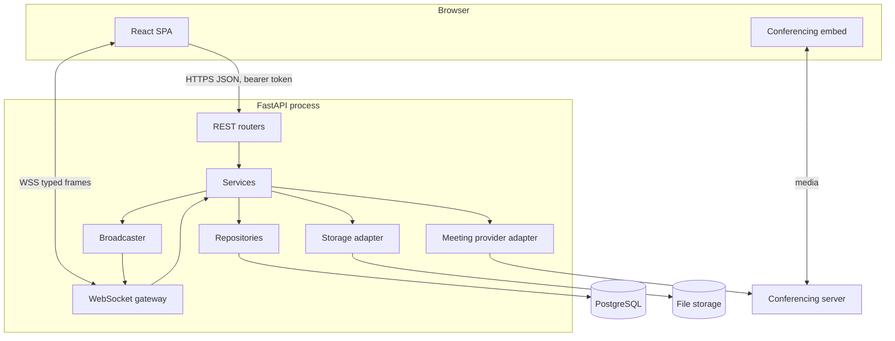

# OVC detailed architecture

The reference map behind the [technical introduction](../../docs/technical-introduction.md): where each component lives, which package may import which, what each component is built with, how it is configured, and which mechanics are still open. Behavior contracts live in [`knowledge/specs/`](../README.md); decisions live in [`docs/decisions/`](../../docs/decisions/README.md) and win when this file disagrees with them.

## Component diagram

Media never passes through the backend. The backend creates rooms, authorizes joins and hands the browser what it needs to embed the room ([ADR-0003](../../docs/decisions/0003-embedded-video-provider.md)).

## Module and contract map

### Backend (`backend/`)

| Package | Owns | Contract |
|---|---|---|
| `ovc.api` | REST routers, request dependencies (current user, role and ownership guards), error mapping | [API](../specs/api.md) |
| `ovc.realtime` | WebSocket gateway, connection registry, broadcaster | [Realtime and video](../specs/realtime-and-video.md#chat) |
| `ovc.services` | Business rules per feature: auth, courses, lessons, chat, homework, meetings | [API](../specs/api.md), [data model](../specs/data-model.md) |
| `ovc.repositories` | All database access, one repository per aggregate | [Data model](../specs/data-model.md) |
| `ovc.models` | SQLAlchemy ORM tables | [Data model](../specs/data-model.md) |
| `ovc.schemas` | Pydantic request, response and frame models | [API](../specs/api.md) |
| `ovc.adapters` | Storage (local, S3-compatible), meeting provider (Jitsi, BigBlueButton, fake), notifier | [Realtime and video](../specs/realtime-and-video.md#provider-interface) |
| `ovc.domain` | Enums (roles, statuses, frame types), value types and pure rules shared by every layer | [Data model](../specs/data-model.md) |
| `ovc.core` | Settings, security primitives (hashing, tokens), database engine and sessions, logging bootstrap | [Configuration](#configuration), [observability](../specs/observability.md) |
| `ovc.main` | Composition root: builds the application and wires adapters from settings | — |

### Frontend (`frontend/src/`)

| Area | Owns |
|---|---|
| `features/auth` | Login, registration, token storage and refresh, route guards |
| `features/courses` | Course list, creation, enrolment, members |
| `features/calendar` | Calendar views, lesson scheduling and editing |
| `features/chat` | Channels, message list and composer, typing and presence |
| `features/video` | Join flow and the conferencing embed lifecycle |
| `features/homework` | Assignments, submissions, grading queue and feedback |
| `lib/api` | Typed API client, error type, token attachment and refresh |
| `lib/realtime` | One reconnecting WebSocket client and typed frame subscriptions |
| `components/ui` | Shared presentational primitives |
| `routes` | Thin route components composing features |

## Package layers

A package may import only the packages in its row. The architecture test that enforces this table lands with the backend scaffold ([roadmap slice 1](../../docs/roadmap.md#slice-1-scaffold-and-local-loop)); a new package enters the table in the change that creates it, and widening a row is stated in that change's approved plan.

| Package | May import |
|---|---|
| `ovc.domain` | standard library only |
| `ovc.core` | `ovc.domain` |
| `ovc.models` | `ovc.domain`, `ovc.core` |
| `ovc.schemas` | `ovc.domain` |
| `ovc.repositories` | `ovc.domain`, `ovc.core`, `ovc.models` |
| `ovc.adapters` | `ovc.domain`, `ovc.core` |
| `ovc.services` | `ovc.domain`, `ovc.core`, `ovc.repositories`, `ovc.adapters`, `ovc.schemas` |
| `ovc.realtime` | `ovc.domain`, `ovc.core`, `ovc.schemas`, `ovc.services` |
| `ovc.api` | `ovc.domain`, `ovc.core`, `ovc.schemas`, `ovc.services`, `ovc.realtime` |
| `ovc.main` | every package |

Routers and the gateway never import repositories or models; services never import routers or FastAPI request objects. A type that two layers need moves down to `ovc.domain` instead of widening a row.

## Stack per component

Exact versions are pinned in the lockfiles and recorded with check dates in `knowledge/research/` when first adopted. [ADR-0002](../../docs/decisions/0002-implementation-stack.md) owns the decided rows.

| Component | Choice | Reason |
|---|---|---|
| Backend language | Python 3.11 (`.python-version`) | Team experience; typed async ecosystem |
| Web framework | FastAPI | Async-first, Pydantic integration, native WebSockets, generated OpenAPI |
| Validation | Pydantic v2 | Boundary parsing into precise types |
| ORM and migrations | SQLAlchemy 2.0 async, Alembic | Typed async sessions; reviewed migrations |
| Database | PostgreSQL | Relational academic data, keyset pagination, `LISTEN/NOTIFY` for later fan-out |
| Password hashing | Argon2id | Current recommended password hash |
| Tokens | Signed JWT access token, opaque rotating refresh token stored hashed | Stateless requests with revocable sessions |
| Python tooling | uv, ruff (lint and format), pyright strict, pytest | One fast toolchain; strict typing |
| Frontend | React, Vite, TypeScript strict | Conventional SPA stack |
| Frontend state | TanStack Query for server state, React state for UI | No hand-rolled cache |
| Styling | Tailwind CSS | Utility styling with shared primitives |
| Frontend tooling | pnpm, ESLint, Prettier, Vitest, Testing Library, Playwright | Lockfile-pinned, strict lint, real-browser end-to-end tests |
| Conferencing | Jitsi Meet embed; BigBlueButton behind the same adapter | Delegates media; open source and self-hostable |
| Local infrastructure | Docker Compose (PostgreSQL, optional local Jitsi) | One-command development environment |

## Configuration

Settings are read once from the environment into one typed object in `ovc.core`. Every variable is documented in `backend/.env.example`; the frontend reads only `VITE_`-prefixed build-time variables.

| Variable | Meaning |
|---|---|
| `OVC_DATABASE_URL` | PostgreSQL connection URL |
| `OVC_JWT_SECRET` | Access-token signing key |
| `OVC_ACCESS_TOKEN_TTL_SECONDS`, `OVC_REFRESH_TOKEN_TTL_SECONDS` | Token lifetimes |
| `OVC_CORS_ORIGINS` | Explicit frontend origins |
| `OVC_STORAGE_BACKEND`, `OVC_STORAGE_ROOT` | `local` or `s3`, and the local root directory |
| `OVC_UPLOAD_MAX_BYTES`, `OVC_UPLOAD_ALLOWED_TYPES` | Upload bounds |
| `OVC_MEETING_PROVIDER` | `jitsi`, `bbb` or `fake` |
| `OVC_JITSI_DOMAIN`, `OVC_JITSI_APP_ID`, `OVC_JITSI_APP_SECRET` | Jitsi deployment and optional token signing |
| `OVC_BBB_URL`, `OVC_BBB_SECRET` | BigBlueButton deployment |
| `OVC_LOG_LEVEL`, `OVC_LOG_FORMAT` | Diagnostics level and `json` or `console` output |
| `VITE_API_URL`, `VITE_WS_URL` | Frontend endpoints |

## Deployment shapes

- **Local development:** Docker Compose runs PostgreSQL; the backend runs under `uvicorn --reload`, the frontend under the Vite dev server; the meeting provider is `fake` or the public Jitsi instance.
- **Production (later):** backend and built frontend as containers behind a TLS reverse proxy, managed PostgreSQL, S3-compatible storage, a self-hosted token-gated Jitsi or BigBlueButton. One backend instance until the broadcaster gains a cross-instance channel.

## Glossary

| Term | Meaning |
|---|---|
| Course | A teacher's class; the unit of membership, chat, lessons and homework |
| Enrolment | A student's membership in a course |
| Lesson | A scheduled calendar slot in a course, optionally with a meeting |
| Meeting | The conferencing room that backs one lesson |
| Channel | A chat scope: one per course, or a direct conversation between two users |
| Frame | One typed JSON message on the WebSocket |
| Assignment | Homework a teacher posts to a course |
| Submission | One student's answer to one assignment |
| Grade | A teacher's points and feedback on a submission |
| Attachment | A stored file owned by an assignment, a submission, a message or an avatar |
| Adapter | An implementation of an interface to an external system; fakes are adapters too |

## Open implementation questions

Questions not settled by a decision record. Each is resolved in the slice that first needs it and recorded as a decision or a specification change.

| Question | Constraint already settled | Resolved in |
|---|---|---|
| Refresh token transport: `HttpOnly` cookie or response body | Never in URLs or logs | Slice 2 |
| Recurring lessons: stored rule or materialized rows | UTC storage, per-user timezone display | Slice 4 |
| Calendar export (iCalendar feed) in the MVP or later | — | Slice 4 |
| Read receipts and unread counts: per message or per channel watermark | Chat history is the source of truth | Slice 5 |
| Token-gated Jitsi in development or only in production | Room names stay unguessable either way | Slice 6 |
| Submission history: overwrite or versions | One current submission per student and assignment | Slice 7 |
| Plagiarism or file scanning of uploads | Upload bounds and allowlist are mandatory regardless | After MVP |
