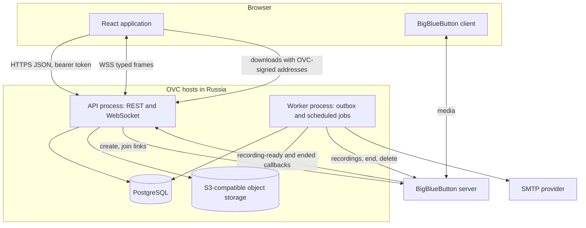

# OVC detailed architecture

The reference map behind the [technical introduction](../../docs/technical-introduction.md): where each component lives, which package may import which, what each component is built with, how it is configured, and which mechanics are still open. Behavior contracts live in [`knowledge/specs/`](../README.md); decisions live in [`docs/decisions/`](../../docs/decisions/README.md) and win when this file disagrees with them.

## Component diagram

Media never passes through OVC. Every external effect that must not be lost goes through the outbox and the worker ([ADR-0006](../../docs/decisions/0006-background-worker-and-email.md)).

## Module and contract map

### Backend (`backend/`)

One Go module ([ADR-0012](../../docs/decisions/0012-go-backend.md)). Executables live in `cmd/`, shared packages in `internal/`, SQL migrations in `migrations/` and SQL queries in `queries/`.

| Package | Owns | Contract |
|---|---|---|
| `internal/api` | REST handlers registered with huma, request middleware (current user, relationship and group guards), error mapping | [API](../specs/api.md) |
| `internal/realtime` | WebSocket gateway (exact-origin check, first-frame and in-band authentication, inbound frame limits), connection registry and its goroutine lifetimes, per-socket outbound queues, suspension and the re-check worker, token lapse, the sweep, listener-loss handling, shutdown, and delivery of signals from the listener to local sockets | [Realtime](../specs/realtime-and-video.md#connection) |
| `internal/services/accounts` | Registration, verification, sessions, passwords, deletion | [Accounts](../specs/accounts.md) |
| `internal/services/tutoring` | Relationships, invitations, join requests, groups | [Accounts](../specs/accounts.md#tutorstudent-relationships) |
| `internal/services/schedule` | Lessons, series, materialisation, overlap checks, the visibility of lessons, the label table, and the status, reminder and horizon-extension work the worker runs; recurrence and timezone arithmetic comes from `internal/domain/schedule` | [Schedule](../specs/schedule.md) |
| `internal/services/meetings` | Creation coordinator with durable ownership, authorized join, end and restart with their rate admission, the unsigned ended hint, bounded meeting recovery scanner, cleanup with provider inspection and exact-generation End, and revision-bound local operator recovery; recordings remain pending | [Video](../specs/realtime-and-video.md#video) |
| `internal/services/library` | Folders, materials, templates, block validation and completeness, template references and charges, and the template's student projection (from slice 8; covered by the `internal/services` row of the package layers) | [Homework](../specs/homework.md#library) |
| `internal/services/homework` | From slice 9: issues with their snapshots and references, submissions, answers and file answers, scoring on submission, review revisions and corrected files, the review queue, the student projections of issued work and the readability predicate they share, the issue and submission frames, homework notifications, its parts of the ending, erasure and purge paths, and the `homework.cleanup` job the worker runs; it reads templates (the tutor schema and the template's references) through a narrow interface that `internal/services/library` implements, so the library keeps its own repository; the pure rules (scoring, the percentage, the submission state machine, the reveal rule) live in `internal/domain` with their unit tests; analytics come after the MVP (covered by the `internal/services` row of the package layers) | [Homework](../specs/homework.md) |
| `internal/services/chat` | Channels, messages, read markers | [Chat](../specs/realtime-and-video.md#chat) |
| `internal/services/notifications` | Notification rows, email composition, preferences, outbox writes | [Notifications](../specs/notifications.md) |
| `internal/services/outbox` | Claiming, leases, completion, retries with backoff, reclaim and cleanup of outbox rows, and the job-run table | [Outbox and worker](../specs/notifications.md#outbox-and-worker) |
| `internal/services/files` | Uploads, binding, downloads, quotas | [Files](../specs/files.md) |
| `internal/services/operators` | Operator actions behind `ovc-admin`: listing, blocking, unblocking, restoring accounts and setting tutor quotas; needs only repositories, the clock and logging | [Administration command](../specs/accounts.md#administration-command) |
| `internal/repositories` | All business-data access, one repository per aggregate, wrapping the generated queries; from slice 4 also `Signals`, which writes broadcaster signals with `pg_notify` inside the caller's transaction | [Data model](../specs/data-model.md), [broadcaster](../specs/realtime-and-video.md#broadcaster) |
| `internal/dbgen` | Query functions and row types generated by sqlc from `queries/` and `migrations/`; never edited by hand | [Data model](../specs/data-model.md) |
| `internal/schemas` | Request and response structs that huma validates and publishes as OpenAPI, with separate student and tutor variants; the WebSocket frame payload structs, which are not published through OpenAPI and are mirrored by hand in the frontend, checked by a contract test; the refresh cookie builder shared by the API and the test control routes | [API](../specs/api.md#conventions), [frame format](../specs/realtime-and-video.md#frame-format) |
| `internal/adapters/meeting` | From slice 7 L1/L2b: typed meeting-provider contract (from slice 8 with the optional lesson presentation as a redacting secret type), bounded in-memory fake, PostgreSQL-backed shared fake owning only its `fake_meeting_` infrastructure tables, the BigBlueButton HTTP adapter, which no process can select until the remote probe, and the test-control conversion of its links into the [navigable fake room](../specs/realtime-and-video.md#navigable-fake-room); not a media server | [Video](../specs/realtime-and-video.md#provider-interface) |
| `internal/adapters` | Storage (S3, in-memory fake; from slice 8 the 5-minute signed read of the lesson presentation on the conferencing server's storage endpoint), meeting provider (BigBlueButton, fake), mail (SMTP, database sink), clock (system, shared fake), and from slice 4 the PostgreSQL listener: one dedicated `LISTEN` connection per API instance with keepalives, the self-heartbeat, a generation and reconnect with backoff; there is no in-process broadcaster | [Video](../specs/realtime-and-video.md#provider-interface), [files](../specs/files.md), [notifications](../specs/notifications.md#email) |
| `internal/domain` | Named types and enumerations, value types and pure rules: normalisation, scoring, recurrence expansion, state transitions; from slice 8 text normalisation and number parsing version 1; from slice 9 the scoring rules, the final score and percentage, the submission state machine and the answer reveal rule | domain specifications, [normalisation](../specs/homework.md#short-answer-normalisation) |
| `internal/domain/schedule` | From slice 5: the pure recurrence and timezone rules, without I/O: occurrence dates from weekdays, first date and end, and each occurrence's start instant with the gap and repeated-time rules computed from the zone's transitions | [Recurrence and timezones](../specs/schedule.md#recurrence-and-timezones) |
| `internal/core` | Settings, security primitives (from slice 4 also the unsubscribe token signer), the `pgx` connection pool, logging bootstrap, i18n of emails (from slice 5 with the hand-written Russian and English plural rules and the date forms of emails) | [Configuration](#configuration), [observability](../specs/observability.md), [email](../specs/notifications.md#email) |
| `internal/core/timezonecities` | From slice 5: the timezone city table for emails, `timezone-cities.json` embedded with `//go:embed`, one of two identical copies with `frontend/src/lib/time/timezone-cities.json`, which `TestTimezoneCityTablesAreIdentical` compares byte for byte | [Recurrence and timezones](../specs/schedule.md#recurrence-and-timezones) |
| `internal/worker` | Outbox dispatcher (from slice 4 one loop per lane that refills its slots) and scheduled jobs, the `Tick(now)` entry point | [Outbox and worker](../specs/notifications.md#outbox-and-worker) |
| `internal/admin` | The `ovc-admin` command line: parsing, output, exit codes and the audit event | [Administration command](../specs/accounts.md#administration-command) |
| `internal/testcontrol` | The end-to-end test control routes, present only with `OVC_TEST_CONTROL=1`; from slice 7 the fake room page and its availability, end and embed controls; from slice 4 also presence from the API instance's registry, closing a user's sockets with `4429` or `1012` through the real gateway, and minting an unsubscribe token through the real signer; after slice 4 also seeding confirmed accounts and their sessions through the accounts service's seeder | [Test harness](../../docs/development.md#end-to-end-test-harness) |
| `internal/teststorage` | Test-only helper: the local S3-compatible bucket `ovc-test`, created when missing, with the keys from `OVC_DEV_STORAGE_*` | [Development guide](../../docs/development.md#backend-checks) |
| `internal/testmail` | Test-only pausable mail sender that wraps a real mailer (the database sink in tests), holds sends while paused and releases them one recipient at a time or all at once; it passes the mail adapter contract tests and lets worker tests hold email slots in flight | [Outbox and worker](../specs/notifications.md#outbox-and-worker), [testing rules](../../AGENTS.md#testing) |
| `internal/testhasher` | Test-only fake of the password hasher with verification counting, failure injection and a pause after a verification, and the hasher contract that both it and the Argon2 hasher keep | [Testing rules](../../AGENTS.md#testing) |
| `internal/testdb` | Test-only helper: one migrated PostgreSQL database per test, created from `OVC_TEST_DATABASE_ADMIN_URL` as a clone of a template database that each test process migrates once, and dropped afterwards; from slice 4 also `internal/testdb/forwarder`, the in-process TCP forwarder in front of a test database for the listener's liveness tests only, which a conventions test lets only the listener adapter's tests import | [Development guide](../../docs/development.md#backend-checks) |
| `internal/conventions` | Test-only package: the no-comments and no-`any` check and the package-layer architecture test, which parses the table below | [AGENTS.md](../../AGENTS.md#code) |
| `migrations` | goose SQL migrations, embedded with `//go:embed` | [Data model](../specs/data-model.md) |
| `cmd/api`, `cmd/worker`, `cmd/ovc-admin` | Composition roots: the API server (with the `migrate` and `openapi` subcommands), the worker process and, from slice 2, the operator command; `cmd/internal/startup` holds their shared start-up code: migration checks, signal handling, safe failure descriptions and the wiring of the files, accounts, mail and worker services | — |

### Frontend (`frontend/src/`)

| Area | Owns |
|---|---|
| `features/auth` | Sign in, sign up (including the student code form), confirmation and reset with their outcomes, invitation acceptance, the reclaim choice page, session refresh, route guards |
| `features/home` | Tutor Today (with the join-request panel and the tutor code), student Home (with its tutor parts), first-run checklist; from slice 9 Today's Needs checking and Upcoming deadlines panels and Home's To do and Recently checked panels, with the `homeworkPanels` texts |
| `features/schedule` | Calendar views, lesson dialog, series scope choice, overlap confirmation |
| `features/lessons` | Lesson page, join flow, embedded room lifecycle, recordings player |
| `features/students` | Students list, student card, join requests, invitations, provisional and reclaim-pending card actions |
| `features/tutors` | The student's My tutors: active and past tutors with colours, code entry, sent requests, Stop studying |
| `features/groups` | Groups list and page |
| `features/library` | Library browser, materials, folders, search, the Move dialog and the library picker that the lesson page reuses (slice 8) |
| `features/builder` | Assignment builder and preview, the block discriminated union parsed at the API boundary, autosave and reordering, prompt pictures and its own single-choice material picker (slice 8); loaded only by the builder route with its texts, so none of its modules reach the entry or a student page chunk, which `pnpm check:bundle` asserts from the build's module graph in `build-report/module-graph.json` (slice 8 change F3) |
| `features/assignment` | From slice 8: the student view of an assignment, `StudentBlocks`, rendered from the server's student projection after a parser that copies only the student fields; the builder preview uses it (slice 8 change F3). From slice 9 also the student's pages: the Homework section with its To do, Submitted, Checked and Closed tabs and the tutor filter, the assignment page with autosave, the conflict banner, file answers and submitting, and the per-submission results with the published review and the revealed answers; unsaved answers stay in memory only, never in Web Storage, addresses or logs, and a failed save retries with backoff while the page is open. It imports nothing from `features/builder`, `features/library` or `features/homework` (an ESLint rule), so tutor data cannot enter it; its texts are the `assignment` feature section |
| `features/review` | From slice 9 change F3: the Needs checking tab's review queue and the review screen, each loaded on demand: the tutor-schema parser that refuses the student schema, the draft model and its autosave state machine (one request in flight, `save_id` kept across retries, the draft position taken only from the first load, its own saves and Reload), corrected-file uploads and the publishing actions; its query keys live under `review`, which live refetch invalidates; its texts are in the `homework` feature section; `pnpm check:bundle` asserts that no student page reaches it |
| `features/homework` | From slice 9: the tutor's homework pages: the Issue dialog, the Issued tab and the issue page (without analytics, which come after the MVP), and the homework parts of the student card, the group page and the lesson page; the Issue dialog, the issued pages and the review screen each load on demand, and the feedback preview reuses `lib/markdown`; its texts are the `homework` feature section |
| `features/messages` | Lazy conversations, scoped history and read markers, the serialized REST history owner in `historyRefresh.ts`, bounded chat upload queue, signed-file previews, presence and anonymous typing; unread keys and the bounded mounted-owner intent registry in `refetch.ts` are shared with the signed-in frame |
| `features/notifications` | The Notifications item ("bell") with the unread count in the sidebar and the narrow top bar, the panel with the latest 10, the `/notifications` page, marking rows read, polite announcements of new rows; from slice 9 the six homework events and the `assignment` and `review` link kinds |
| `features/settings` | Profile, account, notifications (email switches per group), teaching settings (tutor code, blocked students), and the `/unsubscribe` token page |
| `lib/api` | Typed API client generated from OpenAPI, error type, token handling; the session reaches the network only through the `AuthTransport` adapter (HTTP, and an in-memory fake for unit tests checked by the same contract against the real backend); from slice 4 the session's refresh reports its result (renewed, ended with a reason, or superseded by another epoch), and the session hands the realtime client fresh access tokens tagged with their epoch |
| `lib/realtime` | One reconnecting WebSocket client per tab, owned by the session epoch: `auth` and in-band re-authentication with the in-memory access token, backoff with jitter, `ping` and `pong`, the hand-written frame types and strict parser in `frames.ts`, an injected socket factory with a fake gateway (`fakeGateway.ts`) checked by the frame contract test (`realtimeContract.ts`, run against the fake in the unit tests and against the real gateway in the Chromium-only browserless suite), and the [live refetch mapping](#live-refetch-mapping); the client is loaded on demand after the first sign-in, outside the first load, and is closed on `pagehide` and started again when the page returns from the back-forward cache |
| `lib/markdown` | From slice 8: OVC's own restricted Markdown parser producing React elements, never an HTML string ([restricted Markdown](../specs/homework.md#restricted-markdown)) |
| `lib/i18n` | i18next setup, ICU formatting, error-code messages, `ru` and `en` resources; from slice 8 change F3, `featureTexts.ts` adds a feature's own texts section (`library`, `builder`, `assignment`, and from slice 9 `homework`, `homeworkPanels` for the Today and Home panels, and `notifications`, loaded with the notification panel and page, when adding the homework notification texts to the global language chunk would leave less than 1 KB of `pnpm check:bundle` headroom) to the catalogue in both languages when its page first loads, so those texts stay out of the language chunk of the first load; an ESLint rule refuses their keys outside their own features, whose texts another page would not have loaded (the lesson page's material picker keeps its own copies in `features/schedule/materialTexts.ts`) |
| `lib/preferences` | Per-browser preferences before sign-in (language, theme, sidebar), with an in-memory store for tests |
| `lib/format` | Dates and times in the viewer's language and timezone (`en-GB` and Russian forms, 24-hour time) |
| `lib/time` | From slice 5: the timezone city table (`timezone-cities.json`, identical to the backend copy and loaded with the lesson page's and the account settings' code) and the helper that computes local-midnight range bounds in a zone by iterating on its offset; no date or calendar dependency |
| `lib/clipboard` | Copying text, such as invitation links and the tutor code, through the Clipboard API only, reporting a refusal instead of falling back to another channel |
| `app` | Shared React contexts and hooks (preferences, media queries), the role sections and route handles the frames and pages read; from slice 4 the query client, the live refetch mapping and the start of the realtime client; from slice 5 the injected scheduler (`clock.ts`, the browser's timers and clock in the app, the session fake's manual scheduler in component tests) behind debounced searches and behind the local today and the lesson clock, both read again when the page becomes visible or returns from the back-forward cache |
| `components/frame` | Public and signed-in frames, sidebar and its overlay, language switch, focus on route change |
| `components/ui` | Shared primitives built on the [tokens](../design/web/tokens.md) |
| `routes` | Thin route components and role guards ([navigation](../design/web/navigation.md)); from slice 4 each route's page module loads on demand, while the frames, the access rule and the token pages' address replacement stay in the entry chunk's static imports, which load and run before the router starts, so a token leaves the address before any lazily loaded code is requested or runs; `pnpm check:bundle` checks that the access rule and the token holders stay in that first load |

### Live refetch mapping

Frames never carry state; `lib/realtime` turns each into TanStack Query invalidations ([realtime](../specs/realtime-and-video.md#in-app-notifications-and-live-updates)), and a refetch that removes the focused element moves focus as [shared behavior](../design/web/pages.md#shared-behavior) defines:

| Frame | Queries invalidated |
|---|---|
| `entity.changed relationship` | the Students list and its tabs (including the Today checklist's student query), the student card with that identifier, group pages (members), My tutors, the tutor list on student Home, and every calendar range (Schedule, Today, Home), so a student whose relationship ended loses its group lessons without a reload (design slice step D2, pending owner review); from slice 9 also the student's `/assignments` lists and counts, Home's To do and Recently checked panels and the mounted assignment page, so work kept or hidden by a reclaim or closed by an ending appears or goes without a reload |
| `entity.changed join_request` | the tutor's join requests (Students and Today), the student's sent requests (My tutors and Home) |
| `entity.changed notification`, `notification.new` | the notification list, the panel and the badge |
| `entity.changed channel` (from slice 6) | the channel list's first page (also shown as Today's unread messages), the channel with that identifier and its conversation header, the sidebar's unread count, and every calendar range (Schedule, Today, Home), so a removed group member, who gets only this last frame, loses the group's lessons without a reload (design slice step D2, pending owner review) |
| `message.new`, `message.updated`, `message.deleted` (from slice 6) | the mounted conversation's REST catch-up after its greatest retained `seq` (`after_seq`, at most 100 rows per page), or one authorized identified-row read for each changed cached message, plus the channel list's first page, channel detail and sidebar unread count; one scheduled coalescing wave per second, which may require several HTTP requests |
| `read.updated` (from slice 6) | the sidebar's unread count and the channel list's first page |
| `typing`, `presence` (from slice 6) | nothing: they update the typing indicator and the presence dot directly, as the one exception, and presence is refetched with the channel list on every `ready` |
| `entity.changed lesson` (from slice 5) | the calendar ranges of the Schedule, Today and Home, the lesson page with that identifier (with its materials from slice 8), the student card's next lessons and Lessons tab, the group page's next lessons, and the next lesson on the Students and Groups lists |
| `entity.changed issue` (from slice 9) | the tutor's issued lists (the issued list, Today's Upcoming deadlines, the student card's Homework tab and Overview, the group page's issued work), the issue page with that identifier and no other, and from slice 10 only the lesson pages of the lessons the frame names in `lesson_ids` ([homework frame identifiers](../specs/realtime-and-video.md#frame-format), pending owner review) |
| `entity.changed submission` (from slice 9) | the review queue, its panel and next item and the Homework count (for the tutor: Today's Needs checking), the review screen with that identifier and no other; the `/assignments` lists and their counts (for the student: the Homework count, the Closed tab, Home's To do and Recently checked panels), the assignment page with that identifier and no other; from slice 10, when the frame carries `issue_id` (only the tutor's frames of submission events do), the issued lists and the issue page with that identifier, and only the lesson pages of the lessons the frame names in `lesson_ids` (pending owner review). Each role mounts only its own queries, so the other role's prefixes refetch nothing. A refetch that finds the submission gone (withdrawn or erased) shows "This assignment is no longer available." inside the page, with focus on it when focus was lost |
| the first `ready` of a socket (the first connection or a reconnect) | every active query that holds an answer or is being fetched, and after a reconnect (a `ready` that follows an earlier `ready` or a failed or refused attempt of the same client, or the first `ready` of a client resumed after `beforeunload` or restored from the back-forward cache) also every active query whose last fetch ended in an error |

Besides frames, Today's Upcoming deadlines refetches itself once at the earliest deadline it lists, on the injected scheduler, so an issue whose deadline passed leaves the panel without a reload; when the next answer still lists the passed deadline (the client's clock runs ahead of the server's), it retries after 1 second and then backs off from 30 seconds, doubling up to 10 minutes, so a skewed clock costs a bounded number of reads (from slice 10, pending owner review).

Known live message frames retain only a new-message sequence high-water and at most 100 dirty message identifiers per mounted conversation; overflow selects full reconciliation instead of dropping a change. A lazy, per-query-client mounted owner serializes incremental, default full-query and older-page reads through one publication barrier. It merges only REST-authorized rows, retaining the older continuation cursor; read markers derive only from rendered rows. Inactive conversations retain no frame work and perform authoritative reads on mount. Account epoch, channel-query identity, operation scope revision, cancellation and incremental generation checks prevent obsolete publication.

Approved 2026-11-02: incremental reads apply only to known live message frames. The default query remains authoritative over every displayed page. Initial reads, every socket's first ready/reconnect, unclassified or channel-scope invalidations, explicit Retry, stale-conflict recovery and signed-file renewal reconcile the displayed history fully. Reconnect must recover missed edits and deletions anywhere in it; append-only after_seq cannot establish that. A full query clears earlier incremental intents it covers, while events after its start retain follow-up work. The one-second cadence bounds scheduled waves rather than total HTTP requests.

Queries are invalidated by key prefix, so only the queries a page has mounted are fetched again. The application's query client lets a running fetch finish instead of aborting it when a frame or a page's own action asks for the same query, and fetches once more after it when it ended with data, because that fetch may have started before the change; so a live frame and the action that caused it never abort each other's request, and the last answer is never older than the change. A list row that a refetch removes moves focus through the shared hook in `components/ui/liveRows.ts`.

## Package layers

The layers make OVC a modular monolith ([ADR-0016](../../docs/decisions/0016-modular-monolith.md)): one Go module builds the API, the worker and `ovc-admin` over one database.

A package may import only the packages in its row (all paths under `backend/`; the standard library is always allowed, and a third-party library only in the packages that own its concern: `pgx` in `internal/core`, `internal/dbgen`, `internal/repositories`, `internal/adapters` (only for the adapters' own tables and the listening connection's `LISTEN` and self-heartbeat; every other signal is written through the `Signals` repository) and `internal/testdb`; goose in `cmd/*`, which apply the embedded migrations, and in `internal/testdb`; huma in `internal/api` and `internal/schemas`; `coder/websocket` in `internal/realtime`; storage and mail clients in `internal/adapters`; `x/image` (the WebP decoder) in `internal/services/files`; `golang.org/x/text` in `internal/domain` (from slice 8, kept there by a depguard rule); each recorded in the [stack table](#stack-per-component)); packages under `internal/services` follow the `internal/services` row and may import each other only through their exported service interfaces. The architecture test that enforces this table lands with the backend scaffold ([roadmap slice 1](../../docs/roadmap.md#slice-1-scaffold-and-local-loop)) and checks the Go imports of non-test files (test files may also import `internal/testdb` and the packages they exercise); a new package enters the table in the change that creates it.

Infrastructure adapters that keep their own state in PostgreSQL, namely the database mail sink, the shared test clock and the shared fake meeting provider, use the connection pool from `internal/core` for their own tables only. The one exception is a read of the shared test clock inside a write transaction: the clock adapter reads it through the `TestClock` repository on that transaction's connection, so a write never needs a second pooled connection to learn the time (pending owner review). The PostgreSQL listener in `internal/adapters` holds one dedicated listening connection and keeps no tables; it only receives signals; its self-heartbeat, whose payload carries the instance identifier in `i`, is the one signal it writes itself, on that listening connection and never on the pool, with the bound `SELECT pg_notify($1, $2)` statement, and carries no business data. Signals themselves are written by the `Signals` repository inside the producer's transaction, and the revocation triggers are part of the schema. These are the exceptions to "only repositories touch the database" in AGENTS.md. Business data is never read or written outside `internal/repositories`.

| Package | May import |
|---|---|
| `internal/domain` | standard library and `golang.org/x/text` (from slice 8, for text normalisation) |
| `internal/domain/schedule` | `internal/domain` |
| `migrations` | standard library only |
| `internal/core` | `internal/domain` |
| `internal/dbgen` | `internal/domain` (for sqlc type overrides) |
| `internal/schemas` | `internal/domain` |
| `internal/repositories` | `internal/domain`, `internal/core`, `internal/dbgen` |
| `internal/adapters` | `internal/domain`, `internal/core` |
| `internal/adapters/meeting` | `internal/domain`, `internal/core` |
| `internal/services` | `internal/domain`, `internal/core`, `internal/repositories`, `internal/adapters`, `internal/schemas` |
| `internal/services/meetings` | `internal/domain`, `internal/core`, `internal/repositories`, `internal/adapters`, `internal/services/outbox` (exported typed recovery outcome only) |
| `internal/services/schedule` | `internal/domain`, `internal/domain/schedule`, `internal/core`, `internal/repositories`, `internal/adapters`, `internal/schemas` |
| `internal/realtime` | `internal/domain`, `internal/core`, `internal/schemas`, `internal/services`, `internal/adapters` (the listener interface) |
| `internal/api` | `internal/domain`, `internal/core`, `internal/schemas`, `internal/services`, `internal/realtime` |
| `internal/worker` | `internal/domain`, `internal/core`, `internal/services`, `internal/adapters` |
| `internal/admin` | `internal/domain`, `internal/core`, `internal/services` |
| `internal/testcontrol` | `internal/domain`, `internal/core`, `internal/schemas`, `internal/services`, `internal/adapters`, `internal/worker`, `internal/realtime` (the presence and socket-closing test routes) |
| `internal/testdb` | `internal/core`, `migrations` (test helper; never imported by production code) |
| `internal/teststorage` | `internal/core`, `internal/adapters` (test helper for the local S3-compatible server; never imported by production code) |
| `internal/testhasher` | `internal/core` (test helper; never imported by production code) |
| `internal/testmail` | `internal/adapters` (test helper; never imported by production code) |
| `cmd/*` | every package |

## Stack per component

Exact versions are pinned in the lockfiles and recorded with check dates in `knowledge/research/` when adopted. [ADR-0002](../../docs/decisions/0002-implementation-stack.md) owns the decided rows; libraries marked "chosen in slice" are selected with a recorded reason in the slice that first needs them.

| Component | Choice | Reason |
|---|---|---|
| Backend language | Go, latest stable when slice 1 starts, pinned in `go.mod` | Compile-time checks, goroutines for WebSockets, single-binary deployment ([ADR-0012](../../docs/decisions/0012-go-backend.md)) |
| HTTP and API contract | huma 2.39.1 on `net/http` | Typed handlers, input validation and OpenAPI 3.1 generated from code; defaults reviewed in [research](../research/toolchain-2026-10-21.md) |
| WebSockets | `coder/websocket` 1.8.15, added in slice 4 with `go get` ([version and confirmed behaviour](../research/backend-libraries-2026-10-21.md#notes)); depguard keeps it in `internal/realtime`, apart from the API and process tests that dial the gateway | Context-aware, maintained, standard `net/http` integration, no dependencies of its own. Its own origin rule, confirmed against 1.8.15, is weaker than OVC's (it accepts a missing `Origin` and one whose host equals the request's `Host`, reads only the first `Origin` value, matches patterns on the host without the scheme, and refuses with a plain-text `403`), so the gateway checks exactly one `Origin` and the upgrade headers itself before calling it, and uses `OriginPatterns` with the OVC host only as a second check ([connection](../specs/realtime-and-video.md#connection)) |
| Database access and migrations | `pgx` 5.10.0 and `goose` 3.28.0 with embedded SQL files; `sqlc` 1.31.1 as a Go tool ([versions](../research/backend-libraries-2026-10-21.md)) | Visible SQL compiled to typed functions; reviewed plain-SQL migrations with a session lock |
| Database and queue | PostgreSQL 18 | Relational data, keyset pagination, leased `SKIP LOCKED` outbox, and the broadcaster: signals written with `pg_notify` inside the committing transaction and received on one listening connection per API instance; pgx 5.10.0 parses no `tcp_user_timeout` parameter, so the listener dials through its own dialer with TCP keepalives and, on Linux, `TCP_USER_TIMEOUT` ([confirmed 2026-10-25](../research/backend-libraries-2026-10-21.md#notes)); the self-heartbeat detects a silent connection either way |
| Timezones | Standard library `time` with the embedded `time/tzdata` database | IANA rules without a dependency, independent of the host's zone files |
| Logging | Standard library `log/slog`, JSON | Structured, leveled diagnostics without a dependency |
| Password hashing | Argon2id from `golang.org/x/crypto/argon2` 0.57.0, with OVC's own PHC encoding ([versions](../research/backend-libraries-2026-10-21.md)) | Current recommended password hash; the Go team's package, no third-party wrapper |
| Tokens | HS256 JWT access tokens with `github.com/golang-jwt/jwt/v5` 5.3.1; opaque hashed refresh, email and invitation tokens | Stateless requests with revocable sessions; the signature is checked explicitly before the claims are validated |
| Object storage | S3-compatible service in Russia through the AWS SDK for Go v2 S3 client 1.114.1, built from settings without the shared AWS configuration ([versions](../research/backend-libraries-2026-10-21.md)); SeaweedFS as the local S3-compatible server in development and tests | Quotas, recordings, signed URLs ([ADR-0008](../../docs/decisions/0008-hosting-and-data-residency.md)); from slice 6 the same client carries multipart uploads with abort and ranged reads |
| Upload inspection and download tokens | No new dependency (slice 6): type detection, ZIP inspection (`archive/zip`), multipart parsing, the picture metadata filter, HMAC and HKDF use the standard library and `golang.org/x/crypto`, already present; the frontend adds none (link detection uses `URL`) | The allowlists are short and intricate, and a sniffing or image library would need a row of its own |
| Text normalisation | `golang.org/x/text` (`unicode/norm` for NFKC and `cases` for case folding), the Go team's package already present as an indirect dependency at 0.42.0 and made direct in slice 8 with `go get`, used only in `internal/domain` | Unicode-correct NFKC and case folding; hand-written folding tables would drift from Unicode ([normalisation](../specs/homework.md#short-answer-normalisation)) |
| Restricted Markdown and block reordering | No dependency (slice 8): OVC's own parser in `frontend/src/lib/markdown/` producing React elements, and the browser's own drag events with Move up and Move down buttons in `features/builder` (the owner's decisions of 2026-11-10 in the [slice 8 plan](../plans/slice-8.md#4-owner-questions)) | No HTML string ever reaches the DOM, the unsafe-sink lint rules stay unweakened, and the builder has no vendor code to split |
| Image decoding | Standard library `image/jpeg` and `image/png`, plus `golang.org/x/image` 0.46.0 for the WebP decoder ([versions](../research/backend-libraries-2026-10-21.md)) | Avatars are decoded and encoded again to remove metadata; the Go team's package, used only in `internal/services/files` |
| Email | SMTP through a Russian provider with `github.com/emersion/go-smtp` 0.25.0 and `github.com/emersion/go-sasl` for PLAIN authentication ([versions](../research/backend-libraries-2026-10-21.md)); OVC composes the MIME message itself | Transactional email from the worker; OVC keeps control of `Message-ID`, header encoding and CR/LF stripping |
| Conferencing | BigBlueButton 4.0, self-hosted | Whiteboard and recordings ([ADR-0004](../../docs/decisions/0004-bigbluebutton-primary-provider.md)) |
| Go tooling | `gofmt`, `go vet`, golangci-lint, `govulncheck`, standard `testing` | Strict static checks and vulnerability scanning with the standard toolchain |
| Frontend | React 19.3, Vite 8.3 with `@vitejs/plugin-react`, TypeScript 6.0 strict | Conventional SPA stack; TypeScript 6 because typescript-eslint does not yet support 7 ([research](../research/frontend-toolchain-2026-10-21.md)) |
| Routing | React Router 8.4 (data router) | Addresses from [navigation](../design/web/navigation.md) with route handles for page titles |
| Frontend state | TanStack Query 5.104; client generated with openapi-typescript 7.13 and called through openapi-fetch 0.17 | No hand-rolled cache; schema parity checked by regeneration; openapi-typescript declares a TypeScript 5 peer and works with 6, accepted in `pnpm-workspace.yaml` |
| Styling | Tailwind CSS 4.3 through `@tailwindcss/vite`, default palette, type scale, radii and shadows cleared so only the [tokens](../design/web/tokens.md) exist | Utility styling with shared primitives |
| Localisation | i18next 26.4, react-i18next 17.0, i18next-icu 2.5 with intl-messageformat 12.1 (its peer, declared explicitly) | Russian plurals through ICU, two languages, typed keys |
| Fonts | `@fontsource/golos-text`, `@fontsource/literata` and `@fontsource/jetbrains-mono` 5.3, imported per weight with every subset's `unicode-range` (the bundle also carries Greek and Vietnamese subsets for Literata and JetBrains Mono), so a page downloads only the subsets its text uses, Cyrillic and Latin in parallel | Quiet text-first style with Cyrillic-first interface and book-serif titles ([ADR-0010](../../docs/decisions/0010-quiet-visual-language.md)); WOFF2 files bundled under the OVC origin, no font CDN |
| Icons | Own inline SVG components in `components/ui/icons.tsx` | One outline set per the tokens; no icon dependency |
| Frontend tooling | pnpm 12.14 (no dependency install scripts; minimum release age 3 days until the first deployment, then 14 days, ADR-0017, checked by `pnpm lint`), ESLint 9.39 with typescript-eslint 8.71 strict-type-checked, eslint-plugin-react-hooks 7.1, eslint-plugin-jsx-a11y 6.10 strict and `@eslint-community/eslint-plugin-eslint-comments` 4.8; Prettier 3.9; Vitest 5.0 with jsdom 30.1 and Testing Library 16.3 for the rare unit and component tests and the lint-rule fixtures; Playwright 1.63; js-yaml 4.3, the YAML parser of the release-age check | Lockfile-pinned, strict lint; ESLint 9 because jsx-a11y does not yet support 10 ([research](../research/frontend-toolchain-2026-10-21.md)); js-yaml because the release-age check must read both workspace files as pnpm does, which line matching cannot, and it refuses repeated keys; it was already in the lockfile through ESLint and the API client generator at the same version (published 2026-08-26), so adding it as a direct development dependency resolved no new version; a `pnpm-workspace.yaml` override `minimatch@10: 11.0.5` replaces the version-10 minimatch of typescript-eslint's typescript-estree, which declares only `^10.2.2`, because version 10 is affected by GHSA-g3hv-75wg-m249 and the caller uses only the named `minimatch` function, which version 11 keeps; version 11 brings `@isaacs/nonrecursive-glob-match` from the same publisher ([triage](../research/minimatch-advisory-2026-10-31.md)) |
| Local infrastructure | Docker Compose: PostgreSQL 18.6 and SeaweedFS 4.48, pinned by digest, published on loopback | One-command development environment; SeaweedFS chosen for its licence, maintenance and presigned `Content-Disposition` support ([research](../research/local-s3-2026-10-21.md)) |
| Documentation tools | pnpm project `tools/docs` pinning markdownlint-cli, mermaid-cli with puppeteer (browser download denied) and playwright-core, under the frontend's pnpm policy | Reproducible documentation checks without `npx`; the renderer reuses Playwright's Chromium ([research](../research/toolchain-2026-10-21.md#documentation-tools)); the same override `minimatch@10: 11.0.5` replaces markdownlint-cli's version-10 minimatch (it declares only `~10.2.5`), whose `Minimatch` class and `match` method version 11 keeps ([triage](../research/minimatch-advisory-2026-10-31.md)) |
| Repository tools | Go module `tools/` pinning Gitleaks 8.30.1, OSV-Scanner 2.6.0, golangci-lint 2.14.0 and govulncheck 1.8.0 | Pinned versions with checksums ([security scanning](../../docs/development.md#security-scanning), [backend checks](../../docs/development.md#backend-checks)) |

## Configuration

Settings are read once from the environment into one typed struct in `internal/core`. Every variable is documented in `backend/.env.example`, which a test checks against the settings loader; unknown values of boolean and enum variables are refused at start-up. The frontend bundle reads no variables: it calls the API on its own origin. Its development and preview servers read `OVC_FRONTEND_API_TARGET` once in `vite.config.ts`, documented in `frontend/.env.example`.

| Variable | Meaning |
|---|---|
| `OVC_HTTP_ADDR` | API listen address, `127.0.0.1:8000` by default; a loopback IP literal is required with `OVC_TEST_CONTROL=1` |
| `OVC_DATABASE_URL` | PostgreSQL connection URL, required; reserved characters in the user name and password must be percent-encoded; the driver's `PG*` environment variables are refused at start-up; a `Secret` whose diagnostics show only hosts and database name |
| `OVC_PUBLIC_URL` | Required origin of the web application, used in emails and provider callbacks, for message identifiers and as the exact `Origin` of sign-in and refresh; `https`, without a path, query or user info, with an ASCII host (punycode for internationalised names), a dotted IPv4 address or an IPv6 address, and a port without leading zeros, normalised to lower case, to the canonical IPv6 form and without a default port, so it equals the browser's `Origin`, and `http` only with `OVC_TEST_CONTROL=1` |
| `OVC_JWT_SECRET` | Required by the API, including `api migrate`, at least 32 bytes; HKDF derives separate keys from it for access tokens, rate-limit subjects and the refresh cookie MAC |
| `OVC_UNSUBSCRIBE_SIGNING_SECRET` | Key for unsubscribe tokens only, from slice 4: a `Secret` of at least 32 bytes, required by the API and the worker from the change that adds it (the worker mints tokens from slice 5), and refused when it equals `OVC_JWT_SECRET` or `OVC_FIELD_ENCRYPTION_KEY`; HKDF-SHA-256 with the info string `unsubscribe` derives the token MAC key from it. A dedicated secret, because rotating `OVC_JWT_SECRET` signs everyone out by design and must not also invalidate 90-day unsubscribe links ([preferences and unsubscribe](../specs/notifications.md#preferences-and-unsubscribe)) |
| `OVC_FIELD_ENCRYPTION_KEY` | Required by the API, including `api migrate`, and the worker: exactly 32 random bytes in standard padded base64, generated with `openssl rand -base64 32`, a `Secret`; a missing or malformed key is refused at start-up with a message naming only the variable and the problem, and `api check-settings` and `worker check-settings` load the settings without side effects and print only `ok` or that message. It is the AES-256-GCM key of `core.FieldCipher` (a 12-byte nonce from the injected random source, the label `ovc.invitation-token.v1` and the invitation identifier as additional data) for the invitation tokens a card shows again and the worker emails ([invitations](../specs/accounts.md#invitations)); a dedicated key rather than one derived from `OVC_JWT_SECRET`, because rotating that secret signs everyone out by design and must not also make open links unreadable; not rotated in the MVP, because a new key makes open links unreadable |
| `OVC_ACCESS_TOKEN_TTL_SECONDS`, `OVC_REFRESH_TOKEN_TTL_SECONDS` | Token lifetimes: 900 by default (60 to 3600) and 2592000 by default (one to 90 days) |
| `OVC_TRUSTED_PROXY_CIDRS` | Comma-separated CIDR ranges of OVC's own reverse proxies, empty by default; IPv4 ranges wider than /8, IPv6 ranges wider than /32 and IPv4-mapped IPv6 ranges are refused, each range checked on its own. The client address for per-IP limits is taken from `X-Forwarded-For` only behind these |
| `OVC_CORS_ORIGINS` | Explicit frontend origins |
| `OVC_STORAGE_ENDPOINT`, `OVC_STORAGE_REGION`, `OVC_STORAGE_BUCKET`, `OVC_STORAGE_ACCESS_KEY`, `OVC_STORAGE_SECRET_KEY`, `OVC_STORAGE_BACKEND` | S3-compatible storage, required by the API and the worker: an `https` origin (plain `http` only on a loopback host), a region and bucket name, and the two keys (secret); the backend is only `s3`, and the in-memory store exists only for contract and unit tests. Integration tests read the local server's keys from `OVC_DEV_STORAGE_ACCESS_KEY`, `OVC_DEV_STORAGE_SECRET_KEY` and `OVC_DEV_STORAGE_PORT` and use the bucket `ovc-test` |
| `OVC_DEFAULT_FILE_QUOTA_BYTES`, `OVC_DEFAULT_RECORDING_QUOTA_BYTES` | Default tutor quotas, read by the API and written to a tutor profile at sign-up: 5000000000 and 50000000000 bytes by default (0 to 2^50) |
| `OVC_PRESENTATION_STORAGE_ENDPOINT` | From slice 8: the storage origin the conferencing server can reach, used only to presign the lesson presentation; required by the API; an `https` origin, or `http` only on a loopback host with `OVC_MEETING_PROVIDER=fake`; with the fake provider only on a loopback host in either scheme; and under `OVC_TEST_CONTROL=1` only on a loopback IP literal, as for the storage endpoint; documented in `backend/.env.example` ([presentation](../specs/realtime-and-video.md#presentation)) |
| `OVC_MEETING_PROVIDER` | `fake` (the only value accepted; `bbb` stays refused until the remote probe passes, although the adapter exists) |
| `OVC_FAKE_ROOM_ORIGIN` | Origin of the navigable fake meeting room, allowed only with `OVC_TEST_CONTROL=1`; empty by default, which uses `http://` followed by `OVC_HTTP_ADDR`; when set, an `http` or `https` origin with a port whose host is exactly `127.0.0.1` or `[::1]` |
| `OVC_BBB_URL`, `OVC_BBB_SECRET`, `OVC_BBB_CHECKSUM_ALGORITHM` | BigBlueButton server, shared secret, checksum algorithm; not read until the remote probe activates the adapter |
| `OVC_BBB_EMBED_ENABLED` | Embed the conferencing client in the lesson page; false until the slice 7 probe passes; not read until the remote probe activates the adapter, the composition passes false |
| `OVC_MAIL_BACKEND` | `smtp`, or the database `sink` in development and tests (the default); the worker refuses `sink` unless every database host is local and the database name ends in `_test` or `_dev` |
| `OVC_SMTP_HOST`, `OVC_SMTP_PORT`, `OVC_SMTP_TLS`, `OVC_SMTP_USERNAME`, `OVC_SMTP_PASSWORD`, `OVC_MAIL_FROM` | SMTP for the worker with `OVC_MAIL_BACKEND=smtp`: host name, port (587 by default), `starttls` (default) or `implicit` TLS, an optional user name with its password (a secret, set together), and one sender address |
| `OVC_API_DOCS_ENABLED` | `true` serves the OpenAPI JSON at `/api/docs/openapi.json`; `false` by default and in production |
| `OVC_TEST_CONTROL` | Enable the test control routes, including the mail sink route; refused unless the meeting provider is `fake`, mail is the sink, the listen address and, for the API and the worker, the storage endpoint are loopback IP literals, and the database is a test or development database |
| `OVC_CLOCK` | `system`, or `test` for the shared test clock (only with `OVC_TEST_CONTROL=1`) |
| `OVC_DB_POOL_SIZE` | Connections per process: 20 for the API and 10 for the worker by default, plus one dedicated listening connection per API instance |
| `OVC_LOG_LEVEL`, `OVC_LOG_FORMAT` | Diagnostics level (`debug`, `info` by default, `warn`, `error`) and `json` (default) or `console` output |
| `OVC_TEST_DATABASE_ADMIN_URL` | Tests only: a PostgreSQL URL allowed to create and drop the per-test databases |
| `OVC_FRONTEND_API_TARGET` | Frontend development and preview servers only: where they proxy `/api`, `http://127.0.0.1:8000` by default |
| `OVC_FRONTEND_TEST_ROOM_ORIGIN` | Frontend preview server only, set by the end-to-end deployment: the `https://127.0.0.1` origin of the fake room admitted in `frame-src`; any other value refuses to start, and without it `frame-src` stays `'none'` |

## Deployment shapes

The configuration of the first deployment and of every later one lives in a `deploy/` folder at the repository root; `pnpm lint` refuses a release age below 14 days once that folder exists ([ADR-0017](../../docs/decisions/0017-dependency-release-age.md)).

- **Local development:**
  - Docker Compose runs PostgreSQL and a local S3-compatible server;
  - `go run ./cmd/api migrate` applies migrations, then the API and the worker run with `go run ./cmd/api` and `go run ./cmd/worker`, restarted by hand, and the frontend under the Vite dev server;
  - the meeting provider is `fake` and mail goes to the database sink, readable only through the test control route `POST /__test__/mail`.
- **Production:**
  - hosts in Russia ([ADR-0008](../../docs/decisions/0008-hosting-and-data-residency.md));
  - the API and the worker as small containers built from static Go binaries, behind a TLS reverse proxy that also serves the built frontend;
  - managed PostgreSQL with backups, S3-compatible storage, a Russian SMTP provider;
  - BigBlueButton 4.0 on a dedicated Ubuntu 24.04 host on a subdomain of the OVC domain;
  - the first deployment, a pilot of two tutors with one-to-one lessons, deviates on purpose ([ADR-0013](../../docs/decisions/0013-pilot-deployment.md)): PostgreSQL runs on the application VM, reached by the API and the worker over its Unix socket or loopback only, with WAL-G backups to object storage, BigBlueButton runs on a 4-vCPU host, and email goes through Yandex Postbox; the shape above applies once the pilot grows.
- **Scaling:** one API instance and one worker in the MVP; the broadcaster, whose every instance delivers from its own listening connection, and the leased outbox already allow more of each, provided every pass stops claiming before its leases could expire, which the worker enforces with a claim budget below the lease.

## Glossary

| Term | Meaning |
|---|---|
| Tutor | An account that teaches; owns students' cards, groups, lessons, library and issues |
| Student | An account that studies with one or more tutors |
| Relationship | One tutor's link to one student: invited, provisional (email not yet confirmed), reclaim-pending (waiting for the mailbox owner's choice), active, ended or discarded; the student card is its tutor-facing view |
| Invitation | The single-use link of a student card that links a student to a relationship; one open per card |
| Tutor code | A short shareable code; a student enters it to create a join request |
| Join request | A student's request to study with a tutor, accepted or declined by the tutor; held, invisible to the tutor, while the student's email is not confirmed |
| Reclaim | A confirmation with a new password from another browser, or a reset of an unconfirmed account, after which the mailbox owner keeps or drops each earlier link and request |
| Group | A tutor's named set of students with its own chat, lessons and issues |
| Lesson | One scheduled session for a student or a group |
| Series | A weekly pattern that generates lessons |
| Roster | The students frozen into a lesson when it leaves `scheduled`: when it becomes live, is cancelled or is ended by the status job |
| Meeting | The BigBlueButton room behind one lesson |
| Recording | A copy of a meeting recording stored and served by OVC |
| Material | A library file |
| Template | A library assignment that can be issued many times |
| Issue | One issuing of a template to a student or group, with a snapshot, deadline and answer policy |
| Submission | One student's work on one issue |
| Review | A tutor's scores, comments, corrected files and feedback on a submission |
| Outbox | Database rows describing external effects that the worker performs |
| Signal | A `pg_notify` payload written inside a committing transaction that tells every API instance to re-check, notify or refresh named accounts; it carries identifiers only and no authority |
| Narrowing | What happens to live connections when scope is lost (an ended relationship, a removed or dropped link): no socket closes, and frames stop reaching the party who lost the scope, because recipients are decided from rows held under locks |
| Operator | The person running the platform through `ovc-admin` |

## Open implementation questions

| Question | Constraint already settled | Resolved in |
|---|---|---|
| Who may use OVC: the owner decided on 2026-10-25 that anyone may be a tutor and anyone a student, minors included, that the pilot runs with tutors of school students, and that the first real lessons come after slice 10 (see [the early-stage strategy analysis](../analysis/early-stage-product-strategy-2026-10-25.md)); [ADR-0005](../../docs/decisions/0005-tutor-centric-domain.md), the [product overview](../../docs/product.md), the requirements and the [threat model](../../docs/threat-model.md) still describe adult students | Until a decision record replaces it, the documented scope stays adult students, and no feature collects a student's age or a guardian's data | A proposal in `docs/proposals/` on minors (age bands, a legal guardian's consent under 152-FZ, a parent role, score visibility, the personal data agreement), then a decision record, before slice 10 |
| The order after the MVP, web push in slice 10 and the store app, from the owner's answers of 2026-10-25 in [the post-pilot plan](../analysis/post-pilot-plan-and-mobile-app-2026-10-25.md#the-owners-answers) | Recorded on 2026-10-26 in [ADR-0015](../../docs/decisions/0015-web-push.md) and the [roadmap](../../docs/roadmap.md) (slice 10, before the pilot, after the MVP), pending owner review | Resolved |
| The exact push-service hosts the worker may send to, a volatile fact checked with its date in `knowledge/research/` | Hosts fixed in code, matched exactly or at a dot boundary, `https` on port 443 only ([ADR-0015](../../docs/decisions/0015-web-push.md), T-46) | Slice 10 plan |
| How reliable web push subscriptions stay on iOS and iPadOS for an installed web app, and how the client notices a lapsed one | Required notices stay in email and in-app; push never replaces them ([ADR-0015](../../docs/decisions/0015-web-push.md)) | Slice 10, measured in the pilot |
| Which notification kinds beyond lesson reminders and lesson changes may be pushed, and the per-channel preference switches | Only kinds whose timing reveals little; never single chat messages ([ADR-0015](../../docs/decisions/0015-web-push.md)) | Slice 10 plan |
| Rendered recording format available on BigBlueButton 4.0, or a protected-recordings load balancer instead; blocks the recordings plan after the MVP | Never serve stock public playback links | Recordings probe after the MVP |
| Provider retry behavior for non-2xx callback answers; joining with `redirect=false` and a session token; behavior of two joins with the same `userID`; external assets (STUN) the client loads | Reconciliation does not depend on callbacks; join links are never stored | Slice 7 probe |
| How bounces and complaints arrive from the chosen SMTP provider (webhook or polling); for the pilot, Yandex Postbox events read from Yandex Data Streams ([ADR-0013](../../docs/decisions/0013-pilot-deployment.md)) | Undeliverable addresses stop optional emails | Slice 10, before the first deployment |
| Embedded client works on all supported browsers | "Open in new tab" always available | Slice 7 probe |
| Which Russian providers for hosting, storage and SMTP; compared in [hosting research](../research/hosting-2026-10-22.md) | All in Russia | Before first deployment |
| How downloads get `X-Content-Type-Options: nosniff` when the S3-compatible provider cannot add response headers (for example a proxy in front of signed downloads) | Resolved by the owner's decision of 2026-10-29: chat attachments are served by the API's own download route `GET /api/v1/files/{id}` with OVC-signed addresses, which sets `nosniff` and every other header itself ([downloads](../specs/files.md#downloads), [T-35](../../docs/threat-model.md#threats-and-controls)); recordings, after the MVP, decide their own route | Resolved (slice 6 plan) |
| Which field of `GET /lessons/{id}` carries the series rule that the lesson page's side column shows ([pages](../design/web/pages.md#lesson)) | Decided by the owner on 2026-10-28: `series`, the object `POST /lessons` returns, for both roles, describing the series the lesson currently belongs to, or `null`; `series_id` stays ([lesson detail](../specs/schedule.md#lesson-detail)) | Resolved |
| Thumbnails for image previews | Originals constrained by the client in the MVP | After MVP |
| Malware scanning of uploads | Content-type allowlist and size limits are mandatory regardless | After MVP |
| Offline queue for assignment answers beyond retrying | Resolved in the slice 9 plan: no offline queue; a failed save retries with backoff while the assignment page is open, and unsaved answers stay in that page's memory only, never in Web Storage, addresses or logs; autosave conditions on the submission's version, and a conflict keeps the unsaved answers shown for reapplying ([slice 9 plan](../plans/slice-9.md)); an offline queue beyond this comes after the MVP | Resolved (slice 9 plan) |
| The read deadline for upload routes (a per-MiB rate with a ceiling) | Resolved: the context's per-file limit at 128 KiB per second, at least 60 s and at most 10 minutes, a stall rule of 16 KiB per 30 s, and the 35-second write deadline after the body ([upload flow](../specs/files.md#upload-flow)) | Resolved (slice 6 plan) |
| How the student's Home knows that checked feedback is new (a per-submission seen marker in the data model, or dropping the marker) | Home shows recently checked work without points; from slice 9 it reads it from `/assignments?status=checked`, whose items carry the feedback excerpt and the corrected-file flag, until `GET /home` replaces that read | Slice 10 |
| Phone navigation frame (a bottom bar or the interim top bar with an overlay sidebar) and phone layouts | Computer-first design; every page works from 360 px in one column meanwhile ([ADR-0010](../../docs/decisions/0010-quiet-visual-language.md)) | Slice 10 |
