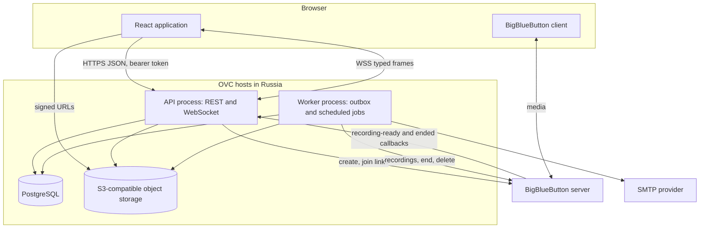

# OVC detailed architecture

The reference map behind the [technical introduction](../../docs/technical-introduction.md): where each component lives, which package may import which, what each component is built with, how it is configured, and which mechanics are still open. Behavior contracts live in [`knowledge/specs/`](../README.md); decisions live in [`docs/decisions/`](../../docs/decisions/README.md) and win when this file disagrees with them.

## Component diagram

Media never passes through OVC. Every external effect that must not be lost goes through the outbox and the worker ([ADR-0006](../../docs/decisions/0006-background-worker-and-email.md)).

## Module and contract map

### Backend (`backend/`)

| Package | Owns | Contract |
|---|---|---|
| `ovc.api` | REST routers, request dependencies (current user, relationship and group guards), error mapping | [API](../specs/api.md) |
| `ovc.realtime` | WebSocket gateway, connection registry and its task lifetimes, delivery of broadcast signals to local sockets | [Realtime](../specs/realtime-and-video.md#connection) |
| `ovc.services.accounts` | Registration, verification, sessions, passwords, deletion | [Accounts](../specs/accounts.md) |
| `ovc.services.tutoring` | Relationships, invitations, join requests, groups | [Accounts](../specs/accounts.md#tutorstudent-relationships) |
| `ovc.services.schedule` | Lessons, series, recurrence, status | [Schedule](../specs/schedule.md) |
| `ovc.services.meetings` | Meetings, joins, callbacks, recordings | [Video](../specs/realtime-and-video.md#video) |
| `ovc.services.library` | Folders, materials, templates | [Homework](../specs/homework.md#library) |
| `ovc.services.homework` | Issues, submissions, scoring, reviews, analytics | [Homework](../specs/homework.md) |
| `ovc.services.chat` | Channels, messages, read markers | [Chat](../specs/realtime-and-video.md#chat) |
| `ovc.services.notifications` | Notification rows, email composition, preferences, outbox writes | [Notifications](../specs/notifications.md) |
| `ovc.services.files` | Uploads, binding, downloads, quotas | [Files](../specs/files.md) |
| `ovc.repositories` | All database access, one repository per aggregate | [Data model](../specs/data-model.md) |
| `ovc.models` | SQLAlchemy tables | [Data model](../specs/data-model.md) |
| `ovc.schemas` | Pydantic request, response and frame models; student and tutor variants | [API](../specs/api.md#conventions) |
| `ovc.adapters` | Storage (S3, in-memory fake), meeting provider (BigBlueButton, fake), mail (SMTP, database sink), clock (system, shared fake), broadcaster (PostgreSQL `NOTIFY`, in-process fake) | [Video](../specs/realtime-and-video.md#provider-interface), [files](../specs/files.md), [notifications](../specs/notifications.md#email) |
| `ovc.domain` | Enums, value types and pure rules: normalisation, scoring, recurrence expansion, state transitions | domain specifications |
| `ovc.core` | Settings, security primitives, database engine and sessions, logging bootstrap, i18n of emails | [Configuration](#configuration), [observability](../specs/observability.md) |
| `ovc.worker` | Outbox dispatcher and scheduled jobs, the `tick(now)` entry point | [Outbox and worker](../specs/notifications.md#outbox-and-worker) |
| `ovc.admin` | The `ovc-admin` command | [Administration command](../specs/accounts.md#administration-command) |
| `ovc.testing` | The end-to-end test control routes, present only with `OVC_TEST_CONTROL=1` | [Test harness](../../docs/development.md#end-to-end-test-harness) |
| `ovc.main` | Composition roots: the API application and the worker process | — |

### Frontend (`frontend/src/`)

| Area | Owns |
|---|---|
| `features/auth` | Sign in, sign up, confirmation, password reset, invitation acceptance, session refresh, route guards |
| `features/home` | Tutor Today, student Home, first-run checklist |
| `features/schedule` | Calendar views, lesson dialog, series scope choice, overlap confirmation |
| `features/lessons` | Lesson page, join flow, embedded room lifecycle, recordings player |
| `features/students` | Students list, student card, join requests, invitations, tutor code |
| `features/groups` | Groups list and page |
| `features/library` | Library browser, materials, folders |
| `features/builder` | Assignment builder and preview |
| `features/homework` | Issue dialog, issued work, analytics, review queue and review screen, student assignment page and results |
| `features/chat` | Channel list, conversation, composer, presence, typing |
| `features/notifications` | Bell and list |
| `features/settings` | Profile, account, notifications, teaching settings |
| `lib/api` | Typed API client generated from OpenAPI, error type, token handling |
| `lib/realtime` | One reconnecting WebSocket client and typed subscriptions |
| `lib/i18n` | i18next setup, ICU formatting, error-code messages, `ru` and `en` resources |
| `components/ui` | Shared primitives built on the [tokens](../design/web/tokens.md) |
| `routes` | Thin route components and role guards ([navigation](../design/web/navigation.md)) |

## Package layers

A package may import only the packages in its row; subpackages of `ovc.services` follow the `ovc.services` row and may import each other only through their public service interfaces. The architecture test that enforces this table lands with the backend scaffold ([roadmap slice 1](../../docs/roadmap.md#slice-1-scaffold-and-local-loop)); a new package enters the table in the change that creates it.

Infrastructure adapters that keep their own state in PostgreSQL, namely the `NOTIFY` broadcaster, the database mail sink and the shared test clock, use database sessions from `ovc.core` for their own tables only. This is the single exception to "only repositories touch the database" in AGENTS.md. Business data is never read or written outside `ovc.repositories`.

| Package | May import |
|---|---|
| `ovc.domain` | standard library only |
| `ovc.core` | `ovc.domain` |
| `ovc.models` | `ovc.domain`, `ovc.core` |
| `ovc.schemas` | `ovc.domain` |
| `ovc.repositories` | `ovc.domain`, `ovc.core`, `ovc.models` |
| `ovc.adapters` | `ovc.domain`, `ovc.core` |
| `ovc.services` | `ovc.domain`, `ovc.core`, `ovc.repositories`, `ovc.adapters`, `ovc.schemas` |
| `ovc.realtime` | `ovc.domain`, `ovc.core`, `ovc.schemas`, `ovc.services`, `ovc.adapters` (the broadcaster interface) |
| `ovc.api` | `ovc.domain`, `ovc.core`, `ovc.schemas`, `ovc.services`, `ovc.realtime` |
| `ovc.worker` | `ovc.domain`, `ovc.core`, `ovc.services`, `ovc.adapters` |
| `ovc.admin` | `ovc.domain`, `ovc.core`, `ovc.services` |
| `ovc.testing` | `ovc.domain`, `ovc.core`, `ovc.services`, `ovc.adapters`, `ovc.worker` |
| `ovc.main` | every package |

## Stack per component

Exact versions are pinned in the lockfiles and recorded with check dates in `knowledge/research/` when adopted. [ADR-0002](../../docs/decisions/0002-implementation-stack.md) owns the decided rows; libraries marked "chosen in slice" are selected with a recorded reason in the slice that first needs them.

| Component | Choice | Reason |
|---|---|---|
| Backend language | Python 3.11 (`.python-version`) | Team experience; typed async ecosystem |
| Web framework | FastAPI | Async-first, Pydantic, native WebSockets, OpenAPI |
| Validation | Pydantic v2 | Boundary parsing into precise types |
| ORM and migrations | SQLAlchemy 2.0 async, Alembic | Typed async sessions; reviewed migrations |
| Database and queue | PostgreSQL | Relational data, keyset pagination, leased `SKIP LOCKED` outbox, `LISTEN/NOTIFY` broadcaster |
| Timezones | Standard library `zoneinfo` | IANA rules without a dependency |
| Password hashing | Argon2id (library chosen in slice 2) | Current recommended password hash |
| Tokens | Signed JWT access tokens (library chosen in slice 2); opaque hashed refresh, email and invitation tokens | Stateless requests with revocable sessions |
| Object storage | S3-compatible service in Russia; async S3 client chosen in slice 2; local S3-compatible server in development | Quotas, recordings, signed URLs ([ADR-0008](../../docs/decisions/0008-hosting-and-data-residency.md)) |
| Email | SMTP through a Russian provider; async SMTP client chosen in slice 2 | Transactional email from the worker |
| Conferencing | BigBlueButton 4.0, self-hosted | Whiteboard and recordings ([ADR-0004](../../docs/decisions/0004-bigbluebutton-primary-provider.md)) |
| Python tooling | uv, ruff, pyright strict, pytest | One fast toolchain; strict typing |
| Frontend | React, Vite, TypeScript strict | Conventional SPA stack |
| Frontend state | TanStack Query; generated OpenAPI client | No hand-rolled cache; schema parity |
| Styling | Tailwind CSS over design tokens | Utility styling with shared primitives |
| Localisation | i18next with ICU message format | Russian plurals, two languages |
| Fonts | Nunito, JetBrains Mono, self-hosted | Warm style, Cyrillic, no external CDN |
| Frontend tooling | pnpm, ESLint, Prettier, Vitest, Testing Library, Playwright | Lockfile-pinned, strict lint, real-browser tests |
| Local infrastructure | Docker Compose: PostgreSQL, local S3-compatible server | One-command development environment |

## Configuration

Settings are read once from the environment into one typed object in `ovc.core`. Every variable is documented in `backend/.env.example`; the frontend reads only `VITE_`-prefixed build-time variables.

| Variable | Meaning |
|---|---|
| `OVC_DATABASE_URL` | PostgreSQL connection URL |
| `OVC_PUBLIC_URL` | Base URL used in emails and provider callbacks |
| `OVC_JWT_SECRET` | Access-token signing key |
| `OVC_UNSUBSCRIBE_SIGNING_SECRET` | Key for unsubscribe tokens only |
| `OVC_FIELD_ENCRYPTION_KEY` | Key for encrypted invitation tokens |
| `OVC_ACCESS_TOKEN_TTL_SECONDS`, `OVC_REFRESH_TOKEN_TTL_SECONDS` | Token lifetimes |
| `OVC_CORS_ORIGINS` | Explicit frontend origins |
| `OVC_STORAGE_ENDPOINT`, `OVC_STORAGE_BUCKET`, `OVC_STORAGE_ACCESS_KEY`, `OVC_STORAGE_SECRET_KEY`, `OVC_STORAGE_BACKEND` | S3-compatible storage, or `memory` in tests |
| `OVC_DEFAULT_FILE_QUOTA_BYTES`, `OVC_DEFAULT_RECORDING_QUOTA_BYTES` | Default tutor quotas |
| `OVC_MEETING_PROVIDER` | `bbb` or `fake` |
| `OVC_BBB_URL`, `OVC_BBB_SECRET`, `OVC_BBB_CHECKSUM_ALGORITHM` | BigBlueButton server, shared secret, checksum algorithm |
| `OVC_BBB_EMBED_ENABLED` | Embed the conferencing client in the lesson page; false until the slice 7 probe passes |
| `OVC_SMTP_HOST`, `OVC_SMTP_PORT`, `OVC_SMTP_USERNAME`, `OVC_SMTP_PASSWORD`, `OVC_MAIL_FROM`, `OVC_MAIL_BACKEND` | Email, or the database `sink` in development and tests |
| `OVC_API_DOCS_ENABLED` | Serve OpenAPI at `/api/docs`; false in production |
| `OVC_TEST_CONTROL` | Enable the test control routes and the mail sink viewer; refused unless the meeting provider is `fake`, mail is the sink and the database is a test or development database |
| `OVC_CLOCK` | `system`, or `test` for the shared test clock (only with `OVC_TEST_CONTROL=1`) |
| `OVC_BROADCASTER` | `postgres`, or `memory` for unit and contract tests |
| `OVC_DB_POOL_SIZE` | Connections per process: 20 for the API and 10 for the worker by default, plus one dedicated listening connection per API instance |
| `OVC_LOG_LEVEL`, `OVC_LOG_FORMAT` | Diagnostics level and `json` or `console` output |
| `VITE_API_URL`, `VITE_WS_URL` | Frontend endpoints |

## Deployment shapes

- **Local development:**
  - Docker Compose runs PostgreSQL and a local S3-compatible server;
  - the API runs under `uvicorn --reload`, the worker as a second process, the frontend under the Vite dev server;
  - the meeting provider is `fake` and mail goes to the database sink, viewable through a development-only page.
- **Production:**
  - hosts in Russia ([ADR-0008](../../docs/decisions/0008-hosting-and-data-residency.md));
  - the API and the worker as containers behind a TLS reverse proxy that also serves the built frontend;
  - managed PostgreSQL with backups, S3-compatible storage, a Russian SMTP provider;
  - BigBlueButton 4.0 on a dedicated Ubuntu 24.04 host on a subdomain of the OVC domain.
- **Scaling:** one API instance and one worker in the MVP; the `NOTIFY` broadcaster and the leased outbox already allow more of each.

## Glossary

| Term | Meaning |
|---|---|
| Tutor | An account that teaches; owns students' cards, groups, lessons, library and issues |
| Student | An account that studies with one or more tutors |
| Relationship | One tutor's link to one student: invited, active or ended; the student card is its tutor-facing view |
| Invitation | A single-use link that links a student to a relationship |
| Tutor code | A short shareable code; a student enters it to create a join request |
| Join request | A student's request to study with a tutor, accepted or declined by the tutor |
| Group | A tutor's named set of students with its own chat, lessons and issues |
| Lesson | One scheduled session for a student or a group |
| Series | A weekly pattern that generates lessons |
| Roster | The students frozen into a lesson when it becomes live |
| Meeting | The BigBlueButton room behind one lesson |
| Recording | A copy of a meeting recording stored and served by OVC |
| Material | A library file |
| Template | A library assignment that can be issued many times |
| Issue | One issuing of a template to a student or group, with a snapshot, deadline and answer policy |
| Submission | One student's work on one issue |
| Review | A tutor's scores, comments, corrected files and feedback on a submission |
| Outbox | Database rows describing external effects that the worker performs |
| Operator | The person running the platform through `ovc-admin` |

## Open implementation questions

| Question | Constraint already settled | Resolved in |
|---|---|---|
| Rendered recording format available on BigBlueButton 4.0, or a protected-recordings load balancer instead; blocks the slice 7 plan | Never serve stock public playback links | Slice 7 probe |
| Provider retry behavior for non-2xx callback answers; joining with `redirect=false` and a session token; behavior of two joins with the same `userID`; external assets (STUN) the client loads | Reconciliation does not depend on callbacks; join links are never stored | Slice 7 probe |
| How bounces and complaints arrive from the chosen SMTP provider (webhook or polling) | Undeliverable addresses stop optional emails | Slice 2, with the provider choice |
| Embedded client works on all supported browsers | "Open in new tab" always available | Slice 7 probe |
| Which Russian providers for hosting, storage and SMTP | All in Russia | Before first deployment |
| Thumbnails for image previews | Originals constrained by the client in the MVP | After MVP |
| Malware scanning of uploads | Content-type allowlist and size limits are mandatory regardless | After MVP |
| Offline queue for assignment answers beyond retrying | Autosave with versions | Slice 9 |
