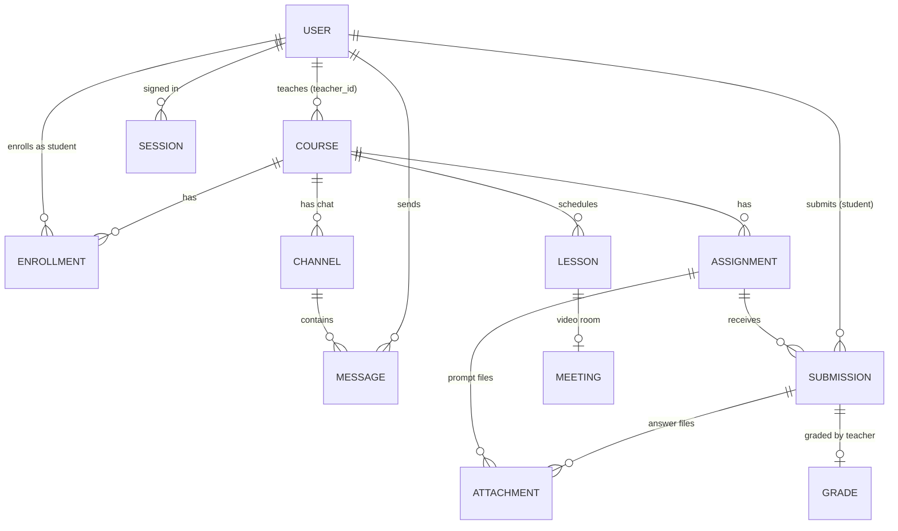

# Data model specification

PostgreSQL via async SQLAlchemy 2.0. All tables use a UUID primary key, `created_at`/`updated_at`
timestamps (UTC), and soft-delete only where noted. Enums are stored as strings and defined once in
`ovc.domain`. Only repositories in `ovc.repositories` read or write these tables
([package layers](../architecture/detailed.md#package-layers)).

## Entity–relationship overview

## Entities

### User

The account. One row per person; a `role` distinguishes behavior.

| field | type | notes |
|-------|------|-------|
| id | uuid PK | |
| email | citext unique | login identity |
| hashed_password | text | Argon2id |
| full_name | text | |
| role | enum(`teacher`,`student`,`admin`) | re-checked server-side |
| avatar_url | text null | |
| bio | text null | shown on teacher profiles |
| subject | text null | teacher's subject(s), free text / tags |
| timezone | text | for calendar display; default UTC |
| is_active | bool | disable without deleting |
| created_at / updated_at | timestamptz | |

### Session

One signed-in device. Holds the rotating refresh token; access tokens are not stored.

| field | type | notes |
|-------|------|-------|
| id | uuid PK | also the `sid` claim in access tokens |
| user_id | uuid FK → user | |
| refresh_token_hash | text unique | hash of the current refresh token; the token itself is never stored |
| previous_token_hash | text null | the rotated-out token, kept to detect reuse |
| expires_at | timestamptz | absolute session expiry |
| revoked_at | timestamptz null | set on logout or on detected refresh-token reuse |
| created_at / last_used_at | timestamptz | |

Presenting a rotated-out refresh token revokes the whole session (reuse detection).

### Course

A teacher's class/space. "Any teacher, any subject" lives here.

| field | type | notes |
|-------|------|-------|
| id | uuid PK | |
| teacher_id | uuid FK → user | owner |
| title | text | |
| description | text null | |
| subject | text null | |
| join_code | text unique null | optional self-enroll code |
| is_archived | bool | |
| created_at / updated_at | timestamptz | |

### Enrollment

Student ↔ course membership (join table with state).

| field | type | notes |
|-------|------|-------|
| id | uuid PK | |
| course_id | uuid FK → course | |
| student_id | uuid FK → user | |
| status | enum(`active`,`invited`,`removed`) | |
| created_at | timestamptz | |
| unique(course_id, student_id) | | one membership per pair |

### Lesson

A scheduled session on the calendar. Optionally backed by a video meeting.

| field | type | notes |
|-------|------|-------|
| id | uuid PK | |
| course_id | uuid FK → course | |
| title | text | |
| description | text null | |
| starts_at / ends_at | timestamptz | calendar slot |
| status | enum(`scheduled`,`live`,`ended`,`cancelled`) | |
| created_at / updated_at | timestamptz | |

### Meeting

The video room for a lesson (provider-agnostic). 1:1 with a lesson that has video.

| field | type | notes |
|-------|------|-------|
| id | uuid PK | |
| lesson_id | uuid FK → lesson unique | |
| provider | enum(`jitsi`,`bbb`) | from config |
| room_name | text | provider room id (opaque, server-generated) |
| join_url | text null | resolved join URL (or built client-side for Jitsi) |
| started_at / ended_at | timestamptz null | actual times |

### Channel

A chat scope. One default channel per course; direct-message channels are 2-member channels.

| field | type | notes |
|-------|------|-------|
| id | uuid PK | |
| course_id | uuid FK → course null | null for DMs |
| kind | enum(`course`,`direct`) | |
| created_at | timestamptz | |

`ChannelMember(channel_id, user_id)` for DM membership (course channels derive membership from
enrollment + the teacher).

### Message

A chat message. Persisted, then fanned out over WebSocket.

| field | type | notes |
|-------|------|-------|
| id | uuid PK | ordering by (created_at, id) |
| channel_id | uuid FK → channel | |
| sender_id | uuid FK → user | |
| body | text | |
| created_at | timestamptz | |
| edited_at / deleted_at | timestamptz null | soft edit/delete |

### Assignment

Homework a teacher posts to a course.

| field | type | notes |
|-------|------|-------|
| id | uuid PK | |
| course_id | uuid FK → course | |
| title | text | |
| instructions | text null | |
| due_at | timestamptz null | |
| max_points | int null | for grading scale |
| is_published | bool | draft vs visible to students |
| created_at / updated_at | timestamptz | |

### Submission

A student's answer to an assignment. One per (assignment, student); may be resubmitted
(versioned) or overwritten — see note below.

| field | type | notes |
|-------|------|-------|
| id | uuid PK | |
| assignment_id | uuid FK → assignment | |
| student_id | uuid FK → user | |
| body | text null | optional text answer |
| status | enum(`draft`,`submitted`,`returned`,`graded`) | |
| submitted_at | timestamptz null | |
| created_at / updated_at | timestamptz | |
| unique(assignment_id, student_id) | | |

### Grade

A teacher's evaluation of a submission. 1:1 with a submission.

| field | type | notes |
|-------|------|-------|
| id | uuid PK | |
| submission_id | uuid FK → submission unique | |
| graded_by | uuid FK → user | teacher |
| points | numeric null | within assignment `max_points` |
| feedback | text null | |
| graded_at | timestamptz | |

### Attachment

A stored file, polymorphic by owner (assignment prompt files or submission answer files).

| field | type | notes |
|-------|------|-------|
| id | uuid PK | |
| owner_type | enum(`assignment`,`submission`,`message`,`user_avatar`) | |
| owner_id | uuid | FK resolved by owner_type |
| storage_key | text | path/key in the storage backend (random, not client-supplied) |
| filename | text | original display name |
| content_type | text | validated against allowlist |
| size_bytes | bigint | enforced max |
| uploaded_by | uuid FK → user | |
| created_at | timestamptz | |

## Notes & decisions

- **Resubmission:** v1 overwrites the single `Submission` row and keeps attachments; if history is
  needed later, add a `SubmissionVersion` child table rather than reworking the unique constraint.
- **Message ordering:** paginate by `(created_at, id)` keyset, not `OFFSET`, for stable infinite scroll.
- **Soft delete** only on `Message` (edit/delete UX) and `is_archived`/`is_active` flags elsewhere —
  no hard deletes of academic records in normal flows.
- **Indexes (initial):** `enrollment(course_id)`, `enrollment(student_id)`, `message(channel_id, created_at)`,
  `submission(assignment_id)`, `assignment(course_id)`, `lesson(course_id, starts_at)`.
- **Timezones:** store everything UTC (`timestamptz`); convert for display using the user's `timezone`.

See the [module map](../architecture/detailed.md#module-and-contract-map) for how services and
repositories use these, and the [API specification](api.md) for the exposed surface.
