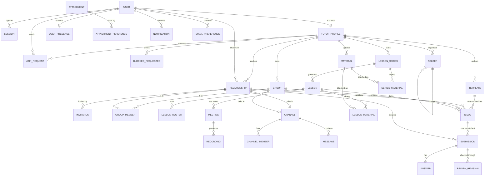

# Data model specification

PostgreSQL through `pgx`, with queries compiled to typed functions by `sqlc` and the schema built by `goose` SQL migrations. Behavior lives in the domain specifications ([accounts](accounts.md), [schedule](schedule.md), [homework](homework.md), [realtime and video](realtime-and-video.md), [notifications](notifications.md), [files](files.md)); this file fixes entities, keys, indexes and purge rules. Business tables are read and written only by repositories in `internal/repositories`; the infrastructure exceptions are listed under [package layers](../architecture/detailed.md#package-layers).

## Conventions

- Primary keys are random (version 4) UUIDs generated by the application, except where a natural composite key is given.
- Every table has `created_at` and, where rows change, `updated_at`, both `timestamptz` in UTC.
- **Enums** are stored as strings and defined once in `internal/domain`. The enums of states, roles and contexts appear here. Notification event names are those of the [event table](notifications.md#events), and error codes are those of the [API conventions](api.md#conventions).
- **Tokens:**
  - session, email confirmation and reset tokens are stored only as SHA-256 hashes;
  - invitation tokens are stored as a SHA-256 hash for lookup and as AES-256-GCM ciphertext under `OVC_FIELD_ENCRYPTION_KEY` (a 12-byte random nonce, as additional data the ASCII label `ovc.invitation-token.v1` followed by the invitation identifier's 16 bytes, so a value sealed for any other purpose never opens as an invitation token; the stored value is the nonce followed by the ciphertext and its 16-byte tag, and any value that fails to open is refused) for re-display and email rendering; the ciphertext is set to null once the invitation is used, revoked or expired;
  - unsubscribe tokens are stateless and not stored.
- Free text written by users is stored as entered; normalised forms are separate columns.
- **Deletion:**
  - business entities leave the database only through the purge and cleanup jobs, and otherwise change state (withdrawn, discarded, cancelled, deleted);
  - pure link rows are deleted directly when the link ends: group members, channel members, blocked requesters, attachment references, quota charges, lesson and series materials, and empty folders.
- "xor" pairs are enforced with check constraints.

## Overview

## Accounts

### User

| Column | Notes |
|---|---|
| `id` | |
| `role` | `tutor`, `student` |
| `state` | `unverified`, `active`, `blocked`, `deleted` |
| `state_before_block` | |
| `email` | citext, unique |
| `email_verified_at` | |
| `password_hash` | Argon2id |
| `name` | 1–100 characters |
| `language` | `ru`, `en` |
| `timezone` | IANA, from the browser at sign-up |
| `theme` | `light`, `dark`, `system` |
| `consent_version`, `consent_at` | |
| `unverified_since` | when the 7-day cleanup clock started: sign-up, or a restore or unblock into `unverified`; partial index where `state = 'unverified'`, for cleanup |
| `deleted_at` | set exactly when `state = 'deleted'`; partial index where `state = 'deleted'` |
| `reclaim_until` | slice 3; the deadline of a [reclaim](accounts.md#provisional-links-and-reclaim), set once by the reclaim to 7 days after it and cleared by the owner's choice, by a signed-in acceptance that keeps the last waiting link, by the account's deletion, or by `reclaim.expire`; written only by the account's own transactions and only a hint for the job, since whether a choice is due is derived from the waiting rows; partial index where not null |
| `email_undeliverable_at` | added with the email provider choice |

Slice 2 creates the table with every column above that names no later slice. Persisted presence and the digest bookkeeping are not user columns: they live in [their own tables](#presence-and-digest-bookkeeping) (slice 6), because writing a column on many recipients' user rows inside a send would lock user rows after relationships and channels, against the lock order. `state_before_block` is set exactly when `state = 'blocked'`, an `active` account always has `email_verified_at`, and `password_hash` must be an Argon2id string. A user's avatar is the attachment referenced with `ref_kind = avatar` and `ref_id` the user's identifier; the user row holds no attachment column, so no foreign key runs in both directions.

### Tutor profile

One per tutor user.

| Column | Notes |
|---|---|
| `user_id` | primary key |
| `bio` | up to 1,000 characters |
| `subjects` | up to 10 strings |
| `code` | slice 3; unique, not null, 8 characters from `23456789ABCDEFGHJKMNPQRSTUVWXYZ` (checked by a constraint); minted at sign-up and retried on a unique violation; the slice 3 migration gives every existing tutor one, failing loudly on a collision; shared openly by design |
| `recording_retention_days` | 7, 30, 90, 180 or 365; default 90 |
| `file_quota_bytes`, `recording_quota_bytes` | |
| `file_usage_bytes`, `recording_usage_bytes` | |
| `onboarding_dismissed_at` | nullable; from slice 10 set once by `PATCH /tutor/settings` under the profile lock when the tutor dismisses Today's checklist and never cleared; read as `onboarding_dismissed`; leaves with the profile at the tutor purge and at every purge of an unconfirmed tutor (pending owner review) |
| `snapshot_bytes_total` | slice 9; not null, default 0: the sum of `snapshot_bytes` over the tutor's issues, increased by issuing and decreased by the erasure of a dropped provisional link's issues and by the purge, never by a withdrawal, each under the profile lock; issuing refuses when it would pass 512 MiB ([issue](#issue)) |

### Session

`id` (also the `sid` claim), `user_id`, `generation`, `refresh_hash`, `expires_at`, `revoked_at`, `last_used_at`. The refresh cookie carries the session identifier, the generation and a random part; `refresh_hash` is the SHA-256 hash of the current random part. Rotation is one conditional update on the identifier, generation, hash, `revoked_at` and `expires_at`, so concurrent refreshes cannot both rotate, and a presented generation older than the current one identifies reuse only when the server can authenticate that older cookie as one it issued. The table keeps no hash of earlier generations, so the cookie, `<sid>.<generation>.<random>.<mac>`, also carries an untruncated HMAC-SHA-256 over the identifier and generation, keyed with a key derived by HKDF-SHA-256 from `OVC_JWT_SECRET` with the info string `refresh-generation`, never the signing key itself, and compared in constant time. A cookie whose MAC fails, whose generation is newer than the stored one, or whose generation is current but whose random part does not match is refused without revoking anything; only a valid MAC with an older generation revokes. Rotating `OVC_JWT_SECRET` therefore invalidates every refresh cookie, which are then refused without revocation. `expires_at` is fixed at sign-in and never extended. No user-agent summary is collected. An index on `expires_at` and a partial index on `revoked_at` where it is set serve the hourly cleanup, which deletes a session a day after it expires or is revoked. Revoking a session fires a [revocation trigger](#revocation-triggers).

### Revocation triggers

Slice 4 adds three row-level `AFTER` triggers, so every path that revokes a session or ends an account, in the API, the worker or `ovc-admin`, today and later, signals the [broadcaster](realtime-and-video.md#broadcaster) in its own transaction, sign-out's single autocommit statement included:

| Trigger | Fires |
|---|---|
| `AFTER UPDATE OF revoked_at ON sessions FOR EACH ROW WHEN (OLD.revoked_at IS NULL AND NEW.revoked_at IS NOT NULL)` | a session is revoked; the signal names the session's `user_id` |
| `AFTER UPDATE OF state ON users FOR EACH ROW WHEN (NEW.state IN ('blocked', 'deleted') AND OLD.state IS DISTINCT FROM NEW.state)` | an account is blocked or marked deleted |
| `AFTER DELETE ON users FOR EACH ROW` | an account is deleted by the purge, the 7-day cleanup or the immediate purge of an unconfirmed account |

- Each trigger calls its own PL/pgSQL function, which calls `pg_notify('ovc_realtime', …)` with a `recheck` payload built by `json_build_object` from the account's identifier only, in the form the listener parses (`{"v": 1, "k": "recheck", "u": [<user id>]}`); a test parses every trigger-built payload with the listener's parser.
- An unrelated update of a session or user row, an update of an already revoked session and a state change to `active` or `unverified` send nothing.
- PostgreSQL collapses identical notifications within one transaction, so revoking every session of an account sends one signal; a purge batch sends one signal per purged account.
- The function bodies are dollar-quoted, multi-statement PL/pgSQL, which goose splits at their semicolons unless each body is wrapped in `-- +goose StatementBegin` and `-- +goose StatementEnd`. These markers are admitted only around a function body in `backend/migrations/*.sql`, each alone on its line, through the exception in AGENTS.md and [ADR-0009](../../docs/decisions/0009-owner-approved-exceptions-and-visibility.md) item 8; `TestMigrationStatementMarkersOnlyWrapFunctionBodies` in the conventions tests enforces both conditions. Otherwise the migration holds the goose `Up` and `Down` markers and SQL without comments.

### Email token and email request

- **Email request:** `id`, `user_id`, `purpose` (`verify_email`, `reset_password`). An index on `created_at` serves the hourly cleanup, which deletes requests older than 7 days with their tokens. It is recorded when a confirmation or reset is requested, and its identifier is the outbox idempotency key.
- **Email token:** `id`, `request_id`, `user_id`, `purpose`, `token_hash` (unique), `expires_at`, `used_at`. It is minted by the worker at dispatch. A new token of the same purpose deletes earlier unused ones, and blocking, deletion, confirmation, reset and password change delete every unused token of both purposes. A token's request, user and purpose must match its email request (a composite foreign key). Consumption is one conditional update on the hash, purpose, `used_at` and `expires_at`.

### Rate limit counter

`purpose`, `subject`, `window_start`, `count`; primary key on the three key columns, plus an index on `window_start` for cleanup. `subject` is the 32-byte HMAC-SHA-256 of the email, IP address (IPv6 by /64), account or tutor, keyed with a key derived by HKDF-SHA-256 from `OVC_JWT_SECRET` with the info string `throttle`, never the signing key itself, so no raw address is stored. A slot is reserved with one `INSERT … ON CONFLICT … DO UPDATE … RETURNING count` before any hashing work. From slice 8 library writes reserve here with the purpose `library_writes_hour` (the tutor as `subject`, at most 600 per hour), and template saves with `template_saves_hour` (the tutor, at most 3,600 per hour) and `template_saves_second` (the template, the second as `window_start`, at most 2), under the same reservation rule as lesson writes ([library](homework.md#library)). From slice 9 homework writes reserve here under the same rule: `issues_hour` (the tutor, at most 100 issues created per hour), `homework_writes_hour` (the tutor, at most 600 per hour, counting every other issue write, changes and withdrawals, and every review publication, `check` and `return`), `answer_saves_second` (the submission, the second as `window_start`, at most 2) and `answer_saves_hour` (the student, at most 3,600) for autosaves and submissions, and `review_saves_second` (the submission, at most 2) and `review_saves_hour` (the tutor, at most 3,600) for review draft saves ([issuing](homework.md#issuing)); from slice 10 `feedback_marks_hour` (the student, at most 600 per hour) for `POST /submissions/{id}/feedback-seen` and `tutor_settings_writes_hour` (the tutor, at most 60 per hour) for `PATCH /tutor/settings` (pending owner review); the caps are constructor settings. From slice 5 lesson write attempts reserve here with the purpose `lesson_writes_hour`, the tutor as `subject` and the hour as `window_start` (at most 120 per tutor per hour, committed after the schema checks and the replay and before every check of the service, and kept when the request is refused, [scheduling limits](schedule.md#scheduling-limits)), and the dispatcher also reserves here, with the purpose `lesson_emails`, the recipient's account as `subject` and the UTC day as `window_start`, one slot per student-addressed lesson email (`lesson_reminders` and `lesson_changes` together, at most 20 per day), reserved only after every other dispatch check passed, immediately before sending, and only while the counter is below 20, so an email dropped over the cap holds no slot, and released with `ReleaseRateLimitSlot` for the `window_start` of its own reservation when the send fails, and the hourly cleanup of rate-limit windows removes the old counters ([dispatch-time checks](notifications.md#dispatch-time-checks)). From slice 9 the dispatcher reserves homework email slots by the same rule: `homework_emails` (the student's account, the UTC day, at most 20 `homework` and `results` emails together across tutors) and `submission_emails` (the tutor's account, the UTC day, at most 50 `submissions` emails); an email over its cap is dropped with `email.dropped` (`reason` `daily_cap`) and its in-app row stays.

## Relationships and groups

### Relationship

| Column | Notes |
|---|---|
| `id` | |
| `tutor_id` | references the tutor profile, `ON DELETE CASCADE` |
| `student_id` | null while `invited`, then fixed; set to null when the student is purged; references the user with `ON DELETE RESTRICT`, so the purge clears it first |
| `state` | `invited`, `provisional`, `reclaim_pending`, `active`, `ended`, `discarded` |
| `discard_reason` | `withdrawn`, `merged`, `removed`, `tutor_deleted`, `student_purged`; set exactly when `discarded` |
| `ended_by` | `tutor`, `student`, `deletion`; set, with `ended_at`, when `ended`, and kept when a student's purge discards an ended row; null in every other state |
| `display_name` | the tutor's private name for the student, 1–100 characters when set; for a card created by accepting a join request, a copy of the student's account name at accept time, which the tutor can edit; nullable: null means erased, set only on a `discarded` row, by a withdrawal, a merge, a removal or the student's purge ([ADR-0024](../../docs/decisions/0024-legal-documents-and-student-data.md), pending owner review; pending implementation by L4) |
| `email` | optional, citext, 3–254 characters |
| `email_set_at` | the time the card's current email was entered or changed, or, on the new card of a removal, the removal time; set exactly when `email` is set; the 90-day erasure counts from it (pending owner review) |
| `email_erased_at` | the erasure marker: set by the 90-day erasure on an `invited` card, and cleared when the tutor enters an email and by every transaction that moves the card out of `invited` (a withdrawal, a tutor's deletion, a link); while it is set, regenerating and sending are refused (pending owner review) |
| `colour` | one of the eight palette keys |
| `notes` | tutor-only, up to 10,000 characters, empty by default |
| `create_key` | the `Idempotency-Key` of the creating request, nullable |
| `linked_at`, `ended_at`, `discarded_at` | |

No column follows the student's account name. A card's display name, email and notes are personal data of the student, not the tutor's own data: they are erased when the card is withdrawn or merged (display name, email and notes), when its provisional or reclaim-pending link is removed (the display name; the notes and email move to the new card), and after 90 days for an unaccepted card's email; the student's purge sets the display name of every row of the student to null, shown as the fixed label `former_student`, and erases the notes, and the tutor's history stays under that label ([ADR-0024](../../docs/decisions/0024-legal-documents-and-student-data.md), as specified by change L0 of the [interface rework plan](../plans/ui-rework.md), pending owner review; pending implementation by L4).

Constraints and indexes:

- `display_name` is null only while the state is `discarded`, otherwise 1–100 characters; `email_set_at` is null exactly when `email` is null; `email_erased_at` is set only while the state is `invited` and `email` is null, so every transition out of `invited` clears it (pending owner review);
- `invited` requires `student_id` to be null; `provisional`, `reclaim_pending`, `active` and `ended` require it to be set; `discarded` allows either;
- `colour` and `linked_at` are null while `invited` and set in `provisional`, `reclaim_pending`, `active` and `ended`, since the colour is chosen at linking time; a `discarded` row keeps whatever it had;
- unique `(tutor_id, student_id)` where `student_id` is not null and the state is not `discarded`;
- unique `(tutor_id, email)` where `email` is not null and the state is not `discarded`;
- unique `(student_id)` where the state is `provisional`, so an account holds at most one provisional link;
- `(tutor_id, state, created_at DESC, id DESC)` for the student list, and `(student_id)`;
- unique `(tutor_id, create_key)` where `create_key` is not null;
- partial `(email_set_at, id)` where the state is `invited` and `email` is not null, for `cards.erase_emails` (pending owner review).

### Invitation

| Column | Notes |
|---|---|
| `id` | |
| `relationship_id` | references the relationship, `ON DELETE CASCADE` |
| `token_hash` | 32 bytes, unique |
| `token_encrypted` | nullable; null whenever `used_at` or `revoked_at` is set, and cleared by `invitations.expire` once expired |
| `bound_student_id` | for the link of an `ended` card: the only account that may accept it; references the user, `ON DELETE CASCADE` |
| `expires_at`, `used_at` | |
| `used_by` | references the user, `ON DELETE SET NULL` |
| `revoked_at`, `revoke_reason` | `regenerated`, `withdrawn`, `email_changed`, `mismatch_limit`, `linked`, `removed`, `tutor_deleted`, `expired_on_send`, and `email_erased` for the 90-day erasure of the card's email (pending owner review) |
| `mismatch_count` | 0–5; the fifth `invitation_email_mismatch` revokes the invitation |
| `send_count` | emails sent for this invitation; part of the email's idempotency key |

- One open invitation per card: unique `(relationship_id)` where `used_at` and `revoked_at` are null; also indexes on `relationship_id`, `bound_student_id` and `used_by`.
- Consumption is one conditional update on `used_at is null and revoked_at is null and expires_at > now` and, for a bound invitation, `bound_student_id` equal to the consuming account, which also sets the ciphertext to null; a wrong account never spends a bound link. The mismatch counter is one conditional update on the presented token's hash, under the same open and unexpired conditions, that increments `mismatch_count` and, at 5, revokes the invitation and clears its ciphertext. Revoking a card's open invitation is scoped to the card's tutor.
- Partial index on `expires_at` where `token_encrypted` is not null, for `invitations.expire`.
- Checks: an invitation is never both used and revoked; `used_by` is set only on a used one (and falls to null when that account is purged); `mismatch_count` is 5 exactly when the invitation was revoked for `mismatch_limit`.

### Join request and blocked requester

- **Join request:** `id`, `tutor_id` (the tutor profile, `ON DELETE CASCADE`), `student_id` (the user, `ON DELETE CASCADE`), `state` (`held`, `pending`, `accepted`, `declined`, `expired`), `suppressed` (`none`, `blocked`, `limit`), `owner_choice_pending` (boolean, only while `held`: the request waits for the owner's choice after a reclaim), `expires_at`, `decided_at`, `created_at`. `suppressed` is other than `none` only while `pending`, and `decided_at` is set exactly when the request is `accepted`, `declined` or `expired` (for an expiry, the time it expired, which is its `expires_at` when the expiry job or a later code entry expires it; a request closed by an unblock is `expired` with `decided_at` set to its future `expires_at`, and the student sees it as pending until then; a code entry before then reopens it as `pending` with `decided_at` cleared). Indexes:
  - unique `(tutor_id, student_id)` where the state is `held` or `pending`;
  - partial `(expires_at)` where the state is `held` or `pending`, for `join_requests.expire`;
  - partial `(tutor_id, created_at, id)` where `state = 'pending' and suppressed = 'none'`, for the tutor's list and the limit of 50;
  - partial `(tutor_id, created_at, id)` where `state = 'pending' and suppressed = 'limit'`, for un-suppression;
  - `(tutor_id)` and `(student_id, created_at DESC, id DESC)`.
- **Blocked requester:** `tutor_id`, `student_id` (both cascading), `created_at`; primary key on the pair, an index on `(tutor_id, created_at DESC, student_id)` for the list and one on `student_id`.

### Group and group member

- **Group:** `id`, `tutor_id` (the tutor profile, `ON DELETE CASCADE`), `name` (1–60 characters), `colour`, `archived_at`, `create_key`; an index on `tutor_id`, unique `(id, tutor_id)` for the membership key, and unique `(tutor_id, create_key)` where `create_key` is not null. At most 200 per tutor, archived ones included.
- **Group member:** `group_id`, `relationship_id`, `tutor_id` and `added_at`; `(group_id, tutor_id)` references the group's `(id, tutor_id)` and `(relationship_id, tutor_id)` the relationship's `(id, tutor_id)`, both cascading, so a group can only hold its own tutor's relationships; primary key on `(group_id, relationship_id)`, and an index on `relationship_id`. The relationship table carries a unique `(id, tutor_id)` for this key.

## Schedule

Slice 5 adds the `lesson_series`, `lesson` and `lesson_roster` tables. Series and lessons reference the tutor profile, the relationship and the group with `ON DELETE RESTRICT`, so the tutor purge deletes them first ([purge](#purge)); the relationship key is `(relationship_id, tutor_id)` against the relationship's `(id, tutor_id)` and the group key `(group_id, tutor_id)` against the group's `(id, tutor_id)`, as for group members, so a lesson or series can only hold its own tutor's audience; the xor of relationship and group is a check constraint. The material tables of lessons and series below arrive with the library in slice 8.

### Lesson series

| Column | Notes |
|---|---|
| `id` | |
| `tutor_id` | references the tutor profile, `ON DELETE RESTRICT`; indexed as `(tutor_id, created_at DESC, id)`, which orders the tutor purge's series batches, and partially as `(tutor_id, id)` where `ended_at` is null, through which a tutor deletion locks the series it ends without walking the ended ones (pending owner review) |
| `relationship_id` xor `group_id` | each with the tutor in its key, `ON DELETE RESTRICT` |
| `weekdays` | set of 1–7 |
| `local_start` | time |
| `duration_minutes` | |
| `timezone` | |
| `first_date` | |
| `end_date` xor `count` | the end date is on or after the first date unless the series has ended: a split or "cancel following" at its first occurrence leaves an end date of the day before (pending owner review) |
| `title`, `description` | title 1–120 characters, description at most 2,000, both plain text as entered |
| `materialised_until` | partial index on `(materialised_until, id)` where `ended_at` is null, the order in which horizon extension pages its candidates (pending owner review) |
| `split_from_series_id` | references the series, `ON DELETE SET NULL`, indexed |
| `create_key` | the `Idempotency-Key` of the creating request, nullable; unique `(tutor_id, create_key)` where not null |
| `ended_at` | |

From slice 8 `lesson_series` and `lesson` (below) each have a unique `(id, tutor_id)`, which the composite same-tutor keys of series and lesson materials reference.

The rollbacks of the slice 8 library migrations refuse to drop rows, so a rollback stops before any library data is lost (slice 8 review follow-up, pending owner review): 00036 refuses while any `lesson_material` or `series_material` row or any `lesson` or `series` reference remains, 00035 while any template or `template` reference remains, and 00034 while any folder, material or `material` reference remains, each with a `CHECK (false)` or kind check added and dropped again before its tables are dropped, as 00033 does; `TestLibraryRollbacksStopBeforeDroppingLibraryRows` proves it.

**Series material** (slice 8): `series_id`, `material_id`, `tutor_id`, `position`, `created_at`; primary key `(series_id, material_id)`, unique `(series_id, position)`. `(series_id, tutor_id)` references the series' `(id, tutor_id)` with `ON DELETE RESTRICT`, and `(material_id, tutor_id)` the material's `(id, tutor_id)` with `ON DELETE RESTRICT`, so a series can only hold its own tutor's materials ([T-5](../../docs/threat-model.md#threats-and-controls)); indexes on `material_id` and `(tutor_id, series_id)` serve the purge. Each row has a `series` [attachment reference](#attachment-reference-and-quota-charge) for the material's file, charged to the tutor, so a material deleted from the library is still copied into new occurrences ([lesson materials](schedule.md#lesson-materials)). At most 20 rows per series. The table is `series_materials` (change B5).

### Lesson

| Column | Notes |
|---|---|
| `id` | |
| `tutor_id` | references the tutor profile, `ON DELETE RESTRICT` |
| `series_id` | nullable; references the series |
| `occurrence_date` | nullable; set for series occurrences |
| `relationship_id` xor `group_id` | each with the tutor in its key, `ON DELETE RESTRICT` |
| `title`, `description` | title 1–120 characters, description at most 2,000, both plain text as entered |
| `starts_at`, `duration_minutes` | |
| `status` | `scheduled`, `live`, `ended`, `cancelled` |
| `timezone` | the tutor-side timezone: the series timezone, or the tutor's at creation for one-off lessons |
| `schedule_revision` | incremented on every change to start or duration |
| `version` | incremented on every change of any field an edit changes; edits are conditional on it ([edits](schedule.md#rules-for-all-edits)) |
| `reminded_24h_revision`, `reminded_1h_revision` | the schedule revision the reminders were last written for |
| `overridden_fields` | set of start time, date, duration, title, description and materials; `materials` is recorded from slice 8 when `POST /lessons/{id}/materials` changes a series occurrence ([lesson materials](schedule.md#lesson-materials)) |
| `cancelled_at`, `cancel_cause` | `cancel_cause` is `tutor`, `relationship_ended`, `provisional_removed`, `group_archived` or `tutor_deleted`; both are set exactly when the status is `cancelled`, checked |
| `create_key` | the `Idempotency-Key` of the creating request of a one-off lesson, nullable; unique `(tutor_id, create_key)` where not null |
| `live_at`, `ended_at` | "took place" means `live_at` is set |

Indexes:

- unique `(series_id, occurrence_date)`;
- unique `(id, tutor_id)` from slice 8, for the same-tutor key of lesson materials;
- `(tutor_id, starts_at, id)`, which also orders the tutor purge's lesson batches, `(relationship_id, starts_at)` and `(group_id, starts_at)`;
- partial `(group_id, starts_at)` where `status = 'scheduled'`, for the group page;
- partial `(tutor_id, starts_at)` where `status = 'scheduled'`, through which a tutor deletion cancels the tutor's future lessons and an ending or a tutor deletion finds the tutor's lessons under way without reading past or cancelled ones (pending owner review);
- partial `(starts_at)` where `status = 'scheduled'`;
- partial `(starts_at)` where `status = 'live'`;
- partial on the end instant computed in UTC, `(timezone('UTC', starts_at) + make_interval(mins => duration_minutes::int)), id`, where `status = 'scheduled'`, the order in which the status job pages due lessons; the expression is immutable, as an index requires, because `timezone(text, timestamptz)` is immutable and yields a timestamp without a time zone, `make_interval` is immutable, and adding an interval to a timestamp without a time zone is immutable, whereas adding an interval to a `timestamptz` is only stable (pending owner review);
- partial `(cancel_cause, cancelled_at)` where `cancelled_at` is not null, for the aggregated emails that list cancelled lessons ([notifications](notifications.md#events)).

### Lesson roster

`lesson_id` (references the lesson, `ON DELETE CASCADE`), `student_id`, `lesson_starts_at` (copied from the lesson for calendar queries), `added_at`. Primary key on the pair, and an index on `(student_id, lesson_starts_at)`, which also drives the lesson listings of the `group.archived` and `tutor.deleted` emails ([notifications](notifications.md#events), pending owner review).

- **No foreign key to the user:** inserting a roster row with a key to the student would take `FOR KEY SHARE` on the student's user row, and tutor deletion, which freezes rosters, must lock no student's user row ([accounts](accounts.md#locks-and-the-session-re-check)). A roster row is inserted only while its transaction holds the student's relationship row with at least `FOR SHARE` and has re-checked its state; a student's purge discards those relationships before it deletes the account's roster rows through the `student_id` index and then the user row, so an inserter waiting behind the purge finds the relationship discarded and inserts nothing.

### Lesson links

**Lesson material** (slice 8): `lesson_id`, `material_id`, `tutor_id`, `position`, `created_at`; primary key `(lesson_id, material_id)`, unique `(lesson_id, position)`. `(lesson_id, tutor_id)` references the lesson's `(id, tutor_id)` with `ON DELETE RESTRICT`, and `(material_id, tutor_id)` the material's `(id, tutor_id)` with `ON DELETE RESTRICT`, so a lesson can only hold its own tutor's materials; indexes on `material_id` and `(tutor_id, lesson_id)` serve the purge. Each row has a `lesson` [attachment reference](#attachment-reference-and-quota-charge) for the material's file, charged to the tutor, so the file stays downloadable from the lesson after the material's deletion. At most 20 rows per lesson. The table is `lesson_materials` (change B5). The lesson's linked issues (slice 9) are the issues whose `lesson_id` names it; at most 20 of them are `active` and not marked for erasure, and only those are listed ([linked issues](schedule.md#linked-issues)), read through the index on `issues.lesson_id` for `GET /lessons/{id}` only.

### Meeting

Slice 7 L2a implements only durable local lifecycle storage: `id`, `lesson_id`, `provider`, `provider_meeting_id`, `routing_key`, `state`, `create_time`, `first_join_at`, `ended_at`, `close_reason`, `created_at` and `updated_at`. The table below also describes later consumers: `retention_days`, `recordingmarks` and `settled_at`, and the unsettled-ended reconciliation index, remain pending with recording, callback and reconciliation work. L2a introduces no fabricated retention default or provider activation.

Stored lifecycle states are distinct from provider status. One partial unique index admits at most one non-closed row per lesson; a complete lesson index supports deletion of closed history. Provider and routing identifiers are unique, nonzero opaque UUIDs. Creating rows have no provider create time or join/end data; open rows have a positive create time and no end data; closed rows have a reason and end time, and may lack create time when creation failed. First join requires a create time and is set once. Timestamp checks preserve the lifecycle order, including explicit null refusals.

Repository operations bind every named row to both lesson and meeting identifiers, with expected-state/generation predicates for transitions. A stale request cannot reopen a closed row or mutate a replacement meeting. Repeat close preserves original terminal metadata. Mutation methods are named `UnderLessonLock`: the caller acquires the lesson lock after existing audience/series locks and keeps it through any post-update classification read. Outcomes distinguish applied, refused, already joined and already closed; this repository boundary is not caller authorization. No join URL, provider secret or participant name is stored.

Lesson deletion cascades local meeting metadata; student purge retains the tutor-owned meeting history. The independent recovery ledger below survives that cascade. Until application activation, no production path creates these rows and no provider resource is owned. Provider cleanup, reconciliation and history-retention bounds must be implemented before activation; cascade deletion alone must never be represented as remote cleanup. See the [approved persistence plan](../plans/slice-7-meeting-persistence.md).

| Column | Notes |
|---|---|
| `id` | |
| `lesson_id` | |
| `provider` | `bbb`, `fake` |
| `provider_meeting_id` | random, unique |
| `state` | `creating`, `open`, `closed` |
| `create_time` | the value returned by the provider; null while `creating` |
| `routing_key` | random, unique, not a secret |
| `retention_days` | copied from the tutor at creation |
| `first_join_at` | |
| `recordingmarks` | from the meeting-ended hint, diagnostic only |
| `ended_at`, `close_reason` | `tutor_end`, `tutor_restart`, `status_job`, `provider_not_found`, `provider_error` |
| `settled_at` | |

Indexes:

- at most one meeting per lesson that is not `closed` (partial unique index);
- the partial `meetings_creating_idx` on `(created_at, id)` of `creating` rows, which bounds the recovery scanner's search for abandoned rows;
- the future recording reconciliation index on `ended_at` where business `settled_at` is null. This does not impose a settlement deadline on the separate provider recovery ledger: unresolved creation can remain indefinitely under ADR-0020.

`revocation_confirmed_at` records that the exact generation of a `tutor_restart` closure was confirmed ended by a request; it does not settle the ledger. `ended_hint_at`, `ended_hint_until` and `ended_hint_checks` (0 to 3) hold the debounce and the bounded recheck chain of the unsigned ended hint.

### Lesson participant

`lesson_participants` has the primary key `(lesson_id, account_id)` and a unique random nonzero `participant_id`, with `created_at`. `lesson_id` references lessons with `ON DELETE CASCADE`. `account_id` has an index and no foreign key, like `lesson_roster.student_id`, so inserting a row takes no lock on a user row late in a transaction; the account purge deletes the rows explicitly. A row is inserted only after the caller's authorization, under the tutor's profile lock or the student's user row lock.

### Meeting recovery ledger

The [approved recovery-ledger plan](../plans/slice-7-meeting-recovery-ledger.md) adds durable provider ownership without activating calls or cleanup. `meeting_recovery` has an immutable nonzero provider identifier, provider kind and provenance, a nullable unique business meeting reference with indexed `ON DELETE SET NULL`, finite timestamps, a positive evidence revision, a monotonic cleanup request, and conditional attempt/generation evidence. It retains no account identifier, name, participant, routing key, join address, credential or raw error. An orphan remains a cleanup candidate without needing the deleted account or lesson.

New business meetings and their attempt-origin prepared ledger rows are created atomically. Successful closure atomically requests cleanup; a stale refusal affects neither a replacement nor its ledger. A close records the later of its instant and the row's `updated_at`, so a clock stepped back cannot strand an open room; a close that refuses a row read under the lesson lock is an error and rolls back. The existing lesson/meeting lock order precedes ledger locks. Ledger-only completion never subsequently acquires business locks. Existing Open requires matching returned generation evidence, an attached creating business meeting and no cleanup request. These predicates are not caller authorization.

| Origin and state | Attempt identifier | Acknowledged create time |
| --- | --- | --- |
| attempt / prepared | absent | absent |
| attempt / started or uncertain | nonzero | absent |
| attempt / returned | nonzero | positive |
| legacy / uncertain | absent | absent |
| legacy / returned | absent | positive |

Other combinations are refused. Begin transitions prepared to started exactly once using an injected attempt identifier and expected revision under the caller's lesson lock. Uncertainty cannot reset an attempt. A returned generation is bound to the same attempt, permits an exact idempotent repetition, and cannot be replaced by conflicting evidence. Late successful evidence may be retained after closure or purge without clearing cleanup or reopening a room. Legacy origin never accepts Begin or attempt completion; migration records existing positive generations with legacy provenance and otherwise preserves uncertainty, never inventing an acknowledgement.

Revision counts explicit repository evidence transitions, not the foreign-key action that nulls the business reference. Dispatch and publication must check current membership and cleanup as well as revision. An absent provider inspection, elapsed time, a cancelled operation or a database lease proves neither that remote Create cannot finish later nor that cleanup is complete.

Cleanup candidates satisfy `cleanup_requested OR meeting_id IS NULL`, use a matching partial index ordered by immutable provider identifier, and are read through keyset pages of 1–100 rows under the caller's context. A later scan must restart to see eligibility acquired behind its cursor; pagination does not establish a consistent cross-transaction snapshot or worker fairness. The subsequent recovery-storage extension below provides admission, settlement and retained cycle evidence. Runtime reconciliation and operator recovery remain required before application activation. Downgrade locks the table and refuses while any ledger remains, rather than discarding obligations; migration round trips use disposable databases only.

#### Recovery capacity and cleanup-cycle storage

[ADR-0020](../../docs/decisions/0020-durable-meeting-recovery.md) and the [approved local completion plan](../plans/slice-7-local-completion.md) add a singleton count of unsettled obligations. New meeting insertion reserves capacity atomically with business and ledger creation. A count of 4096 or more refuses admission without partial rows; migration backfills the actual count even when it exceeds the limit. Rollback cannot leak a slot. Open rooms consume capacity until terminal settlement.

The total lock order is existing scope/lesson locks, capacity, business meeting, ledger, then outbox. A ledger-only operation that needs capacity locks it before the ledger and never subsequently acquires business locks. Closing only marks cleanup; it does not release capacity or prove provider erasure. A tutor limit of 64 unsettled obligations, counted through the partial `meeting_recovery_unsettled_meeting_idx` index under the tutor's profile lock, refuses before the reservation.

The ledger gains a terminal settlement time and durable cleanup-cycle state. Settlement is conditional on the expected evidence revision, cleanup eligibility, and either a prepared attempt irrevocably barred from dispatch or a returned acknowledgement matching the exact confirmed provider generation. Started and uncertain attempts, including legacy uncertainty, cannot settle from an absent snapshot or discovered-generation End except through the [quiet-window settlement](#quiet-window-settlement). Settlement releases capacity once and fences later dispatch/publication. A stored return alone is not remote End evidence: the coordinator must establish that before invoking the repository settlement transition.

Each cycle is tied to a stable outbox identity and typed automatic/operator origin. Queueing records its ledger transition, durable cycle receipt and provider-call outbox work atomically. Completed or exhausted cycle evidence survives deletion of its outbox row. Automatic scheduling cannot renew a spent cycle; a definitive late acknowledgement can enable only one additional final cycle. Operator cycles are explicit, separately identified and revision-checked; receipts preserve their history until terminal ledger retention expires. Their number is not bounded by the admission slot count. No raw provider errors, participant data or capabilities enter receipts.

An indexed, bounded keyset cursor persists its last provider identifier and a compare-and-swap revision. It is shared across recovery passes and survives process reconstruction. The caller advances it after failed candidates and wraps at the end; a stale cursor writer cannot overwrite newer progress. Administrative reads page through technical records and receipts at most 100 at a time. These persistence operations do not create a worker loop.

Settled records and their receipts may be removed only after seven days in indexed batches of at most 100, with context cancellation. Unsettled entries are never eligible. Purge still removes the business reference without deleting cleanup ownership. Downgrade refuses while recovery evidence is present. The first extension provides storage only: provider effects, monotonic pass budgets, operator commands and caller authorization remain pending integration.

#### Lease-fenced meeting cleanup completion

The runtime prerequisite adds `Store.FinishMeetingRecovery`: one transaction locks capacity, the owning ledger and the outbox row in that order, without business locks or provider calls. The current in-progress lease must match and remain unexpired, the current cycle must still be pending, and successful effect completion must match the evidence revision observed by the effect. A settled result additionally requires the existing exact-generation settlement predicate. Capacity release, ledger outcome, durable receipt and outbox terminal state commit together; any missing receipt, refused fence, cancellation or failed statement rolls all of them back. The earlier standalone `Settle` and `CompleteCycle` repository operations do not provide this combined effect-completion guarantee.

Terminal effect failures and the expiry of the eighth lease atomically record `exhausted` and mark the outbox dead while retaining capacity and creation evidence. Earlier expired leases return to pending without renewing the attempt budget. Late acknowledgements retain their evidence and one-final-cycle flag even when the current cycle is exhausted. Generic outbox completion, kill and reclaim exclude meeting cleanup; pending cycle receipts also protect their outbox rows from retention deletion.

Meeting lease reclamation selects at most 100 expired rows through a dedicated partial expiry index, within one 20-second monotonic deadline. Per-candidate transactions use nonblocking locks in the same capacity–ledger–outbox order; a locked candidate is left for a later pass while other candidates can proceed. Candidate errors are accumulated without suppressing later work within the pass. The terminal APIs have a 30-second maximum database budget, shortened by any caller deadline. These bounds cover pool acquisition and SQL waits. They do not activate provider effects, the minute recovery scanner, creation coordination, operator commands or public meeting routes.

#### Quiet-window settlement

Migration 00031 implements [ADR-0021](../../docs/decisions/0021-quiet-window-meeting-settlement.md). `dispatched_at` is null exactly for `prepared` evidence and otherwise not earlier than `created_at`; Begin sets it to its business instant, and the migration backfills existing rows from `updated_at`. `settlement` is null exactly while `settled_at` is null and otherwise `revoked` for `prepared`, `confirmed_end` for `returned`, or `quiet_absence` for `started` and `uncertain` evidence without a create time whose `settled_at` is at least 1 hour after `dispatched_at`; the migration backfills existing settled rows. `reconcile_cycle_used` records the one automatic reconciliation cycle after the window; for these states an automatic cycle after the first consumes it instead of the final-cycle allowance, which belongs to returned evidence. Settlement of unknown-outcome evidence also requires a caller-supplied evaluation instant at least 1 hour after `dispatched_at` and not later than the settlement instant. Settlement still releases capacity once, under the capacity lock. Downgrade refuses while any ledger row remains. None of the three columns holds personal data.

### Shared fake provider infrastructure

Slice 7 L2b adds `fake_meeting_` infrastructure tables owned only by the meeting adapter. They have no foreign keys to business meetings, lessons or accounts and do not establish caller authorization. A singleton holds the 256-bit provider namespace, immutable limits, availability simulation and bounded scalar counters. Rooms hold opaque provider IDs, synthetic create times and bounded names; participant rows hold opaque IDs, immutable roles and presence; issued-link rows hold capability digests and generation/participant/role bindings. Raw capabilities and participant names are absent.

Room-owned state is removed on End through indexed references; singleton counters survive reconstruction. Global capacity is serialized through the singleton row and never silently evicts active state. Independent deployments require independently generated namespaces; database cloning preserves the original provider identity. Business lesson deletion does not cascade into this separate simulation. Cleanup/reconciliation must precede application activation. See the [shared-provider contract](realtime-and-video.md#shared-local-provider-slice-7-l2b).

From slice 8 a room row also records the size and SHA-256 of the presentation the fake fetched at creation (both null without one), never its URL or content, added by a migration of the meeting presentation change ([presentation](realtime-and-video.md#presentation)).

### Recording

| Column | Notes |
|---|---|
| `id` | |
| `meeting_id` | |
| `provider_recording_id` | unique |
| `state` | `processing`, `copying`, `held_quota`, `available`, `failed`, `expired`, `deleted` |
| `failure_reason` | |
| `copy_generation` | incremented on each retry |
| `held_since` | partial index where `state = 'held_quota'` |
| `storage_key` | |
| `size_bytes`, `sha256`, `duration_seconds` | |
| `available_at` | |
| `expires_at` | partial index where `state = 'available'` |
| `provider_copy_deleted_at`, `deleted_at` | |

## Chat

Slice 6 adds these tables; behavior is in [chat](realtime-and-video.md#chat). Migrations take the next free number when they merge.

### Channel

| Column | Notes |
|---|---|
| `id` | |
| `kind` | `direct`, `group` |
| `tutor_id` | references the tutor profile, `ON DELETE RESTRICT` |
| `relationship_id` xor `group_id` | each unique, each with the tutor in its key as lessons have (`(relationship_id, tutor_id)` against the relationship's `(id, tutor_id)`, `(group_id, tutor_id)` against the group's), `ON DELETE RESTRICT`, so the tutor purge deletes channels before group members and relationships |
| `last_seq` | the sequence of the channel's latest message, 0 without messages; assigned under the channel's `FOR UPDATE` lock |
| `last_activity_at` | not null: the creation time, moved by every message; the channel list's keyset order `(last_activity_at DESC, id)` |
| `read_only_since` | set to `ended_at` when the relationship ends and to `archived_at` when the group is archived, cleared on reactivation and unarchiving |
| `provisional_through_seq` | set by a reclaim to `last_seq`: every message up to it was written during the provisional period |
| `discarded_at` | set by a discarding transaction and never cleared |
| `erase_pending_since` | set with `discarded_at`, cleared by the erasure job when no message is left; partial index where not null, for `chat.erase_channels` |
| `pinned_message_id` | nullable; the channel's one pinned message, a foreign key on `(id, pinned_message_id)` to the message's unique `(channel_id, id)`, so it can only name a message of the same channel; set and cleared by the tutor under the channel's `FOR UPDATE` lock, and cleared in the transaction that deletes or erases that message, by the delete, the sender's purge and the erasure job; the tutor purge clears it before deleting the channel's messages (specified 2026-11-23 by change U1b of the [interface rework plan](../plans/ui-rework.md), pending owner review; pending implementation by M2) |

### Channel member

| Column | Notes |
|---|---|
| `channel_id` | references the channel, `ON DELETE RESTRICT`, so the purges delete member rows first |
| `user_id` | no foreign key to the user: inserting a row with one would take `FOR KEY SHARE` on a user row late in the transaction, and tutor deletion locks no student's user row; every purge path deletes the account's rows through the index on `user_id` under the channel locks |
| `last_read_seq` | the member's read marker; a new or re-added group member's row starts at the channel's `last_seq` |
| `last_read_at` | |
| `digested_through_seq` | the highest sequence a digest has counted for this member; starts at the channel's `last_seq` |
| `suspended_since` | set while the student's link is `reclaim_pending`; a suspended row grants nothing |
| `shared_read_seq` | the read marker the other member of a direct channel may see: a read-marker move sets it to the new `last_read_seq` only while the channel is writable and both member rows are active (not suspended), so it stays frozen while the channel is read-only or the student's row is suspended, and moves again with the member's first read after a restore; a write that lowers `last_read_seq` (keeping a reclaimed link) lowers it to the same value; a new row starts at `last_read_seq`; unused in group channels (specified 2026-11-23 by change U1b of the [interface rework plan](../plans/ui-rework.md), pending owner review; pending implementation by M3) |

Primary key `(channel_id, user_id)`, and an index on `user_id`. Membership rows mirror the relationship or group and are updated in the same transaction.

The one active-member predicate ([channels](realtime-and-video.md#channels)) is the view `active_channel_members`: the member rows that are not suspended, joined to their channels that are neither discarded nor pending erasure, with the channel's columns beside each row. Every access query reads members through the view; only the mirror's own statements, the purges' deletions and the lock of an account's channels in the student purge read `channel_members` directly, and `TestEveryPathReadsMembersThroughTheActivePredicate` holds the list. A partial index on `attachments (scope_kind, scope_id)` for `pending` rows lets a discard or a group member's removal find the channel's pending chat uploads.

### Message

| Column | Notes |
|---|---|
| `id` | |
| `channel_id` | references the channel, `ON DELETE RESTRICT` |
| `seq` | unique with `channel_id`; the history's keyset order |
| `sender_id` | nullable, without a foreign key to the user; set to null by the sender's purge; indexed for the student purge |
| `client_key` | the `Idempotency-Key` of the send; unique `(sender_id, channel_id, client_key)` where all three are not null |
| `body` | 0 to 4,000 code points of plain text as entered; erased (null) on deletion and on the sender's purge |
| `version` | incremented on every edit; edits are conditional on it |
| `created_at`, `edited_at`, `deleted_at`, `erased_at` | |
| `reply_to_message_id` | nullable; M2's migration adds the unique key `(channel_id, id)` on messages that this column's and `channels.pinned_message_id`'s foreign keys reference; the message this one replies to, a foreign key on `(channel_id, reply_to_message_id)` to the message's `(channel_id, id)` with `ON DELETE SET NULL (reply_to_message_id)`, so a reply can only name a message of its own channel and loses the link when the tutor purge deletes the quoted message; set only by the send and never changed by an edit; an index on it where not null (specified 2026-11-23 by change U1b of the [interface rework plan](../plans/ui-rework.md), pending owner review; pending implementation by M2) |

A message's attachments are references with `ref_kind = message` and `ref_id` the message's identifier.

### Message reaction

Specified 2026-11-23 by change U1b of the [interface rework plan](../plans/ui-rework.md) (pending owner review; pending implementation by M5).

| Column | Notes |
|---|---|
| `message_id` | references the message `ON DELETE CASCADE` |
| `user_id` | the member who reacted; no foreign key to the user, for the reason given for member rows; indexed, so every purge path deletes the account's reactions through it |
| `reaction` | one of the six values of the `Reaction` enum in `internal/domain` ([messages](realtime-and-video.md#messages)), checked |
| `created_at` | |

Primary key `(message_id, user_id)`: one reaction per member and message. A delete of the message deletes its reactions in the same transaction, the sender's purge erases the message's body and deletes its reactions, and the student purge's final transaction deletes the account's own reactions under the channel locks with its member rows.

### Presence and digest bookkeeping

- **User presence** (slice 6): `user_presence (user_id, online_until, last_seen_at)` is the account summary; `user_id` is the primary key and references the user `ON DELETE CASCADE`. `user_presence_instances (user_id, instance_id, online_until, last_seen_at)` stores per-API leases, with primary key `(user_id, instance_id)`, a cascading user foreign key and an `online_until` expiry index. A named UUID instance identifier is generated once per API process through the injected random source, never reused after restart, accepted from clients or exposed in browser payloads. All writes lock existing users `FOR KEY SHARE` in identifier order, initialize and lock summaries in identifier order, then modify leases and recompute summaries. Missing purged accounts are skipped, never recreated. These user locks pass `FOR SHARE` and `FOR NO KEY UPDATE`, but may wait for short operator and purge transactions holding `FOR UPDATE`, an owner-approved exception; those locks remain unchanged. Extensions take the greatest existing lease deadline and business time plus 90 seconds; activity instants are monotonic. Closing deletes only this instance's lease and sets summary `online_until` to the greatest closing instant and retained deadlines. Extension uses the greatest lease deadline; cleanup alone never moves presence into the future. Summary `last_seen_at` preserves the greatest real activity instant across leases and the existing summary, never a future deadline. An account without a summary has never connected: offline with no last-seen time. `chat.expire_presence` runs once a minute, deletes at most 500 expired leases per transaction within a 20-second monotonic deadline including SQL and lock waits, and selects identifiers through the expiry index without first locking leases. It uses the same user-summary-lease order, rechecks expiry after locking and preserves renewals and historical summaries.
The account presence summary never places `online_until` before its recorded `last_seen_at`: a late operation sampled before a newer connection activity or an expired-lease cleanup cannot backdate the start of the account offline period.

- **Digest pending** (slice 6): `user_id` (primary key, no foreign key), `pending_since`, a positive sequence-backed `revision` that never repeats across row lifetimes, with an index on `pending_since`. Its only producer is a new-message send, which holds the channel lock and upserts recipients in user-identifier order, assigning a new revision and retaining the earliest pending time. Idempotent replays do not advance it. Digest/read cleanup checks a captured revision to preserve concurrent sends.
- **Digest state** (slice 6): `user_id` (primary key, no foreign key), `last_digest_at`.

Rows keyed by an account without a foreign key are deleted by every purge path, through their keys, in the final transaction that locks the account's channels `FOR UPDATE` before it deletes the account's member rows and digest rows, so no row names a purged account once the purge commits.

## Homework

Slice 8 adds the `folder`, `material` and `template` tables ([library](homework.md#library)). Each references the tutor profile with `ON DELETE RESTRICT`, so the tutor purge deletes them first, and carries a unique `(id, tutor_id)` so that every same-tutor link below is a composite foreign key and a cross-tutor link is impossible below the service ([T-5](../../docs/threat-model.md#threats-and-controls)). Attachment references are polymorphic (`ref_kind`, `ref_id`), so their same-tutor rule is enforced by the library and schedule services and proven by their foreign-attachment and denial tests.

Slice 9 adds the `issues`, `submissions`, `answers` and `review_revisions` tables ([issuing](homework.md#issuing), [submission lifecycle](homework.md#submission-lifecycle), [scoring and review](homework.md#scoring-and-review)). `issues` and `submissions` arrive together, `answers` and then `review_revisions` (with `submissions.published_revision_id`) in later changes, each table with its [purge](#purge) batches in the change that creates it, so no purge path fails while the slice is half built. Every link of an issue or a submission to another tutor-owned row is a composite foreign key against that row's `(id, tutor_id)`, so a cross-tutor link is impossible below the service ([T-5](../../docs/threat-model.md#threats-and-controls)); the same-tutor rule of their attachment references is enforced by the homework service ([attachment reference and quota charge](#attachment-reference-and-quota-charge)).

### Folder

| Column | Notes |
|---|---|
| `id` | |
| `tutor_id` | references the tutor profile, `ON DELETE RESTRICT` |
| `parent_id` | nullable (the root); `(parent_id, tutor_id)` references the folder's `(id, tutor_id)` with `ON DELETE RESTRICT`, so only an empty folder can be deleted and the purge deletes folders deepest first; indexed; the depth of at most 3 and the absence of cycles are checked by the service under the tutor's profile lock |
| `name`, `normalised_name` | 1 to 100 code points as entered, and its text normalisation version 1, at most 400 bytes, with the `C` collation; unique `(tutor_id, parent_id, normalised_name)` with `NULLS NOT DISTINCT`, so two root folders cannot share a name either |
| `updated_at` | |

Deleted folders leave the table directly.

### Material

| Column | Notes |
|---|---|
| `id` | |
| `tutor_id` | references the tutor profile, `ON DELETE RESTRICT` |
| `folder_id` | null means the library root, and is set to null when the material is deleted; `(folder_id, tutor_id)` references the folder's `(id, tutor_id)` with `ON DELETE RESTRICT` |
| `title`, `normalised_title` | 1 to 200 code points as entered, and its text normalisation version 1, at most 800 bytes, with the `C` collation that the listing's keyset order uses |
| `attachment_id` | the material's file, never replaced; its `material` [reference](#attachment-reference-and-quota-charge) exists while the material is not deleted; no foreign key, because the attachment row leaves storage and the table after its last reference is removed while a deleted material stays until the purge |
| `deleted_at` | soft deletion; deleted materials stay until the tutor purge, because lessons, series and templates keep showing their titles |
| `updated_at` | |

Indexes: `(tutor_id, folder_id, normalised_title, id)` and `(tutor_id, normalised_title, id)`, both where `deleted_at` is null, for listing and search; `(tutor_id, id)` for the caps and the purge; `folder_id`.

### Template

| Column | Notes |
|---|---|
| `id` | |
| `tutor_id` | references the tutor profile, `ON DELETE RESTRICT` |
| `folder_id` | as for materials |
| `title`, `normalised_title` | 1 to 200 code points as entered, and its text normalisation version 1 |
| `blocks` | JSON validated by the [block schema](homework.md#block-schema) |
| `schema_version` | the block schema's version, `1` from slice 8 |
| `version` | optimistic lock, incremented by every save |
| `last_save_id` | the `save_id` of the last applied save, nullable |
| `create_key` | the `Idempotency-Key` of the creating request, nullable; unique `(tutor_id, create_key)` where not null |
| `question_count`, `max_points`, `ready` | written by every save from the blocks ([validation](homework.md#validation)) |
| `blocks_bytes` | the byte length of the stored `blocks`, written by every save and set to 0 on deletion, when `blocks` becomes an empty list; the per-tutor budget of 64 MiB sums it over the tutor's templates that are not deleted through a partial index `(tutor_id) INCLUDE (blocks_bytes)` where `deleted_at` is null, so a save reads no deleted row ([library](homework.md#library)) |
| `deleted_at` | soft deletion; issues reference the template, so it is never removed before the tutor purge |
| `updated_at` | |

Indexes as for materials, where `deleted_at` is null, plus `(tutor_id, id)` and `folder_id`.

### Issue

Slice 9. One row per issuing ([issuing](homework.md#issuing)).

| Column | Notes |
|---|---|
| `id` | |
| `tutor_id` | references the tutor profile, `ON DELETE RESTRICT`; unique `(tutor_id, id)`, which the submissions' composite key references |
| `template_id` | always set; `(template_id, tutor_id)` references the template's `(id, tutor_id)` with `ON DELETE RESTRICT`; templates are soft-deleted and stay until the tutor purge, which deletes issues first |
| `relationship_id` xor `group_id` | `(relationship_id, tutor_id)` against the relationship's `(id, tutor_id)` and `(group_id, tutor_id)` against the group's, both `ON DELETE RESTRICT`; the xor is a check constraint; a relationship audience was `active` or `provisional` at issuing, never reached through a group |
| `lesson_id` | nullable; `(lesson_id, tutor_id)` references the lesson's `(id, tutor_id)` with `ON DELETE RESTRICT`; a lesson of the same audience in any status; at most 20 issues per lesson, counted by the service under the tutor's profile lock over the lesson's linked issues that are `active` and not marked for erasure |
| `title` | the template's title at issuing, 1 to 200 code points as entered |
| `snapshot` | immutable JSON: the template's blocks with every option identifier replaced by a fresh random UUID, block identifiers kept as the question identifiers (unique within the snapshot), and the answer keys, points and explanations as the template held them; each material block carries the material's title and attachment identifier copied at issuing, so it never follows a later rename or deletion |
| `snapshot_bytes` | the byte length of the stored `snapshot`, added to the tutor profile's `snapshot_bytes_total` at issuing |
| `max_points` | the sum of the snapshot's question points, fixed at issuing |
| `has_manual_questions` | whether the snapshot holds at least one manual question ([scoring and review](homework.md#scoring-and-review)) |
| `deadline_at` | nullable; later than now when set at issuing or by a change |
| `answer_policy` | `never`, `after_submission`, `after_check`; never changes |
| `status` | `active`, `withdrawn` |
| `create_key` | the `Idempotency-Key` of the creating request, nullable; unique `(tutor_id, create_key)` where not null; never logged |
| `version` | optimistic lock of `PATCH /issues/{id}`, incremented by every change of the deadline or the linked lesson and by the withdrawal |
| `erase_pending_since` | set when the issue's one-to-one link is dropped while provisional or `reclaim_pending` ([homework cleanup](#homework-cleanup)); a marked issue is unreadable to both roles at once (left out of every student and tutor list and count, `404` on every route and download mint of either role, and on a replayed `Idempotency-Key` of `POST /issues`) and is erased by `homework.cleanup`; never cleared |
| `issued_at`, `withdrawn_at`, `updated_at` | `withdrawn_at` is set exactly when the status is `withdrawn`, checked |

Indexes:

- `(tutor_id, issued_at, id)`, the tutor's list in `(issued_at DESC, id)` order and the tutor purge's issue batches;
- partial `(tutor_id, deadline_at, id)` where `status = 'active'`, for the list filtered by `deadline_before`;
- `lesson_id`, `relationship_id`, `group_id` and `template_id`, for the lesson detail, the list filters and the restricting keys;
- partial `(erase_pending_since)` where not null, for `homework.cleanup`.

The issue's references are `issue_snapshot` [attachment references](#attachment-reference-and-quota-charge), one per distinct attachment the snapshot shows (prompt pictures and material files), with `ref_id` the issue. Issuing creates no charge and needs no quota check, because the tutor already holds a charge for each of these files through the template; the references, and with them the charge, stay after the template or the material is deleted and after a withdrawal, until the issue's erasure or the tutor purge.

### Submission

Slice 9. One per student of an issue, created in the issue's transaction: the relationship's student, or each current member of the group; students who join the group later get none.

| Column | Notes |
|---|---|
| `id` | |
| `issue_id`, `tutor_id` | `(tutor_id, issue_id)` references the issue's `(tutor_id, id)` with `ON DELETE RESTRICT`; `tutor_id` is the issue's tutor, for the review queue |
| `relationship_id` | the student's relationship with the tutor, also for a group issue; `(relationship_id, tutor_id)` references the relationship's `(id, tutor_id)` with `ON DELETE RESTRICT`; it decides scope, the tutor colour and the ending rules |
| `student_id` | the student's account; no foreign key to the user, as for [roster rows](#lesson-roster): a submission is inserted only while its transaction holds the relationship `FOR SHARE` and has re-checked its state, so issuing takes no lock on a student's user row; the student purge deletes the account's submissions through this column |
| `status` | `not_started`, `draft`, `submitted`, `returned`, `checked`, `closed`, changed only along the [submission lifecycle](homework.md#submission-lifecycle) |
| `deadline_at`, `issued_at` | copied from the issue; a deadline change rewrites `deadline_at` on every submission of the issue in the same transaction |
| `version` | the student-visible version and the optimistic lock of autosave and submission: it advances on an autosave, a submission, every status change and a publication that changes student-visible content, never on a points-only publication, a draft review save, or a change of the deadline or the linked lesson |
| `last_save_id` | the `save_id` of the last applied autosave, nullable |
| `file_bytes` | the total size of the files its answers reference, at most 250 MB, maintained by every save that binds or releases a file answer |
| `first_submitted_at`, `submitted_at`, `checked_at` | `first_submitted_at` is set once, on the first submission, and `submitted_at` on every submission; `checked_at` is set once, the first time the submission becomes `checked` |
| `late` | boolean; true when `first_submitted_at` is after `deadline_at`; recomputed from the two by a deadline change |
| `auto_points`, `final_points` | set on submission and by every publication; tutor-only |
| `published_revision_id` | nullable: the latest published review revision; references the revision with `ON DELETE SET NULL`, indexed, so the purge deletes revisions before their submission without meeting the circular key; null for work checked automatically (review revision 0, which has no row); arrives with the review revisions |
| `release_pending_since` | set by an ending that closes the submission when its answers hold file references never submitted ([homework cleanup](#homework-cleanup)); cleared by `homework.cleanup` once it released them |
| `feedback_version`, `feedback_seen_version` | slice 10 (pending owner review); nullable integers for the student's [seen marker](homework.md#the-seen-marker). `feedback_version` is set by every publication the student can see (a `check`, a `return`, or a later revision that is not [points-only](homework.md#points-only-publications)) to the `version` that publication produced, never by a points-only publication or a draft save; `feedback_seen_version` is set only by `POST /submissions/{id}/feedback-seen`, to `feedback_version`, in one statement conditioned on `version`. Neither advances `version` or `updated_at`, and no tutor schema, order or filter reads them. The migration that adds them sets both to the current `version` on every submission with a published review revision, so no work checked before it shows as new. They leave with the submission at every purge and erasure stage (the student purge, the tutor purge, the erasure of a dropped provisional link and the immediate purge of an unconfirmed account) |
| `issued_before_reclaim` | boolean, not null, false by default: set by the reclaim transaction on every submission of the reclaimed link, after its relationship and channel locks, so every keep path finds it set; never cleared; shown to both roles as the fixed cue "Issued before the account was reclaimed", never with the earlier holder's name or other account data |
| `created_at`, `updated_at` | |

Constraints and indexes:

- unique `(issue_id, student_id)`;
- `(student_id, status)`, and `relationship_id`;
- `(tutor_id, issue_id)`, for the composite key to the issue and the tutor purge's batches;
- partial `(tutor_id, first_submitted_at, id)` where `status = 'submitted'`, for the review queue and its `count`;
- partial `(student_id, deadline_at, issued_at, id)` where the status is `not_started`, `draft` or `returned`, for the student's `todo` list;
- partial `(release_pending_since)` where not null, for `homework.cleanup`;
- `published_revision_id`.

### Answer

Slice 9, after the issues and submissions.

- **Columns:**
  - `submission_id` (references the submission, `ON DELETE RESTRICT`), `question_id` (the snapshot block identifier);
  - `value`: JSON in the autosave's form for the question's type: `{option_ids}` for choice questions, `{text}` for short and long text and for a short number's raw text, `{attachment_ids}` for a file question, whose files are also held by `answer` references with `ref_id` the submission and `question_id` the question;
  - `normalised`, `normaliser_version`: the normalised text or the parsed number of an automatic answer and the normalisation version (1), written on submission;
  - `auto_points`, `auto_correct` (boolean), `frozen_at`: written when the automatic question is scored on submission, after which the answer is frozen; submitting writes a frozen row for every automatic question still without one, so an unanswered automatic question is frozen unanswered with 0 points and `auto_correct` false; an empty list or an empty text is stored as unanswered;
  - `created_at`, `updated_at`.
- **Primary key** on the pair.
- **Files:** a released file (replaced in a save, released by a withdrawal or by `homework.cleanup`) loses its reference, and `answers.files` in both roles' schemas lists only the files still referenced, so closed work never lists a file that can no longer be downloaded.

### Review revision

Slice 9, after the answers. `id`, `submission_id` (references the submission, `ON DELETE RESTRICT`), `tutor_id` (the issue's tutor), `revision` (1, 2, …; automatic checking is revision 0 and has no row), `state` (`draft`, `published`), `action` (`check`, `return`), `feedback` (up to 10,000 code points of restricted Markdown, as entered), `items` (JSON per question: `question_id`, `points`, `override_points`, `override_reason`, `comment`, `corrected_attachment_ids`), `version` (the draft's optimistic lock), `last_save_id` (the `save_id` of the last applied review save, nullable), `published_at`, `created_at`, `updated_at`.

- Unique `(submission_id, revision)`, and at most one `draft` per submission by a partial unique index on `submission_id` where `state = 'draft'`; at most 100 revisions per submission.
- `action` and `published_at` are set exactly when the state is `published`, checked; a published revision never changes.
- Corrected files reference attachments with reference kind `review_item`, `ref_id` this revision's `id` and `question_id` the question. A new draft starts as a copy of the latest published revision with new `review_item` references to its corrected files.

### Homework cleanup

Cleanup deletes at most 500 rows of each kind per transaction and retains markers through resumable child stages. It deletes notification subjects before submissions, references before their owners, and review revisions before submissions, whose published-revision foreign key clears the circular edge. Cleanup queries join no user row: immediate unverified deletion can leave marked submissions after deleting the account. The charged profile serializes cleanup with tutor purge; existence and markers are rechecked after that lock, before ordered issue/submission/revision/attachment locks. Student purge uses the same child stages but keeps tutor issues and snapshot accounting; current provisional and reclaim-pending work waits for final removal marking.

- **Erasure markers:** `issues.erase_pending_since` is set on a dropped provisional link's one-to-one issues in the transactions that apply the removal effects (removal, stopping studying on a provisional link, a dropped reclaim link, a keep treated as a drop, `reclaim.expire`, the 7-day cleanup, the immediate purge of an unconfirmed account, student deletion's removal effects on its provisional and reclaim-pending links) and in tutor deletion's discard of provisional and reclaim-pending links, each after its lesson locks. The student purge's `student_purged` discard does not mark: it deletes the student's submissions itself and leaves the tutor's issues in the tutor's history.
- **Release markers:** an ending, and each ending of a tutor deletion, closes every `not_started`, `draft` and `returned` submission of the relationship and sets `release_pending_since` on each closed submission whose answers hold `answer` references created after its latest `submitted_at` (all of them when it was never submitted), compared through the reference's `created_at`; the ending releases no charge itself, and the files submitted before stay referenced.
- **`homework.cleanup`** runs every minute within 20 seconds and selects only marked rows through the two partial indexes, so an empty run is two index probes. It erases marked issues with their submissions, answers, review revisions and every reference they hold (`issue_snapshot`, `answer`, `review_item`), and releases the never-submitted `answer` references of submissions marked for release, 500 rows per batch; each batch locks the charged tutor's profile first, under the charge lock order, decreases `snapshot_bytes_total` by the erased issues' `snapshot_bytes`, deletes the in-app notification rows whose subject is an erased submission (the `issue.*` and `submission.*` events, for both roles) through the homework subject index of [notification](#notification), so a later holder of the account never sees rows of the earlier holder's work, and queues each file's `storage_delete` with its last reference, as `chat.erase_channels` does for channels. Pending `answer` and `corrected` uploads scoped to an erased submission go through the intent-routed deletion of the [upload flow](files.md#upload-flow).

## Files

### Attachment

| Column | Notes |
|---|---|
| `id` | |
| `uploader_id` | nullable, references `users(id)` with `ON DELETE SET NULL`; new uploads require an uploader and binding without one is refused. Final purge retains bound answer files without uploader identity until homework cleanup releases their references and charges (owner decision, 2026-11-13). Slice 8: a partial index on `uploader_id` where the state is `pending` and the context is `library` or `prompt_image` serves the hourly `uploads.expire` sweep of uploads whose tutor is blocked or deleted ([upload flow](files.md#upload-flow)); from slice 9 the per-user bound of 20 open uploads and 60 starts per hour counts the `answer` and `corrected` contexts together |
| `context` | `avatar`, `prompt_image`, `library`, `chat`, `answer`, `corrected` |
| `scope_kind`, `scope_id`, `scope_question_id` | the upload scope: `channel` or `submission`; both kind and identifier or neither; a question only within a submission; neither for the `avatar`, `library` and `prompt_image` contexts, whose scope is the uploader's own account or library; from slice 9 the `answer` and `corrected` contexts always carry `submission` with the submission and question (`submission:<submission id>:<question id>`), stored at creation and checked again at completion and at binding; the partial index on `(scope_kind, scope_id)` of `pending` rows also finds a submission's pending uploads for its erasure and the purges |
| `quota_tutor_id` | slice 6: a partial index `(uploader_id, quota_tutor_id, created_at)` where `context = 'chat'` serves retained-upload backfill and the uploading-row check of [daily accounting cleanup](files.md#durable-daily-upload-accounting); from slice 9 `answer` and `corrected` uploads are charged to the issue's tutor, and a partial index `(uploader_id, quota_tutor_id, created_at)` where `context = 'answer'` and the state is `uploading` or `pending` serves the per-student and tutor bound of 100 MB `uploading` or `pending` and the uploading-row check of the daily answer-bytes cleanup, and a partial index on `id` of `pending` `answer` and `corrected` rows serves the hourly expiry of homework uploads that are no longer bindable |
| `storage_key` | random, never returned |
| `filename` | |
| `media_type` | null only while `uploading` and on a `deleted` row that never completed (slice 6); a check requires it on every `pending` and `bound` row |
| `size_bytes`, `sha256` | null under the same rule as `media_type`, enforced by the same check (`attachments_stored_rows_described`) |
| `state` | `uploading` (slice 6: the row exists while its object streams and is inspected; a partial index on `created_at` where `uploading` serves the age rule of `uploads.expire`), `pending`, `bound`, `deleted` |
| `expires_at` | pending only; partial index |
| `reserved_bytes` | slice 6; the bytes an `uploading` row counts against the quota: the request's `Content-Length` capped at the context limit, or the context limit without one; a check requires it on every `uploading` row; slice 6 served the quota checks' sum of open uploads with a partial index on `quota_tutor_id` where `context = 'chat'` and the state is `uploading` or `pending`, which slice 8 replaces with a partial index on `quota_tutor_id` where the state is `uploading` or `pending`, whatever the context, serving admission and the completion check across contexts ([quotas](files.md#quotas)) |
| `multipart_upload_id` | slice 6; the storage multipart upload's identifier, recorded with the independent intent in a short transaction after Create and before parts; cleanup reads the latest intent ID even after the attachment is purged. An unknown incomplete MPU remains subject to the configured one-day lifecycle eligibility, not a guaranteed physical-erasure instant ([upload flow](files.md#upload-flow)) |
| `width`, `height` | slice 6; a picture's dimensions read from its header, null for other kinds and above 50 megapixels |

### Daily chat upload accounting

`daily_chat_upload_bytes` has primary key `(student_id, tutor_id, upload_day)` and non-negative `completed_bytes`. `upload_day` is a finite `timestamptz` constrained to midnight UTC; day bounds use elapsed 24 hours and do not depend on the database session timezone. Separate indexes on `(upload_day, student_id)` and `(tutor_id, student_id, upload_day)` support historical cleanup and final tutor purge. It stores no attachment, message, key, filename or credential. Attachment/object lifetime and quota release never subtract from this table.

`student_id` references the already serialized user row with final-delete cascade. `tutor_id` deliberately has no foreign key: acquiring an implicit tutor-user/profile KEY SHARE lock after channel or attachment locks would invert the established order. Tutor purge removes aggregates in bounded batches only after its channels and member rows are removed, while existing account/profile serialization prevents new channel membership; uploads either settle before the relevant channel is removed or find it absent. The last purge transaction cannot leave an aggregate naming that tutor. Student purge serializes uploads on its user row and cascades its aggregates. Soft deletion, blocking and restoration do not remove them.

**Daily answer upload accounting** (slice 9): `daily_answer_upload_bytes` has the same design for `answer` uploads: primary key `(student_id, tutor_id, upload_day)` with `tutor_id` the issue's tutor, non-negative `completed_bytes`, the same midnight-UTC constraint and indexes, `student_id` referencing the user with final-delete cascade and no foreign key on `tutor_id`. As for chat, an `answer` upload starts only while the student's completed bytes for that tutor on that UTC day of the injected business clock are below 200 MB, and its bytes count when it completes: completion increments the aggregate in the same transaction as the uploading-to-pending transition, under the student's user lock; nothing subtracts from it. `uploads.daily_cleanup` removes its past days by the same rule, and the tutor purge removes its rows in batches after the homework batches. It needs no activation record, because no `answer` upload predates it. Tutor `corrected` uploads are exempt.

`chat_upload_accounting_activation` is a singleton with a finite midnight-UTC instant. Migration installs it after retained-row backfill at the next UTC-day boundary. Row updates/deletion and table truncation are rejected; repeated migration-runner execution preserves it. Application reads require exactly one valid record and fail closed otherwise. Its initial one-day cutover and cleanup-only legacy intents are specified under [daily upload accounting](files.md#durable-daily-upload-accounting).

### Upload cleanup intent

The chat journal of [ADR-0019](../../docs/decisions/0019-durable-upload-cleanup.md) is independent of attachment/account lifetime. `upload_intents` has an immutable `attachment_id` primary key and unique random `storage_key`, with no foreign key to an attachment, account or channel. It stores no filename, content or session credential. `multipart_upload_id` permits exactly one NULL-to-ID transition; a different non-NULL ID is refused.

Named phases are `opening`, `streaming`, `completing`, `cleanup` and `uncertain`. Monotonic `completion_started`, `completion_confirmed` and `cleanup_requested` flags separate authorization, definite acknowledgement and irrevocable publication revocation. `final_cleanup_required` preserves the final generation obligation while another cycle is active. Automatic generation is absent, 0 or 1; each has a fixed outbox identity and a safe result (`none`, `queued`, `deleted`, `failed`). Business timestamps support scheduling and diagnostics, never remote-operation fencing. Error fields contain finite safe codes, not raw text. SQL checks and conditional transitions enforce valid state combinations.

A capacity row holds `used`, bounded from zero to 4,096. From slice 8 ([ADR-0022](../../docs/decisions/0022-library-upload-cleanup-adoption.md)) the journal has one capacity row per capacity class: `chat`, bounded to 4,096, and `library`, bounded to 1,024 and shared by the `library` and `prompt_image` contexts; each intent records its class, so its creation reserves and its removal releases that class's row. Migration 00033 keys the capacity rows by `capacity_class`, with a check bounding each class, gives every existing intent the `chat` class, and adds the `library` row at zero; its rollback is refused while any `library` intent or any `library` or `prompt_image` attachment row remains, because the earlier code cannot delete their objects, and otherwise restores the single row with the chat count. From slice 9 a third class, `homework`, bounded to 1,024 and shared by the `answer` and `corrected` contexts, is added at zero by migration 00039 of the upload contexts change; its rollback is refused while any `homework` intent or any `answer` or `corrected` attachment row remains. Intent creation reserves and terminal removal releases capacity atomically, with that row locked last. A confirmed pending publication removes the intent in the same transaction. An uncertain started Complete retains the journal even after successful Delete; failed/dead results survive ordinary outbox retention. Indexed candidate state and attachment-ID keyset ordering support bounded recovery without taking intent locks before attachment locks.

From [ADR-0025](../../docs/decisions/0025-export-upload-cleanup-adoption.md) (pending owner review; pending implementation by E1) each intent also records its subject kind, `attachment` or `export_build`: for `export_build` the immutable identity column holds the export's build identifier instead of an attachment identifier, the key lies under the `exports/` prefix, and recovery locks the export row with that build identifier, if it exists, instead of an attachment. A fourth capacity row, `export`, bounded to 256, is added at zero by E1's migration, which gives every existing intent the `attachment` kind; its rollback is refused while any `export_build` intent or any export row holding a storage key remains.

Operator receipts have an immutable `(attachment_id, attempt_id UUID)` identity, fixed outbox identity and cycle state. They survive outbox retention until safe intent removal; no total receipt count limit is imposed. Only explicit privileged commands create them. UUID lookup and active-cycle lookup are indexed; paginated inspection returns at most 100 history rows, with no full-history scan under the intent lock. The 4,096-intent capacity does not bound all receipt bytes. See [cleanup rules](files.md#durable-chat-upload-cleanup) for generation and removal evidence.

### Attachment reference and quota charge

- **Attachment reference:**
  - columns: `attachment_id`, `ref_kind` (`message`, `answer`, `review_item`, `material`, `template`, `issue_snapshot`, `lesson`, `series`, `avatar`; `series` from slice 8, for the files of a series' materials), `ref_id`, `question_id` (for answers and review items);
  - a unique constraint on all four with `NULLS NOT DISTINCT`, because `question_id` is null for most kinds, an index on `(ref_kind, ref_id)`, and a unique partial index on `ref_id` where `ref_kind = 'avatar'`, so a user has at most one avatar; replacing an avatar deletes the old reference before inserting the new one in the same transaction.
- **Item identifiers** (slice 9): an `issue_snapshot` reference's `ref_id` is the issue, an `answer` reference's the submission with `question_id` the question, and a `review_item` reference's the review revision with `question_id` the question; the reference's `created_at` decides which answer files an ending leaves unsubmitted ([homework cleanup](#homework-cleanup)).
- **Quota charge:** `tutor_id`, `attachment_id`, `size_bytes`; primary key on the pair. It is created with the first reference that charges the tutor and deleted with the last one. Every `material`, `template`, `lesson` and `series` reference charges the material's, template's, lesson's or series' tutor; from slice 9 every `issue_snapshot`, `answer` and `review_item` reference charges the issue's tutor.
- **Same-tutor rule:** a `material`, `template`, `lesson` or `series` reference names a file of that item's own tutor: an attachment the tutor uploaded in the `library` or `prompt_image` context, or the file of one of the tutor's own materials; from slice 9 an `issue_snapshot` reference names a file the issued template references, an `answer` reference a file uploaded in the `answer` context scoped to that submission and question, and a `review_item` reference a file uploaded in the `corrected` context scoped to that submission and question, or one the latest published revision already references; the services check it before inserting, because the reference is polymorphic and has no composite key, and denial tests prove it.

### Export

Specified 2026-11-23 by change U1b of the [interface rework plan](../plans/ui-rework.md) (pending owner review; pending implementation by E1); behavior in [exports](files.md#exports), storage in [ADR-0025](../../docs/decisions/0025-export-upload-cleanup-adoption.md).

| Column | Notes |
|---|---|
| `id` | |
| `user_id` | references the user `ON DELETE RESTRICT`; unique, so a user holds at most one export |
| `state` | `queued`, `building`, `ready`, `failed`, `expired` |
| `language`, `timezone` | the account's at request, for the workbook's sheet names, headers and date cells |
| `requested_at` | the injected clock at request; a partial index on it where `queued` serves the lane's claim |
| `build_id`, `storage_key` | random and unique, set together at build start and never reused; `storage_key` under `exports/`, never returned; `storage_key` is cleared when the object's deletion is queued |
| `build_started_at` | a partial index where `building` serves the recovery pass of `exports.recover` |
| `progress_done`, `progress_total` | counts of items while `building` |
| `built_at`, `size_bytes`, `expires_at` | set by publication; a partial index on `expires_at` where `ready` serves `exports.expire` |
| `failure` | `error`, `too_long`, `too_large`, `withdrawn`; set exactly while `failed` |

Checks tie the columns to the states: `queued` holds no build identifier or key; `building` holds both and `build_started_at`; `ready` holds the key, `built_at`, `size_bytes` and `expires_at`; `failed` holds `failure`. The row is locked `FOR UPDATE` before any intent ([lock order](accounts.md#locks-and-the-session-re-check)).

`export_limits` has primary key `user_id` (references the user `ON DELETE CASCADE`), `export_id` (the export whose `ready` publication wrote it) and `allowed_from` (that export's `requested_at` plus 24 hours). Publication upserts it after the export row and before the intent; a withdrawal of that export deletes it; deleting the export itself keeps it.

## Notifications and worker

### Notification

Slice 4. Rows store identifiers only, never names or titles; labels are resolved at read time ([labels and links](notifications.md#labels-and-links)).

| Column | Notes |
|---|---|
| `id` | |
| `user_id` | the recipient |
| `tutor_id` | the tutor the event concerns; null only for the export events, which concern the recipient's own export, enforced by a check (specified 2026-11-23 by change U1b of the [interface rework plan](../plans/ui-rework.md), pending owner review; pending implementation by E1) |
| `student_id` | the student the event concerns; nullable |
| `event` | checked against the five slice 4 events (`invitation.accepted`, `join_request.created`, `join_request.accepted`, `join_request.declined`, `relationship.ended`), widened in slice 5 with `lesson.reminder_1h`, `lesson.moved`, `lesson.cancelled`, `lesson.series_changed` and `group.archived`, and in slice 9 with `issue.created`, `issue.withdrawn`, `submission.submitted`, `submission.checked`, `submission.returned` and `submission.review_updated`; from the interface rework stage with `export.ready` and `export.failed` (specified 2026-11-23 by change U1b of the [interface rework plan](../plans/ui-rework.md), pending owner review; pending implementation by E1); later slices widen the check with their events |
| `subject_id` | the relationship or the join request; from slice 5 the lesson (for `lesson.series_changed`, the occurrence the tutor acted on) or the group ([in-app producers in slice 5](notifications.md#in-app-producers-in-slice-5)); from slice 9 the submission for the six homework events, also for `issue.created` and `issue.withdrawn`, with `relationship_id` the submission's relationship; for the export events the export's identifier (specified 2026-11-23 by change U1b of the [interface rework plan](../plans/ui-rework.md), pending owner review; pending implementation by E1) |
| `relationship_id` | nullable; for the tutor colour |
| `idempotency_key` | unique |
| `created_at`, `read_at` | |

- **No foreign keys:** inserting a row with a key to the recipient would take `FOR KEY SHARE` on the recipient's user row late in the transaction, which the lock order forbids (user rows are locked up front), and tutor deletion must never lock a student's row. The purge deletes the rows explicitly instead ([purge](#purge)).
- **Indexes:** `(user_id, created_at DESC, id DESC)` for the list, a partial `(user_id)` where `read_at` is null for unread counts, `(created_at)` for retention, `(tutor_id)` and a partial `(student_id)` where `student_id` is not null for the purge, and from slice 9 a partial `(subject_id)` where the event is one of the six homework events, through which `homework.cleanup` deletes the rows of erased submissions ([homework cleanup](#homework-cleanup)).

### Email preference

Slice 4. `user_id` (references the user, `ON DELETE CASCADE`), `email_group` (`lesson_reminders`, `lesson_changes`, `homework`, `results`, `submissions`, `message_digest`, checked; the column is not named `group`, which is a reserved word), `enabled`, `updated_at`. Primary key `(user_id, email_group)`. A missing row means enabled; a save writes a row per named group.

### Outbox

| Column | Notes |
|---|---|
| `id` | |
| `lane` | `email`, `provider_call`, `recording_copy`, `storage_delete` |
| `kind` | the event or effect name; the `storage_delete` lane gains `export_intent` and `export_object` ([ADR-0025](../../docs/decisions/0025-export-upload-cleanup-adoption.md), pending owner review; pending implementation by E1) |
| `payload` | identifiers only |
| `priority` | 0 high, 1 normal |
| `idempotency_key` | unique |
| `status` | `pending`, `in_progress`, `done`, `dead` |
| `attempts` | incremented at claim |
| `next_attempt_at` | |
| `lease_token`, `lease_expires_at` | |
| `last_error_code` | |
| `done_reason` | `sent`, `obsolete` |
| `done_at` | partial index where `status in ('done', 'dead')`, for cleanup |
| `created_at` | |

Partial indexes on `(lane, priority, next_attempt_at)` where pending, and on `(lease_expires_at)` where in progress. `priority` is a small integer, 0 for high and 1 for normal, so claim order is explicit. A lease token and its expiry are set exactly while a row is `in_progress`, `done_at` exactly for `done` and `dead`, and `done_reason` exactly for `done`. Claims take due pending rows with `FOR UPDATE SKIP LOCKED` in priority order; completing, retrying and failing a row are conditional on its current lease token. Reclaiming an expired lease returns a row to `pending`, or makes it `dead` with `lease_expired` once it has used every attempt (8, the domain constant `OutboxMaxAttempts`). Cleanup deletes `done` and `dead` rows against their own retention cutoffs, in bounded batches.

### Job run

`job`, `last_run_at`, `last_result` (`ok` or `failed`); primary key `job`.

### Test-only tables

Created by the normal migrations in every database, but written only by the test adapters (the shared test clock and the database mail sink), which run only against test and development databases:

- **Test clock:** a single row with the shared instant.
- **Mail sink:** recipient, subject, bodies, links and sent time; from slice 5 also the headers as sent, so tests read the unsubscribe headers and tokens.

## Purge

The student purge's relationship row below follows [ADR-0024](../../docs/decisions/0024-legal-documents-and-student-data.md), as specified by change L0 of the [interface rework plan](../plans/ui-rework.md) on 2026-11-23 (pending owner review; pending implementation by L4).

What the purge job does 30 days after an account is deleted. Slice 2 implements the rows for users, sessions, email requests and tokens, tutor profiles, and attachments with their references: every upload of the account is deleted, and each still-stored object gets a `storage_delete` outbox row carrying its storage key, so the object is deleted after its row is gone. Throttle counters are pseudonymous and expire with their windows. Slice 3 adds the relationship, invitation, join-request, blocked-requester and group rows; a tutor purge deletes group members, groups, invitations, join requests, blocked requesters and relationships in batches of 500 rows per transaction, each locking the user row and re-checking that the account is still `deleted`, and then deletes the profile and the user in a final transaction. One run of the purge job spends at most 100 such batches across all accounts and the next run continues where it stopped ([account deletion](accounts.md#account-deletion)). Slice 4 adds the notification rows that name the account and the account's email preferences, on every purge path: the 30-day purge, the 7-day cleanup and the immediate purge of an unconfirmed account its owner deletes. Slice 5 adds:

- **lesson batches:** the tutor purge's batch kinds gain lesson rosters, lessons and series (newest series first, so a series is deleted before the series it was split from), each 500 rows at a time in key order, before group members, because lessons and series restrict the deletion of the profile, the relationships and the groups; the student purge deletes the account's roster rows in one statement of the transaction that deletes the user row, after its relationships are discarded;
- **a share per account:** a run of `accounts.purge` (and of `accounts.cleanup_unverified`) gives the due accounts its 100 batch transactions round-robin: each round gives every account still due one batch, oldest deletion first, until the budget is spent or no account is due, so one large tutor purge no longer delays the purge of other accounts by whole runs; `account.purge_paused` reports the batches each account spent.

Slice 6 adds, on every purge path:

- **the student purge's message batches:** the bodies of the student's messages are erased (`erased_at`), `sender_id` is set to null and their attachment references are removed, in batches of 500 messages per transaction through the `sender_id` index inside the purge's round-robin budget, each batch locking the profiles of the tutors charged for the batch's attachments and then their channels, before the transaction that deletes the user row; that final transaction locks the account's channels `FOR UPDATE` and then deletes its member rows (suspended ones included), its `digest_pending` and `digest_state` rows, and the user row, whose deletion cascades to `user_presence` and `user_presence_instances`;
- **the tutor purge's chat batches:** the attachment references and quota charges of the tutor's channels, queueing a `storage_delete` for every attachment that loses its last reference, whoever uploaded it (students' uploads included), then messages, member rows and channels, each 500 rows per batch in key order, before group members, because channels reference the relationships and groups; the final transaction therefore finds no charge left, so `attachments.quota_tutor_id`'s `ON DELETE RESTRICT` never fails the purge, and it also deletes the tutor's `digest_pending` and `digest_state` rows;
- **a discarded link's channel** is erased whole by the deferred erasure job, not by the purge ([channels](realtime-and-video.md#channels)).

Slice 8 adds, on every purge path of a tutor (the 30-day purge, the 7-day cleanup and the immediate purge of an unconfirmed tutor):

- **the library batches,** before the lesson batches, because lesson and series materials reference materials and restrict the deletion of lessons and series: lesson materials with their `lesson` references and charges, series materials with their `series` references and charges, then template references and charges, material references and charges, templates, materials, and folders deepest first, each 500 rows per batch in key order inside the round-robin budget; each `storage_delete` follows its file's last reference, in the batch that removes it, and each batch locks the tutor's profile before any charge, as the charge lock order requires; `account.purge_paused` counts these batch kinds with the others;
- **the tutor's unbound library uploads:** `uploading` and `pending` attachments of the `library` and `prompt_image` contexts go through the intent-routed deletion of [upload flow](files.md#upload-flow) item 11, and `uploads.expire` treats them as no longer bindable once their tutor is deleted or blocked;
- the student purge is unchanged: a student holds no library row and no lesson or series material.

Slice 9 adds, each table's batches in the change that creates the table:

- **the tutor purge's homework batches,** on every purge path of a tutor and before the library batches, because issues restrict the deletion of templates, lessons, relationships and groups: `review_item` references and charges, `answer` references and charges, review revisions, answers, submissions, `issue_snapshot` references and issues, each 500 rows per batch in key order inside the round-robin budget, each batch locking the tutor's profile before any charge and queueing each file's `storage_delete` with its last reference; `submissions.published_revision_id` is set to null by `ON DELETE SET NULL` as its revisions go; then the tutor's `daily_answer_upload_bytes` rows in batches; `account.purge_paused` counts these batch kinds with the others;
- **the student purge's submission batches:** the student's submissions with their answers, review revisions and every reference they hold, found through `submissions.student_id`, in batches of 500 rows per transaction inside the round-robin budget, each batch locking the profiles of the tutors charged for the batch's attachments first, before the transaction that deletes the user row; the tutor's issues stay in the tutor's history, and the student's `daily_answer_upload_bytes` rows cascade with the user row;
- **pending `answer` and `corrected` uploads** of a purged account, or scoped to a submission that no longer exists, go through the intent-routed deletion of [upload flow](files.md#upload-flow) item 11;
- **a dropped provisional link's work** keeps its bound answer files, references and charges through final user deletion; generic upload purge excludes bound answer files and `ON DELETE SET NULL` clears their uploader. `homework.cleanup` removes their references and charges and queues last-reference storage deletion under D30, without joining users. The work is erased by `homework.cleanup`, not by the purge ([homework cleanup](#homework-cleanup)), and a tutor deletion's ended relationships keep their students' submissions readable until the tutor purge: unsubmitted work closed, submitted work `submitted` and read-only, checked work checked.

| Table | Student purge | Tutor purge |
|---|---|---|
| User | Row deleted | Row deleted |
| Daily chat upload bytes | Cascaded with final user deletion | Deleted in batches after channel removal; no tutor foreign key |
| Daily answer upload bytes | Cascaded with final user deletion | Deleted in batches after the homework batches; no tutor foreign key |
| Session, email request, email token | Deleted | Deleted |
| Tutor profile | — | Deleted |
| Relationship | On every row of the student, discarded ones included, `student_id`, the card `email`, `email_set_at` and `display_name` set to null, the name shown as the fixed label `former_student`, and `notes` emptied (pending owner review; pending implementation by L4); non-discarded rows become `discarded` (`student_purged`), keeping `ended_at` and `ended_by`, for the tutor's history under that label; a provisional or reclaim-pending link gets the removal effects first, so its tutor gets a new card (also while the tutor is blocked; its link is invalid until the tutor is `active` again); an `active` row is first ended (`deletion`) | Deleted |
| Invitation, join request, blocked requester | Invitations bound to the student, and the student's join requests and blocked-requester rows, deleted; `used_by` set to null | Rows of the tutor deleted |
| Group, group member | Memberships deleted | Groups and memberships deleted |
| Lesson series, lesson, roster | Roster rows of the student deleted through the `student_id` index in one statement of the transaction that deletes the user row, after the student's relationships are discarded | Deleted in batches: rosters, then lessons, then series, before group members |
| Meeting, recording | Kept until each recording's expiry | Media and rows deleted |
| Channel, channel member | Memberships deleted, suspended ones included, under the channel locks in the final transaction | Channels and memberships deleted in batches |
| Message | Body erased, `sender_id` null, its attachment references removed, in batches | Messages of the tutor's channels deleted in batches, after their references and charges |
| User presence summary and instance leases, digest pending, digest state | Removed: presence with the user row (`ON DELETE CASCADE`), the digest rows in the final transaction | Same |
| Folder, material, template | — | Deleted in batches with their references and charges, before lessons and series, folders deepest first |
| Lesson material, series material | — | Deleted in batches with their `lesson` and `series` references and charges, before the other library batches |
| Issue | — (the tutor's issues stay in the tutor's history) | Deleted in batches with their `issue_snapshot` references and charges, after the submission batches and before the library batches |
| Submission, answer, review revision | Deleted in batches through `submissions.student_id` with their `answer` and `review_item` references, each batch locking the charged tutors' profiles first, before the final transaction | Deleted in batches: `review_item` and `answer` references and charges, review revisions, answers, submissions |
| Attachment, reference, quota charge | References from deleted rows removed; unreferenced files deleted | Same |
| Upload cleanup intent and operator receipt | Minimal unresolved technical records survive purge independently until safe terminal cleanup; no account/channel identifier is retained | Same |
| Notification | Every row whose `user_id`, `tutor_id` or `student_id` is the student deleted, through their indexes, inside the purge's batches | Every row whose `user_id`, `tutor_id` or `student_id` is the tutor deleted, likewise |
| Email preference | Removed with the user row (`ON DELETE CASCADE`) | Same |
| Message reaction (pending implementation by M5) | The account's own reactions deleted in the final transaction, under the channel locks | Deleted with the tutor's channels' messages (`ON DELETE CASCADE`) |
| Export and export limit (pending implementation by E1) | The account's export already withdrawn at deletion; its row and limit row deleted in the final transaction by the [deletion path](files.md#states), queueing an object deletion only if one is still due | Same |

## Indexes and integrity notes

- `attachments.quota_tutor_id` refers to the tutor's profile with `ON DELETE RESTRICT`, so a tutor purge first removes or re-charges every attachment charged to that tutor's quota; otherwise the purge fails on every run, reported as `account.purge_failed`. Slice 2 has no charged contexts (avatars count against no quota); slice 6 adds the first, chat, and with it the tutor purge's charge batches and their test.
- Every foreign key used in authorization filters is indexed:
  - `relationship.tutor_id`, `relationship.student_id`;
  - `invitation.relationship_id`, `invitation.bound_student_id`, `invitation.used_by`;
  - `join_request.tutor_id`, `join_request.student_id`, `blocked_requester.student_id`;
  - `group.tutor_id`, `group_member.relationship_id`;
  - `lesson_series.tutor_id`, `lesson_series.relationship_id`, `lesson_series.group_id` and `lesson_series.split_from_series_id`, as the rule below requires, and the lesson indexes above, which lead with `tutor_id`, `relationship_id`, `group_id` and `series_id`;
  - `folder.tutor_id` and `folder.parent_id`, `material.tutor_id` and `material.folder_id`, `template.tutor_id` and `template.folder_id`, `lesson_material.material_id` and `series_material.material_id` (slice 8);
  - `issue.tutor_id`, `issue.relationship_id`, `issue.group_id`, `issue.template_id`, `issue.lesson_id` (slice 9);
  - `submission.student_id`, `submission.issue_id` (through its unique key with `student_id`), `submission.relationship_id`, `submission.published_revision_id`, `answer.submission_id` and `review_revision.submission_id` (through their keys) (slice 9);
  - `lesson_roster.student_id`;
  - `channel.tutor_id`, `channel.relationship_id`, `channel.group_id`, `channel_member.user_id`, `message.channel_id` (through its unique key with `seq`) and `message.sender_id`.
- Every foreign key that cascades, restricts or sets null on delete is indexed, so a purge never scans a table for referencing rows.
- Notification rows have no foreign keys, so the purge's deletion of the rows that name an account goes through the `user_id`, `tutor_id` and `student_id` indexes; every purge path (the 30-day purge, the 7-day cleanup and the immediate purge) applies it, and once it commits no row names the account, because every producer of such a row holds a lock that the purge also takes ([channels](notifications.md#channels)).
- Message pagination, notification lists, the student list, join-request lists, the library listing and search (from slice 8), and from slice 9 the tutor's issue list, the student's assignment lists and the review queue use keyset ordering on indexed columns, never `OFFSET`.
- Every periodic job reads through the partial index on its due column named above and processes a bounded batch per run.

A null attachment uploader is valid only for `answer` context in `bound` or `deleted` state. Migration `00042_attachment_uploader_retention.sql` enforces this with a check constraint; other orphan uploads cause deletion to fail transactionally. Its downgrade restores `NOT NULL` before removing the constraint and refuses while retained null uploaders exist.
