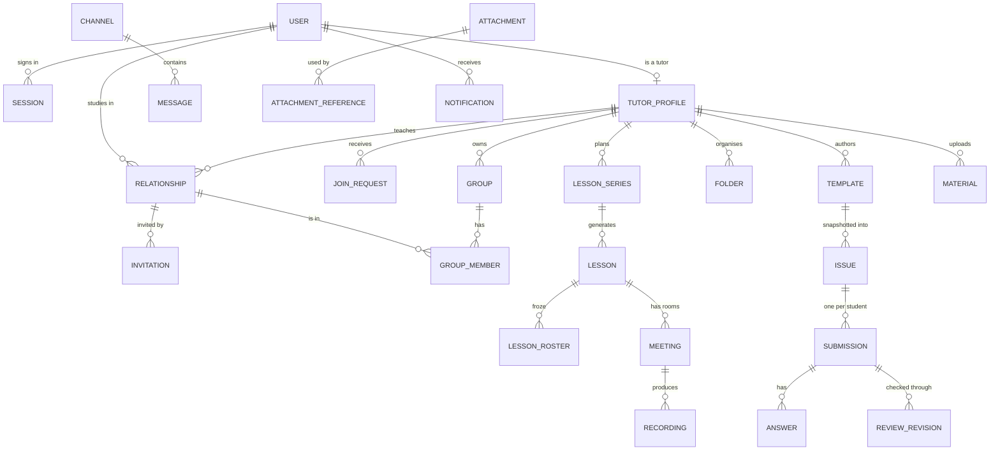

# Data model specification

PostgreSQL through `pgx`, with queries compiled to typed functions by `sqlc` and the schema built by `goose` SQL migrations. Behavior lives in the domain specifications ([accounts](accounts.md), [schedule](schedule.md), [homework](homework.md), [realtime and video](realtime-and-video.md), [notifications](notifications.md), [files](files.md)); this file fixes entities, keys, indexes and purge rules. Business tables are read and written only by repositories in `internal/repositories`; the infrastructure exceptions are listed under [package layers](../architecture/detailed.md#package-layers).

## Conventions

- Primary keys are random (version 4) UUIDs generated by the application, except where a natural composite key is given.
- Every table has `created_at` and, where rows change, `updated_at`, both `timestamptz` in UTC.
- **Enums** are stored as strings and defined once in `internal/domain`. The enums of states, roles and contexts appear here. Notification event names are those of the [event table](notifications.md#events), and error codes are those of the [API conventions](api.md#conventions).
- **Tokens:**
  - session, email confirmation and reset tokens are stored only as SHA-256 hashes;
  - invitation tokens are stored as a hash for lookup and encrypted with `OVC_FIELD_ENCRYPTION_KEY` for re-display and email rendering;
  - unsubscribe tokens are stateless and not stored.
- Free text written by users is stored as entered; normalised forms are separate columns.
- **Deletion:**
  - business entities leave the database only through the purge and cleanup jobs, and otherwise change state (withdrawn, discarded, cancelled, deleted);
  - pure link rows are deleted directly when the link ends: group members, channel members, blocked requesters, attachment references, quota charges, lesson and series materials, and empty folders.
- "xor" pairs are enforced with check constraints.

## Overview

## Accounts

### User

| Column | Notes |
|---|---|
| `id` | |
| `role` | `tutor`, `student` |
| `state` | `unverified`, `active`, `blocked`, `deleted` |
| `state_before_block` | |
| `email` | citext, unique |
| `email_verified_at` | |
| `password_hash` | Argon2id |
| `name` | 1–100 characters |
| `avatar_attachment_id` | |
| `language` | `ru`, `en` |
| `timezone` | IANA, from the browser at sign-up |
| `theme` | `light`, `dark`, `system` |
| `consent_version`, `consent_at` | |
| `pending_tutor_code` | |
| `reserved_invitation_id` | |
| `deleted_at` | partial index where `state = 'deleted'` |
| `email_undeliverable_at` | |
| `online_until` | persisted presence |
| `last_seen_at` | |
| `digest_pending_since` | partial index where not null |
| `last_digest_at` | |

Partial index on `created_at` where `state = 'unverified'`, for cleanup.

### Tutor profile

One per tutor user.

| Column | Notes |
|---|---|
| `user_id` | primary key |
| `bio` | up to 1,000 characters |
| `subjects` | up to 10 strings |
| `code` | unique; shared openly by design |
| `recording_retention_days` | 7, 30, 90, 180 or 365; default 90 |
| `file_quota_bytes`, `recording_quota_bytes` | |
| `file_usage_bytes`, `recording_usage_bytes` | |
| `onboarding_dismissed_at` | |

### Session

`id` (also the `sid` claim), `user_id`, `refresh_token_hash` (unique), `previous_token_hash`, `expires_at`, `revoked_at`, `last_used_at`, `user_agent_summary`.

### Email token and email request

- **Email request:** `id`, `user_id`, `purpose` (`verify_email`, `reset_password`). It is recorded when a confirmation or reset is requested, and its identifier is the outbox idempotency key.
- **Email token:** `id`, `request_id`, `user_id`, `purpose`, `token_hash` (unique), `expires_at`, `used_at`. It is minted by the worker at dispatch. A new token of the same purpose invalidates earlier unused ones.

### Rate limit counter

`purpose`, `subject` (email, IP, account or tutor), `window_start`, `count`; primary key on the three key columns, plus an index on `window_start` for cleanup.

## Relationships and groups

### Relationship

| Column | Notes |
|---|---|
| `id` | |
| `tutor_id` | |
| `student_id` | null until linked, then fixed; set to null when the student is purged |
| `student_name_snapshot` | the account name at purge, kept for the tutor's history |
| `state` | `invited`, `active`, `ended`, `discarded` |
| `display_name` | the tutor's private name for the student |
| `email` | optional |
| `colour` | palette key |
| `notes` | tutor-only, up to 10,000 characters |
| `linked_at`, `ended_at` | |

Constraints and indexes:

- unique `(tutor_id, student_id)` where `student_id` is not null and the state is not `discarded`;
- unique `(tutor_id, lower(email))` where `email` is not null and the state is not `discarded`;
- indexes on `tutor_id` and `student_id`.

### Invitation

`id`, `relationship_id`, `delivery` (`link`, `email`), `token_hash` (unique), `token_encrypted`, `email`, `bound_student_id` (for linked cards), `reserved_by_user_id`, `expires_at`, `used_at`, `revoked_at`.

- Consumption is a conditional update on `used_at is null and revoked_at is null`, and on the reservation being absent or held by the caller.
- Partial index on `expires_at` where unused and unrevoked.

### Join request and blocked requester

- **Join request:** `id`, `tutor_id`, `student_id`, `state` (`pending`, `accepted`, `declined`, `expired`), `expires_at`, `decided_at`. At most one `pending` per `(tutor_id, student_id)`. Partial index on `expires_at` where pending.
- **Blocked requester:** `tutor_id`, `student_id`, `created_at`; primary key on the pair.

### Group and group member

- **Group:** `id`, `tutor_id`, `name`, `colour`, `archived_at`.
- **Group member:** `group_id`, `relationship_id`, `added_at`; primary key on the pair, and an index on `relationship_id`.

## Schedule

### Lesson series

| Column | Notes |
|---|---|
| `id` | |
| `tutor_id` | |
| `relationship_id` xor `group_id` | |
| `weekdays` | set of 1–7 |
| `local_start` | time |
| `duration_minutes` | |
| `timezone` | |
| `first_date` | |
| `end_date` xor `count` | |
| `title`, `description` | |
| `materialised_until` | partial index where `ended_at` is null |
| `split_from_series_id` | |
| `ended_at` | |

**Series material:** `series_id`, `material_id`, `position`; primary key `(series_id, material_id)`.

### Lesson

| Column | Notes |
|---|---|
| `id` | |
| `tutor_id` | |
| `series_id` | nullable |
| `occurrence_date` | nullable; set for series occurrences |
| `relationship_id` xor `group_id` | |
| `title`, `description` | |
| `starts_at`, `duration_minutes` | |
| `status` | `scheduled`, `live`, `ended`, `cancelled` |
| `timezone` | the tutor-side timezone: the series timezone, or the tutor's at creation for one-off lessons |
| `schedule_revision` | incremented on every change to start or duration |
| `reminded_24h_revision`, `reminded_1h_revision` | the schedule revision the reminders were last written for |
| `overridden_fields` | set |
| `live_at`, `ended_at` | "took place" means `live_at` is set |

Indexes:

- unique `(series_id, occurrence_date)`;
- `(tutor_id, starts_at)`, `(relationship_id, starts_at)` and `(group_id, starts_at)`;
- partial `(starts_at)` where `status = 'scheduled'`;
- partial `(starts_at)` where `status = 'live'`.

### Lesson roster

`lesson_id`, `student_id`, `lesson_starts_at` (copied from the lesson for calendar queries), `added_at`. Primary key on the pair, and an index on `(student_id, lesson_starts_at)`.

### Lesson links

**Lesson material:** `lesson_id`, `material_id`, `position`; primary key `(lesson_id, material_id)`. The lesson's linked issues are `issue.lesson_id`.

### Meeting

| Column | Notes |
|---|---|
| `id` | |
| `lesson_id` | |
| `provider` | `bbb`, `fake` |
| `provider_meeting_id` | random, unique |
| `state` | `creating`, `open`, `closed` |
| `create_time` | the value returned by the provider; null while `creating` |
| `routing_key` | random, unique, not a secret |
| `retention_days` | copied from the tutor at creation |
| `first_join_at` | |
| `recordingmarks` | from the meeting-ended hint, diagnostic only |
| `ended_at`, `close_reason` | `tutor_end`, `tutor_restart`, `status_job`, `provider_not_found`, `provider_error` |
| `settled_at` | |

Indexes:

- at most one meeting per lesson that is not `closed` (partial unique index);
- a partial index on `ended_at` where `settled_at` is null; reconciliation settles every meeting within 7 days, so the index stays small.

### Recording

| Column | Notes |
|---|---|
| `id` | |
| `meeting_id` | |
| `provider_recording_id` | unique |
| `state` | `processing`, `copying`, `held_quota`, `available`, `failed`, `expired`, `deleted` |
| `failure_reason` | |
| `copy_generation` | incremented on each retry |
| `held_since` | partial index where `state = 'held_quota'` |
| `storage_key` | |
| `size_bytes`, `sha256`, `duration_seconds` | |
| `available_at` | |
| `expires_at` | partial index where `state = 'available'` |
| `provider_copy_deleted_at`, `deleted_at` | |

## Chat

### Channel and channel member

- **Channel:** `id`, `kind` (`direct`, `group`), `relationship_id` xor `group_id`, `last_message_id`, `read_only_since`.
- **Channel member:** `channel_id`, `user_id`, `last_read_message_id`, `last_read_at`. Primary key on the pair, and an index on `user_id`.

Membership rows mirror the relationship or group and are updated in the same transaction.

### Message

`id`, `channel_id`, `sender_id` (nullable after the sender's purge), `body` (null after erasure), `created_at`, `edited_at`, `deleted_at`, `erased_at`. Index `(channel_id, created_at, id)`.

## Homework

### Folder

`id`, `tutor_id`, `parent_id` (nullable, depth ≤ 3), `name`.

### Material

`id`, `tutor_id`, `folder_id` (null means the library root), `title`, `normalised_title`, `attachment_id`, `deleted_at`.

### Template

`id`, `tutor_id`, `folder_id` (null means the library root), `title`, `normalised_title`, `blocks` (JSON validated by the block schema), `schema_version`, `version` (optimistic lock), `deleted_at`.

### Issue

| Column | Notes |
|---|---|
| `id` | |
| `tutor_id` | indexed |
| `template_id` | always set; templates are soft-deleted |
| `relationship_id` xor `group_id` | indexed |
| `lesson_id` | nullable |
| `title` | |
| `snapshot` | JSON blocks with option identifiers, answer keys, material titles and attachment identifiers |
| `max_points` | |
| `has_manual_questions` | |
| `deadline_at` | |
| `answer_policy` | `never`, `after_submission`, `after_check` |
| `status` | `active`, `withdrawn` |
| `issued_at`, `withdrawn_at` | |

### Submission

| Column | Notes |
|---|---|
| `id` | |
| `issue_id` | |
| `tutor_id` | copied from the issue for the review queue |
| `student_id` | |
| `status` | `not_started`, `draft`, `submitted`, `returned`, `checked`, `closed` |
| `version` | optimistic lock |
| `last_save_id` | the save identifier of the last applied autosave |
| `first_submitted_at`, `submitted_at`, `checked_at` | |
| `late` | boolean |
| `auto_points`, `final_points` | |
| `published_revision_id` | |

Constraints and indexes:

- unique `(issue_id, student_id)`;
- index `(student_id, status)`;
- partial index `(tutor_id, first_submitted_at, id)` where `status = 'submitted'`, for the review queue.

### Answer

- **Columns:**
  - `submission_id`, `question_id` (the snapshot block identifier);
  - `value`: JSON with selected option identifiers, raw text or number text;
  - `normalised`, `normaliser_version`;
  - `auto_points`, `auto_correct` (boolean), `frozen_at`.
- **Primary key** on the pair.
- **File answers** reference attachments with reference kind `answer`.

### Review revision

`id`, `submission_id`, `revision` (1, 2, …), `tutor_id`, `state` (`draft`, `published`), `action` (`check`, `return`), `feedback`, `items` (JSON per question: points, override points and reason, comment), `published_at`.

- Unique `(submission_id, revision)`, and at most one `draft` per submission.
- Corrected files reference attachments with reference kind `review_item` and this revision's `id`.

## Files

### Attachment

| Column | Notes |
|---|---|
| `id` | |
| `uploader_id` | |
| `context` | `avatar`, `prompt_image`, `library`, `chat`, `answer`, `corrected` |
| `scope_kind`, `scope_id`, `scope_question_id` | the upload scope |
| `quota_tutor_id` | |
| `storage_key` | random, never returned |
| `filename` | |
| `media_type` | |
| `size_bytes`, `sha256` | |
| `state` | `pending`, `bound`, `deleted` |
| `expires_at` | pending only; partial index |

### Attachment reference and quota charge

- **Attachment reference:**
  - columns: `attachment_id`, `ref_kind` (`message`, `answer`, `review_item`, `material`, `template`, `issue_snapshot`, `lesson`, `avatar`), `ref_id`, `question_id` (for answers and review items);
  - primary key on all four, and an index on `(ref_kind, ref_id)`.
- **Quota charge:** `tutor_id`, `attachment_id`, `size_bytes`; primary key on the pair. It is created with the first reference that charges the tutor and deleted with the last one.

## Notifications and worker

### Notification

`id`, `user_id`, `event`, `tutor_id`, `idempotency_key` (unique), `payload` (identifiers and titles only), `created_at`, `read_at`. Indexes `(user_id, created_at, id)`, `(created_at)` and a partial `(user_id)` where `read_at` is null for unread counts.

### Email preference

`user_id`, `group` (`lesson_reminders`, `lesson_changes`, `homework`, `results`, `submissions`, `message_digest`), `enabled`. Primary key on the pair. A missing row means enabled.

### Outbox

| Column | Notes |
|---|---|
| `id` | |
| `lane` | `email`, `provider_call`, `recording_copy`, `storage_delete` |
| `kind` | |
| `payload` | identifiers only |
| `idempotency_key` | unique |
| `status` | `pending`, `in_progress`, `done`, `dead` |
| `attempts` | incremented at claim |
| `next_attempt_at` | |
| `lease_token`, `lease_expires_at` | |
| `last_error_code` | |
| `done_reason` | `sent`, `obsolete` |
| `done_at` | partial index where `status in ('done', 'dead')`, for cleanup |

Partial indexes on `(lane, priority, next_attempt_at)` where pending, and on `(lease_expires_at)` where in progress. The `priority` column is `high` or `normal`.

### Job run

`job`, `last_run_at`, `last_result`; primary key `job`.

### Test-only tables

Created only in test and development databases, never by production migrations:

- **Test clock:** a single row with the shared instant.
- **Mail sink:** recipient, subject, bodies, links and sent time.

## Purge

What the purge job does 30 days after an account is deleted.

| Table | Student purge | Tutor purge |
|---|---|---|
| User | Row deleted | Row deleted |
| Session, email request, email token | Deleted | Deleted |
| Tutor profile | — | Deleted |
| Relationship | `student_id` set to null, name snapshot kept for the tutor's history; state `discarded` | Deleted |
| Invitation, join request, blocked requester | Rows of the student deleted | Rows of the tutor deleted |
| Group, group member | Memberships deleted | Groups and memberships deleted |
| Lesson series, lesson, roster | Roster rows of the student deleted | Deleted |
| Meeting, recording | Kept until each recording's expiry | Media and rows deleted |
| Channel, channel member | Memberships deleted | Channels deleted |
| Message | Body erased, `sender_id` null, its attachment references removed | Messages of the tutor's channels deleted |
| Folder, material, template | — | Deleted |
| Issue | — | Deleted |
| Submission, answer, review revision | Deleted; analytics no longer count them | Deleted |
| Attachment, reference, quota charge | References from deleted rows removed; unreferenced files deleted | Same |
| Notification, email preference | The student's rows deleted | The tutor's rows deleted, and other users' rows that name the tutor |

## Indexes and integrity notes

- Every foreign key used in authorization filters is indexed:
  - `relationship.tutor_id`, `relationship.student_id`;
  - `group_member.relationship_id`;
  - `issue.tutor_id`, `issue.relationship_id`, `issue.group_id`;
  - `submission.student_id`;
  - `lesson_roster.student_id`;
  - `channel_member.user_id`.
- Message pagination, notification lists and the review queue use keyset ordering on indexed columns, never `OFFSET`.
- Every periodic job reads through the partial index on its due column named above and processes a bounded batch per run.
