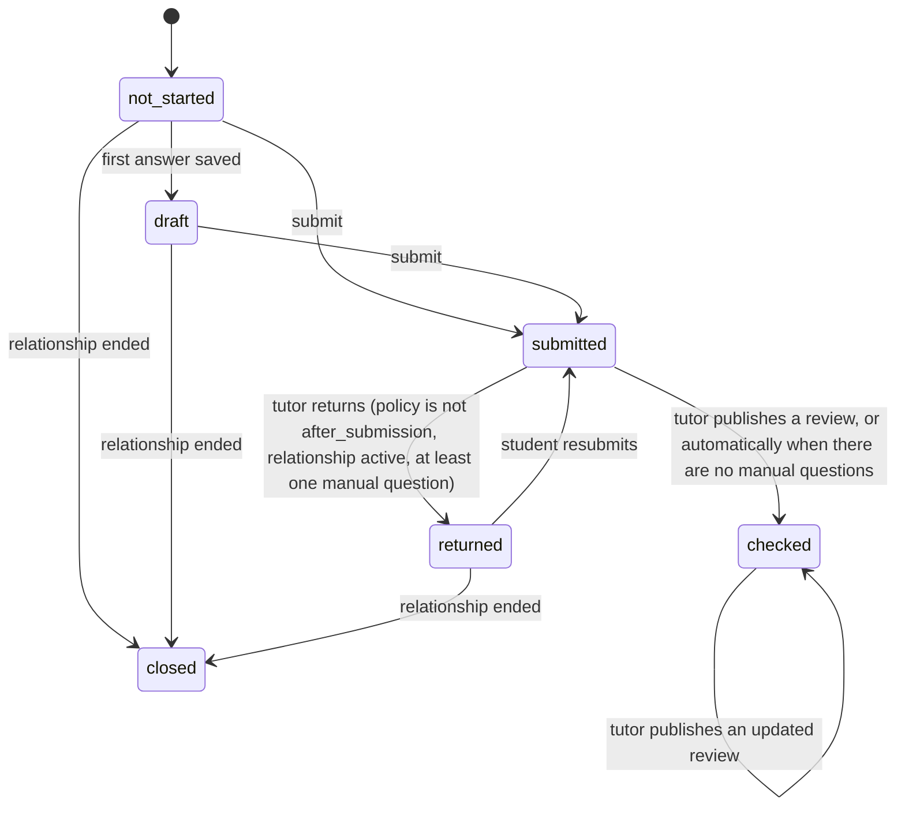

# Homework specification

Behavior for FR-6 to FR-11: library, builder, issuing, completing, checking, results and analytics. Slice 8 builds the library, the builder and the preview; slice 9 builds issuing, completing and checking. Entities are in the [data model](data-model.md#homework); routes are in the [API](api.md#homework); files are shared through [attachment references](files.md#references).

## Library

Built in slice 8 ([slice 8 plan](../plans/slice-8.md)) by `internal/services/library`, which owns folders, materials, templates and the template's student projection. Routes are in the [API](api.md#homework); rows in the [data model](data-model.md#homework).

- **Contents:** a tutor's library holds **materials** (an uploaded file with a title) and **templates** (an assignment with a title and blocks).
- **Tutor-only:** library rows belong to one tutor. Every library route resolves every identifier, in the path, the query or the body, within the caller's own library and answers `404 not_found` otherwise, with the same body as a random identifier; a student gets `404` for the role, as on every tutor route. Library routes are open to a tutor whose email is not confirmed (`unverified ok`), because an unconfirmed tutor shares nothing with anyone; uploads of the `library` and `prompt_image` contexts are the exception and need a confirmed email ([contexts and limits](files.md#contexts-and-limits)).
- **Locks and the session:** every library write locks the tutor's user row and then the tutor's profile, in the general lock order, before any other row, and answers `401 unauthenticated`, changing nothing, unless the tutor is `active` or `unverified` under those locks, with the session re-check of [locks and the session re-check](accounts.md#locks-and-the-session-re-check), so a write that waited on a reclaim sees its revoked session (the owner's decision of 2026-11-10 during slice 8 change B3); a write that creates or removes a quota charge then follows the charge lock order of the [quotas](files.md#quotas). The profile lock also serialises folder moves, so the depth and cycle checks below cannot race.
- **Per-tutor caps:** at most 1,000 folders, 10,000 materials that are not deleted, 2,000 templates that are not deleted, and 50,000 material and template rows in all, deleted ones included until the purge. A creation or duplicate beyond any cap answers `422 validation_failed` (`body`, `too_many`), counted under the profile lock. The block JSON of all the tutor's templates together holds at most 64 MiB, the sum of their stored `blocks_bytes` (deleted templates hold none, below); a create, save or duplicate that would pass it answers `422 validation_failed` (`body`, `too_many`), checked under the profile lock (the owner's decision of 2026-11-10 during the slice 8 contract change). The caps and the budget are constructor settings, so tests use small ones ([T-20](../../docs/threat-model.md#threats-and-controls)).
- **Write rates:** at most 600 library writes per tutor per hour (rate-limit purpose `library_writes_hour`): every create, edit, move, duplicate and delete of a folder, material or template, except template saves. Template saves (`PUT /library/templates/{id}`) count only toward their own limits: at most 2 per second per template (`template_saves_second`) and 3,600 per tutor per hour (`template_saves_hour`). Beyond any of them the answer is `429 rate_limited` with `Retry-After`. Slots are reserved as for lesson writes ([scheduling limits](schedule.md#scheduling-limits)): in their own committed step under the profile lock, after the audience, the schema checks and the replay of a repeated `Idempotency-Key`, before every check of the service, and kept when the request is later refused; a replay found at admission and a `429` itself use none.
- **Names and titles:** a folder name holds 1 to 100 code points, and a material or template title 1 to 200; both are plain text stored as entered, with their normalised form ([text normalisation](#short-answer-normalisation)) stored beside them. A control character or a Unicode format character (category `Cf`, which includes the bidirectional overrides) answers `422 validation_failed` with the field code `invalid`, as for [file names](files.md#file-names); a value that is empty after trimming, or whose normalised form is empty, answers `required`; one longer than its limit in code points, or whose normalised form holds more than 400 bytes (a folder name) or 800 bytes (a title), answers `too_long`, because text normalisation can expand a value up to about 11 times in bytes and the normalised forms are indexed (slice 8 change B3). They are rendered as text in an element isolated with `dir="auto"`.

### Folders

- **Nesting:** a folder at the root is at level 1, and folders nest at most three levels deep. Every material and template is in exactly one folder, or at the root (`folder_id` null).
- **Creating:** `POST /library/folders {name, parent_id}` (`parent_id: null` for the root) answers `201` with `{id, name, parent_id}`; a parent outside the tutor's library answers `404`, and a parent at level 3 answers `422 validation_failed` (`body.parent_id`, `invalid`).
- **Unique names:** a name is unique among its siblings by its normalised form; a second one answers `422 validation_failed` (`body.name`, `taken`); `taken` is a field code that slice 8 adds to the field-code enum, while no new error code is added.
- **Moving:** `PATCH /library/folders/{id}` takes `{name?, parent_id?}` (`parent_id: null` moves the folder to the root). A parent outside the tutor's library answers `404`. Moving a folder into itself or one of its descendants, or so that any folder of its subtree would end deeper than level 3, answers `422 validation_failed` (`body.parent_id`, `invalid`). The checks read the tree under the profile lock.
- **Deleting:** only an empty folder is deleted: one with no child folder and no material or template that is not deleted; otherwise `409 not_editable`. Deleting a material or template sets its `folder_id` to null, so a deleted item never blocks or breaks a folder deletion. A deleted folder leaves the table at once, as the data model's rule for pure link rows allows, so a repeated delete answers `404`.
- **Every folder:** `GET /library/folders` answers every folder of the tutor, unpaginated (bounded by the folder cap), as `{folders: [{id, name, parent_id}]}` ordered by normalised name and identifier, for the folder tree and the Move dialog's destination picker.

### Listing and search

- **`GET /library?folder=&q=&limit=&cursor=`** answers one folder of the library: `folder` is a folder identifier of the tutor (any other answers `404`), and without it the root.
- **The answer** is `{folder: {id, name, parent_id} | null, path: [{id, name}], folders: [{id, name, parent_id}], items: [LibraryItem], next_cursor, template_count}`:
  - `path` lists the folder's path from the root, the folder itself included (at most three entries, empty at the root), and `folders` its child folders, unpaginated (bounded by the folder cap), ordered by normalised name and identifier;
  - `items` holds the folder's materials and templates that are not deleted, keyset paginated (`limit` default 30, maximum 100) on `(normalised_title COLLATE "C", kind, id)`;
  - a `LibraryItem` is `{kind: material | template, id, title, folder_id, path, updated_at}` plus, for a material, `{attachment_id, filename, media_type, size_bytes, width, height, url, expires_at}`, where `url` and `expires_at` are an `inline` download address minted for this response for a picture with recorded dimensions and `null` for every other file, which the client downloads through [`GET /attachments/{id}`](files.md#downloads) with `ref=material:<id>`; and, for a template, `{question_count, max_points, ready, version}`, the `version` that a move sends back; `path` is `null` here;
  - `template_count` is the number of the tutor's templates that are not deleted, which Today's first-run checklist reads with `limit=1` ([pages](../design/web/pages.md#today)).
- **Search:** with `q` (1 to 200 code points), the answer holds every matching material and template across all folders instead, in the same order and pagination, each with `path`, its folder's path from the root including the folder itself (at most three entries, empty at the root); `folder` is then `null`, `path` and `folders` are empty, and a `folder` parameter given with `q` answers `422 validation_failed` (`query.folder`, `not_allowed`). `q` is normalised by text normalisation version 1 and matched as a substring of the normalised title, with `%`, `_` and `\` escaped, so they match literally; a `q` that normalises to empty answers `422 validation_failed` (`query.q`, `required`). The scan reads the tutor's rows through the `(tutor_id, normalised_title, id)` indexes, without a trigram index; the caps bound it.
- **Live data:** library data belongs to one tutor, so no frame announces its changes; another tab of the same tutor meets a stale template save as `conflict`, and the other library pages refetch on their next visit ([live refetch mapping](../architecture/detailed.md#live-refetch-mapping)).

### Materials

- **Creating:** `POST /library/materials {attachment_id, title, folder_id}` binds the caller's own `pending` upload of the `library` context whose 24-hour expiry has not passed, creating its `material` reference and, when the tutor holds no charge for the attachment yet, the charge (`507 quota_exceeded` when the usage would pass the quota). Any other attachment identifier, and a `folder_id` outside the tutor's library, answer `404`, like a random one. It answers `201` with the material as a `LibraryItem`.
- **Editing:** `PATCH /library/materials/{id} {title?, folder_id?}` renames and moves (`folder_id: null` moves to the root); the file is never replaced. A field equal to its current value is no change, and an edit that changes nothing answers the current state.
- **Deleting:** `DELETE /library/materials/{id}` sets `deleted_at`, sets `folder_id` to null and removes the material's own reference, releasing its charge and queueing the file's `storage_delete` when that was the file's last reference; it answers `204`, also when repeated. Templates, lessons, series and issue snapshots that use the file keep their own references, so it stays in storage and in the tutor's quota until its last reference is gone, and a lesson keeps showing the material under its last title. A deleted material is not listed, is not found by search and answers `404` to `PATCH`.

### Templates

- **Creating:** `POST /library/templates {title, folder_id, blocks}` with an `Idempotency-Key` header (1 to 64 characters of `^[A-Za-z0-9._-]{1,64}$`), stored per tutor as `create_key`: a repeated key answers `201` with the template it created, as it is now, whatever the body, and uses no rate slot; a key whose template was since deleted answers `404`. `blocks` may be empty, and is validated and bound as a save is. The builder's "New assignment" sends the localised title "New assignment" and no blocks.
- **Reading:** `GET /library/templates/{id}` answers the tutor's template schema: `{id, title, folder_id, blocks, version, ready, problems, question_count, max_points, created_at, updated_at}`, with answer keys, explanations and points, every prompt image and material block carrying a download address minted per response.
- **Autosave:** `PUT /library/templates/{id} {title, blocks, version, save_id}` replaces the title and the blocks, conditionally on `version`, and increments it. `save_id` is a version 4 UUID generated per request; a request whose `save_id` equals the stored `last_save_id` answers the current state instead of `conflict`, as submission autosave does ([submission lifecycle](#submission-lifecycle)). A stale `version` answers `409 conflict`. It answers the template schema of `GET`. The client saves one second after the last change, with at most one request in flight, and flushes the pending save before it opens the preview.
- **Moving:** `PATCH /library/templates/{id} {folder_id, version}` moves the template to another folder (`folder_id: null` for the root), conditionally on `version`, which it increments (`409 conflict` for another one), and answers the template schema of `GET`; a `folder_id` outside the tutor's library answers `404`, and a move to the current folder is no change. It counts toward the 600 library writes, not toward the template save limits (the owner's decision of 2026-11-10 during the slice 8 contract change). Because it increments `version`, a builder open in another tab meets its next save as `conflict` and offers Reload. The title changes only through a save in the builder, so the library offers no Rename for templates.
- **Duplicating:** `POST /library/templates/{id}/duplicate {title, folder_id}` creates a template with a copy of the blocks, their block and option identifiers kept, and a new `template` reference for every attachment they show, so no bytes are copied and no charge is created (the tutor already holds one); it answers `201` with the new template. The client proposes the localised title "{title} (copy)" cut to 200 code points.
- **Deleting:** `DELETE /library/templates/{id}` sets `deleted_at`, sets `folder_id` to null, replaces `blocks` with an empty list and `blocks_bytes` with 0 (issued work lives in its own snapshot, so nothing reads a deleted template's blocks; the owner's decision of 2026-11-10 during the slice 8 contract change) and removes the template's references, releasing every file used only by it; it answers `204`, also when repeated. Issued work keeps its snapshot ([issuing](#issuing)).
- **Size:** a template's request body stays within the 1 MiB JSON limit of the [API conventions](api.md#conventions), which the per-block limits alone would allow it to exceed; a larger body answers `413 payload_too_large`, which the builder shows as "This assignment is too large to save".
- **Caching:** every library response sends `Cache-Control: no-store`, because it carries answer keys or download addresses.

## Assignment blocks

An assignment is a title of 1 to 200 code points and an ordered list of at most 100 blocks; a template may be saved with no blocks or with incomplete questions ([validation](#validation)), and only a [ready](#validation) template can be issued.

| Block | Fields | Checked |
|---|---|---|
| `instruction` | text in the [restricted Markdown subset](#restricted-markdown), up to 10,000 code points | — |
| `material` | a reference to a library material | — |
| `single_choice` | prompt; 2–10 options, exactly one correct; points; explanation | automatically |
| `multiple_choice` | prompt; 2–10 options, at least one correct; points; scoring `all_or_nothing` (default) or `partial`; explanation | automatically |
| `short_text` | prompt; 1–20 accepted answers of up to 500 code points each; points; explanation; student answers up to 500 characters | automatically, after normalisation |
| `short_number` | prompt; value and absolute tolerance ≥ 0, as decimal strings with at most 6 fractional digits; points; explanation | automatically, in exact decimal arithmetic |
| `long_text` | prompt; maximum length from 1 to 20,000 characters; points; explanation | by the tutor |
| `file` | prompt; allowed kinds, a non-empty subset of `images`, `pdf`, `office` and `audio`; maximum file count 1–5; points; explanation | by the tutor |

- **Prompts** use the restricted Markdown subset, hold up to 10,000 code points and may attach up to 3 images. Option texts are plain text up to 500 code points.
- **Points** are integers from 0 to 100 per question. The assignment's maximum is the sum. A template whose maximum is 0 (content only, or all questions worth 0) can be issued; the tutor sees its score as "not scored". Students never see points ([answer visibility](#answer-visibility)).
- **Explanations** are optional restricted Markdown of up to 10,000 code points, shown only when [answers are visible](#answer-visibility).
- **Scoring of `multiple_choice`:**
  - **All or nothing:** the full points when the selected set equals the correct set exactly, otherwise 0.
  - **Partial:** `floor(points × max(0, correct_selected − incorrect_selected) / correct_options)`, computed in integers.
- **Unanswered questions** score 0.

### Block schema

From slice 8. One `TemplateBlock` struct carries `id`, `type` and the optional fields of every type; a field that does not belong to the block's type answers `422 validation_failed` with the field code `not_allowed`. The frontend parses blocks into a discriminated union at the boundary in `features/builder`.

| Field | Types | Request | Response additions |
|---|---|---|---|
| `id` | all | a version 4 UUID generated by the client (`crypto.randomUUID`), unique within the template | — |
| `type` | all | one of the eight block types | — |
| `text` | `instruction` | string, 0 to 10,000 code points | — |
| `material_id` | `material` | a material identifier of the tutor, required | `material: {material_id, attachment_id, title, filename, media_type, size_bytes, width, height, deleted, url, expires_at}` with the material's current title |
| `prompt` | question types | string, 0 to 10,000 code points | — |
| `image_ids` | question types | 0 to 3 attachment identifiers, without repeats, each a picture (JPEG, PNG, WebP or GIF) | `images: [{attachment_id, filename, media_type, size_bytes, width, height, url, expires_at}]` in the same order |
| `options` | `single_choice`, `multiple_choice` | 0 to 10 `{id, text, correct}`: `id` a version 4 UUID unique within the template, `text` 0 to 500 code points, `correct` a boolean | — |
| `scoring` | `multiple_choice` | `all_or_nothing` or `partial`, required | — |
| `accepted_answers` | `short_text` | 0 to 20 strings of up to 500 code points | — |
| `value`, `tolerance` | `short_number` | strings of up to 64 code points | — |
| `max_length` | `long_text` | integer from 1 to 20,000, required | — |
| `allowed_kinds` | `file` | a non-empty set of `images`, `pdf`, `office`, `audio`, without repeats, required | — |
| `max_files` | `file` | integer from 1 to 5, required | — |
| `points` | question types | integer from 0 to 100, required | — |
| `explanation` | question types | string, 0 to 10,000 code points, optional | — |

Field paths name the block by its position, for example `body.blocks[3].options[1].text` with `too_long`; a repeated block or option identifier answers `invalid` at the second occurrence's `id`. Duplicating a template keeps its identifiers, because they are unique only within a template; the builder's per-block Duplicate copies a block in the client with fresh block and option identifiers. A slice 9 snapshot issues fresh random option identifiers, so two issues of one template under different answer policies never share them ([answer visibility](#answer-visibility)).

### Validation

Two levels, so autosave never fails while the tutor types because a question is incomplete (the owner's decision of 2026-11-10 in the [slice 8 plan](../plans/slice-8.md#4-owner-questions)):

- **Structural rules** always refuse a save with `422 validation_failed` and field paths: the title's bounds, block and field types, identifiers, `not_allowed` fields, the upper bound of every count and length above, the required fields of the schema, points from 0 to 100, at most 100 blocks, at most 3 images per prompt, and attachments and materials that may be referenced ([template references](#template-references)).
- **Completeness rules** never refuse a save. They are answered as `problems: [{block_id, code}]` beside the template, in block order (`block_id` null for the template itself), and the template's `ready` is true exactly when there are none:

  | Code | When |
  |---|---|
  | `no_blocks` | the template has no blocks (`block_id` null) |
  | `text_missing` | an instruction whose text is empty after trimming |
  | `prompt_missing` | a question whose prompt is empty after trimming |
  | `too_few_options` | a choice question with fewer than two options |
  | `option_empty` | a choice option whose text is empty after trimming |
  | `correct_count` | a single choice without exactly one correct option |
  | `no_correct_option` | a multiple choice without a correct option |
  | `no_accepted_answer` | a short text without an accepted answer |
  | `accepted_answer_empty` | a short text with an accepted answer whose normalised form is empty |
  | `value_invalid` | a value that is not a decimal of at most 6 fractional digits (`^[+-]?[0-9]+(\.[0-9]{1,6})?$`) |
  | `tolerance_invalid` | a tolerance that is not such a decimal, or is negative |

- **Stored summary:** every save writes the template's `question_count` (blocks of the six question types), `max_points`, `ready`, `blocks_bytes` (the byte length of its stored block JSON) and `updated_at`, so the library list never parses block JSON.
- **Issuing** a template that is not ready is refused in slice 9.

### Template references

- A template holds one `template` reference per distinct attachment its blocks show: its prompt images and the files of its material blocks.
- A save computes the new set. An attachment may appear in `image_ids` only when it is a picture (JPEG, PNG, WebP or GIF) of the `prompt_image` context that the template already references or that is the caller's own `pending` upload described next (any other file answers `404` at its position, like a random identifier), and in a material block only as the file of the block's material, already referenced or newly allowed as below; when it is the caller's own `pending` upload of the `prompt_image` context whose 24-hour expiry has not passed; or, in a material block, when it is the attachment of a material of the tutor that is not deleted, named by the block's `material_id`. A block naming a deleted material is kept only when the template already references that material's file. Anything else answers `404 not_found`, like a random identifier, whatever position it holds.
- The save then adds and removes references and charges in the same transaction, under the profile lock and the charge lock order; a removed last reference queues the file's `storage_delete`. A removed prompt image is therefore released at once; the builder keeps the picked file in memory until the page closes and uploads it again when the removal is undone.

### Builder preview

- **`GET /library/templates/{id}/student-view`** answers the template through the student content schema that slice 9 reuses for issued work (the owner's decision of 2026-11-10 in the [slice 8 plan](../plans/slice-8.md#4-owner-questions)): `{title, blocks}`, where each block holds only `id`, `type`, and as its type has them `text`, `prompt`, `options: [{id, text}]`, `max_length`, `allowed_kinds`, `max_files`, `material: {title, filename, media_type, size_bytes, width, height, url, expires_at}` and `images: [{filename, media_type, size_bytes, width, height, url, expires_at}]`.
- The schema is a separate Go struct with no field for correctness, accepted answers, value, tolerance, explanations, points, `max_points`, `ready`, `problems`, the `multiple_choice` scoring mode (points data under [ADR-0009](../../docs/decisions/0009-owner-approved-exceptions-and-visibility.md)), `material_id` or `attachment_id`.
- **Its test is an allowlist:** for a seeded template holding every block type, it asserts the exact set of keys of every object in the response (the top level, each block per type, each option, each material entry and each prompt-image entry), failing on any other key, and asserts that no string in the response contains any of the distinctive sentinel accepted answers, numeric values, tolerances or explanations seeded in that template. It decodes the response recursively into `map[string]json.RawMessage`, without `any` or `reflect`, and its allowed key sets are literals taken from this section, not derived from the struct. It starts the answer-key contract test of slice 9.
- **The builder** flushes autosave before it opens the preview, and renders the answer in the student view's components.

### Restricted Markdown

Paragraphs, bold, italic, ordered and unordered lists, inline code, code blocks and links (`https` only, opened with `rel="noopener noreferrer"`). No raw HTML, no images except attached ones, no embeds. It is rendered by one renderer shared by every view.

- **The renderer** (from slice 8; the owner's decision of 2026-11-10 in the [slice 8 plan](../plans/slice-8.md#4-owner-questions)) is OVC's own small parser in `frontend/src/lib/markdown/`, with no dependency, producing React elements and never an HTML string, so the lint rules against unsafe DOM sinks stay unweakened.
- **Links** are kept only when the URL parser yields `https:` with a host and no user information; they open with `target="_blank"` and `rel="noopener noreferrer"`, and anything else, a raw HTML tag included, renders as text.
- **Blocks and nesting:** fenced code blocks open with three or more backticks or tildes; a line break inside a paragraph or a list item is kept as a line break; lists do not nest, so a marker indented by up to three spaces with the list's own bullet or delimiter continues the list, a marker of another kind starts a new list, and a line indented further continues the item's text; emphasis and links nested deeper than eight levels render as plain text, which bounds the depth of the rendered tree.
- **Tests** run an injection corpus (raw HTML, `javascript:` and `data:` links, nested emphasis, unbalanced markers) and count the parser's steps on 10,000-character adversarial inputs, which must stay within a fixed multiple of the input length; there is no wall-clock bound.
- Lesson descriptions stay plain text ([schedule](schedule.md#titles-and-descriptions)).

## Short-answer normalisation

**Text normalisation, version `1`,** is applied identically to accepted answers, to student answers and to search terms:

1. Unicode NFKC, then case folding, then NFKC again, so the result is stable when applied twice. Case folding follows the Unicode case folding table, which folds Cherokee letters to their uppercase forms; `golang.org/x/text/cases` folds them to lowercase instead, so Cherokee letters are mapped to uppercase after it (the owner's decision of 2026-11-10 during the change that implements this rule).
2. `ё` → `е`, repeated after canonical composition until no `ё` remains, because an `е` followed by a combining diaeresis left in the text composes into `ё` again (the owner's decision of 2026-11-10 during the change that implements this rule).
3. Quotes `«`, `»`, `„`, `“`, `”`, `‟` → `"`; quotes `‘`, `’`, `‚`, `‛`, `′`, `‹`, `›` → `'`.
4. Dashes `‐`, `‑`, `‒`, `–`, `—`, `―`, `−` → `-`.
5. Trim, and collapse every run of whitespace to one space.

A `short_text` answer is correct when its normalised form equals the normalised form of any accepted answer. An accepted answer whose normalised form is empty is a completeness problem of the template (`accepted_answer_empty`), which keeps it from being issued ([validation](#validation)).

From slice 8 both rules live in `internal/domain` as pure functions with unit tests for every step, idempotence and the Russian cases: text normalisation uses `golang.org/x/text/unicode/norm` for NFKC and `golang.org/x/text/cases` for case folding, and number parsing parses into `math/big` rationals, so slice 9 needs no new parser ([stack](../architecture/detailed.md#stack-per-component)).

**Number parsing, version `1`,** takes the text normalisation result and then:

1. Removes spaces, including U+00A0, U+202F and U+2009.
2. Accepts at most one decimal separator, `,` or `.`; a text containing both is invalid. Under this rule `1,000` is the number one, following the Russian decimal comma.
3. Requires the whole text to match `^[+-]?[0-9]+([.,][0-9]+)?$`, where `-` also covers every dash of step 4 above. Anything else, including exponents, `NaN` and `Infinity`, is invalid.
4. Parses the match into an exact decimal.

The answer is correct when `|answer − value| ≤ tolerance` in exact decimal arithmetic. A text that does not parse is incorrect and is kept as entered.

Each stored answer keeps its raw text, its normalised or parsed form and the normalisation version, so a later version never re-scores existing work.

## Issuing

- **An issue** has:
  - a snapshot of the template's title and blocks, holding its own references to every file it shows, with each material's title and attachment identifier copied in and fresh random option identifiers ([answer visibility](#answer-visibility));
  - a [ready](#validation) template: issuing a template with completeness problems is refused (decided with slice 8; the slice 9 plan fixes the refusal's code);
  - an audience: one `active` relationship, or one non-archived group with at least one member. Otherwise it is refused: `relationship_not_active` for an invited or ended relationship, `audience_not_active` for an archived or empty group;
  - an optional linked lesson of the same tutor and audience, which can be set or changed later;
  - an optional deadline, which must be in the future when set;
  - an [answer visibility policy](#answer-visibility);
  - a flag recording whether the snapshot has manual questions.
- **Retries:** `POST /issues` accepts an `Idempotency-Key` header, so a retried request never creates a second issue.
- **One submission per student** is created in the same transaction: the relationship's student, or every current group member. Students who join the group later get nothing until the tutor issues the template again.
- **The snapshot is immutable.** Template edits and deletions never change it.
- **The tutor may change the deadline later.** Each submission's late flag is then recomputed from its first submission time. The policy is fixed at issue time.
- **Withdrawing:**
  - allowed while no submission has been submitted;
  - it locks the issue row, and every autosave and submission takes the same lock in shared mode and checks the issue status, so a withdrawal never races them;
  - the issue becomes `withdrawn` and its submissions disappear from every list; their routes answer `not_found`;
  - references held by its draft answers are released;
  - `issue.withdrawn` notifies the students.
- **An email and an in-app notification** go to each student when work is issued ([notifications](notifications.md#events)).

## Answer visibility

The policy is one of `never`, `after_submission` or `after_check`. **Correct answers are revealed** to a student when:

- `after_submission`: their submission is `submitted` or `checked`;
- `after_check`: their submission is `checked`;
- `never`: never.

**Tutor review content visible to the student** (comments, corrected files, feedback) comes only from the latest **published** review revision, whatever the policy. Points the tutor sets or overrides stay tutor-only. Overrides apply only to automatic questions. A draft revision is never visible, and its corrected files cannot be downloaded by the student: corrected files are referenced by the revision's own identifier, and students are authorized only through the latest published revision.

| Data | Before submission | After submission, not revealed | Revealed |
|---|---|---|---|
| Prompts, options (identifier and text), their own answers | yes | yes | yes |
| Status (to do, in progress, due soon, overdue, submitted, returned, checked, late) | yes | yes | yes |
| Published review content | no | yes, once published | yes, once published |
| Which options are correct, accepted answers, numeric value and tolerance | no | no | yes |
| Explanations | no | no | yes |
| Any points, totals, overrides, scores or percentages | never | never | never |

**Points are tutor-only** ([ADR-0009](../../docs/decisions/0009-owner-approved-exceptions-and-visibility.md)): no student-facing response, frame, notification or email contains points, totals, overrides, scores or percentages.

- **Because no points reach the student**, nothing reveals the key before the policy allows it ([T-30](../../docs/threat-model.md#threats-and-controls)).
- **Explanations carry no attachments**, so no file reference can reveal them early.
- **Separate schemas:** the student schemas are separate Go structs with no field for points, scores, correctness, accepted answers or explanations. The revealed data is a separate object, added only when the rules above hold.
- **Option identifiers** are random UUIDs, not positions. A template's option identifiers are generated by the builder; each issue's snapshot replaces them with fresh random ones, so two issues of one template under different answer policies never share them (decided with slice 8).
- **A contract test** walks every student-facing response, WebSocket frame, notification payload and email for submissions in every state, and fails if any points or score field appears, or any key field appears before reveal.
- **With `after_submission`, returning work is unavailable**, because the student has already seen the answers.

## Submission lifecycle

- **Autosave:** the client sends at most one request per second per submission, carrying every answer changed since the last save, with the submission's version number and a save identifier generated per request.
  - A replayed request whose save identifier the server already applied returns the current state instead of `conflict`.
  - The server accepts at most two requests per second per submission (`rate_limited` beyond) and refuses with:
  - `conflict` for a stale version; the client keeps its unsaved answers and offers to reapply them after reloading;
  - `answer_frozen` for a frozen answer;
  - `not_editable` when the submission is not in an editable state.
- **Submitting:** the student may submit with unanswered questions after a confirmation that lists them.
  - On submission, automatic questions are scored and their answers frozen.
  - `first_submitted_at` is set on the first submission only; `submitted_at` is the latest one.
  - The submission is **late** when its first submission came after the deadline.
  - A `file` question counts as answered with at least one file.
- **Returned work** reopens only the manual questions; automatic answers and scores stay frozen. The published comments stay visible while revising, under every policy.
- **Checked work:** `checked_at` is the first time it became checked. The tutor may publish updated review revisions. They notify the student with `submission.review_updated` only when student-visible content (comments, corrected files, feedback) changed, so a points-only change reveals nothing.
- **Closed** submissions are read-only and excluded from "to do" lists.
- **After a relationship ends**, `submitted` work can still be checked but not returned.
- **A student removed from a group** keeps their open work and may still submit it while their relationship is active.
- **Replacing a file answer** releases the reference to the old file.

## Scoring and review

- **The review queue** lists submissions in `submitted` status whose issue has manual questions, oldest `first_submitted_at` first, across all of the tutor's issues, with filters by issue, student and group.
- **The review screen** shows the student's answers question by question. For each question the tutor can:
  - set points for manual questions (0 to the question's points);
  - override an automatic score with points in the same range and a reason;
  - comment;
  - attach up to 5 corrected files to a `file` answer.

  The tutor also writes overall feedback in restricted Markdown.
- **A review has numbered revisions**, each with its own identifier.
  - A new draft starts as a copy of the latest published revision, including new references to its corrected files; a corrected file removed from the draft loses that draft's reference.
  - The tutor edits the draft, saved with `PUT`, and publishes it by naming the draft's revision number:
  - **checking** (`POST /check`), which requires points for every manual question;
  - **returning** (`POST /return`), which requires at least one comment or overall feedback.

  Publishing the same revision again is idempotent; publishing a revision number that is not the current draft is refused with `conflict`. Publishing a new revision of checked work updates the student's results.
- **Refusals:** reviewing work that is `not_started`, `draft` or `closed`, or returning work that is `returned`, is refused with `not_editable`.
- **The final score** is the sum over questions of: the override if present, otherwise the tutor's points for manual questions, otherwise the automatic points.
- **The percentage** is final score ÷ maximum × 100, rounded half up to an integer. It is absent ("not scored") when the maximum is 0.
- **Correctness** of an automatic question is stored with the answer as a boolean when it is scored. A tutor override changes the question's points, not its stored correctness.

## Analytics

After the MVP ([roadmap](../../docs/roadmap.md#after-the-mvp)).

Visible only to the issuing tutor and computed on read from final scores, with a fixed number of queries that does not grow with the number of submissions or questions ([NFR-2.6](../../docs/requirements/non-functional.md#nfr-2-performance)).

- **Per issue:**
  - students with `first_submitted_at` set ("submitted"), checked, returned and late counts, and the total number of students;
  - average percentage over `checked` submissions, absent when the maximum is 0;
  - for each automatic question, the share of submitted submissions whose final points for it, after any override, equal its points; for questions worth 0 points the stored correctness is used instead; unanswered counts as not correct;
  - for each manual question, the average points over checked submissions;
  - for choice questions, the count of each option among submitted answers;
  - for `short_text`, the 10 most frequent normalised answers with counts, ties ordered alphabetically.
- **Per student**, on the student card: checked submissions with issue title, check date, final score and percentage, newest first, keyset paginated.
- **Deleted students** are removed from analytics at purge.
