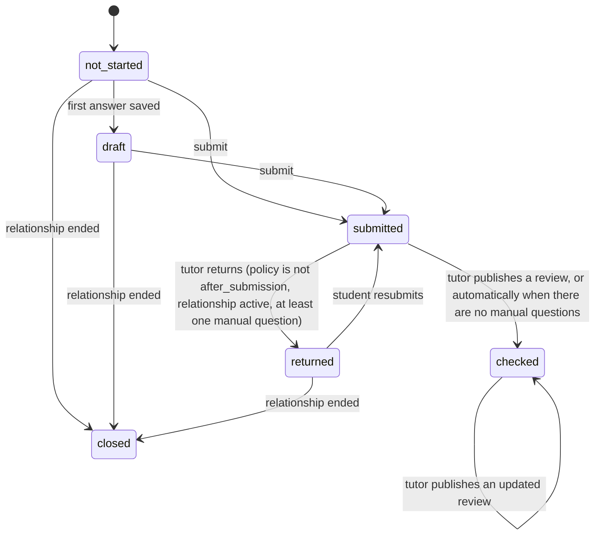

# Homework specification

Behavior for FR-6 to FR-11: library, builder, issuing, completing, checking, results and analytics. Entities are in the [data model](data-model.md#homework); routes are in the [API](api.md#homework); files are shared through [attachment references](files.md#references).

## Library

- **Contents:** a tutor's library holds **materials** (an uploaded file with a title) and **templates** (an assignment with a title and blocks).
- **Folders** nest at most three levels deep. Every item is in exactly one folder, or at the root (no folder). Moving a folder into itself or its descendants, or beyond the depth limit, is refused with `validation_failed`.
- **Search** is a substring match on titles after [text normalisation](#short-answer-normalisation), across all folders.
- **Templates** can be duplicated, edited and deleted at any time:
  - a duplicate shares its files with the original through new references;
  - deleting a template removes its own references, so files used only by it are released;
  - issued work keeps its snapshot ([issuing](#issuing)).
- **Deleting a material** removes it from the library. Snapshots, lessons and blocks that reference its file keep their references, and the file stays in storage and in the tutor's quota until its last reference is gone.

## Assignment blocks

An assignment is a title (1–200 characters) and an ordered list of 1 to 100 blocks.

| Block | Fields | Checked |
|---|---|---|
| `instruction` | text in the [restricted Markdown subset](#restricted-markdown), up to 10,000 characters | — |
| `material` | a reference to a library material | — |
| `single_choice` | prompt; 2–10 options, exactly one correct; points; explanation | automatically |
| `multiple_choice` | prompt; 2–10 options, at least one correct; points; scoring `all_or_nothing` (default) or `partial`; explanation | automatically |
| `short_text` | prompt; 1–20 accepted answers; points; explanation; student answers up to 500 characters | automatically, after normalisation |
| `short_number` | prompt; value and absolute tolerance ≥ 0, as decimal strings with at most 6 fractional digits; points; explanation | automatically, in exact decimal arithmetic |
| `long_text` | prompt; maximum length up to 20,000 characters; points; explanation | by the tutor |
| `file` | prompt; allowed kinds (images, PDF, office documents, audio); maximum file count 1–5; points; explanation | by the tutor |

- **Prompts** use the restricted Markdown subset and may attach up to 3 images. Option texts are plain text up to 500 characters.
- **Points** are integers from 0 to 100 per question. The assignment's maximum is the sum. A template whose maximum is 0 (content only, or all questions worth 0) can be issued; the tutor sees its score as "not scored". Students never see points ([answer visibility](#answer-visibility)).
- **Explanations** are optional restricted Markdown, shown only when [answers are visible](#answer-visibility).
- **Scoring of `multiple_choice`:**
  - **All or nothing:** the full points when the selected set equals the correct set exactly, otherwise 0.
  - **Partial:** `floor(points × max(0, correct_selected − incorrect_selected) / correct_options)`, computed in integers.
- **Unanswered questions** score 0.
- **The builder preview** renders the assignment through the student view with no answers stored.

### Restricted Markdown

Paragraphs, bold, italic, ordered and unordered lists, inline code, code blocks and links (`https` only, opened with `rel="noopener noreferrer"`). No raw HTML, no images except attached ones, no embeds. It is rendered by one sanitising renderer shared by every view.

## Short-answer normalisation

**Text normalisation, version `1`,** is applied identically to accepted answers, to student answers and to search terms:

1. Unicode NFKC, then case folding, then NFKC again, so the result is stable when applied twice.
2. `ё` → `е`.
3. Quotes `«`, `»`, `„`, `“`, `”`, `‟` → `"`; quotes `‘`, `’`, `‚`, `‛`, `′`, `‹`, `›` → `'`.
4. Dashes `‐`, `‑`, `‒`, `–`, `—`, `―`, `−` → `-`.
5. Trim, and collapse every run of whitespace to one space.

A `short_text` answer is correct when its normalised form equals the normalised form of any accepted answer. An accepted answer whose normalised form is empty is refused when the template is saved.

**Number parsing, version `1`,** takes the text normalisation result and then:

1. Removes spaces, including U+00A0, U+202F and U+2009.
2. Accepts at most one decimal separator, `,` or `.`; a text containing both is invalid. Under this rule `1,000` is the number one, following the Russian decimal comma.
3. Requires the whole text to match `^[+-]?[0-9]+([.,][0-9]+)?$`, where `-` also covers `−` and `–` after step 4 above. Anything else, including exponents, `NaN` and `Infinity`, is invalid.
4. Parses the match into an exact decimal.

The answer is correct when `|answer − value| ≤ tolerance` in exact decimal arithmetic. A text that does not parse is incorrect and is kept as entered.

Each stored answer keeps its raw text, its normalised or parsed form and the normalisation version, so a later version never re-scores existing work.

## Issuing

- **An issue** has:
  - a snapshot of the template's title and blocks, holding its own references to every file it shows, with each material's title and attachment identifier copied in;
  - an audience: one `active` relationship, or one non-archived group with at least one member. Otherwise it is refused: `relationship_not_active` for an invited or ended relationship, `audience_not_active` for an archived or empty group;
  - an optional linked lesson of the same tutor and audience, which can be set or changed later;
  - an optional deadline, which must be in the future when set;
  - an [answer visibility policy](#answer-visibility);
  - a flag recording whether the snapshot has manual questions.
- **Retries:** `POST /issues` accepts an `Idempotency-Key` header, so a retried request never creates a second issue.
- **One submission per student** is created in the same transaction: the relationship's student, or every current group member. Students who join the group later get nothing until the tutor issues the template again.
- **The snapshot is immutable.** Template edits and deletions never change it.
- **The tutor may change the deadline later.** Each submission's late flag is then recomputed from its first submission time. The policy is fixed at issue time.
- **Withdrawing:**
  - allowed while no submission has been submitted;
  - it locks the issue row, and every autosave and submission takes the same lock in shared mode and checks the issue status, so a withdrawal never races them;
  - the issue becomes `withdrawn` and its submissions disappear from every list; their routes answer `not_found`;
  - references held by its draft answers are released;
  - `issue.withdrawn` notifies the students.
- **An email and an in-app notification** go to each student when work is issued ([notifications](notifications.md#events)).

## Answer visibility

The policy is one of `never`, `after_submission` or `after_check`. **Correct answers are revealed** to a student when:

- `after_submission`: their submission is `submitted` or `checked`;
- `after_check`: their submission is `checked`;
- `never`: never.

**Tutor review content visible to the student** (comments, corrected files, feedback) comes only from the latest **published** review revision, whatever the policy. Points the tutor sets or overrides stay tutor-only. Overrides apply only to automatic questions. A draft revision is never visible, and its corrected files cannot be downloaded by the student: corrected files are referenced by the revision's own identifier, and students are authorized only through the latest published revision.

| Data | Before submission | After submission, not revealed | Revealed |
|---|---|---|---|
| Prompts, options (identifier and text), their own answers | yes | yes | yes |
| Status (to do, in progress, due soon, overdue, submitted, returned, checked, late) | yes | yes | yes |
| Published review content | no | yes, once published | yes, once published |
| Which options are correct, accepted answers, numeric value and tolerance | no | no | yes |
| Explanations | no | no | yes |
| Any points, totals, overrides, scores or percentages | never | never | never |

**Points are tutor-only** ([ADR-0009](../../docs/decisions/0009-owner-approved-exceptions-and-visibility.md)): no student-facing response, frame, notification or email contains points, totals, overrides, scores or percentages.

- **Because no points reach the student**, nothing reveals the key before the policy allows it ([T-30](../../docs/threat-model.md#threats-and-controls)).
- **Explanations carry no attachments**, so no file reference can reveal them early.
- **Separate schemas:** the student schemas are separate Go structs with no field for points, scores, correctness, accepted answers or explanations. The revealed data is a separate object, added only when the rules above hold.
- **Option identifiers** are random UUIDs, not positions.
- **A contract test** walks every student-facing response, WebSocket frame, notification payload and email for submissions in every state, and fails if any points or score field appears, or any key field appears before reveal.
- **With `after_submission`, returning work is unavailable**, because the student has already seen the answers.

## Submission lifecycle

- **Autosave:** the client sends at most one request per second per submission, carrying every answer changed since the last save, with the submission's version number and a save identifier generated per request.
  - A replayed request whose save identifier the server already applied returns the current state instead of `conflict`.
  - The server accepts at most two requests per second per submission (`rate_limited` beyond) and refuses with:
  - `conflict` for a stale version; the client keeps its unsaved answers and offers to reapply them after reloading;
  - `answer_frozen` for a frozen answer;
  - `not_editable` when the submission is not in an editable state.
- **Submitting:** the student may submit with unanswered questions after a confirmation that lists them.
  - On submission, automatic questions are scored and their answers frozen.
  - `first_submitted_at` is set on the first submission only; `submitted_at` is the latest one.
  - The submission is **late** when its first submission came after the deadline.
  - A `file` question counts as answered with at least one file.
- **Returned work** reopens only the manual questions; automatic answers and scores stay frozen. The published comments stay visible while revising, under every policy.
- **Checked work:** `checked_at` is the first time it became checked. The tutor may publish updated review revisions. They notify the student with `submission.review_updated` only when student-visible content (comments, corrected files, feedback) changed, so a points-only change reveals nothing.
- **Closed** submissions are read-only and excluded from "to do" lists.
- **After a relationship ends**, `submitted` work can still be checked but not returned.
- **A student removed from a group** keeps their open work and may still submit it while their relationship is active.
- **Replacing a file answer** releases the reference to the old file.

## Scoring and review

- **The review queue** lists submissions in `submitted` status whose issue has manual questions, oldest `first_submitted_at` first, across all of the tutor's issues, with filters by issue, student and group.
- **The review screen** shows the student's answers question by question. For each question the tutor can:
  - set points for manual questions (0 to the question's points);
  - override an automatic score with points in the same range and a reason;
  - comment;
  - attach up to 5 corrected files to a `file` answer.

  The tutor also writes overall feedback in restricted Markdown.
- **A review has numbered revisions**, each with its own identifier.
  - A new draft starts as a copy of the latest published revision, including new references to its corrected files; a corrected file removed from the draft loses that draft's reference.
  - The tutor edits the draft, saved with `PUT`, and publishes it by naming the draft's revision number:
  - **checking** (`POST /check`), which requires points for every manual question;
  - **returning** (`POST /return`), which requires at least one comment or overall feedback.

  Publishing the same revision again is idempotent; publishing a revision number that is not the current draft is refused with `conflict`. Publishing a new revision of checked work updates the student's results.
- **Refusals:** reviewing work that is `not_started`, `draft` or `closed`, or returning work that is `returned`, is refused with `not_editable`.
- **The final score** is the sum over questions of: the override if present, otherwise the tutor's points for manual questions, otherwise the automatic points.
- **The percentage** is final score ÷ maximum × 100, rounded half up to an integer. It is absent ("not scored") when the maximum is 0.
- **Correctness** of an automatic question is stored with the answer as a boolean when it is scored. A tutor override changes the question's points, not its stored correctness.

## Analytics

Visible only to the issuing tutor and computed on read from final scores, with a fixed number of queries that does not grow with the number of submissions or questions ([NFR-2.6](../../docs/requirements/non-functional.md#nfr-2-performance)).

- **Per issue:**
  - students with `first_submitted_at` set ("submitted"), checked, returned and late counts, and the total number of students;
  - average percentage over `checked` submissions, absent when the maximum is 0;
  - for each automatic question, the share of submitted submissions whose final points for it, after any override, equal its points; for questions worth 0 points the stored correctness is used instead; unanswered counts as not correct;
  - for each manual question, the average points over checked submissions;
  - for choice questions, the count of each option among submitted answers;
  - for `short_text`, the 10 most frequent normalised answers with counts, ties ordered alphabetically.
- **Per student**, on the student card: checked submissions with issue title, check date, final score and percentage, newest first, keyset paginated.
- **Deleted students** are removed from analytics at purge.
