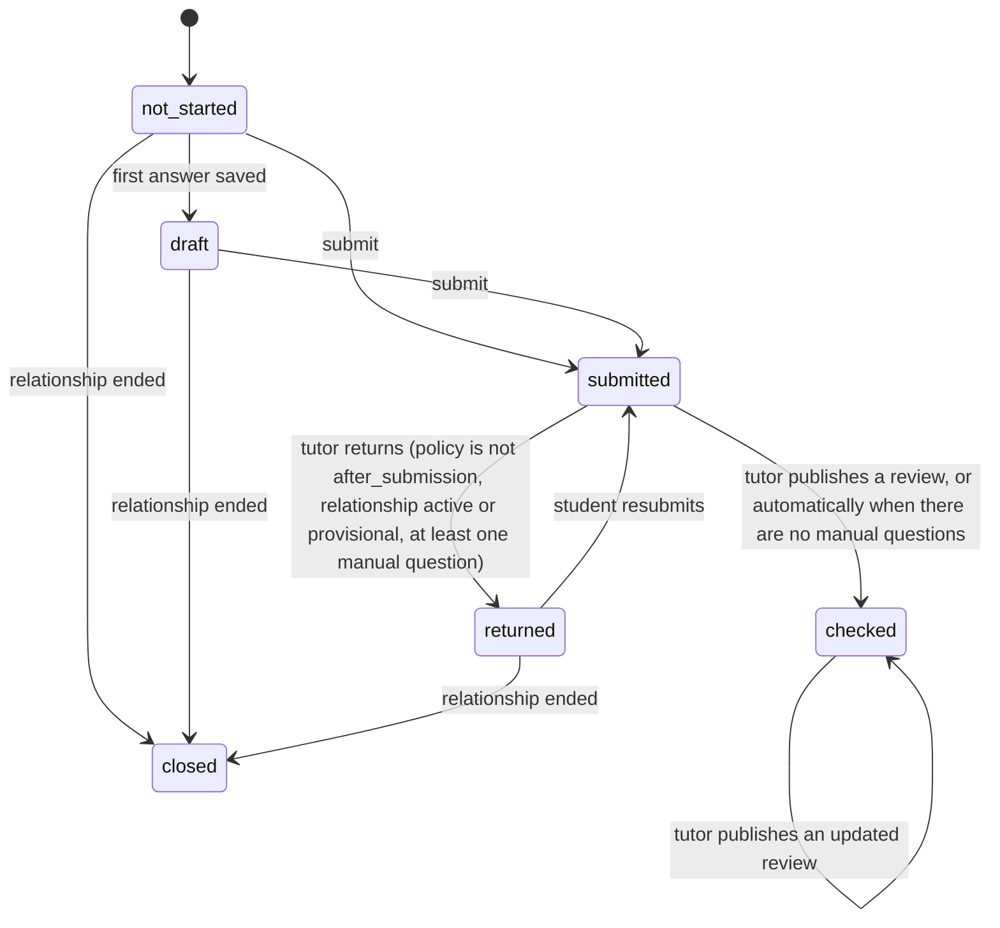

# Homework specification

Behavior for FR-6 to FR-11: library, builder, issuing, completing, checking, results and analytics. Slice 8 builds the library, the builder and the preview; slice 9 builds issuing, completing and checking ([slice 9 plan](../plans/slice-9.md)), with the per-submission results on the assignment page; analytics comes after the MVP. Entities are in the [data model](data-model.md#homework); routes are in the [API](api.md#homework); files are shared through [attachment references](files.md#references).

## Library

Built in slice 8 ([slice 8 plan](../plans/slice-8.md)) by `internal/services/library`, which owns folders, materials, templates and the template's student projection. Routes are in the [API](api.md#homework); rows in the [data model](data-model.md#homework).

- **Contents:** a tutor's library holds **materials** (an uploaded file with a title) and **templates** (an assignment with a title and blocks).
- **Tutor-only:** library rows belong to one tutor. Every library route resolves every identifier, in the path, the query or the body, within the caller's own library and answers `404 not_found` otherwise, with the same body as a random identifier; a student gets `404` for the role, as on every tutor route. Library routes are open to a tutor whose email is not confirmed (`unverified ok`), because an unconfirmed tutor shares nothing with anyone; uploads of the `library` and `prompt_image` contexts are the exception and need a confirmed email ([contexts and limits](files.md#contexts-and-limits)).
- **Locks and the session:** every library write locks the tutor's user row and then the tutor's profile, in the general lock order, before any other row, and answers `401 unauthenticated`, changing nothing, unless the tutor is `active` or `unverified` under those locks, with the session re-check of [locks and the session re-check](accounts.md#locks-and-the-session-re-check), so a write that waited on a reclaim sees its revoked session (the owner's decision of 2026-11-10 during slice 8 change B3); a write that creates or removes a quota charge then follows the charge lock order of the [quotas](files.md#quotas). The profile lock also serialises folder moves, so the depth and cycle checks below cannot race.
- **Per-tutor caps:** at most 1,000 folders, 10,000 materials that are not deleted, 2,000 templates that are not deleted, and 50,000 material and template rows in all, deleted ones included until the purge. A creation or duplicate beyond any cap answers `422 validation_failed` (`body`, `too_many`), counted under the profile lock. The block JSON of all the tutor's templates together holds at most 64 MiB, the sum of their stored `blocks_bytes` (deleted templates hold none, below); a create, save or duplicate that would pass it answers `422 validation_failed` (`body`, `too_many`), checked under the profile lock (the owner's decision of 2026-11-10 during the slice 8 contract change). The caps and the budget are constructor settings, so tests use small ones ([T-20](../../docs/threat-model.md#threats-and-controls)).
- **Write rates:** at most 600 library writes per tutor per hour (rate-limit purpose `library_writes_hour`): every create, edit, move, duplicate and delete of a folder, material or template, except template saves. Template saves (`PUT /library/templates/{id}`) count only toward their own limits: at most 2 per second per template (`template_saves_second`) and 3,600 per tutor per hour (`template_saves_hour`). Beyond any of them the answer is `429 rate_limited` with `Retry-After`. Slots are reserved as for lesson writes ([scheduling limits](schedule.md#scheduling-limits)): in their own committed step under the profile lock, after the audience, the schema checks and the replay of a repeated `Idempotency-Key`, before every check of the service, and kept when the request is later refused; a replay found at admission and a `429` itself use none.
- **Names and titles:** a folder name holds 1 to 100 code points, and a material or template title 1 to 200; both are plain text stored as entered, with their normalised form ([text normalisation](#short-answer-normalisation)) stored beside them. A control character or a Unicode format character (category `Cf`, which includes the bidirectional overrides) answers `422 validation_failed` with the field code `invalid`, as for [file names](files.md#file-names); a value that is empty after trimming, or whose normalised form is empty, answers `required`; one longer than its limit in code points, or whose normalised form holds more than 400 bytes (a folder name) or 800 bytes (a title), answers `too_long`, because text normalisation can expand a value up to about 11 times in bytes and the normalised forms are indexed (slice 8 change B3). They are rendered as text in an element isolated with `dir="auto"`.

### Folders

- **Nesting:** a folder at the root is at level 1, and folders nest at most three levels deep. Every material and template is in exactly one folder, or at the root (`folder_id` null).
- **Creating:** `POST /library/folders {name, parent_id}` (`parent_id: null` for the root) answers `201` with `{id, name, parent_id}`; a parent outside the tutor's library answers `404`, and a parent at level 3 answers `422 validation_failed` (`body.parent_id`, `invalid`).
- **Unique names:** a name is unique among its siblings by its normalised form; a second one answers `422 validation_failed` (`body.name`, `taken`); `taken` is a field code that slice 8 adds to the field-code enum, while no new error code is added.
- **Moving:** `PATCH /library/folders/{id}` takes `{name?, parent_id?}` (`parent_id: null` moves the folder to the root). A parent outside the tutor's library answers `404`. Moving a folder into itself or one of its descendants, or so that any folder of its subtree would end deeper than level 3, answers `422 validation_failed` (`body.parent_id`, `invalid`). The checks read the tree under the profile lock.
- **Deleting:** only an empty folder is deleted: one with no child folder and no material or template that is not deleted; otherwise `409 not_editable`. Deleting a material or template sets its `folder_id` to null, so a deleted item never blocks or breaks a folder deletion. A deleted folder leaves the table at once, as the data model's rule for pure link rows allows, so a repeated delete answers `404`.
- **Every folder:** `GET /library/folders` answers every folder of the tutor, unpaginated (bounded by the folder cap), as `{folders: [{id, name, parent_id}]}` ordered by normalised name and identifier, for the folder tree and the Move dialog's destination picker.

### Listing and search

- **`GET /library?folder=&q=&limit=&cursor=`** answers one folder of the library: `folder` is a folder identifier of the tutor (any other answers `404`), and without it the root.
- **The answer** is `{folder: {id, name, parent_id} | null, path: [{id, name}], folders: [{id, name, parent_id}], items: [LibraryItem], next_cursor, template_count}`:
  - `path` lists the folder's path from the root, the folder itself included (at most three entries, empty at the root), and `folders` its child folders, unpaginated (bounded by the folder cap), ordered by normalised name and identifier;
  - `items` holds the folder's materials and templates that are not deleted, keyset paginated (`limit` default 30, maximum 100) on `(normalised_title COLLATE "C", kind, id)`;
  - a `LibraryItem` is `{kind: material | template, id, title, folder_id, path, updated_at}` plus, for a material, `{attachment_id, filename, media_type, size_bytes, width, height, url, expires_at}`, where `url` and `expires_at` are an `inline` download address minted for this response for a picture with recorded dimensions and `null` for every other file, which the client downloads through [`GET /attachments/{id}`](files.md#downloads) with `ref=material:<id>`; and, for a template, `{question_count, max_points, ready, version}`, the `version` that a move sends back; `path` is `null` here;
  - `template_count` is the number of the tutor's templates that are not deleted, which Today's first-run checklist reads with `limit=1` ([pages](../design/web/pages.md#today)).
- **Search:** with `q` (1 to 200 code points), the answer holds every matching material and template across all folders instead, in the same order and pagination, each with `path`, its folder's path from the root including the folder itself (at most three entries, empty at the root); `folder` is then `null`, `path` and `folders` are empty, and a `folder` parameter given with `q` answers `422 validation_failed` (`query.folder`, `not_allowed`). `q` is normalised by text normalisation version 1 and matched as a substring of the normalised title, with `%`, `_` and `\` escaped, so they match literally; a `q` that normalises to empty answers `422 validation_failed` (`query.q`, `required`). The scan reads the tutor's rows through the `(tutor_id, normalised_title, id)` indexes, without a trigram index; the caps bound it.
- **Live data:** library data belongs to one tutor, so no frame announces its changes; another tab of the same tutor meets a stale template save as `conflict`, and the other library pages refetch on their next visit ([live refetch mapping](../architecture/detailed.md#live-refetch-mapping)).

### Materials

- **Creating:** `POST /library/materials {attachment_id, title, folder_id}` binds the caller's own `pending` upload of the `library` context whose 24-hour expiry has not passed, creating its `material` reference and, when the tutor holds no charge for the attachment yet, the charge (`507 quota_exceeded` when the usage would pass the quota). Any other attachment identifier, and a `folder_id` outside the tutor's library, answer `404`, like a random one. It answers `201` with the material as a `LibraryItem`.
- **Editing:** `PATCH /library/materials/{id} {title?, folder_id?}` renames and moves (`folder_id: null` moves to the root); the file is never replaced. A field equal to its current value is no change, and an edit that changes nothing answers the current state.
- **Deleting:** `DELETE /library/materials/{id}` sets `deleted_at`, sets `folder_id` to null and removes the material's own reference, releasing its charge and queueing the file's `storage_delete` when that was the file's last reference; it answers `204`, also when repeated. Templates, lessons, series and issue snapshots that use the file keep their own references, so it stays in storage and in the tutor's quota until its last reference is gone, and a lesson keeps showing the material under its last title. A deleted material is not listed, is not found by search and answers `404` to `PATCH`.

### Templates

- **Creating:** `POST /library/templates {title, folder_id, blocks}` with an `Idempotency-Key` header (1 to 64 characters of `^[A-Za-z0-9._-]{1,64}$`), stored per tutor as `create_key`: a repeated key answers `201` with the template it created, as it is now, whatever the body, and uses no rate slot; a key whose template was since deleted answers `404`. `blocks` may be empty, and is validated and bound as a save is. The builder's "New assignment" sends the localised title "New assignment" and no blocks.
- **Reading:** `GET /library/templates/{id}` answers the tutor's template schema: `{id, title, folder_id, blocks, version, ready, problems, question_count, max_points, created_at, updated_at}`, with answer keys, explanations and points, every prompt image and material block carrying a download address minted per response, bound to the `template` reference kind: `inline` for a picture with recorded dimensions and `attachment` for every other file (slice 8 change B4).
- **Autosave:** `PUT /library/templates/{id} {title, blocks, version, save_id}` replaces the title and the blocks, conditionally on `version`, and increments it. `save_id` is a version 4 UUID generated per request; a request whose `save_id` equals the stored `last_save_id` answers the current state instead of `conflict`, as submission autosave does ([submission lifecycle](#submission-lifecycle)). A stale `version` answers `409 conflict`. It answers the template schema of `GET`. The client saves one second after the last change, with at most one request in flight, and flushes the pending save before it opens the preview.
- **Moving:** `PATCH /library/templates/{id} {folder_id, version}` moves the template to another folder (`folder_id: null` for the root), conditionally on `version`, which it increments (`409 conflict` for another one), and answers the template schema of `GET`; a `folder_id` outside the tutor's library answers `404`, and a move to the current folder is no change. It counts toward the 600 library writes, not toward the template save limits (the owner's decision of 2026-11-10 during the slice 8 contract change). Because it increments `version`, a builder open in another tab meets its next save as `conflict` and offers Reload. The title changes only through a save in the builder, so the library offers no Rename for templates.
- **Duplicating:** `POST /library/templates/{id}/duplicate {title, folder_id}` creates a template with a copy of the blocks, their block and option identifiers kept, and a new `template` reference for every attachment they show, so no bytes are copied and no charge is created (the tutor already holds one); it answers `201` with the new template. The client proposes the localised title "{title} (copy)" cut to 200 code points.
- **Deleting:** `DELETE /library/templates/{id}` sets `deleted_at`, sets `folder_id` to null, replaces `blocks` with an empty list and `blocks_bytes` with 0 (issued work lives in its own snapshot, so nothing reads a deleted template's blocks; the owner's decision of 2026-11-10 during the slice 8 contract change) and removes the template's references, releasing every file used only by it; it answers `204`, also when repeated. Issued work keeps its snapshot ([issuing](#issuing)).
- **Size:** a template's request body stays within the 1 MiB JSON limit of the [API conventions](api.md#conventions), which the per-block limits alone would allow it to exceed; a larger body answers `413 payload_too_large`, which the builder shows as "This assignment is too large to save".
- **Caching:** every library response sends `Cache-Control: no-store`, because it carries answer keys or download addresses.

## Assignment blocks

An assignment is a title of 1 to 200 code points and an ordered list of at most 100 blocks; a template may be saved with no blocks or with incomplete questions ([validation](#validation)), and only a [ready](#validation) template can be issued.

| Block | Fields | Checked |
|---|---|---|
| `instruction` | text in the [restricted Markdown subset](#restricted-markdown), up to 10,000 code points | — |
| `material` | a reference to a library material | — |
| `single_choice` | prompt; 2–10 options, exactly one correct; points; explanation | automatically |
| `multiple_choice` | prompt; 2–10 options, at least one correct; points; scoring `all_or_nothing` (default) or `partial`; explanation | automatically |
| `short_text` | prompt; 1–20 accepted answers of up to 500 code points each; points; explanation; student answers up to 500 characters | automatically, after normalisation |
| `short_number` | prompt; value and absolute tolerance ≥ 0, as decimal strings with at most 6 fractional digits; points; explanation | automatically, in exact decimal arithmetic |
| `long_text` | prompt; maximum length from 1 to 20,000 characters; points; explanation | by the tutor |
| `file` | prompt; allowed kinds, a non-empty subset of `images`, `pdf`, `office` and `audio`; maximum file count 1–5; points; explanation | by the tutor |

- **Prompts** use the restricted Markdown subset, hold up to 10,000 code points and may attach up to 3 images. Option texts are plain text up to 500 code points.
- **Points** are integers from 0 to 100 per question. The assignment's maximum is the sum. A template whose maximum is 0 (content only, or all questions worth 0) can be issued; the tutor sees its score as "not scored". Students never see points ([answer visibility](#answer-visibility)).
- **Explanations** are optional restricted Markdown of up to 10,000 code points, shown only when [answers are visible](#answer-visibility).
- **Scoring of `multiple_choice`:**
  - **All or nothing:** the full points when the selected set equals the correct set exactly, otherwise 0.
  - **Partial:** `floor(points × max(0, correct_selected − incorrect_selected) / correct_options)`, computed in integers.
- **Unanswered questions** score 0.

### Block schema

From slice 8. One `TemplateBlock` struct carries `id`, `type` and the optional fields of every type; a field that does not belong to the block's type answers `422 validation_failed` with the field code `not_allowed`. The frontend parses blocks into a discriminated union at the boundary in `features/builder`.

| Field | Types | Request | Response additions |
|---|---|---|---|
| `id` | all | a version 4 UUID generated by the client (`crypto.randomUUID`), unique within the template | — |
| `type` | all | one of the eight block types | — |
| `text` | `instruction` | string, 0 to 10,000 code points | — |
| `material_id` | `material` | a material identifier of the tutor, required | `material: {material_id, attachment_id, title, filename, media_type, size_bytes, width, height, deleted, url, expires_at}` with the material's current title |
| `prompt` | question types | string, 0 to 10,000 code points | — |
| `image_ids` | question types | 0 to 3 attachment identifiers, without repeats, each a picture (JPEG, PNG, WebP or GIF) | `images: [{attachment_id, filename, media_type, size_bytes, width, height, url, expires_at}]` in the same order |
| `options` | `single_choice`, `multiple_choice` | 0 to 10 `{id, text, correct}`: `id` a version 4 UUID unique within the template, `text` 0 to 500 code points, `correct` a boolean | — |
| `scoring` | `multiple_choice` | `all_or_nothing` or `partial`, required | — |
| `accepted_answers` | `short_text` | 0 to 20 strings of up to 500 code points | — |
| `value`, `tolerance` | `short_number` | strings of up to 64 code points | — |
| `max_length` | `long_text` | integer from 1 to 20,000, required | — |
| `allowed_kinds` | `file` | a non-empty set of `images`, `pdf`, `office`, `audio`, without repeats, required | — |
| `max_files` | `file` | integer from 1 to 5, required | — |
| `points` | question types | integer from 0 to 100, required | — |
| `explanation` | question types | string, 0 to 10,000 code points, optional | — |

Field paths name the block by its position, for example `body.blocks[3].options[1].text` with `too_long`; a repeated block or option identifier answers `invalid` at the second occurrence's `id`. Duplicating a template keeps its identifiers, because they are unique only within a template; the builder's per-block Duplicate copies a block in the client with fresh block and option identifiers. From slice 9 each issue's snapshot replaces every option identifier with a fresh random one, so two issues of one template under different answer policies never share them ([the snapshot](#the-snapshot)).

### Validation

Two levels, so autosave never fails while the tutor types because a question is incomplete (the owner's decision of 2026-11-10 in the [slice 8 plan](../plans/slice-8.md#4-owner-questions)):

- **Structural rules** always refuse a save with `422 validation_failed` and field paths: the title's bounds, block and field types, identifiers, `not_allowed` fields, the upper bound of every count and length above, the required fields of the schema, points from 0 to 100, at most 100 blocks, at most 3 images per prompt, and attachments and materials that may be referenced ([template references](#template-references)).
- **Completeness rules** never refuse a save. They are answered as `problems: [{block_id, code}]` beside the template, in block order (`block_id` null for the template itself), and the template's `ready` is true exactly when there are none:

  | Code | When |
  |---|---|
  | `no_blocks` | the template has no blocks (`block_id` null) |
  | `text_missing` | an instruction whose text is empty after trimming |
  | `prompt_missing` | a question whose prompt is empty after trimming |
  | `too_few_options` | a choice question with fewer than two options |
  | `option_empty` | a choice option whose text is empty after trimming |
  | `correct_count` | a single choice without exactly one correct option |
  | `no_correct_option` | a multiple choice without a correct option |
  | `no_accepted_answer` | a short text without an accepted answer |
  | `accepted_answer_empty` | a short text with an accepted answer whose normalised form is empty |
  | `value_invalid` | a value that is not a decimal of at most 6 fractional digits (`^[+-]?[0-9]+(\.[0-9]{1,6})?$`) |
  | `tolerance_invalid` | a tolerance that is not such a decimal, or is negative |

- **Field codes** (slice 8 change B4): a count above its bound (blocks, options, accepted answers, prompt images) answers `too_many` at the list; a string above its bound answers `too_long`; a number outside its range (points, `max_length`, `max_files`), an unknown `scoring`, an empty or repeating `allowed_kinds`, a malformed or repeated identifier and a string holding the null character, which the database's JSON type cannot store, answer `invalid`; a missing required field answers `required`, and an option without `correct` is a missing required field. Identifiers are stored in their lowercase canonical form.
- **Order of checks of a save** (slice 8 change B4): the template (`404`, also a deleted one), the replay of `save_id`, the `version` (`409`), the structural rules (`422`), the attachments and materials the blocks name (`404`), the block JSON budget (`422`, `too_many`), then the quota (`507`). A create checks the folder (`404`) first and the template caps beside the budget.
- **Stored summary:** every save writes the template's `question_count` (blocks of the six question types), `max_points`, `ready`, `blocks_bytes` (the byte length of its stored block JSON) and `updated_at`, so the library list never parses block JSON.
- **Issuing** a template that is not ready answers `409 not_editable` ([creating an issue](#creating-an-issue)).

### Template references

- A template holds one `template` reference per distinct attachment its blocks show: its prompt images and the files of its material blocks.
- A save computes the new set. An attachment may appear in `image_ids` only when it is a picture (JPEG, PNG, WebP or GIF) of the `prompt_image` context that the template already references or that is the caller's own `pending` upload described next (any other file answers `404` at its position, like a random identifier), and in a material block only as the file of the block's material, already referenced or newly allowed as below; when it is the caller's own `pending` upload of the `prompt_image` context whose 24-hour expiry has not passed; or, in a material block, when it is the attachment of a material of the tutor that is not deleted, named by the block's `material_id`. A block naming a deleted material is kept only when the template already references that material's file. Anything else answers `404 not_found`, like a random identifier, whatever position it holds.
- The save then adds and removes references and charges in the same transaction, under the profile lock and the charge lock order; a removed last reference queues the file's `storage_delete`. Removed references are released before newly bound uploads are charged, so replacing a picture with one of the same size succeeds at the quota (slice 8 change B4). A removed prompt image is therefore released at once; the builder keeps the picked file in memory until the page closes and uploads it again when the removal is undone.

### Builder preview

- **`GET /library/templates/{id}/student-view`** answers the template through the student content schema that slice 9 reuses for issued work (the owner's decision of 2026-11-10 in the [slice 8 plan](../plans/slice-8.md#4-owner-questions)): `{title, blocks}`, where each block holds only `id`, `type`, and as its type has them `text`, `prompt`, `options: [{id, text}]`, `max_length`, `allowed_kinds`, `max_files`, `material: {title, filename, media_type, size_bytes, width, height, url, expires_at}` and `images: [{filename, media_type, size_bytes, width, height, url, expires_at}]`.
- The schema is a separate Go struct with no field for correctness, accepted answers, value, tolerance, explanations, points, `max_points`, `ready`, `problems`, the `multiple_choice` scoring mode (points data under [ADR-0009](../../docs/decisions/0009-owner-approved-exceptions-and-visibility.md)), `material_id` or `attachment_id`.
- **Its test is an allowlist:** for a seeded template holding every block type, it asserts the exact set of keys of every object in the response (the top level, each block per type, each option, each material entry and each prompt-image entry), failing on any other key, and asserts that no string in the response contains any of the distinctive sentinel accepted answers, numeric values, tolerances or explanations seeded in that template. It decodes the response recursively into `map[string]json.RawMessage`, without `any` or `reflect`, and its allowed key sets are literals taken from this section, not derived from the struct. It starts the [answer-key contract test](#the-answer-key-contract-test) of slice 9.
- **The builder** flushes autosave before it opens the preview, and renders the answer in the student view's components.

### Restricted Markdown

Paragraphs, bold, italic, ordered and unordered lists, inline code, code blocks and links (`https` only, opened with `rel="noopener noreferrer"`). No raw HTML, no images except attached ones, no embeds. It is rendered by one renderer shared by every view.

- **The renderer** (from slice 8; the owner's decision of 2026-11-10 in the [slice 8 plan](../plans/slice-8.md#4-owner-questions)) is OVC's own small parser in `frontend/src/lib/markdown/`, with no dependency, producing React elements and never an HTML string, so the lint rules against unsafe DOM sinks stay unweakened.
- **Links** are kept only when the URL parser yields `https:` with a host and no user information; they open with `target="_blank"` and `rel="noopener noreferrer"`, and anything else, a raw HTML tag included, renders as text.
- **Blocks and nesting:** fenced code blocks open with three or more backticks or tildes; a line break inside a paragraph or a list item is kept as a line break; lists do not nest, so a marker indented by up to three spaces with the list's own bullet or delimiter continues the list, a marker of another kind starts a new list, and a line indented further continues the item's text; emphasis and links nested deeper than eight levels render as plain text, which bounds the depth of the rendered tree.
- **Tests** run an injection corpus (raw HTML, `javascript:` and `data:` links, nested emphasis, unbalanced markers) and count the parser's steps on 10,000-character adversarial inputs, which must stay within a fixed multiple of the input length; there is no wall-clock bound.
- Lesson descriptions stay plain text ([schedule](schedule.md#titles-and-descriptions)).

## Short-answer normalisation

**Text normalisation, version `1`,** is applied identically to accepted answers, to student answers and to search terms:

1. Unicode NFKC, then case folding, then NFKC again, so the result is stable when applied twice. Case folding follows the Unicode case folding table, which folds Cherokee letters to their uppercase forms; `golang.org/x/text/cases` folds them to lowercase instead, so Cherokee letters are mapped to uppercase after it (the owner's decision of 2026-11-10 during the change that implements this rule).
2. `ё` → `е`, repeated after canonical composition until no `ё` remains, because an `е` followed by a combining diaeresis left in the text composes into `ё` again (the owner's decision of 2026-11-10 during the change that implements this rule).
3. Quotes `«`, `»`, `„`, `“`, `”`, `‟` → `"`; quotes `‘`, `’`, `‚`, `‛`, `′`, `‹`, `›` → `'`.
4. Dashes `‐`, `‑`, `‒`, `–`, `—`, `―`, `−` → `-`.
5. Trim, and collapse every run of whitespace to one space.

A `short_text` answer is correct when its normalised form equals the normalised form of any accepted answer. An accepted answer whose normalised form is empty is a completeness problem of the template (`accepted_answer_empty`), which keeps it from being issued ([validation](#validation)).

From slice 8 both rules live in `internal/domain` as pure functions with unit tests for every step, idempotence and the Russian cases: text normalisation uses `golang.org/x/text/unicode/norm` for NFKC and `golang.org/x/text/cases` for case folding, and number parsing parses into `math/big` rationals, so slice 9 needs no new parser ([stack](../architecture/detailed.md#stack-per-component)).

**Number parsing, version `1`,** takes the text normalisation result and then:

1. Removes spaces, including U+00A0, U+202F and U+2009.
2. Accepts at most one decimal separator, `,` or `.`; a text containing both is invalid. Under this rule `1,000` is the number one, following the Russian decimal comma.
3. Requires the whole text to match `^[+-]?[0-9]+([.,][0-9]+)?$`, where `-` also covers every dash of step 4 above. Anything else, including exponents, `NaN` and `Infinity`, is invalid.
4. Parses the match into an exact decimal.

The answer is correct when `|answer − value| ≤ tolerance` in exact decimal arithmetic. A text that does not parse is incorrect and is kept as entered.

Each stored answer keeps its raw text, its normalised or parsed form and the normalisation version, so a later version never re-scores existing work.

## Issued work

From slice 9 one service, `internal/services/homework`, owns issues, submissions, answers, scoring, reviews and the student projections of issued work ([module map](../architecture/detailed.md#backend-backend)). It reads templates only through a narrow interface that `internal/services/library` implements (a template's tutor schema and its references), so the library keeps its own repository. The pure rules, [scoring](#scoring-rules), the [percentage](#scoring-rules), the [submission state machine](#submission-lifecycle) and the [reveal rule](#reveal-rule), live in `internal/domain` with unit tests; nothing else of this section is unit-tested, and the rest is proven by integration tests through the real API, worker, PostgreSQL and local S3-compatible server. Routes are in the [API](api.md#homework), rows in the [data model](data-model.md#issue), uploads and downloads in the [files specification](files.md#contexts-and-limits), events in the [notifications](notifications.md#events), frames in the [live updates](realtime-and-video.md#in-app-notifications-and-live-updates).

- **Caching:** every homework route answers `Cache-Control: no-store`, because its responses carry answer keys, answers or download addresses.
- **Scope:** every identifier in a path, the query or a body resolves within the caller's scope and answers `404 not_found` otherwise, with the same body as a random identifier: for a tutor within their own issues that are not marked for erasure, templates, lessons, groups and cards; for a student within the submissions the [readability predicate](#student-readability) lets them read. A second tutor's issue, a second student's submission, an issue marked for erasure and its submissions (for both roles, [erasure](#erasure-of-a-dropped-provisional-link)), and a withdrawn or erased issue's submission for the student answer alike.
- **Refusal order** of every homework route: the role; `403 email_not_verified` for the routes not marked `unverified ok`; parsing and schema (`400`, `413`, `422`); the replay of a repeated `Idempotency-Key` on `POST /issues`; the session under the first lock (`401`); `429 rate_limited`; the identifiers' scope and readability (`404`); then the route's own replay (a repeated `save_id` of an autosave or a review draft save, a repeated submission of `submitted` or `checked` work, the same published revision number of a check or return), which answers the current state; then the state refusals (`409`, in the order each route below states); then the remaining validation (`422`); then the quota (`507`). Every per-route order below follows it, except that autosave and review draft saves resolve the files they bind (`404`) after their structural `422`, as their orders state.
- **Names:** every tutor surface names a student by the card's own display name, never the live account name ([T-44](../../docs/threat-model.md#threats-and-controls)); every student surface names the tutor by the tutor's account name with the relationship colour.
- **Titles, answers, comments and feedback** are rendered as text in an element isolated with `dir="auto"`, except feedback, which goes through the one [restricted Markdown](#restricted-markdown) renderer; file names follow [file names](files.md#file-names).

## Issuing

### Creating an issue

`POST /issues {template_id, audience, lesson_id, deadline_at, answer_policy}` with an `Idempotency-Key` header (1 to 64 characters of `^[A-Za-z0-9._-]{1,64}$`), stored per tutor as `issue.create_key`: a repeated key answers `201` with the issue it created, as it is now, whatever the body, and uses no rate slot. The route is open to tutors only and needs a confirmed email (`403 email_not_verified` otherwise). It answers `201` with the [tutor's issue](#tutor-reads).

- **The template** must be the tutor's, not deleted (`404` otherwise) and [ready](#validation); a template with completeness problems answers `409 not_editable`, a state refusal with no code of its own.
- **The audience** is `{relationship_id}` or `{group_id}`, exactly one:
  - one `active` relationship, or one `provisional` relationship, directly and never through a group: a provisional student gets work only from the one tutor who linked them, gets no email while unconfirmed, cannot upload file answers until confirmed, and loses the work when the link is dropped ([erasure of a dropped provisional link](#erasure-of-a-dropped-provisional-link)); an invited, `ended` or `reclaim_pending` relationship answers `409 relationship_not_active`, and a discarded one or one outside the tutor's scope `404`;
  - or one non-archived group of the tutor with at least one member; an archived or empty group answers `409 audience_not_active`.
- **The linked lesson** (`lesson_id`, nullable) names a lesson of the same tutor and the same audience (the relationship's one-to-one lessons, or the group's lessons) in any status; anything else answers `404`.
- **The deadline** (`deadline_at`, nullable) must be later than the injected clock's now; otherwise `422 validation_failed` (`body.deadline_at`, `invalid`).
- **The answer visibility policy** is `never`, `after_submission` or `after_check` ([answer visibility](#answer-visibility)) and never changes after issuing.
- **Refusal order:** the role, `403 email_not_verified`, parsing and schema (`400`, `413`, `422`), the replay of a repeated `Idempotency-Key` (`404` when the issue it created is now marked for erasure), the session under the profile lock (`401`), `429`, the identifiers' scope (`404`), the state refusals (`409 not_editable`, `relationship_not_active`, `audience_not_active`, then `409 conflict` when the group's members changed again under the locks after the one retry of [locks of issuing](#locks-of-issuing)), the remaining validation (`422`, including `too_many` from the [bounds](#issue-bounds)).

### Locks of issuing

Issuing locks the tutor's profile with the session re-check of [locks and the session re-check](accounts.md#locks-and-the-session-re-check) (`401 unauthenticated`, changing nothing, unless the tutor is `active`), then the audience's relationships `FOR SHARE` in identifier order, re-reading the group's members and each relationship's state under those locks, as the [schedule's per-path lock rules](schedule.md#locks-and-jobs) do for lesson audiences: the members must equal the locked set, otherwise the request retries once with the new set and then answers `409 conflict`, changing nothing, and a relationship no longer in an issuable state answers as issuing to it would. So a concurrent ending either waits for the issue or is seen and excludes that student; then the group, the linked lesson, the issue and its submissions. The members are re-read before the group's lock, not under it; that suffices because every writer of a group's membership either holds the tutor's profile lock, which issuing holds first, or takes the relationship `FOR UPDATE`, which waits for issuing's `FOR SHARE` (aligned with the code on 2026-11-15 at the slice 9 review). The homework rows' place in the general lock order and every other homework path's locks are in [locks and the session re-check](accounts.md#locks-and-the-session-re-check): issues, submissions and review revisions come after lessons, then the attachments and intents of the upload rules; every path that names students as frame or notification recipients (issuing, a deadline or lesson change, withdrawal, publication, closure, marking for erasure) locks those submissions' relationships `FOR SHARE` in identifier order, after the profile lock and before any group, lesson or issue, and decides its recipients by the [readability predicate](#student-readability) under those locks.

### The snapshot

- **Content:** `issue.snapshot` holds the template's title and blocks as they are at issuing, with every option identifier replaced by a fresh random version 4 UUID, block identifiers kept as question identifiers (unique within the snapshot, because they are unique within the template), and each material block's current title and attachment identifier copied in; `max_points`, `has_manual_questions` and `snapshot_bytes` (the byte length of the stored snapshot JSON) are stored beside it.
- **References:** the issue holds one `issue_snapshot` reference (`ref_id` the issue) per distinct attachment the snapshot shows, prompt images and material files. The tutor already holds a charge for each of these files through the template, so issuing creates no charge and needs no quota check; the snapshot keeps its references, and with them the charge, after the template or the material is deleted, and after a withdrawal, until the issue's purge or erasure ([references](files.md#references)).
- **Immutable:** template edits, template deletion and material deletion never change a snapshot or its downloads (FR-6.3, FR-8.2).

### Submissions at issue time

The issue's transaction creates one submission for the relationship's student, or one per current member of the group as re-read under the issuing locks, each `not_started`, carrying `relationship_id` (the student's relationship with the tutor, used for scope, the tutor colour and the ending rules) and copies of the issue's `deadline_at` and `issued_at`. Students who join the group later get nothing until the tutor issues the template again; the group page says so when a member is added.

### Issue bounds

The caps are constructor settings, so tests use small ones ([T-20](../../docs/threat-model.md#threats-and-controls)):

- at most 100 issues created per tutor per hour (rate-limit purpose `issues_hour`);
- at most 600 homework writes per tutor per hour (`homework_writes_hour`): every other issue write (a change, a withdrawal) and every review publication (`check`, `return`); autosaves, submissions and review draft saves count only toward their own limits ([autosave](#autosave), [review drafts](#review-drafts));
- the snapshot JSON of all of a tutor's issues together holds at most 512 MiB, kept as the running total `snapshot_bytes_total` on the tutor profile under the profile lock: issuing increases it, the [cleanup job](#the-cleanup-job)'s erasure and the purge decrease it under the same lock, and a withdrawal never does; an issue that would pass it answers `422 validation_failed` (`body`, `too_many`);
- at most 20 issues link to one lesson, counted under the tutor's profile lock over the lesson's linked issues that are `active` and not marked for erasure, the same ones the [lesson detail](schedule.md#linked-issues) lists; the 21st answers `422 validation_failed` (`body.lesson_id`, `too_many`).

Beyond a rate the answer is `429 rate_limited` with `Retry-After`. Slots are reserved as library writes reserve them ([library](#library)): in their own committed step under the profile lock, after the audience, the schema checks and the replay of a repeated `Idempotency-Key`, before every check of the service, and kept when the request is later refused.

### Changing an issue

`PATCH /issues/{id} {deadline_at?, lesson_id?, version}` changes the deadline or the linked lesson, conditionally on the issue's `version`, which it increments (`409 conflict` for a stale one), and answers the tutor's issue.

- **Refusal order:** the session under the profile lock (`401`), `429` (`homework_writes_hour`), the issue and a newly linked lesson in scope (`404`, also for an issue marked for erasure), `409 not_editable` for a withdrawn issue, `409 conflict` for a stale `version`, then the values (`422`).
- **Locks:** the profile lock with the session re-check, the submissions' relationships `FOR SHARE` in identifier order, a newly linked lesson, then the issue row.
- **The deadline** may be null or later than now (`422 validation_failed`, `body.deadline_at`, `invalid`). A new deadline is copied to every submission and recomputes every submission's `late` from its `first_submitted_at` in the same transaction.
- **The lesson** follows the rules of [creating an issue](#creating-an-issue), including the 20 issues per lesson; `null` unlinks it.
- **The policy** never changes; the body has no field for it. A field equal to its current value is no change, and a change that changes nothing answers the current state.
- A change of a withdrawn issue answers `409 not_editable`, before a stale `version` answers `409 conflict`.

### Withdrawing

`POST /issues/{id}/withdraw` takes the profile lock with the session re-check, the submissions' relationships `FOR SHARE` in identifier order and the issue row. Its refusals come in the general order: `401`, `429` (`homework_writes_hour`), `404` (also for an issue marked for erasure), the repeat's current state, then `409 issue_has_submissions`.

- With any submission whose `first_submitted_at` is set it answers `409 issue_has_submissions` and changes nothing.
- Otherwise the issue becomes `withdrawn` with `withdrawn_at`; its submissions leave every student list and count, and their student routes and download mints answer `404`; the references and charges of their draft file answers are released, each last reference queueing the file's `storage_delete`; the snapshot keeps its references until the purge.
- Each student who could read their submission just before the withdrawal ([student readability](#student-readability)) gets the in-app `issue.withdrawn` and `entity.changed submission`; a `reclaim_pending` or discarded student gets neither.
- Repeating it answers the current state.
- Every autosave and submission takes the issue row `FOR SHARE` and checks its status, so a withdrawal never races them: a withdrawal that commits first makes them answer `404`, and a submission that commits first makes the withdrawal answer `issue_has_submissions`.
- The tutor still reads a withdrawn issue through `GET /issues?status=withdrawn` and `GET /issues/{id}`, and its `issue_snapshot` addresses keep working for the tutor.

### Tutor reads

- **Issues marked for erasure** ([erasure](#erasure-of-a-dropped-provisional-link)) are unreadable to the tutor from the moment they are marked, as they are to the student: they leave every tutor list and progress count (`GET /issues` with every filter, so the student card's and the group page's issued work too, the [review queue](#the-review-queue) and its `count`, and the lesson detail's `issues`), and every tutor route naming them or their submissions answers `404` (`GET /issues/{id}`, `PATCH /issues/{id}`, the withdrawal, the tutor's `GET /submissions/{id}`, review draft saves, check, return and `corrected` uploads), as do the tutor's mints of their `issue_snapshot`, `answer` and `review_item` addresses ([references other than messages](files.md#references-other-than-messages)).
- **`GET /issues?status=active|withdrawn&group=&student=&needs_checking=&deadline_before=&limit=&cursor=`** answers the tutor's issues (`status` default `active`; `limit` default 30, maximum 100):
  - keyset paginated on `(issued_at DESC, id)`; with `deadline_before` (an instant) only active issues whose deadline is still ahead of now and before it, keyset on `(deadline_at, id)`, which Today's upcoming deadlines read;
  - `group` (a group identifier of the tutor) lists that group's issues, which the group page reads; `student` (a relationship identifier of the tutor) lists the issues holding that student's submission, which the student card's Homework tab and Overview read; any other identifier answers `404`; `needs_checking=true` keeps issues with at least one `submitted` submission of an issue with manual questions;
  - each item carries `{id, title, audience, lesson_id, deadline_at, answer_policy, status, issued_at, withdrawn_at, has_manual_questions, max_points, version, progress}`, where `audience` is `{relationship_id, display_name}` or `{group_id, name}` and `progress` is `{students, submitted, checked, returned, late, needs_checking}` (`submitted` counts submissions with `first_submitted_at` set), computed by one aggregate query per page; with `student` each item also carries that student's `submission: {id, status, late, final_points, issued_before_reclaim}`.
- **`GET /issues/{id}`** answers the tutor's issue: the item's fields, the snapshot's `blocks` in the tutor's [block schema](#block-schema) with answer keys, explanations, points and `issue_snapshot` download addresses minted per response (`inline` for a picture with recorded dimensions, `attachment` otherwise), and `submissions: [{id, student: {relationship_id, display_name}, status, late, first_submitted_at, submitted_at, checked_at, final_points, percentage, issued_before_reclaim, has_draft}]` ordered by display name and identifier.
- **The tutor's `GET /submissions/{id}`** for a submission of the tutor's own issue answers the tutor schema: the item's identifiers, the student, status, `late`, `issued_before_reclaim`, `deadline_at`, the timestamps and `version`; the snapshot's blocks with keys and points; `answers: [{question_id, value, normalised, normaliser_version, auto_points, auto_correct, frozen_at, files}]` with `answer` download addresses; `revisions`, every review revision with its number, state, action, feedback, items with points, overrides, reasons, comments and corrected files (`review_item` addresses), its `version` and `published_at`; and the scores `auto_points`, `final_points`, `max_points` and `percentage`. A student gets `404` for another student's submission, and a tutor `404` for another tutor's.

## Student readability

One predicate, `ReadableStudentSubmission`, decides whether a student reads a submission: their own submission, of an issue that is `active` and not marked for erasure (`erase_pending_since` null), whose relationship is `active`, `provisional` or `ended`, never `reclaim_pending` or `discarded`. Work issued while a link was provisional and kept after a reclaim stays readable, with the [cue](#work-kept-after-a-reclaim).

- **Who applies it:** `GET /assignments`, the student's `GET /submissions/{id}`, the student's writes, the lesson detail's linked work ([lesson detail](schedule.md#lesson-detail)), the minting and serving of the `issue_snapshot`, `answer` and `review_item` download addresses ([references other than messages](files.md#references-other-than-messages)), the labels and links of the student's in-app rows and the dispatch check of student emails ([dispatch-time checks](notifications.md#dispatch-time-checks)). `TestTheStudentSubmissionReadabilityCopiesAgree` proves the copies agree, as `TestTheStudentVisibilityCopiesAgree` does for lessons ([T-6, T-44](../../docs/threat-model.md#threats-and-controls)).
- **Recipients of access-removing changes:** a withdrawal and a marking for erasure decide their student recipients by the predicate as it held just before the change, under the change's own locks, so the student still gets `issue.withdrawn` and the frame; a `reclaim_pending` or discarded student never does. Every other homework event reaches a student only while the predicate holds at that moment.
- **Writes:** a student writes (autosave, file answer uploads, submission) only when the submission is readable, its relationship is `active` or `provisional`, and its status allows the write; a readable submission that is not writable answers `409 not_editable` (`closed`, an `ended` relationship) rather than `404`.

## Answer visibility

The policy is one of `never`, `after_submission` or `after_check`. **Correct answers are revealed** to a student by the [reveal rule](#reveal-rule):

- `after_submission`: their submission is `submitted` or `checked`;
- `after_check`: their submission is `checked`; work with no manual questions is checked at submission ([submitting](#submitting)), so under this policy it reveals the answers in the submit answer, as `after_submission` would (clarified 2026-11-15 at the slice 9 review);
- `never`: never.

**Tutor review content visible to the student** (comments, corrected files, feedback) comes only from the latest **published** review revision, whatever the policy. Points the tutor sets or overrides stay tutor-only. Overrides apply only to automatic questions. A draft revision is never visible, and its corrected files cannot be downloaded by the student: corrected files are referenced by the revision's own identifier, and students are authorized only through the latest published revision.

| Data | Before submission | After submission, not revealed | Revealed |
|---|---|---|---|
| Prompts, options (identifier and text), their own answers and files | yes | yes | yes |
| Status (to do, in progress, due soon, overdue, submitted, returned, checked, closed, late) and the reclaim cue | yes | yes | yes |
| Published review content (comments, corrected files, feedback) | no | yes, once published, also while revising returned work | yes, once published |
| Which options are correct, accepted answers, numeric value and tolerance | no | no | yes |
| Explanations | no | no | yes |
| Whether an answer was correct (a per-answer verdict), the scoring mode | never | never | never |
| `has_manual_questions` | no field | no field | no field |
| Any points, totals, `max_points`, overrides, scores or percentages | never | never | never |

**`has_manual_questions`** has no field in any student schema; a student may infer which questions are checked by hand from the work's behaviour (a submission that becomes `checked` at once, the questions reopened on a return), and no answer key follows from that.

**Points are tutor-only** ([ADR-0009](../../docs/decisions/0009-owner-approved-exceptions-and-visibility.md)): no student-facing response, error body, frame, notification row or email contains points, totals, overrides, scores or percentages.

- **Because no points reach the student**, nothing reveals the key before the policy allows it ([T-30](../../docs/threat-model.md#threats-and-controls)).
- **Explanations carry no attachments**, so no file reference can reveal them early.
- **Option identifiers** are random UUIDs, not positions. A template's option identifiers are generated by the builder; each issue's snapshot replaces them with fresh random ones ([the snapshot](#the-snapshot)), so two issues of one template under different answer policies never share them.
- **With `after_submission`, returning work is unavailable** (`409 return_not_allowed`), because the student has already seen the answers.

### Separate schemas

- Student-facing structs in `internal/schemas` have no field for points, totals, overrides, scores, percentages, `max_points`, correctness, accepted answers, values, tolerances, explanations, the scoring mode or `has_manual_questions`. The student answer's own `value` is not a forbidden name.
- The revealed data is a separate tree of two named structs, added only when the reveal rule allows: its container, `{questions: [item]}`, and its per-question item, `{question_id, correct_option_ids, accepted_answers, correct_value, tolerance, explanation}`, each field present as the question's type has it. It holds no points, no correctness and no scoring mode, and no per-answer verdict, which the visibility table does not grant and partial scoring would not define.
- **The conventions test** parses `internal/schemas` with `go/parser`, without `reflect`, and fails when a struct whose name marks it student-facing declares any forbidden name, as an exact Go field identifier or JSON key listed in the test. The only exemptions are the two revealed structs, whose exact field sets the test pins; the one allowed referrer is the student submission struct's `revealed` field, a pointer omitted when absent, and the test fails when an exempted struct is embedded in or referenced from any other struct.

### The answer-key contract test

An allowlist, as the [builder preview](#builder-preview)'s test is. For a seeded issue holding every block type, with distinctive sentinel points and maximum (compared as JSON number values) and distinctive sentinel accepted answers, values, tolerances and explanations (compared as substrings), it drives submissions through every state (`not_started`, `draft`, `submitted`, `returned`, `checked`, `closed`) under each policy, including a points-only revision, a revision 1 holding only overrides published after revision 0 on fully automatic work, and an item holding only an override on an automatic question, across whose publication it asserts that the student's `GET /submissions/{id}` stays equal apart from freshly minted download addresses, and for every student surface asserts the exact key set of every object, decoded recursively into `map[string]json.RawMessage` without `any` or `reflect`, with the allowed key sets written as literals from this specification, not derived from the structs. The student surfaces are the `/assignments` answer, the student `GET /submissions/{id}`, the autosave and submit answers, the error bodies of student routes, the `201` answer of an `answer` upload, the lesson detail's linked work, the `/attachments` mint answer, every homework notification row, every `entity.changed` frame a student receives and the HTML and text bodies of every student homework email from the mail sink. It asserts that no sentinel appears anywhere in a student surface and that `revealed` appears exactly when the reveal rule allows. It grows with each change that adds a surface.

### Points-only publications

A later publication on `checked` work that keeps it `checked` and whose comments, corrected file identifiers and feedback equal those of the previous published revision is invisible to the student; revision 0, the automatic check, which has no review revision row, counts here as a revision with no comments, no corrected files and empty feedback, so a revision 1 holding only overrides on fully automatic work is points-only: it sends no frame, no in-app row and no email, advances no student-visible field (not `version`, not `checked_at`), and leaves the student's `GET /submissions/{id}` equal apart from freshly minted download addresses ([T-30](../../docs/threat-model.md#threats-and-controls)). Any difference in those three is a student-visible change, which sends `submission.review_updated`. Residual: a corrected file's address names the revision that references it, so a student comparing addresses across responses can tell that some revision was published, never what changed.

### Reveal rule

A pure function in `internal/domain`, unit-tested over every policy and status: `after_submission` reveals for `submitted` and `checked`, `after_check` for `checked`, `never` never; no policy reveals for `not_started`, `draft`, `returned` or `closed`. With `after_submission` returning is unavailable.

## Submission lifecycle

The state machine lives in `internal/domain` and refuses every transition outside the diagram. A withdrawal or an erasure removes submissions from every student surface without a status change. **Closed** submissions are read-only and excluded from "to do" lists.

### Student reads

- **`GET /assignments?status=todo|submitted|checked|closed&tutor=&limit=&cursor=`** (`student, unverified ok`, because a provisional student reaches their work) answers the caller's readable submissions across tutors (`status` default `todo`; `limit` default 30, maximum 100); `tutor` is a relationship identifier of the caller (`404` otherwise).
- **Orderings,** keyset paginated: `todo` (`not_started`, `draft`, `returned`) on `(deadline_at NULLS LAST, issued_at, id)`; `submitted` on `(submitted_at DESC, id)`; `checked` on `(checked_at DESC, id)`; `closed` on `(issued_at DESC, id)`.
- **An item** is `{submission_id, title, tutor: {relationship_id, name, colour}, status, late, issued_before_reclaim, deadline_at, issued_at, submitted_at, checked_at, feedback_excerpt, has_corrected_files}`. `feedback_excerpt` and `has_corrected_files` come only from the latest published review revision, `null` and `false` without one; the excerpt follows the excerpt rule of `GET /home` (the overall feedback as plain text of at most 140 characters, `null` without feedback; [API](api.md#notifications-and-home-pages)). No item carries points.
- **Counts:** the answer also carries `counts: {todo, closed}`, the caller's readable submissions in those groups across tutors (the `tutor` filter does not apply), each capped at 100, for the student's Homework count and the Closed tab.

### The student schema

The owning student's `GET /submissions/{id}` (`unverified ok`) answers `{id, title, tutor, status, late, issued_before_reclaim, deadline_at, version, blocks, answers, editable_question_ids, review, revealed}`:

- `tutor` is `{relationship_id, name, colour}`;
- `blocks` in the student content schema of the [builder preview](#builder-preview), built from the snapshot, with `issue_snapshot` download addresses minted per response;
- `answers` as `[{question_id, value, files}]`, `value` in the shapes of [autosave](#autosave) and `files` as `[{attachment_id, filename, media_type, size_bytes, width, height, url, expires_at}]` with `answer` download addresses; a file released by the [ending's cleanup](#closing-on-ending) leaves `files` for both roles;
- `editable_question_ids`: the questions the student may still change in the current status (every question while `not_started` or `draft`, the manual questions while `returned`, none otherwise);
- `review`: the latest published revision's `{feedback, items: [{question_id, comment, corrected_files}]}`, with `review_item` download addresses, where `items` holds only the questions with a non-empty comment or at least one corrected file, in the snapshot's question order, so an item holding only points or an override never appears; `review` is `null` without a published revision, and when the latest published revision has empty feedback and no such item; it carries no revision number or publication time, so a [points-only publication](#points-only-publications) changes nothing in it apart from addresses;
- `revealed`: present only when the [reveal rule](#reveal-rule) allows, as the [separate schemas](#separate-schemas) define.

**`version`** is the submission's student-visible version. It advances on an autosave, a submission, every status change and a publication that changes student-visible content; it never advances on a points-only publication, a draft review save, or a deadline or linked-lesson change, which the `entity.changed submission` frame makes the page refetch instead, so an autosave never meets a spurious `conflict`.

### Autosave

`PUT /submissions/{id}/answers {version, save_id, answers: [{question_id, value}]}` (`student, unverified ok`) saves the listed answers and answers the student schema. `save_id` is a version 4 UUID generated per request and stored as `last_save_id`.

- **Value shapes** by question type: `{option_ids}` for choice questions, `{text}` for `short_text`, `long_text` and `short_number` (which keeps its raw text there), `{attachment_ids}` for `file`. An empty list or an empty text saves the question as unanswered.
- **Order of checks** after parsing and schema: the session under the student's row lock (`401`); the rates (`429`); readability (`404`); the replay of `save_id` equal to the stored `last_save_id` (the current state); the status (`409 not_editable` unless `not_started`, `draft` or `returned`, or when the relationship is `ended`); the `version` (`409 conflict`); frozen answers (`409 answer_frozen`, every automatic answer once submitted); the structural limits (`422 validation_failed` with field paths such as `body.answers[2].value`): a question identifier of the snapshot, named once per request (`invalid` otherwise), a value of the question's shape (`invalid`), option identifiers of the question without repeats and at most one for single choice (`invalid`), a short text up to 500 characters, a long text up to the question's `max_length` and a number text up to 64 characters (`too_long`), and at most the question's `max_files` attachments (`too_many`); the file bindings (`404`, [file answers](#file-answers)); the submission's file bytes cap (`422`); then the quota (`507`).
- **The first save** moves `not_started` to `draft`; every applied save increments `version`.
- **Rates:** at most 2 saves per second per submission (`answer_saves_second`) and 3,600 per student per hour (`answer_saves_hour`), `429 rate_limited` with `Retry-After` beyond; a submission counts toward the same two limits. Slots are reserved as for library writes, before readability and the replay of `save_id`, so a replayed save uses a slot and a refused one keeps it.
- **Locks:** the student's user row with the session re-check (`401 unauthenticated`, changing nothing, when the session was revoked), the tutor's profile only when the request binds or releases a file, the relationship `FOR SHARE`, the issue `FOR SHARE` and the submission ([locks and the session re-check](accounts.md#locks-and-the-session-re-check)).
- **The client** saves one second after the last change, with at most one request in flight, carrying every answer changed since the last save; an answer that arrives after newer typing never overwrites it. There is no offline queue: a failed save retries with backoff while the page is open, and unsaved answers stay in memory only, never in Web Storage, addresses or logs. A `conflict` shows the banner "Your answers changed on another device" with "Load the latest", keeping the unsaved answers shown for reapplying ([pages](../design/web/pages.md)).

### File answers

- **Binding:** an `attachment_ids` value may hold files the answer already references, or the caller's own unexpired `pending` uploads of the `answer` context scoped to this submission and question (`submission:<submission id>:<question id>`); anything else answers `404` at its position, like a random identifier. The save binds new files with `answer` references (`ref_id` the submission, `question_id` the question), charged to the issue's tutor, and releases the references of files no longer listed, each last reference queueing the file's `storage_delete`; released references are removed before new ones are charged.
- **Cap:** a submission's file answers hold at most 250 MB in all, kept as the submission's `file_bytes`; a save that would pass it answers `422 validation_failed` (`body.answers`, `too_many`).
- **Decide before locking:** a save decides from the request, before locking, whether it binds or releases a file; only then does it take the tutor's profile lock under the [charge lock order](accounts.md#locks-and-the-session-re-check), re-checking the decision under the locks, retrying once on a changed set and then answering `409 conflict`.
- **Uploads** of the `answer` context need a confirmed email, as chat uploads do, so an unconfirmed student on a provisional link answers every question but a file question; their per-file, per-student and daily limits, the kinds a question allows and the metadata filter are in [contexts and limits](files.md#contexts-and-limits). Bound answer files of submitted work stay charged to the tutor until the purge, and the tutor has no route to remove them ([T-20](../../docs/threat-model.md#threats-and-controls)).

### Submitting

`POST /submissions/{id}/submit {version}` (`student, unverified ok`) answers the student schema.

- **Order of checks** after parsing and schema: the session under the student's row lock (`401`); the rates of [autosave](#autosave) (`429`); readability (`404`); a submission already `submitted` or `checked` answers its current state whatever the version, so a retried submit after a lost answer succeeds; `409 not_editable` for `closed` or an `ended` relationship; `409 conflict` for a stale `version`. It takes the locks of autosave without the profile lock.
- **Scoring:** every automatic question still unscored is scored by the [scoring rules](#scoring-rules) with text normalisation and number parsing version 1, storing the raw value, the normalised or parsed form, the version, `auto_points` and `auto_correct`; those answers are frozen (`frozen_at`). An unanswered automatic question scores 0 and is frozen unanswered.
- **Timestamps and lateness:** `first_submitted_at` is set on the first submission only, `submitted_at` on each; `late` is set when the first submission came after the submission's `deadline_at`.
- **Scores:** `auto_points` is the sum of the automatic points and `final_points` the [final score](#scoring-rules) as it stands.
- **Without manual questions** the submission becomes `checked` at once with `checked_at`, and the student gets `submission.checked` for review revision 0, which names the automatic check and has no review revision row; `published_revision_id` stays null. **Otherwise** it becomes `submitted` and the tutor gets `submission.submitted`, keyed by the new `submitted_at`.
- **The client** submits after a confirmation that lists the unanswered questions; a choice question counts as answered with at least one option, a text question with a non-empty text after trimming, a `file` question with at least one file.
- **Resubmitting returned work** changes only the manual answers; automatic answers and scores stay frozen, and the published comments stay visible while revising, under every policy.

### Who may write

- **A student removed from a group** keeps their work and may still answer and submit it while their relationship is active.
- **After a relationship ends**, `closed` work is readable but not writable, and `submitted` work can still be checked but not returned.
- **File answer uploads** need a confirmed email; every other write is open to an unconfirmed student on a provisional link.

## Scoring and review

### Scoring rules

Pure functions in `internal/domain`, unit-tested:

- **`single_choice`:** the full points when the one correct option is selected, otherwise 0.
- **`multiple_choice`:** all or nothing, the full points when the selected set equals the correct set exactly, otherwise 0; partial, `floor(points × max(0, correct_selected − incorrect_selected) / correct_options)` in integers.
- **`short_text`:** the full points when the answer's normalised form equals the normalised form of any accepted answer ([short-answer normalisation](#short-answer-normalisation)).
- **`short_number`:** the full points when the answer parses and `|answer − value| ≤ tolerance`, in `math/big` rationals.
- **Unanswered questions** score 0.
- **Correctness** of an automatic question is stored with the answer as a boolean when it is scored; a tutor override changes the question's points, not its stored correctness.
- **The final score** is the sum over questions of: the override if present, otherwise the tutor's points for manual questions (0 while unscored), otherwise the automatic points.
- **The percentage** is final score ÷ maximum × 100, rounded half up to an integer; it is absent ("not scored") when the maximum is 0. Both are tutor-only.

### Review drafts

`PUT /submissions/{id}/review {revision, version, save_id, feedback, items: [{question_id, points, override_points, override_reason, comment, corrected_attachment_ids}]}` saves the one draft revision of a submission of the tutor's own issue and answers the tutor schema. A review has numbered revisions, each with its own identifier.

- **Creating the draft:** when no draft exists, `revision` must be the latest published number plus one (1 when none is published) and `version` must be 0 (`409 conflict` otherwise, so a second tab that also saw no draft meets `conflict` instead of overwriting the first tab's new draft, whose `version` starts at 1), and the server creates the draft as a copy of the latest published revision, with new `review_item` references to its corrected files, then applies the body. Afterwards a save names the draft's number and conditions on the draft's `version` (`409 conflict` for a stale one), which it increments.
- **Order of checks** after parsing and schema: the session under the profile lock (`401`); the rates (`429`); the submission's scope (`404`); the replay of `save_id` equal to the draft's `last_save_id` (the current state); the status (`409 not_editable` unless `submitted` or `checked`, so `not_started`, `draft`, `returned` and `closed` work are refused); the revision and `version` (`409 conflict`); the bounds (`422`); the corrected files (`404`); the 100-revision cap (`422`); the quota (`507`).
- **Bounds:** `points` from 0 to the question's points, on manual questions only; `override_points` in the same range, on automatic questions only, with an `override_reason` of 1 to 500 code points (`required` without one); a `comment` and the `feedback` of up to 10,000 code points each, the feedback in restricted Markdown and comments as plain text; `corrected_attachment_ids` only on `file` questions, at most 5 per answer; a field on a question type that does not take it answers `not_allowed`, a value outside its range `invalid`, a long text `too_long`, too many files `too_many`; at most 100 revisions per submission (`422 validation_failed`, `body`, `too_many`).
- **Rates:** at most 2 saves per second per submission (`review_saves_second`) and 3,600 per tutor per hour (`review_saves_hour`), `429 rate_limited` with `Retry-After` beyond; slots are reserved as for library writes, before the scope and the replay of `save_id`.
- **Locks:** the profile lock with the session re-check, the relationship `FOR SHARE`, the issue `FOR SHARE`, the submission and the draft revision.
- **Live data:** a draft save sends no frame and no notification; another tab of the tutor meets its next save as `conflict`.

### Corrected files

A draft's `corrected_attachment_ids` may hold files the draft already references (copied from the published revision or added earlier), or the tutor's own unexpired `pending` uploads of the `corrected` context scoped to this submission and question; anything else answers `404`. They are bound with `review_item` references (`ref_id` the revision, `question_id` the question), charged to the tutor; a file removed from the draft loses that draft's reference, and its last reference queues the file's `storage_delete`. A student never downloads a draft's file: `review_item` addresses are minted for the student only for the latest published revision of a readable submission ([references other than messages](files.md#references-other-than-messages)).

### Publishing

- **Checking:** `POST /submissions/{id}/check {revision}` requires points for every manual question of the named draft and makes the submission `checked`, setting `checked_at` the first time only.
- **Returning:** `POST /submissions/{id}/return {revision}` requires a comment or feedback in the draft, at least one manual question, an `active` or `provisional` relationship, a `submitted` submission and a policy other than `after_submission`, and makes the submission `returned`, reopening only the manual questions.
- **Both** publish the named draft (`state` `published`, `action`, `published_at`), store `final_points`, set `published_revision_id` and increment the submission's `version` unless the publication is points-only. Publishing the same published number again answers the current state, right after the scope and so before `not_editable`; any other number that is not the current draft answers `409 conflict`.
- **Refusals,** in order after parsing and schema: the session under the profile lock (`401`); `429` from the homework writes (`homework_writes_hour`); the scope (`404`); then the same published number again answers the current state, before any state refusal; `409 not_editable` for a submission that is neither `submitted` nor `checked` (and a return of `checked` work); `409 conflict` for the revision; `409 return_not_allowed` for a return under `after_submission`, without a manual question, or on a relationship that is neither `active` nor `provisional`; `422 validation_failed` (`body.revision`, `required`) for a check with a manual question without points or a return without a comment or feedback.
- **Notifications:** the student gets `submission.checked` or `submission.returned`, or, for a later revision of checked work, `submission.review_updated` only when the publication is not [points-only](#points-only-publications), each while the student can read the submission.
- **Checked work without manual questions** may still get a published review (overrides, comments, feedback) as revision 1 after the automatic revision 0; revision 0 counts as an empty revision for the [points-only](#points-only-publications) comparison, so a revision 1 holding only overrides sends nothing to the student and leaves `review` `null`.
- **Locks:** those of [review drafts](#review-drafts).

### The review queue

`GET /review-queue?issue=&group=&student=&limit=&cursor=` answers the tutor's `submitted` submissions of issues with manual questions that are not marked for erasure, oldest `first_submitted_at` first, keyset on `(first_submitted_at, id)` through the partial index (`limit` default 30, maximum 100; `issue`, `group` and `student`, a relationship identifier, filter within the tutor's scope and answer `404` otherwise). Each item is `{submission_id, issue_id, title, student: {relationship_id, display_name}, submitted_at, first_submitted_at, late, has_draft, issued_before_reclaim}`. The answer also carries `count`, the number of such submissions under the same filters, capped at 100, which the Homework count (`limit=1`) and Today's needs checking read.

The review screen shows the student's answers question by question with the controls of [review drafts](#review-drafts) and the overall feedback.

## Relationship, account and purge effects

### Closing on ending

Ending a relationship ([ending a relationship](accounts.md#ending-a-relationship)) closes, in the ending's transaction and after its existing locks, every `not_started`, `draft` and `returned` submission of the relationship (`closed`); `submitted` work stays checkable but not returnable, and checked work stays readable by both. The ending releases no charge itself: it sets `release_pending_since` on each closed submission whose answers hold file references never submitted, the `answer` references created after the submission's latest `submitted_at` (all of them when it was never submitted), compared through the reference's `created_at`. The files it submitted before stay referenced, so the tutor's review and the student's view keep them; the [cleanup job](#the-cleanup-job) releases the others later under the charge lock order, and a released file leaves `answers.files` for both roles, so closed work never lists a file that cannot be downloaded. The tutor and each student who can read the submission get `entity.changed submission`. Tutor deletion applies the same to every relationship it ends. Reactivation reopens nothing.

### Erasure of a dropped provisional link

A dropped provisional link's work is marked for erasure by setting `issues.erase_pending_since` on the link's one-to-one issues, in the transactions that apply the removal effects ([provisional links and reclaim](accounts.md#provisional-links-and-reclaim)): removal, stopping studying on a provisional link, a dropped reclaim link, `reclaim.expire`, the 7-day cleanup, the immediate purge of an unconfirmed account, student deletion's removal effects on its provisional and reclaim-pending links, and tutor deletion's discard of provisional and reclaim-pending links, each after its lesson locks and before nothing else. A keep treated as a drop (the tutor no longer `active`) applies the removal effects and so marks the work. Marked issues are unreadable at once for both roles: the student loses them by the [readability predicate](#student-readability), and the tutor as [tutor reads](#tutor-reads) states (left out of every list, progress count, the review queue and its `count` and the lesson detail, `404` on every tutor route and mint, and a replayed `Idempotency-Key` of the issue answering `404`). The student purge's `student_purged` discard does not mark: it removes the student's submissions itself and leaves the tutor's issues in the tutor's history.

A purged student receives no final submission frame. The seven-day cleanup leaves current provisional work during preliminary student batches and marks it inside the final purge transaction, after rechecking purge eligibility under the user lock; confirmation before that transaction keeps the link and its work. An immediate unverified `DeleteAccount` drains any earlier discarded submissions in separate student batches, checking the password and account state each time, then calls the final `purge(..., 0)`. Current provisional submissions can outlive the user row until cleanup; cleanup queries never join users.

### The cleanup job

`homework.cleanup` runs every minute within 20 seconds and selects only marked rows through the partial indexes on `issues.erase_pending_since` and `submissions.release_pending_since`, so an empty run is two index probes. It erases marked issues with their submissions, answers, review revisions and references, decreasing the tutor's `snapshot_bytes_total`, and in the same batch deletes the in-app notification rows whose subject is an erased submission (the `issue.*` and `submission.*` events, for both roles, through the notification table's homework subject index, [data model](data-model.md#notification)), so a later holder of the account never sees rows of the earlier holder's work; and releases the never-submitted file references of submissions marked on ending, clearing `release_pending_since`; at most 500 deleted rows of each kind per transaction, draining children in resumable stages and retaining the marker until completion. Each batch locks only the charged tutor profile, issues, submissions, revisions and attachments, in that order, never users or relationships; it rechecks issue existence and the marker under lock. Each committed reference stage updates file-byte accounting and the reference-derived `answers.files` projection together; notification rows leave before their submission. Snapshot bytes are subtracted exactly once with the final issue deletion. Removing a file's last reference queues its `storage_delete`, as `chat.erase_channels` does for channels. It reports committed `issues_erased`, `submissions_released` and `references_removed` through the scheduler-owned `job.run`, also on a partially successful run. One cancellable 20-second deadline includes pool acquisition and lock waits. Failed candidates are skipped for the rest of the pass while independent candidates continue; the pass reports aggregate failure. Bounded database cleanup and queued storage deletion do not promise physical erasure in one minute or one run.

### Purges

Each homework table leaves with both purges from the change that creates it ([purge](data-model.md#purge)). The tutor purge's batch kinds gain, before the library batches (issues restrict templates and lessons): review-item references and charges, answer references and charges, review revisions, answers, submissions, issue-snapshot references and issues, 500 rows per batch inside the round-robin budget, on every tutor purge path. The student purge drains selected submissions through the same bounded child stages with a shared per-kind budget, including notification subjects, through `submissions.student_id`, preserving issue snapshots and leaving current provisional/reclaim-pending work for final removal marking, each batch locking the charged tutors' profiles first, before the transaction that deletes the user row. `submissions.published_revision_id` references the revision `ON DELETE SET NULL`, so deleting revisions before their submission never meets the circular key. Pending `answer` and `corrected` uploads of a purged account, or scoped to a submission that no longer exists, go through the intent-routed deletion of the [upload flow](files.md#upload-flow).

Student purge shares a cumulative 500-row budget for each deleted kind across its selected submissions in one transaction. It drains successive child stages and submissions until any kind reaches its bound or the selected work is empty. Profiles, issues, submissions and revisions are locked in globally ordered phases before child deletion; attachment locks and deferred charge release follow. A candidate removed by concurrent cleanup or tutor purge counts as progress. Lifecycle marking and closure, unlike erasure, never lock or write review revisions.

### After a tutor's deletion

Students keep reading their own submissions until the tutor's purge, through the ended relationship: unsubmitted work is closed as on [ending](#closing-on-ending), checked work stays checked, and submitted work stays `submitted` and read-only, because nobody can check it any more. Slice 10's results page builds on this.

### Work kept after a reclaim

Work issued while a link was provisional stays with the account when the mailbox owner keeps the link, as chat keeps its provisional-period messages: unsubmitted work stays open to the owner, and the stored answers stay visible to both roles. The reclaim transaction sets `issued_before_reclaim` on the link's submissions after its relationship and channel locks, so both keep paths (`POST /users/me/reclaim` and the invitation merge that counts as the keep) find the flag already set; a signed-in acceptance of the same tutor's invitation is not a keep path, because invitation acceptance allows only invited and ended cards (owner decision of 2026-11-13, aligned here on 2026-11-15); issuing to a `reclaim_pending` link is refused, so no later work gets it. While the link is `reclaim_pending` the student reads none of its work and gets no row, frame or email for it. The reclaim sends the tutor `entity.changed submission` for each flagged submission, so open tutor pages show the cue without a reload. The flag is a boolean in the student schema, the `/assignments` items, the tutor schema, `GET /issues` with `student`, `GET /issues/{id}` and the review queue, which the interface shows as the fixed cue "Issued before the account was reclaimed" for both roles, never with the earlier holder's name or other account data ([T-44](../../docs/threat-model.md#threats-and-controls)).

## Notifications, frames, uploads and downloads

- **Events** ([events](notifications.md#events)): `issue.created` (email in the `homework` group and in-app) and `issue.withdrawn` (in-app) to each student of the issue; `submission.submitted` to the tutor for work with manual questions (email in `submissions` and in-app); `submission.checked`, `submission.returned` and `submission.review_updated` to the student (email in `results` and in-app). Rows store identifiers only, and labels are read at read time: for the student the issue's title while the student can read the submission, with the relationship colour and the link `{kind: assignment, id: <submission>}`; for the tutor the card's display name with the link `{kind: review, id: <submission>}` while the card is in scope ([labels and links](notifications.md#labels-and-links)).
- **Emails** carry the assignment's title, the tutor's name to a student or the card's display name to the tutor, the deadline in the recipient's timezone and language, and one link to the OVC page; never answers, comments, feedback, file names or points. They are obsolete at dispatch when the student can no longer read the submission or the card is out of the tutor's scope, when the issue is withdrawn or the submission closed (`issue.created`), or when the submission is no longer `submitted` at the keyed `submitted_at` (`submission.submitted`); daily caps per UTC day are 20 `homework` and `results` emails together per student and 50 `submissions` emails per tutor, beyond which the email is dropped and the in-app row stays ([dispatch-time checks](notifications.md#dispatch-time-checks)).
- **Frames** ([in-app notifications and live updates](realtime-and-video.md#in-app-notifications-and-live-updates)): `entity.changed issue` goes to the issue's tutor on creation, change, withdrawal and each submission, which changes the issued list's progress counts (aligned with the code on 2026-11-15 at the slice 9 review); `entity.changed submission` goes to the issue's tutor on creation, withdrawal, a deadline or lesson change, submission, every review publication, closure, erasure and the reclaim's flag, and to the submission's student on the same events except the reclaim's flag while the student can read the submission, except a [points-only publication](#points-only-publications); never on an autosave or a draft review save. Each frame carries the kind and the identifier only.
- **Uploads** of the `answer` and `corrected` contexts and their limits are in [contexts and limits](files.md#contexts-and-limits); the download addresses of the `issue_snapshot`, `answer` and `review_item` kinds, who may mint them and what serving re-checks are in [references other than messages](files.md#references-other-than-messages).
- **Diagnostics** follow the [observability specification](observability.md#events-and-levels): no record carries a title, prompt, option, answer, accepted answer, comment, feedback, file name, display name, score, address or `Idempotency-Key`.

## Analytics

After the MVP ([roadmap](../../docs/roadmap.md#after-the-mvp)): `GET /issues/{id}/analytics` is not registered, the issue page shows no Analytics tab and the student card no Progress tab until then (FR-11.2 to FR-11.4). Slice 9 builds only the per-submission results on the assignment page (status, comments, feedback, corrected files and revealed answers).

Visible only to the issuing tutor and computed on read from final scores, with a fixed number of queries that does not grow with the number of submissions or questions ([NFR-2.6](../../docs/requirements/non-functional.md#nfr-2-performance)).

- **Per issue:**
  - students with `first_submitted_at` set ("submitted"), checked, returned and late counts, and the total number of students;
  - average percentage over `checked` submissions, absent when the maximum is 0;
  - for each automatic question, the share of submitted submissions whose final points for it, after any override, equal its points; for questions worth 0 points the stored correctness is used instead; unanswered counts as not correct;
  - for each manual question, the average points over checked submissions;
  - for choice questions, the count of each option among submitted answers;
  - for `short_text`, the 10 most frequent normalised answers with counts, ties ordered alphabetically.
- **Per student**, on the student card: checked submissions with issue title, check date, final score and percentage, newest first, keyset paginated.
- **Deleted students** are removed from analytics at purge.
