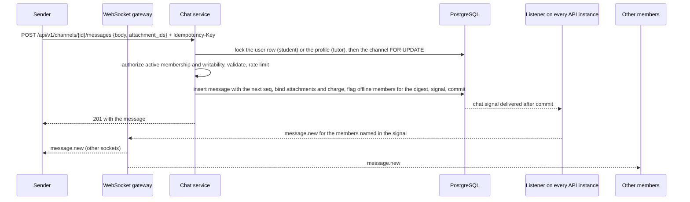
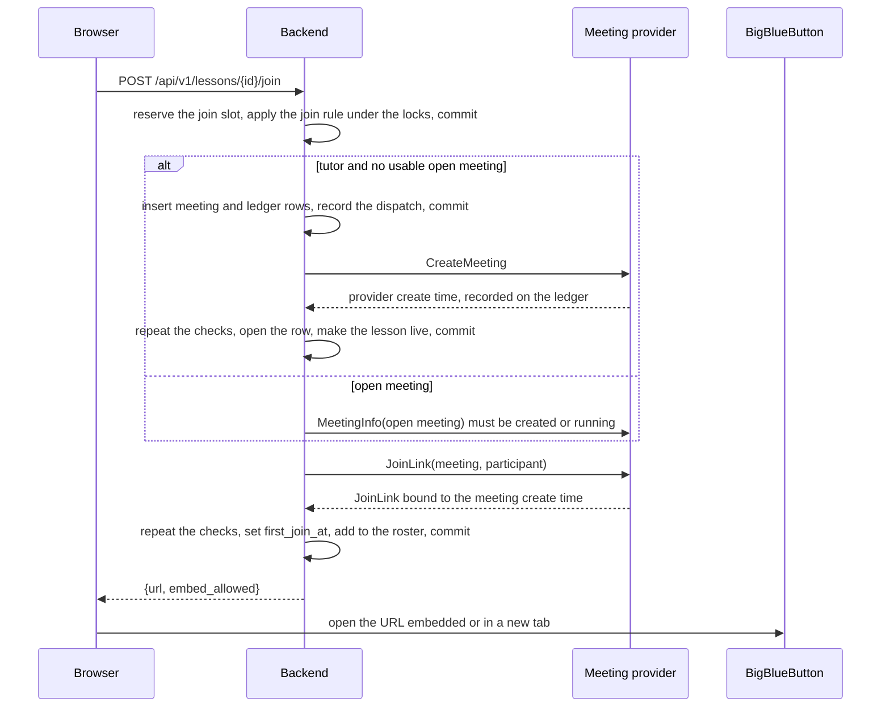
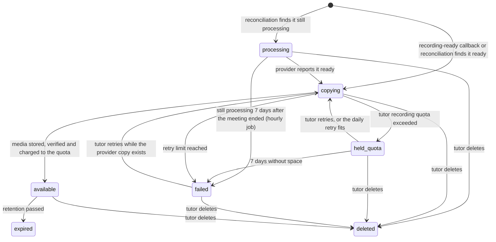

# Realtime and video specification

Covers chat, live updates and in-app notifications over one WebSocket (FR-12, FR-13.1), and video lessons and recordings through BigBlueButton (FR-5). Decisions: [ADR-0003](../../docs/decisions/0003-embedded-video-provider.md), [ADR-0004](../../docs/decisions/0004-bigbluebutton-primary-provider.md). Provider facts: [BigBlueButton research](../research/bigbluebutton-2026-10-20.md).

## Chat

### Channels

Slice 6 builds chat; the [slice 6 plan](../plans/slice-6.md#3-decisions-the-plan-proposes) records the alternatives and reasons behind the rules below.

| Kind | Members | Created | Read-only when |
|---|---|---|---|
| `direct` | the tutor and the student of one relationship, while it is `provisional`, `active` or `ended` | in the transaction that first makes the relationship `provisional` or `active` (invitation sign-up, signed-in acceptance, accepting a join request), never for an `invited` card ([ADR-0014](../../docs/decisions/0014-students-join-through-their-tutor.md)); reactivation reuses it, so the history survives ending and reactivation | the relationship is ended (`read_only_since` set to `ended_at`); writable again on reactivation |
| `group` | the tutor and the current members of one group | in the transaction that creates the group | the group is archived (`read_only_since` set to `archived_at`); writable again on unarchiving |

- There are no student-to-student direct channels.
- **Membership is stored:** `channel_member` rows mirror the relationship and the group, and every path that changes those states updates them in its own transaction, after locking the channel `FOR UPDATE` ([lock order](accounts.md#locks-and-the-session-re-check)): linking, confirmation, the reclaim and the owner's choice, removal, stopping studying, ending, reactivation, group creation, adding and removing members, student and tutor deletion, the 7-day cleanup, the immediate purge of an unconfirmed account, `reclaim.expire` and the purge. Slice 6's migration backfills a channel and its member rows for every relationship that is `provisional`, `active`, `ended` (read-only since its `ended_at`) or `reclaim_pending`, and for every group (an archived one read-only since its `archived_at`).
- **One active-member predicate:** "an active member of a channel" is a member row that is not suspended, of a channel that is neither discarded nor pending erasure. Every access path reads members through this one repository predicate: the chat routes, unread counts, the read marker, an idempotency replay, author deletes, both upload sessions, downloads, frame and signal recipients, presence and typing recipients and `online`, the digest flag and the digest. Deletion and purge lookups do not apply it: they find every member row of the account or channel, suspended ones included, so none survives a purge or an erasure.
- **A provisional link** reaches only its `direct` channel, never a group channel (an unconfirmed account belongs to no group), with text messages only ([upload flow](files.md#upload-flow)).
- **While a link is `reclaim_pending`** the tutor's member row stays and the student's row is suspended (`suspended_since` set), so the account reaches nothing of the channel and is shown to no one; the channel stays writable for the tutor, whose messages wait for the student. The reclaim transaction also sets the channel's `provisional_through_seq` to its `last_seq`: every message up to it was written during the provisional period.
- **Keeping a reclaimed link** (the owner's decision of 2026-10-29, pending owner review) locks the channel, clears the suspension, sets the restored row's `last_read_seq` to just before the first message up to `provisional_through_seq` whose sender is not the account (or leaves it at `provisional_through_seq` when there is none), so those messages and everything after them count as unread, and sets `digested_through_seq` to the channel's `last_seq`, so no digest lists the past. Every message whose sender is the account and whose `seq` is at most `provisional_through_seq` carries `sent_before_reclaim: true` for both roles, derived at read time, and is shown with the fixed cue "Sent before the account was reclaimed": a boolean, never the squatter's chosen name, avatar or other account data. A link confirmed from the account's own browser is not a reclaim and sets no boundary.
- **A discarded link** (a removal, stopping studying on a provisional link, the 7-day cleanup, the immediate purge of an unconfirmed account, a dropped reclaim link, `reclaim.expire`, a tutor deletion) loses both member rows, and its whole channel, both parties' messages included, is erased through the deferred erasure below (the owner's decision of 2026-10-29, pending owner review).
- **Deferred erasure:** a discarding transaction deletes the channel's member rows, sets `discarded_at` (never cleared) and `erase_pending_since` on the channel under its `FOR UPDATE` lock, marks the channel's `pending` chat uploads `deleted` with their `storage_delete` queued (an `uploading` row is left to its own request, whose second session finds the membership gone and discards the object, and to `uploads.expire`), and sends the last `entity.changed channel`. From that commit on no member reaches the channel, `GET /files` refuses its files, and no upload or binding can name it. The `chat.erase_channels` job runs every minute (an empty run is one partial-index probe; the owner's decision of 2026-10-29, pending owner review), with one 20-second monotonic execution deadline created before candidate selection and covering SQL, pool acquisition and lock waits, and erases each pending channel in batches of 500 messages per transaction under the charge locks (the tutor's profile, the channel), releasing charges and queueing `storage_delete`, then clears `erase_pending_since`. Each pass selects at most 100 pending channels. Cancellation rolls back only the unfinished transaction; committed batches remain erased, pending markers remain until completion, and the next scheduled pass resumes without releasing charges or queueing deletion twice. `channel.erased` is emitted only after confirmed completion. Access revocation is immediate, but the once-per-minute schedule is not a one-minute physical-retention guarantee: backlog, lock contention and storage failures can extend retention. Bodies disappear through committed erasure batches; files disappear through retryable storage work, with dead jobs requiring operator recovery. Eventual progress assumes blocking transactions and failures end; a permanently blocked first candidate has no starvation-freedom guarantee (retention clarification approved 2026-11-01, wording pending owner review).
- **A member removed from a group** loses the group channel, including its history, and their `pending` uploads to it are marked `deleted` with their deletion queued in the same transaction. **A new or re-added group member** sees the whole history, including messages written while away, with the new row's `last_read_seq` and `digested_through_seq` set to the channel's `last_seq`, so nothing counts as unread and no digest lists the past (the owner's decision of 2026-10-29, pending owner review).
- **An ended relationship** keeps both member rows: the student keeps read access to the direct channel.
- **Tutor deletion** ends relationships and archives groups, so their channels become read-only through the same statements, and discards provisional and reclaim-pending links, whose channels are erased.
- **Author writes** (send, edit, a chat upload) in a read-only channel are refused with `409 channel_read_only`; deletes stay allowed; reading and moving the read marker stay allowed.

### Labels per role

The labels of erased card names below follow [ADR-0024](../../docs/decisions/0024-legal-documents-and-student-data.md), as specified by change L0 of the [interface rework plan](../plans/ui-rework.md) on 2026-11-23 (pending owner review).

Every name a chat response, a digest and a frame-triggered refetch shows. A fixed label travels as a `label_kind` code beside a `null` label, as lessons do.

| Field | Tutor | Student |
|---|---|---|
| Direct channel label | the card's own display name, also while `provisional` (never the account name a possibly squatting account chose), with `unconfirmed: true` and the cue "Email not confirmed" while the link is provisional; after the student's purge, the fixed label `former_student` ("Former student") of the [label table](schedule.md#labels-per-role), never the account name; the read-only channel keeps the tutor's own messages, which the tutor may delete | the tutor's account name and the relationship colour |
| Group channel label | the group's name and colour | the group's name, with the tutor's account name and the relationship colour as its tutor label |
| Sender of a message | the card's display name for a student of the tutor; "You" for the tutor's own; a purged sender as in the row "Sender purged" | the tutor's account name; another student's account name, on that student's messages only; "You" for the student's own |
| Group members in the conversation header | card display names, never account names | none: the header shows the group's name and tutor label only |
| Typing indicator | the card's display name | the tutor's account name; for another student "Someone is typing…" |
| Presence | every member's, in writable channels only | the tutor's only, in a writable channel only; never another student's |
| Sender whose account is `deleted` | `label_kind: deleted_user` ("Deleted user"), body kept until the purge | the same |
| Sender purged | `label_kind: deleted_user`, body erased ("Message removed") | the same |

Students see other students only on those students' messages: no member list, no presence and anonymous typing (the owner's decision of 2026-10-29, pending owner review).

### Messages

- **Body:** 1 to 4,000 Unicode code points of plain text, stored as entered after refusing NUL and the control characters other than line feed and tab (`422 validation_failed`); a message with at least one attachment may have an empty body, and a whitespace-only body counts as empty. It is rendered as text with line breaks kept by CSS, in an element isolated with `dir="auto"`; nothing is rendered as HTML.
- **Links:** `http` and `https` addresses become links built from the parsed URL with `rel="noopener noreferrer nofollow"` and `target="_blank"`, showing the text as typed; an address with user information (`user@` or `user:password@` before the host) or containing a Unicode format character stays plain text; no other scheme becomes a link.
- **Attachments:** up to 10 from the [chat context](files.md#contexts-and-limits), bound by the send. Pictures get a preview.
- **Sequence:** each message gets `seq`, the channel's `last_seq + 1`, assigned under the channel's `FOR UPDATE` lock in the send transaction, and the send moves the channel's `last_activity_at`.
- **Tutor sessions:** sending, editing, deleting and replaying a send carry the authenticated session to the service and apply the [post-profile-lock session re-check](accounts.md#locks-and-the-session-re-check). An unusable session answers `401 unauthenticated` without a successful business outcome or message write charge, including after block followed by unblock. Tutor replay uses a read-write `READ COMMITTED` transaction for this lock; student replay keeps its read-only transaction.
- **Sending:** `POST /channels/{id}/messages` with `{body, attachment_ids}` and an `Idempotency-Key`; the web client sends only through this route, never over the WebSocket. The key, 1 to 64 characters of `^[A-Za-z0-9._-]{1,64}$`, is stored as `message.client_key`, unique per sender and channel while the sender exists; a repeated key is authorized again (the caller must still be an active member, otherwise `404`) and answers the first message as the caller now sees it, creating nothing and consuming no rate slot; the key is never logged. A send also moves the sender's own read marker to the new message.
- **Editing and deleting:**
  - the author edits their message within 24 hours of `created_at` with `{body, version}`, marked "edited" (`edited_at`, `version` incremented); later edits are refused with `edit_window_passed` and a stale `version` with `conflict`; attachments are not edited; the body rules also apply to editing, so a message with an existing attachment can be edited to empty or whitespace-only text; editing needs a writable channel; a deleted or erased message, or one the caller did not write, answers `404` like a random identifier;
  - the author deletes their message at any time in any channel they are an active member of, read-only ones included; the tutor deletes any message in their direct and group channels, read-only ones included (the owner's decision of 2026-10-29, pending owner review); a delete therefore never answers `channel_read_only`;
  - a delete sets `deleted_at`, erases the body and removes the message's attachment references in the same transaction, under the charge locks, which releases a quota charge with the last reference and queues each object's `storage_delete`; it is idempotent, and the message stays in the list as the placeholder "Message deleted".
- **Rate limits:** at most 30 message writes (sends, edits and deletes together, and from M2 and M5 pins and reactions, pending owner review) per minute per user across channels; a replayed send and a refused request count nothing; the attachment limits are in the [upload flow](files.md#upload-flow); beyond any limit the server refuses with `429 rate_limited` and `Retry-After`. These limits are counted in memory per API instance, through an injected clock and counter, and a restart resets them.
- **History** is keyset paginated on `seq`, newest first, 50 per page by default and at most 100; `?after_seq=` returns up to `limit` (at most 100) newer messages oldest first, for catching up after a frame, with `next_cursor` `null`; a request with both `cursor` and `after_seq` answers `422 validation_failed` at `query.after_seq`.
- **Unread state:**
  - each channel stores `last_seq`, and each member `last_read_seq`, which moves forward only when the client reports reading (`POST /channels/{id}/read` with `{seq}`, clamped to `last_seq`), at most once a second from a visible conversation;
  - a channel's unread count is `last_seq − last_read_seq`, capped at 99 and shown as "99+", with no aggregate over messages; deleted and erased messages count, because they stay in the list as placeholders;
  - `GET /channels/unread` answers the number of channels with unread messages (at most 100) from one indexed query over the caller's member rows, for the sidebar badge;
  - a read-marker move takes no tutor profile lock and signals `read.updated` to the caller's own other sockets; in a group channel no other member learns it (no read receipts in groups), and in a direct channel the other member learns it only as the [read state of direct channels](#read-state-of-direct-channels-m3) defines (amended 2026-11-23 by change U1b, pending owner review; built on 2026-11-25 by M3).
- **Session and profile locks:** every chat write by a student (send, edit, delete, read marker, a chat upload's creation and completion) locks the student's user row first and re-checks the session; every chat write by a tutor except a read-marker move takes the tutor's profile lock first and answers `401 unauthenticated` when the tutor is no longer `active` ([locks and the session re-check](accounts.md#locks-and-the-session-re-check)).
- **Deleted and purged senders:** from an account's deletion until its purge its messages show "Deleted user" with their bodies; the purge erases or deletes them ([account deletion](accounts.md#account-deletion)).

### Messenger contracts

Specified 2026-11-23 by change U1b of the [interface rework plan](../plans/ui-rework.md) with [proposal 0007](../../docs/proposals/0007-tutor-crm-scope.md), whose scope and this stage's plan the owner approved on 2026-11-23 (FR-12.2 to FR-12.4, pending owner review). Each part is pending implementation by the change named in its heading; replies and the pinned message were built by M2 on 2026-11-24 (pending owner review). No new frame type is added: every change below reaches members through the existing `message.new`, `message.updated`, `message.deleted`, `read.updated` and `entity.changed channel` frames, always to the channel's active members only, through the same predicate as message frames, so a suspended `reclaim_pending` row and a removed member receive nothing. Every rendering rule above stays: bodies and quotes as text, links only as parsed, file names isolated.

#### Replies (M2)

- **Sending:** `POST /channels/{id}/messages` accepts an optional `reply_to_message_id`. The server resolves it within the channel before any `409 channel_read_only` refusal: a random identifier, a malformed identifier, a message of another channel, and a message that is deleted or erased all answer the same `404 not_found` at `body.reply_to_message_id`, with the body of a random identifier ([T-5](../../docs/threat-model.md#threats-and-controls)). A replayed send answers the first message, whatever `reply_to_message_id` the replay carries. Editing never changes it.
- **The quote** is read at render time, in every response that carries the message: `reply_to: {message_id, seq, sender_label, sender_label_kind, own, preview, state, sent_before_reclaim}` or `null`, where the sender label follows the reader's row of the [label table](#labels-per-role) ("Deleted user" included), `preview` is the first 120 code points of the quoted message's current body, `state` is `available`, `deleted` (shown as "Message deleted", `preview` `null`) or `removed` (erased by a purge or an erasure, shown as "Message removed", `preview` `null`), and `sent_before_reclaim` is the quoted message's own reclaim cue, shown with the quote and in the reply bar as for the message itself (the owner's decision of 2026-11-24 with M2's plan, pending owner review; [T-44](../../docs/threat-model.md#threats-and-controls)). A quote never outlives an edit, a delete or a purge: the client refetches every loaded page that holds a reply to a message named by a `message.updated` or `message.deleted` frame.
- **Jumping** to the quoted message loads history around it: `GET /channels/{id}/messages?around_seq=` answers up to `limit` messages, oldest first, holding the message with that `seq` (or the nearest older one) and up to half of `limit` on each side, with `next_cursor` for older messages and `has_newer`; `around_seq` with `cursor` or `after_seq` answers `422 validation_failed` at `query.around_seq`.

#### The pinned message (M2)

- The channel's tutor pins one message of the channel that is neither deleted nor erased with `PUT /channels/{id}/pin` `{message_id}` (a malformed, unknown, other channel's, deleted or erased message answers the same `404` at `body.message_id`), replacing any earlier pin, and unpins with `DELETE /channels/{id}/pin`; a student gets `404` on both, as on any tutor route. Pinning in a read-only channel answers `409 channel_read_only`; unpinning stays allowed there, and a read-only channel keeps its pin. Both count as message writes in the 30-a-minute limit and take the locks of a tutor's message write.
- A pinned message that is deleted, or erased by a purge or an erasure, stops being pinned in the same transaction.
- `GET /channels/{id}` carries `pinned: {message_id, seq, sender_label, sender_label_kind, own, preview, sent_before_reclaim}` or `null`, read at render time like a quote, with the reclaim cue shown in the pinned bar, and `null` whenever the pinned message is deleted or erased (pending owner review). Every change of the pin, the clearing by a delete included, sends `entity.changed channel` to the channel's active members.

#### Read state of direct channels (M3)

This amends the "no read receipts" rule above for direct channels only ([proposal 0007](../../docs/proposals/0007-tutor-crm-scope.md), FR-12.4); group channels change nothing, so students never learn each other's reading. Built on 2026-11-25 by change M3 of the [interface rework plan](../plans/ui-rework.md) (pending owner review).

- **Exposed marker:** each member row of a direct channel keeps `shared_read_seq` ([data model](data-model.md#channel-member)). While the channel is writable and both member rows are active, a read-marker request sets it to `GREATEST(shared_read_seq, reported)`, where `reported` is the request's `seq` clamped to the channel's `last_seq`, in the same statement that moves `last_read_seq`; a send (the owner's decision of 2026-11-25) reports its own message's `seq` in the same way. The exposed position is therefore only what the member reports now, never a read made earlier: while the channel is read-only, or the student's row is suspended by a reclaim, it stays frozen at its value at that moment, and after a reactivation or a kept reclaim it stays frozen until that member next reports a position beyond it, so reads made while the channel was read-only or suspended are never disclosed ([T-44](../../docs/threat-model.md#threats-and-controls)). A report that only unfreezes the marker, without moving `last_read_seq`, leaves `last_read_at` alone and sends the reader's own sockets nothing. Keeping a reclaimed link, which lowers the restored row's `last_read_seq` ([channels](#channels)), lowers its `shared_read_seq` to at most that value, so the tutor never sees the reclaiming account's reads as the owner's. A send also exposes a message the other member committed just before it, which the sender's screen may never have loaded, and unfreezes the marker after a restore as a read does (both costs confirmed by the owner on 2026-11-25). Rows that existed before M3 start at 0, so their ticks appear after each member's next read (the owner's decision of 2026-11-25).
- **Reads:** `GET /channels/{id}` and the history, catch-up and around responses of a direct channel carry `peer_read_seq`, the other member row's `shared_read_seq`, read from that row itself, so a suspended row's frozen value is still shown; it is `null` in a group channel and in a direct channel whose other row no longer exists (after a student's purge). The interface shows one tick on the caller's own message and two once `peer_read_seq` reaches its `seq`, reading the value of the channel detail only.
- **Frames:** a read-marker move or a send that advances `shared_read_seq` also signals `read.updated` to the other member's sockets while that member's row is active, coalesced to at most one frame a second per reader and channel on each API instance. Only a committed move reaches the coalescer, from the transaction's after-commit hook: the first such move of a reader and channel opens a one-second window and signals at once, from a short transaction run inside the hook with a 5-second deadline; a later move within the window only marks it dirty; at the window's end a dirty window sends one trailing signal from the same kind of short transaction, run in the background, and opens the next window, while a clean one is removed. Each signalling transaction first takes the channel's `FOR SHARE` lock in a statement of its own, and only the statements after it read the other member and check that the channel is still writable and both member rows still active, so under PostgreSQL's read-committed isolation they see every suspension, purge, ending or discard committed while the lock was awaited; it signals only then, so the last read of a burst reaches the other member and a frozen marker sends nothing. Because the other member's frame is signalled after the move commits rather than inside its transaction, an instance that stops between the two loses that frame, and a restart drops any open window; the other member's client then reads `peer_read_seq` again with its next refetch of the channel (a frame, focus or reconnection). An instance that shuts down stops its windows and waits for running trailing signals before it closes its database pool.
- **Session and locks:** a read-marker move still takes no tutor profile lock; under the channel's `FOR SHARE` lock it updates only the reader's own member row and reads the other row without a row lock, which the channel lock already protects, because every path that changes whether the other row is active or the channel writable (a reclaim, an ending, a reactivation and the other membership paths of [channels](#channels)) locks the channel `FOR UPDATE`; two members reading at once therefore never wait for each other's rows.

#### Search in a conversation (M4)

- `POST /channels/{id}/messages/search` with `{q, cursor}` in the body, so search terms stay out of URLs, access records and logs ([T-18](../../docs/threat-model.md#threats-and-controls)); `q` holds 2 to 100 code points after trimming, with no NUL or other control character, otherwise `422 validation_failed` at `body.q`. The interface keeps the term out of the page's address and history. Any active member may search, unconfirmed accounts included, as they may read.
- It matches a case-insensitive substring of the bodies of the channel's messages that are neither deleted nor erased, with `%`, `_` and `\` in `q` escaped so they match only themselves, and answers `{items: [Message], next_cursor}`, newest first by `seq`, at most 30 per page, keyset paginated like history; case folding is PostgreSQL's `lower()` under the database's collation, and M4's test proves it folds Cyrillic.
- At most 30 searches a minute per user, counted in memory per API instance like the message limits, `429 rate_limited` with `Retry-After` beyond.
- M4 measures the plan and time of a search at 50,000 messages in one channel and adds a trigram index through a migration only if the measurement asks for it, recording the `pg_trgm` extension in the [stack table](../architecture/detailed.md#stack-per-component) if it adds it.

#### Reactions (M5)

- **Values:** six fixed reactions, the `Reaction` enum in one place in `internal/domain`: `thumbs_up` (👍), `heart` (❤️), `joy` (😂), `wow` (😮), `sad` (😢) and `check` (✅); any other value answers `422 validation_failed` at `body.reaction`.
- **Writes:** an active member sets their one reaction to a message with `PUT /messages/{id}/reaction` `{reaction}`, replacing an earlier one, and removes it with `DELETE /messages/{id}/reaction`, idempotently. A message that is deleted or erased, or outside the caller's channels, answers `404`; reacting in a read-only channel answers `409 channel_read_only`, after the message is resolved; removing a reaction there stays allowed. Reactions count as message writes in the 30-a-minute limit and take the locks of an edit. A delete of the message drops its reactions.
- **Reads:** every `Message` carries `reactions: [{reaction, count, mine}]` in the enum's order, only reactions with a count above zero. For the tutor each reaction also carries the optional `members: [{label, label_kind}]`, the card display names of the label table, never an account identifier or account name; it is absent, not `null`, in every student response, as role-only fields are in the schedule's schemas, so `Message` stays one schema, and no student response or frame carries another member's identity for a reaction.
- **Reclaim:** keeping a reclaimed link deletes the account's reactions in that direct channel, in the transaction that clears the suspension, as it lowers the read marker, so the owner never inherits the reclaiming account's reactions; a dropped link's channel is erased with its reactions.
- **Frames:** a reaction change sends `message.updated {channel_id, message_id}` to the channel's active members, who refetch the message.
- **Residual** ([T-6](../../docs/threat-model.md#threats-and-controls)): a count tells a student how many members reacted, which identifies them when it equals the number of members who could have reacted (in a group with one other student, always), and a student watching counts change live can link a change to a member whose messages they see at the same moment.

### Principle

The database is the source of truth; the WebSocket is a delivery channel. Every change is committed first; the signal that announces it is written inside the same transaction and delivered only once that transaction commits ([broadcaster](#broadcaster)). The one exception is the other member's `read.updated` of a direct channel, signalled from a short transaction right after the read or send commits, so a crash between them loses that frame and the next refetch recovers it ([read state of direct channels](#read-state-of-direct-channels-m3), pending owner review). Frames carry identifiers only, never the authoritative state: a client refetches through REST, which enforces scope again. A reconnecting client recovers missed data through REST, never from the socket (NFR-4.3). For known live message frames only, the mounted conversation uses the new sequence as a REST catch-up target and updated/deleted identifiers as REST row locators, never as message state. One scheduled wave per second may contain several authorized requests. Metadata is bounded to a high-water and 100 dirty identifiers; overflow, unknown work and inconsistent coverage require full reconciliation. The default history query, first-ready/reconnect, scope changes, explicit Retry, stale-conflict refresh and signed-address renewal reconcile all displayed pages, including old edits and deletion placeholders. This conservative full-reconciliation exception and wave wording were approved 2026-11-02.

Slice 4 builds the connection, authentication and revocation, the broadcaster, and the frames `ready`, `notification.new`, `entity.changed`, `pong` and `error` from the server and `auth` and `ping` from the client; chat frames, presence and typing arrive with slice 6, whose typing and presence frames are the one exception to identifier-only frames: they carry an account identifier and, for presence, a boolean, because typing has no stored state to refetch and presence is persisted only as times (from slice 10 the `issue` and `submission` kinds of `entity.changed` also carry further identifiers, never state: the identifiers of other entities the recipient may refetch, fixed per recipient under [homework frame identifiers](#frame-format), pending owner review); their recipients are authorized like every other frame, and the client refetches presence through REST on every `ready`. The [slice 4 plan](../plans/slice-4.md#3-decisions-the-plan-proposes) records the alternatives and reasons behind the rules below.

### Connection

- **Endpoint:** one WebSocket per browser tab at `GET /api/v1/ws`, audience `user, unverified ok`, authenticated by its first frame. The URL carries no credential, and the gateway reads no cookie.
- **Before the upgrade:**
  - the route is registered outside huma but passes the same outer handlers as every other route: recovery, request identifier, security headers and the access record, which names the route template only;
  - it requires exactly one `Origin` header, equal to the normalised `OVC_PUBLIC_URL` in scheme, host and port, compared by the same plain `net/http` function that the sign-in, refresh and confirmation routes use over every `Origin` value; a missing, foreign or repeated `Origin` answers `403 forbidden`, and an `Origin` that merely equals the request's `Host` is foreign unless it equals the OVC origin;
  - a request that is not a WebSocket upgrade answers `400 bad_request`; a full unauthenticated budget (below) answers `503 service_unavailable` with `Retry-After: 5`; each of these answers carries the API error body and `Cache-Control: no-store`;
  - only then is `coder/websocket` asked to accept the upgrade, with `OriginPatterns` holding the OVC host only and never `InsecureSkipVerify`, as a second check. The library's own origin rule is weaker than OVC's (for example it accepts a missing `Origin`, matches the host without the scheme and refuses with a plain-text `403`); the gateway's own check decides, so the contract does not depend on the library's behaviour, which is confirmed against the pinned version and recorded in the [stack table](../architecture/detailed.md#stack-per-component) when the dependency is added.
- **After the upgrade:** the read and write deadlines of the HTTP request are cleared; the gateway sets its own deadlines per frame.
- **Authentication:** the first client frame must be `auth` within 5 seconds of the upgrade (an injected duration that tests shorten); [authentication and revocation](#authentication-and-revocation) has the rules.
- **Registry:** `internal/realtime` owns the connection registry: a socket is registered under its account and session when its `auth` frame has a valid token, and removed on every close path.
- **Limits:**
  - at most 500 unauthenticated sockets per instance and 20 per client address (the trusted client address of `OVC_TRUSTED_PROXY_CIDRS`, as for every per-IP limit), counted with the sign-in throttle's bucketing: an IPv4-mapped IPv6 address counts as its IPv4 address and an IPv6 address by its /64 ([sessions and passwords](accounts.md#sessions-and-passwords)); the next upgrade answers `503`;
  - at most 20 authenticated sockets per account per instance; the 21st `auth` closes with `4429`, and the client backs off up to 60 seconds. Residual: a stolen access token can fill its account's 20 slots until the token lapses or the session is revoked;
  - a socket holds its unauthenticated slot from the upgrade until it gets `ready` or closes, and counts against its account's 20 from the moment its `auth` frame carries a valid token, while it is still authenticating.
- **Bounds:**
  - **outbound:** each socket has a FIFO queue of at most 256 frames or 1 MiB, frames held while the socket is suspended included; an enqueue that would exceed either closes the socket with `4429` instead of waiting; the writer writes with a 10-second deadline and closes with `4429` when it passes. A slow socket therefore never delays the listener or another socket ([ADR-0009](../../docs/decisions/0009-owner-approved-exceptions-and-visibility.md), item 3). Each frame is serialised once and the same bytes are enqueued for every recipient socket on the instance;
  - **inbound:** text frames only, and a binary frame closes with `1003`; a frame over 16 KiB closes with `1009`, which the library sends on its read limit (`SetReadLimit(16384)`); a malformed frame or an unknown type gets an `error` frame (`bad_request`) and the socket stays open; more than 20 frames in a second get `error` frames (`rate_limited`), and five violations within 10 seconds close with `4429`, where only frames refused for their rate count as violations; any frame other than `auth` before authentication closes with `4401`. From slice 6, typing frames count toward the 20 frames per second and are coalesced in memory, per socket, account and channel, to at most one relayed frame every 2 seconds on the injected scheduler, before any database work ([presence and typing](#presence-and-typing));
  - **`ref`:** a client frame reference must match `^[A-Za-z0-9._-]{1,64}$`, the request identifier's character set, or the frame is malformed; `ref` values are echoed in `pong` and `error` frames and never logged; the `error` frame for a frame whose `ref` is malformed carries `ref: null`, and a `ping` that carries a `payload` is malformed;
  - **liveness:** the server pings every 25 seconds and closes a socket without a pong for 60 seconds; such a socket, like one whose connection fails, gets no close frame, and its `ws.connection.closed` record names `1006`;
  - **database access:** a socket holds no database session; each lookup it needs runs on a short pool session.
- **Shutdown:** on shutdown the gateway closes every socket with `1001` before the HTTP server's 40-second drain.
- **Goroutines:** every reader, writer, re-check and listener goroutine starts through `core.Go`, which recovers and logs a panic ([observability](observability.md#output-and-failure-behavior)).
- **The client** (`frontend/src/lib/realtime`):
  - one reconnecting client per tab, owned by the session epoch: it connects while the session is signed in and is closed and discarded when the epoch changes;
  - it sends `auth` with the in-memory access token, refreshed first when it expires within 30 seconds by wall-clock time (the session reads the wall clock through its injected scheduler, because a monotonic clock may pause while the system sleeps), and sends every new access token the session obtains in-band as another `auth` frame on the open socket;
  - it reconnects with exponential backoff from 1 to 30 seconds with full jitter, and up to 60 seconds after `4429`; after `1012` it first waits the listener's first reconnect delay of 1 second and then the jittered backoff, so the clients of a lost listener do not reconnect while it is still down and meet `1013`; the backoff starts over only once a socket has answered a `pong`, so connections that close soon after `ready` keep backing off; after the first `ready` of every socket, the first connection included (not after an in-band re-authentication), it refetches the visible data that holds an answer or is being fetched, and after a reconnect also the visible data whose last fetch ended in an error (a reconnect is a `ready` that follows an earlier `ready` or a failed or refused attempt of the same client, or the first `ready` of a client created anew for a resume after `beforeunload` or a restore from the back-forward cache; only the page's first client and a client for a new session epoch start with a first connection, and a client created anew starts its backoff over), because frames committed while the socket authenticated were not delivered ([live refetch mapping](../architecture/detailed.md#live-refetch-mapping));
  - on `4401` it refreshes once: a new token reconnects, and a refused refresh ends the session with the reason the refresh reports ([navigation](../design/web/navigation.md#rules)); while the tab's own sign-out, sign out everywhere or account deletion is in flight, the refresh waits for it: when it ended the session nothing more happens, and when it failed the refresh runs as usual;
  - it sends `ping` every 30 seconds and reconnects when no `pong` arrives within 10 seconds;
  - the page closes it on `beforeunload`, before a reload or navigation (Firefox reports a socket the navigation interrupts as a console error), and connects again 2 seconds later if the page is still shown (a download, a `mailto:` link or a cancelled leave dialog), and only while the session is signed in, with the current epoch's token; repeated `beforeunload` events leave one pending resume; `pagehide` closes it and cancels the resume, and a `pageshow` from the back-forward cache restarts it (pending owner review);
  - the socket factory is injected, and the fake socket of the component tests is checked against the frames the real gateway emits by the same contract test as the client's parser ([frame format](#frame-format)).
- **Chat membership** (slice 6): every chat producer (send, edit, delete, read marker, typing) locks the channel `FOR SHARE`, or `FOR UPDATE` for a send and a charge release, and reads the active members under that lock; the frame recipients are those members, at most 100 per signal (a group channel has at most 31). Every path that removes a member also locks the channel, so a removed member or an ended relationship's student stops receiving at once. There is no per-instance membership cache, and the listener resolves nothing; clients never subscribe to arbitrary channels.

### Authentication and revocation

- **`auth`:** the access token is verified as on REST (signature, expiry, claims). The socket is then registered under its account and session, **suspended** and tagged with the listener's current generation ([broadcaster](#broadcaster)), before the session lookup. The lookup checks that the session is neither revoked nor expired and that the account is `active` or `unverified`. `ready` is sent, and the socket starts receiving, only when:
  - the lookup passed;
  - the listener's generation is unchanged;
  - every `recheck` for the account that arrived after the registration was followed by a passing lookup: a `recheck` that arrives during authentication triggers one more lookup after the first, and when that lookup passes and the generation is still unchanged the socket gets `ready`, so another session's sign-out does not close an authenticating socket.

  Otherwise the socket closes with `4401` (a failed lookup) or `1013` (a changed generation). A revocation committed while a socket authenticates is therefore never missed: its `recheck` finds the registered socket. Frames for the account are not delivered to a socket that is still authenticating; its client refetches after `ready`. A session lookup that fails, at `auth`, on an inbound frame or in a re-check, closes with `1012`. A full per-account budget closes with `4429`, and a lost listener closes with `1013` until `LISTEN` is re-established.
- **In-band `auth`:** a later `auth` frame with a valid token for the same session and the same account verifies its token every time, shares the socket's one-per-second session lookup (below) and reuses its result within that second, because the session must be the same, keeps the later of the recorded and the new token expiry and is answered with `ready`; an `auth` for another session or another account closes with `4401`.
- **Token lapse:** the gateway records the access token's `exp` at `auth`. When the recorded expiry plus a grace of 30 seconds passes without a fresh token, the socket closes with `4401`, so a socket never lives longer than its access token.
- **Inbound frames after `auth`** repeat the session and account lookup, but one socket performs at most one lookup per second and frames within that second reuse its result; a failure closes with `4401`. `ping` is answered with `pong` echoing `ref`.
- **Revocation:** every path that revokes a session or ends an account signals a `recheck` for the account inside its own transaction, through the database triggers of the [data model](data-model.md#revocation-triggers): sign-out (`POST /auth/logout`), sign out everywhere, refresh-token reuse, the same-browser confirmation (the other sessions), a reclaim (every session, the squatter's included), a password reset, a password change (the other sessions), account deletion, an operator block through `ovc-admin` in its own process, the 7-day cleanup of an unconfirmed account and the purge. On a `recheck`:
  - the listener marks that account's local sockets suspended at once and hands the account to the re-check worker; the listener itself never waits for a query;
  - at most one re-check per account runs at a time, and signals that arrive meanwhile make it run once more afterwards;
  - while suspended, frames for those sockets are queued and count against the outbound bound, so an overflow closes with `4429`;
  - one query with a 2-second timeout re-reads their sessions and the account; failing sockets close with `4401`, and the others deliver their queued frames in order and resume;
  - a failed query closes the account's sockets with `1012`, and each reconnect authenticates afresh.
- **Bound:** a `recheck` is delivered at commit, so a revoked session's sockets close with `4401` within 5 seconds while the listener is alive; a listener that has been silent for 5 seconds is detected by its missing heartbeat, and every local socket is then closed with `1012` ([broadcaster](#broadcaster)).
- **Sweep:** every 60 seconds the gateway re-checks the session and account of every local socket in one batched query and closes with `4401` those whose session expired or was revoked, or whose account is no longer `active` or `unverified`, matching the per-frame lookup, as defence in depth.
- **Narrowing on lost scope:** ending a relationship, removing a provisional or reclaim-pending student, a dropped reclaim link and a tutor's or a student's deletion close no socket of the other party (the deleted account's own sockets close through the trigger on its state). Their transactions decide the recipients of `entity.changed` from relationship rows they hold locked ([authorization of frames](#authorization-of-frames)), so the student of a removed or dropped link gets one last `relationship` frame, refetches My tutors, which no longer lists the tutor, and gets nothing about that relationship afterwards; after an ending, frames reach the former student only when the student's projection changes again (a reactivation, `account_closed_until`). Sockets close only when a session or the account itself ends, or when the access token lapses without a fresh one.

### Frame format

Typed JSON text frames: `{"type": <enum>, "ref"?: string, "payload"?: object}`, with unknown properties refused. Types and close codes are enums in `internal/domain`, and payloads are structs in `internal/schemas`. They are not published through OpenAPI, because generating schemas for them would need reflection in hand-written code: the frontend mirrors them by hand in `frontend/src/lib/realtime/frames.ts` with a strict parser, and a contract test drives every server frame type and close code through the real backend and parses each frame with that parser, so a field the gateway adds, renames or removes fails it. On the Go side, `TestEveryFrameTypeHasAGatewayTest` fails when a frame type or close code of the enums has no gateway test that produces it.

| Direction | Type | Payload | Notes |
|---|---|---|---|
| client → server | `auth` | `{access_token}` | first frame, within 5 seconds of the upgrade; later, a fresh token of the same session; the token is never logged |
| client → server | `ping` | — | re-checks the session and account (at most once per second); answered with `pong` |
| server → client | `ready` | `{}` | after a successful `auth`, first or in-band |
| server → client | `notification.new` | `{id}` | a notification row was inserted for this account |
| server → client | `entity.changed` | `{kind, id}`; from slice 10 the kinds `issue` and `submission` may also carry `issue_id` and `lesson_ids` as fixed per recipient below | refetch the entity through REST |
| server → client | `pong` | — | echoes `ref` |
| server → client | `error` | `{code, message, request_id, ref}` | `request_id` is the inbound frame's identifier and `ref` echoes the client's reference; the socket stays open |
| client → server | `typing.start`, `typing.stop` | `{channel_id}` | slice 6; from an active member of a writable channel; anything else answers an `error` frame (`not_found` or `channel_read_only`) and the socket stays open |
| server → client | `message.new` | `{channel_id, message_id, seq}` | slice 6; refetch through REST |
| server → client | `message.updated`, `message.deleted` | `{channel_id, message_id}` | slice 6; refetch through REST; from M5 `message.updated` also follows a reaction change, and from M2 the client also refetches the loaded pages holding a reply to that message (pending owner review) |
| server → client | `read.updated` | `{channel_id}` | slice 6; refetch the unread counts; from M3, a frame about the other member of a direct channel also refetches `peer_read_seq` (pending owner review) |
| server → client | `typing` | `{channel_id, user_id}` | slice 6; `user_id` is `null` in the frames a student receives about another student |
| server → client | `presence` | `{user_id, online}` | slice 6 |

- **`entity.changed` kinds:** `relationship`, `join_request` and `notification` from slice 4; `lesson` from slice 5, `channel` from slice 6, `issue` and `submission` from slice 9 (the `id` an issue's or a submission's identifier), and `recording` after the MVP.
- **Homework frame identifiers** (from slice 10, so that a frame refetches only the queries that can show it; pending owner review): every other kind carries exactly `kind` and `id`. The optional keys are absent rather than `null`; `lesson_ids`, when present, holds one or two distinct lesson identifiers: the issue's linked lesson, and on a change of the linked lesson the previous and the new lesson, each only when it is not `null`.

  | Recipient and event | Payload |
  |---|---|
  | the tutor, `issue` (creation, a deadline or linked-lesson change, a withdrawal) | `kind`, `id`, optional `lesson_ids` |
  | the tutor, `submission` on a submission event (a submission or resubmission, every review publication, a closure by an ending, a deletion or another lifecycle path, a marking for erasure, the reclaim's flag) | `kind`, `id`, `issue_id`, optional `lesson_ids`; one frame per event, which replaces the separate `issue` frame slice 9 sent per submission |
  | the tutor, `submission` on an issue event (the per-submission frames that accompany the `issue` frame above) | `kind`, `id` |
  | a student, `submission` (every event the student receives) | `kind`, `id`, optional `lesson_ids`; never `issue_id`, which no student schema holds |

  A lesson is named to a student only when that student can see it under the schedule's [visibility](schedule.md#visibility) rule, decided in the producer's transaction through `ListStudentNotificationLessons`, one query per student recipient with lessons to name, after the transaction's last write to audiences and rosters, so a removal that hides a student's one-to-one lessons sends its last frame without them, while an ending, whose lessons stay visible through their frozen rosters, still names them. The decision needs no lock beyond the producer's own: the relationship locks above (`FOR SHARE`, `FOR NO KEY UPDATE` on every relationship a group membership change names, or `FOR UPDATE` in an ending, a removal or a reclaim) serialise every change of relationship state and every removal from a group (a group's creation and archiving remove nobody, and an addition only widens visibility after it commits), the tutor's profile lock serialises a tutor's cancellations with homework edits, and a roster freezes from the audience when a lesson leaves `scheduled`, so visibility does not change between a decision and its commit. A signal that carries `issue_id` or `lesson_ids` names exactly one recipient, which the encoder and the listener's parser both enforce, so a tutor's identifiers can never share a payload with a student. A student who loses a lesson gets no frame naming it; an open page of that lesson finds it gone on its next fetch (an accepted residual, recorded in the [slice 10 known limitations](../reviews/slice-10-known-limitations.md)).
- **Slice 9 kinds:** the change that first emits `issue` and `submission` adds both to `frames.ts`, its parser and the realtime contract test, with their rows of the [live refetch mapping](../architecture/detailed.md#live-refetch-mapping).
- **Slice 6 frames:** the client sends messages and read markers only through REST, so `message.send` and `message.read` are not frame types, and a client that sends them gets an `error` frame like any unknown type; until each chat frame lands, its client type gets an `error` frame like an unknown one. Each change that makes the gateway emit a frame or an `entity.changed` kind adds it to `frontend/src/lib/realtime/frames.ts`, its strict parser and the realtime contract test in the same change, so no deployed bundle drops its socket on a frame its parser does not know.

**Close codes:**

| Code | Meaning | Client |
|---|---|---|
| `1000` | the client closed | — |
| `1001` | server shutdown | reconnects with backoff |
| `1003` | a binary frame | reconnects with backoff |
| `1009` | a frame over 16 KiB | reconnects with backoff |
| `1012` | the listener was lost or a re-check failed | reconnects after 1 second plus the jittered backoff |
| `1013` | the listener is not back yet | reconnects later, with backoff |
| `4401` | authentication failed, the token lapsed, or the session or account no longer allows the socket | refreshes once, then reconnects or ends the session |
| `4429` | slow consumer, repeated frame violations, or too many sockets of the account | reconnects after up to 60 seconds |

A client that gives up on a socket still connecting closes it with `1000` as soon as it opens, and sends no frame on it, because browsers report a script closing a connecting socket in the console: Chromium as a warning, Firefox and WebKit as errors. A socket that never opens is left to the browser's own failure, and a later socket to the same address may wait behind it.

Close reasons are fixed short strings, never data.

### Authorization of frames

Inbound frames in slice 4 (`auth`, `ping`) carry no identifier, so nothing is resolved in a client-chosen scope, and clients never subscribe; from slice 6 `typing.start` and `typing.stop` carry a channel identifier, resolved within the caller's active memberships under the channel lock, with `not_found` outside them. Chat recipients are decided under the channel lock instead of the relationship locks: every path that removes a recipient also locks the channel, which gives the same guarantee with one lock per message instead of one per relationship. Outbound recipients are decided in the producer's transaction, from rows it holds locked: a transaction that names a student as a frame recipient reads the relationship row with at least `FOR SHARE`, which conflicts with the `FOR UPDATE` and `FOR NO KEY UPDATE` locks that ending, removal and dropping a reclaim link take, so a producer waiting behind a removal sees the row discarded and names no former student ([lock order](accounts.md#locks-and-the-session-re-check)). A student gets a frame only when the student's own view changes, so the timing and presence of frames never tell a student that a tutor blocked them or suppressed their request, nor that a tutor edited private notes.

| Frame | Recipients |
|---|---|
| `notification.new` | the recipient of the inserted row only |
| `entity.changed relationship` | the tutor on every committed change of the card; the linked student account only when the student-visible projection of the relationship changes: the `MyTutor` fields that come from the relationship row (`state`, `colour`, `ended_at`, `ended_by`, `account_closed_until`), including the change that removes the relationship from the student's view (removal, a dropped reclaim link); never another tutor of the same student. Tutor-only edits (notes, the card name, the card email) send the student nothing |
| `entity.changed join_request` | the tutor only for requests inside the tutor's scope at commit (never held, suppressed, closed by an unblock or of an operator-blocked account); the student only when the student's `SentJoinRequest` changes through a decision: accept, and decline, which sends the same frame with or without a block; the student's own code entry sends one identical frame to the student's other sockets whether the request was created, existing, held or suppressed |
| `entity.changed notification` | the recipient's own sockets, after a read change, so other tabs update the badge |
| `entity.changed lesson` (from slice 5; the web client accepts the kind from the schedule's first change and refetches nothing for it until the Schedule pages add lesson queries) | the tutor on every committed change of the lesson; each student of the current audience (for a `scheduled` lesson) or of the roster (otherwise) when a field they see changes: the time, the duration, the title, the description, the status or, from slice 8, the materials ([lesson materials](schedule.md#lesson-materials)); recipients are named under the relationship locks of the [schedule](schedule.md#locks-and-jobs), never another tutor of the same student. Ending a relationship, a removal and leaving a group send the student who lost the lesson one frame per affected lesson only when it stays visible to them (a frozen roster), and nothing for lessons they no longer see, which they lose on their next fetch; the web client refetches its calendar ranges on the `relationship` and `channel` frames that reach them, so an open page drops those lessons without a reload (design slice step D2, pending owner review). A series operation sends one frame per affected lesson, chunked under the limit of 100 recipients per signal |
| `entity.changed issue` (from slice 9) | the issue's tutor only, when the issue is created, edited (a deadline or linked-lesson change) or withdrawn; never a student, who learns of these changes through the `submission` frames below; from slice 10 it names the linked lessons ([homework frame identifiers](#frame-format)) |
| `entity.changed submission` (from slice 9) | one frame per submission, identifying that submission: to the issue's tutor when the submission is created by issuing, when its issue is withdrawn or its deadline or linked lesson changes, when it is submitted or resubmitted, on every review publication (check, return and every later published revision), when an ending or the tutor's deletion closes it, when its issue is marked for erasure, and when a reclaim sets its `issued_before_reclaim` flag; to the submission's student on the same events except the reclaim, only while the student may read the submission under the readability predicate of [homework](homework.md#student-readability) (their own submission of an `active` issue not marked for erasure, through a relationship that is `active`, `provisional` or `ended`, and from slice 10 of a tutor who is not `deleted` or is still before `account_closed_until`), and never for a later publication on `checked` work that keeps it `checked` and leaves its comments, corrected file identifiers and feedback equal to the previous published revision's (a points-only publication). For a change that removes the student's access (a withdrawal, a marking for erasure) the student is named by the predicate as it held just before the change, so they get this last frame; a student whose relationship is `reclaim_pending` or `discarded` never gets one. No frame is sent for an autosave, a draft review save or, from slice 10, `POST /submissions/{id}/feedback-seen`, and none at a tutor's `account_closed_until`, after which the next read of loaded work answers `404`, not even to the writer's other sockets, which meet `409 conflict` on their next write instead. The cleanup job, which erases work already marked, sends none. From slice 10 the tutor's and the student's frames of one event carry different identifiers ([homework frame identifiers](#frame-format)), so each is a signal of its own |
| `entity.changed channel` (from slice 6) | every active member, read under the channel lock, when what that member sees of the channel changes: becoming read-only or writable, a member added or removed (to the tutor and to the member who joined or left only, never to the other students, who see no member list), the start of an erasure, and the channel's label (a group rename or recolour, an account name change of a member, as the [label table](#labels-per-role) shows it), and from M2 its pinned message (pinning, unpinning, and the clearing of a deleted or erased pinned message; pending owner review). The member who left gets one last frame and then nothing about the channel; message changes use the message frames; a student's frames never reveal another tutor's channels |
| `message.new`, `message.updated`, `message.deleted` (from slice 6) | the channel's active members read under the channel lock, the sender's other sockets included |
| `read.updated` (from slice 6) | the reader's own other sockets; from M3, in a direct channel, also the other member's sockets while that member's row is active, when the move advances the exposed marker, at most one a second per reader and channel ([read state of direct channels](#read-state-of-direct-channels-m3), pending owner review) |
| `typing` (from slice 6) | the channel's other connected active members, read under the channel's `FOR SHARE` lock; a student receives `user_id: null` about another student, the tutor the account |
| `presence` (from slice 6) | the accounts that share a writable channel with the account (presence is hidden in read-only channels, as `online: null` in REST, the owner's decision of 2026-10-29, pending owner review): a student's presence reaches only the tutors of those channels, never another student, and a tutor's presence the students of the tutor's writable channels. The one stated exception to recipients decided under locks: they are read without locks in a short transaction, because presence reveals only whether someone is connected, and a recipient removed concurrently can receive at most one such frame |
| `recheck`, `heartbeat` signals | not frames: they close or keep sockets, or prove the listener alive |

- Creation, release, suppression, un-suppression, the closing by an unblock, a repeated decline that adds a block, expiry (which the student's list derives from times) and an operator block send the student nothing distinguishable.
- Every frame also reaches the acting account's other sockets, within the same rules.
- `entity.changed` to students when a tutor edits their own profile (name, bio, subjects) waits until a page needs it; students see the change on their next fetch.
- Tutor deletion locks no student's user row and sends one `relationship` signal per relationship it ends or removes, naming only that relationship's student, so every signal stays far under the limit of 100 recipients, and issues them together, one statement per 1,000 signals, so the deletion's statements do not grow with its relationships; from slice 9 its `submission` signals for the work it closes or marks for erasure go out the same way, in the same statements, and from slice 10 one per recipient, which at most doubles their number, still bounded by the deletion's submissions and chunked at 1,000 per statement; a student's purge sends the tutor one `relationship` frame per card that loses the student.
- **Homework recipients** (from slice 9) are decided under the producing change's own locks: every homework path that names students (issuing, a deadline or linked-lesson change, a withdrawal, a review publication, a closure, a marking for erasure) holds those submissions' relationships `FOR SHARE` in identifier order after the tutor's profile lock and before any group, lesson or issue, or already holds them `FOR UPDATE` (an ending, a removal, a reclaim), and applies the readability predicate under those locks ([locks and the session re-check](accounts.md#locks-and-the-session-re-check)); a reclaim that races a withdrawal therefore either waits for it, and the provisional student gets the withdrawal's frame, or commits first, and the student gets none. A student's own submission locks the relationship `FOR SHARE` in its own transaction. An issue to a group sends one `submission` signal per submission, written in statements of up to 1,000 payloads.
- Denial tests connect a second tutor who shares the student and prove that no frame about the first tutor's relationship or requests reaches it, and prove that a student's frames are identical whether or not the tutor blocked them.

### Send path

Chat (slice 6) follows the same path as every other producer:



- The web client sends only through REST; the WebSocket carries `typing.start` and `typing.stop` from the client and nothing else of chat (the owner's decision of 2026-10-29, pending owner review).
- **The digest flag:** the send inserts a `digest_pending` row, assigning a fresh sequence-backed revision on conflict and preserving the earliest pending time, for each active member whose `online_until` has passed, in the same transaction, without locking any user row ([message digest](notifications.md#message-digest)).

### Presence and typing

Slice 6 adds these with chat; slice 4 keeps presence only in each API instance's registry, which the test control route `POST /__test__/presence` reports as `{online, sockets}`, counting the sockets that got `ready` ([development](../../docs/development.md#end-to-end-test-harness)).

- **Persisted presence** (slice 6) keeps the account summary in `user_presence` and per-process leases in `user_presence_instances` ([data model](data-model.md#presence-and-digest-bookkeeping)), never on user rows. Each API generates its own named UUID once through the injected random source, never reuses it after restart and neither accepts it from clients nor exposes it in browser payloads. About once a minute an instance extends only its own lease to the greater of its old deadline and business time plus 90 seconds; real activity instants are monotonic. Closing its last socket deletes only its own lease. The summary preserves the greatest real activity instant as `last_seen_at`; its online deadline is the greatest retained lease deadline, or, on close, the greatest closing instant and retained deadlines. Cleanup never creates future online time or erases historical last-seen. All changes lock existing users `FOR KEY SHARE` in identifier order, then initialize and lock summaries in identifier order, then modify leases and recompute summaries. Purged users are skipped. Short operator and purge transactions holding `FOR UPDATE` may delay presence, an approved exception without changing those locks; `FOR SHARE` and `FOR NO KEY UPDATE` do not block it.
- **Readiness and failure:** reserve an account entry before its first durable lease write, persist lease and summary before initial `ready`, then recheck socket closure, session/account revocation and listener generation. Database work never holds the gateway mutex. Failure or timeout closes with reconnectable behavior and no `ready`; authentication invalidated after persistence releases its unused lease through the close path. Desired state is serialized and coalesced per local account with generations, at most four concurrent writers and a cancellation-aware five-second end-to-end deadline including admission. A hard total of 4096 entries includes authenticating, active and pending-release accounts; capacity refusal happens before `ready`, and accepted pending releases are never evicted to admit another account. An entry is freed only after confirmed release or confirmed deletion and completion or definitive cancellation of older writes; uncertain commit outcomes remain pending. A closed socket is no longer live even if release fails. Failed releases retain one pending entry per account, emit safe diagnostics and retry on the injected one-minute cycle, not an unbounded loop. Shutdown cancels scheduling, drains releases within its deadline and reports incomplete release; remaining leases expire normally.
- **Time sources:** summary consumers and lease activity use the injected business clock. Extension cycles, five-second debounce and typing coalescing use the injected scheduler; operation and cleanup execution deadlines use monotonic time, independent of frozen business time. Both Set and Advance through `POST /__test__/clock` extend this API's live leases before a successful response, including Set of the same instant. A failed flush returns a structured failure and can leave the clock changed, requiring explicit local recovery. This acknowledges only local persistence. A multi-instance test controller sets the same absolute instant on every API and waits for every response before assertions, sends or worker/digest execution; none may run during the intermediate interval. This is not a distributed clock barrier.
- An account is online while the summary's `online_until` is in the future. A missing row means never connected and offline with no last-seen. A crashed instance contributes only until its 90-second lease expires; no expiration frame is promised, and REST refetch supplies current state. `chat.expire_presence` runs once a minute with at most 500 expired leases per transaction and a 20-second monotonic execution deadline including SQL and locks. Candidate selection uses the expiry index without locking leases ahead of users and summaries; expiry is rechecked under the locks so renewal and purge are safe.
- **Presence frames** report committed account-wide state, never merely the instance's socket state. A close cannot announce offline while another unexpired lease remains. Debounce stays per instance and account, at most once per five seconds before recipient work, not a cluster-wide rate guarantee. Deferred emissions lock the summary again, read the current aggregate and call `pg_notify` in that same transaction before releasing the lock, ordering signal commits; an already committed offline frame can still arrive after a later online commit, followed by that online frame in listener commit order. Recipients retain the existing lock-free, one-late-frame exception and privacy rules; signals are chunked at 100 recipients. The client refetches REST on every `ready`.
- **Typing:** `typing.start {channel_id}` and `typing.stop {channel_id}` from an active member of a writable channel. The gateway coalesces them in memory first and drops the frames in between before any database work: `typing.start` and `typing.stop` share one window per socket, account and channel, and a frame inside an open window gets no answer. A frame that passes is checked in a short transaction that locks the channel `FOR SHARE`; a `typing.start` then reads the members and writes the `typing` signal inside that transaction, so it is delivered when the transaction commits, while a `typing.stop` is checked the same way and relays nothing, because the `typing` frame carries no state and the client's indicator expires on its own. The producer splits the recipients into those who receive the typing account and the students who receive `user_id: null` because the typing account is another student, and the signal carries both lists, so the listener decides nothing. The client hides an indicator 5 seconds after the last frame, and the dots stop with reduced motion.
- Typing is never persisted.
- **The test control route** `POST /__test__/presence` reports local `{online, sockets}`, counting ready sockets; successful local offline acknowledges release of this instance's lease only, never global offline. An uncommitted release returns a structured failure rather than a successful false assertion of durable closure. Global presence assertions read REST or the database separately.

The account presence summary never places `online_until` before its recorded `last_seen_at`: a late operation sampled before a newer connection activity or an expired-lease cleanup cannot backdate the start of the account offline period.

### In-app notifications and live updates

- A producer that inserts a notification row signals `notification.new` to its recipient in the same transaction, only when the row was actually inserted ([notifications](notifications.md#channels)).
- A producer that changes an entity a user sees signals `entity.changed` to the recipients of the [authorization rules](#authorization-of-frames), for example when a card changes or a request is decided, from slice 5 when a lesson is created, edited, cancelled or ended by the status job, from slice 7 when it becomes live, and from slice 9 when an issue or a submission changes as the `issue` and `submission` rows of that table list.
- The client refetches the entity through REST; frames never carry the authoritative state.
- From slice 10 Today and Home read one `GET /home` ([home](api.md#home)); which frame kinds invalidate it, for which role, and how its refetches are coalesced so a burst of frames costs at most two reads, is listed per frame in the [live refetch mapping](../architecture/detailed.md#live-refetch-mapping). No new frame kind or field is added for it, and no frame is sent at a tutor's `account_closed_until` (pending owner review).

### Broadcaster

- **Signals are written inside the committing transaction.** A producer issues `SELECT pg_notify($1, $2)` with bound parameters through the `Signals` repository in `internal/repositories`, as a statement of its own transaction: `notification` signals one per statement, and `entity` signals, one or many, in statements of up to 1,000 payloads each, `SELECT pg_notify($1, payload) FROM unnest($2::text[])`, with the channel and the encoded payloads bound; revocation signals come from database triggers ([revocation triggers](data-model.md#revocation-triggers)). PostgreSQL delivers a notification only when that transaction commits, in commit order, and never for a rolled-back one, so no crash between commit and publish can lose a signal. Every API instance, the producing one included, delivers from its own listening connection; there is no direct local path.
- **Payload:** versioned JSON on the channel `ovc_realtime`, `{"v": 1, "k": "recheck" | "notification" | "entity" | "heartbeat", "u": [user ids], "e": kind, "i": id}`, from slice 6 also the `chat`, `typing` and `presence` kinds below, at most 7,900 bytes and 100 recipients; a producer with more recipients sends several signals. The trigger-built `recheck` payloads use the same form. PostgreSQL collapses identical notifications within one transaction, so revoking every session of an account sends one signal.
- **Kinds:**
  - `recheck {u}` asks every instance to re-check the sockets of those accounts;
  - `notification {u: [recipient], i}` delivers `notification.new`;
  - `entity {u, e, i}` delivers `entity.changed`; from slice 10 it may also carry `p`, the issue identifier, only with `e` `submission`, and `l`, a list of one or two distinct lesson identifiers, only with `e` `issue` or `submission`, and a payload with either names exactly one recipient; a `null`, empty or longer list, a repeated or non-canonical identifier, or either field on another kind is rejected (pending owner review);
  - `heartbeat {i}` keeps the listener's liveness; `i` carries the sending instance's identifier; it is the one signal not written through the `Signals` repository: the listener sends it on its own listening connection with the same bound `SELECT pg_notify($1, $2)` and payload form, and it carries no business data;
  - from slice 6, `chat {u, e, c, i, s}` delivers a message or read frame: `{"v": 1, "k": "chat", "u": [members], "e": "message.new" | "message.updated" | "message.deleted" | "read.updated", "c": channel, "i": message | null, "s": seq | null}`, written in the producing transaction; an unknown `e` is rejected;
  - from slice 6, `typing {u, n, c, a}` delivers `typing`: `{"v": 1, "k": "typing", "u": [recipients shown the account], "n": [students shown null], "c": channel, "a": account}`, written inside the typing check's short transaction under the channel lock; a payload that names an account in both lists is rejected;
  - from slice 6, `presence {u, a, o}` delivers `presence`: `{"v": 1, "k": "presence", "u": [recipients], "a": account, "o": online}`, written with `pg_notify` in the same transaction that locks the summary and reads the current aggregate and lock-free recipient scope, chunked at 100 recipients.
- **Notification rate** (slice 6): at 2,000 connected users, presence changes at most once per instance and account every 5 seconds and typing at most once per account and channel every 2 seconds make an estimated 100 to 250 notifications a second in a busy minute, each taking PostgreSQL's notification lock at commit; the slice review measures it beside the commit latency of sends and sign-outs, and if it shows contention, the fallback is local delivery of typing on a single instance, which needs a specification amendment.
- **Signals carry no authority.** The listener parses every payload strictly into its typed form and drops anything else with `realtime.signal.rejected`. A forged or replayed `recheck` can only make an instance check sockets, which closes nothing that is still valid; a forged `notification` or `entity` signal carries only identifiers whose content REST authorises again. Only database roles can `NOTIFY`.
- **Recipients are decided by the producer**, which already holds the rows and the scope rules under its locks; the listener never resolves recipients again at delivery, which would read state from a later moment.
- **Listening:** each API instance holds one dedicated listening connection, owned by an adapter in `internal/adapters` and consumed by `internal/realtime`. The listener handles notifications one at a time, never waits for a query and enqueues frames without blocking; each socket's queue is FIFO, so one socket sees frames in commit order.
- **Liveness fails closed:**
  - the listening connection uses TCP keepalives and, on Linux (production), `TCP_USER_TIMEOUT` of 10 seconds; the pinned `pgx` parses no `tcp_user_timeout` parameter, so the listener sets both through its own dialer ([confirmed 2026-10-25](../research/backend-libraries-2026-10-21.md#notes)), and detection does not depend on them, because the heartbeat below detects a silent connection;
  - each instance sends itself a `heartbeat` signal every 2 seconds on its listening connection, between waits for notifications, never on the connection pool, so requests holding every pooled connection cannot delay it; notifications that arrive while a heartbeat is being sent are buffered by the connection and handled next; a heartbeat write is bounded only by the 5 seconds of silence, because cancelling a statement closes the connection; because the listener receives its own heartbeat on the connection that sent it, the heartbeat assumes that the listener and the producers reach the same PostgreSQL server, which holds for the single self-hosted database; the listener is lost when it has received none of its own heartbeats for 5 seconds, when the connection errors or when `LISTEN` fails; a heartbeat that cannot be written is not a loss by itself, only the 5 seconds of silence it causes, whose loss record then names the write failure's kind;
  - the loss is reported when it is detected, before the dropped connection is closed: the silence timer marks the listener lost and tells its consumer even while the consumer is still handling an earlier signal, so a consumer that blocks or is slow never keeps the listener reported as live, and the consumer's callbacks may therefore run concurrently: a generation's loss can even be reported before that generation's connect callback has returned, so the consumer decides liveness only from the listener's state (its generation and live flag), never from the order of the callbacks; a consumer or heartbeat that panics loses the listener too, which then reconnects;
  - the reconnect backoff returns to 1 second only after a connection has received one of its own heartbeats, so a connection that is lost at once keeps backing off up to 30 seconds;
  - a lost listener closes every local socket with `1012`, and closes new sockets after `auth` with `1013` until `LISTEN` is established again; the listener reconnects with backoff from 1 to 30 seconds and increments its generation, which authenticating sockets compare ([authentication](#authentication-and-revocation)).
- **A full notification queue fails notifying commits.** A listener that stops consuming lets PostgreSQL's notification queue fill, and every transaction that notifies then fails at commit, sign-outs and producers included; the listener never waits on a socket or a query, and the heartbeat detects and reconnects a stalled listener. Every notifying transaction also takes PostgreSQL's notification lock at commit, after all its row locks, so sign-outs, purge batches, producers and heartbeats serialise on it; the slice review measures both.
- **No in-process fake.** Publishing is a database statement, so tests use the real listener against the test database; tests of the listener's liveness (its heartbeat and the detection of a silent connection) may put an in-process TCP forwarder in front of the test PostgreSQL, built by `internal/testdb/forwarder` from the checked test database endpoint and listening only on `127.0.0.1`, that relays every byte unchanged, passes an end of stream from one side on to the other as a half-close, and can only stop relaying, in both directions at once and permanently, as AGENTS.md and [ADR-0009](../../docs/decisions/0009-owner-approved-exceptions-and-visibility.md) item 8 allow.
- **The worker and `ovc-admin`** signal through the same statements and triggers in their own transactions, so their changes and revocations reach connected users; several API instances work later without a change to this path.

## Video

In the MVP, rooms are created with `record=false` and without the recording-ready callback URL, the recording-ready callback route is not registered, and the provider interface's recording methods, the `recording` kind of `entity.changed` and every recording job wait for recordings, which come [after the MVP](../../docs/roadmap.md#after-the-mvp) by the owner's decision of 2026-10-22; the recording parts of this section describe that later design. MVP rooms also send `autoStartRecording=false` and `allowStartStopRecording=false`. The checks that prove it: the adapter test against the in-process BigBlueButton API (see contract tests below) asserts the create parameters in every run; an integration test proves the recording-ready callback route answers `404`; the slice 7 probe confirms that a moderator sees no start-recording control and that `getRecordings` with `state=any` is empty after a meeting; and scenario 1 of the pilot asserts that the lesson page shows no Recordings block. The conferencing host is deployed with `disableRecordingDefault=true` and with meeting event retention turned off, so it keeps neither recordings nor raw meeting events; the slice 7 probe confirms both settings and their names.

### Approach

BigBlueButton carries the media; OVC never relays it. OVC:

1. creates a meeting for a lesson when the tutor joins;
2. authorizes each join and issues a join link;
3. tracks lesson status;
4. receives recordings and serves them itself.

### Provider interface

The eventual provider interface has a BigBlueButton implementation and a fake. Recording methods below belong to the post-MVP design and the presentation parameter belongs to the library integration of slice 8 ([presentation](#presentation)); they are not part of the slice 7 L1 implementation:

```go
type MeetingProvider interface {
    CreateMeeting(ctx context.Context, meeting Meeting, presentation *Presentation) (ProviderCreateTime, error)
    MeetingInfo(ctx context.Context, meeting Meeting) (MeetingInfo, error)
    JoinLink(ctx context.Context, meeting Meeting, participant Participant) (JoinLink, error)
    EndMeeting(ctx context.Context, meeting Meeting) error
    ListRecordings(ctx context.Context, meeting Meeting) ([]ProviderRecording, error)
    FetchRecordingMedia(ctx context.Context, recording ProviderRecording) (io.ReadCloser, error)
    DeleteRecording(ctx context.Context, recording ProviderRecording) error
}
```

#### Local provider foundation (slice 7 L1)

The executable MVP contract is `internal/adapters/meeting.Provider`, with `CreateMeeting`, `MeetingInfo`, `JoinLink` and `EndMeeting`. Its inputs are typed `domain.Meeting` and `domain.Participant`; provider status is distinct from lesson status. L1 has no database rows, routes, worker wiring or browser room and changes no application authorization. Later changes add those independently. The local fake is a real implementation selected by constructor injection; it does not contact BBB or establish provider compatibility.

A new meeting input has a random opaque `ProviderMeetingID`, bounded display name and zero create time. The fake returns a monotonic synthetic create time, using the injected clock and advancing beyond its prior value even when the clock is unchanged. Identical active creation is idempotent; inconsistent input is refused. Information, link and end operations bind to the identifier and create time, so an old handle cannot act on a replacement meeting. Missing meetings report `not_found`; creating a link does not move `created` to `running`. Explicit fake entry and departure controls change participant state. Ending an absent meeting is idempotent; an old handle for a newly replaced meeting is refused.

`meeting.JoinLink` reuses the secret redaction behavior for formatting, structured logging, JSON and text. Its `Reveal` method is an explicit consumer boundary. The in-memory fake issues synthetic addresses that are never registered as HTTP routes or sent to a browser; the [navigable fake room](#navigable-fake-room) is the only conversion of a shared-fake address into a browser URL. Redemption requires the issued typed capability from the same fake instance and binds the complete address to the immutable opaque participant identifier, role and meeting generation/create time. Revealing its address does not provide a fake capability import API: reconstructing a link from a string does not grant entry. The private issuer marker retains no meeting state. Unknown or changed credentials are refused without state mutation. A valid address is reusable within its own active meeting, without accumulating extra connections for the same participant; this is a simulation choice, not proof of BBB duplicate-user behavior. End revokes all addresses for that generation.

Constructor limits bound meetings, issued links, distinct participant identifiers per meeting generation and lifetime meeting generations. Leaving keeps the participant’s role binding until the meeting ends; repeated entry does not allocate another participant. Link sequence and synthetic create-time exhaustion fail explicitly. No active state is silently evicted; ending a meeting releases its links and participants, leaving only bounded scalar generation/sequence bookkeeping. Meeting names use the lesson-title bound; participant names match the existing account-name bound. Time, randomness and logger are injected; no background goroutine or external service is created. Cancellation is checked under synchronization before the atomic transition; cancellation after a completed transition does not imply rollback. The fake can explicitly simulate provider unavailability without patching behavior behind the caller's back.

L2a adds [durable lifecycle storage](data-model.md#meeting) independently of this injected fake. It does not wire provider calls, routes or worker jobs. API and worker processes cannot share this in-memory fake by constructing separate instances; a subsequent approved stage must provide shared local provider state/transport before application integration. Database transitions alone neither authorize joins nor revoke provider credentials.

The reusable provider contract initially runs against this fake only. Local lifecycle, boundary, cancellation, concurrency and redaction tests are required. The shared remote provider contract, actual media, embedding, host capacity and network destinations remain unverified until their approved remote checks run. [Local-first development](../plans/slice-7-local-foundation.md) supersedes the old probe-first implementation ordering only, not these acceptance requirements.

#### Shared local provider (slice 7 L2b)

`SharedFake` implements the same provider interface using its own PostgreSQL infrastructure tables, separate from business `meetings`. Constructor-injected clients with the same database observe one provider namespace, room state, immutable limits and monotonic generation/sequence counters. Limits apply across processes. Configuration mismatch and exhaustion fail explicitly; active state is never evicted. No API/worker constructor or HTTP room is wired by L2b. Future activation must implement authorization, provider cleanup and reconciliation.

#### Navigable fake room

Only with `OVC_TEST_CONTROL=1`, so only with the fake provider, the mail sink and a checked test or development database, the API wraps the shared fake at its adapter boundary: `NavigableFake.JoinLink` turns the synthetic address into `<room origin>/__test__/fake-room#<capability>`. The room origin is the configured `OVC_FAKE_ROOM_ORIGIN`, or `http://` plus `OVC_HTTP_ADDR`; it must be exactly an `http` or `https` origin on `127.0.0.1` or `[::1]` with an explicit port, or the process refuses to start, and it never comes from a caller. The capability is the synthetic address without its scheme, so the existing namespace, sequence and nonce validation and the digest binding to one generation, participant and role still decide. The worker issues no links and keeps the unwrapped fake.

The credential travels only in the fragment of the join link, which reaches no server and no referrer, and afterwards only in the bounded JSON body of the room's requests. The link is not stored raw: only its digest is kept, as before.

| Route | Answer |
|---|---|
| `GET /__test__/fake-room`, `/room.js`, `/room.css` | A static page and its assets without any name or credential: `no-store`, `no-referrer`, `nosniff` and `default-src 'none'; script-src 'self'; style-src 'self'; connect-src 'self'; img-src data:; base-uri 'none'; form-action 'none'; frame-ancestors <OVC origin>` |
| `POST /__test__/fake-room/state`, `/enter`, `/leave` with `{capability}` | `{status, room_name, participant_name, role}` with `status` `entered` or `left`; `{status: "absent"}` for a forged, changed, stale or ended capability alike; `{status: "unavailable"}` during a simulated outage |
| `POST /__test__/fake-provider/end` with `{capability}` | `{status: "absent"}` after ending that generation, or `{status: "unavailable"}` |
| `POST /__test__/fake-provider/availability` with `{available}` | `{available}` |

These answers are `200` even for `absent` and `unavailable`, because they describe the simulated provider and a failed room request would otherwise be a browser console error in every journey that ends a lesson. Every `POST` follows the test control guard (loopback `Host`, `application/json`, 4 KiB, no unknown field). Nothing here takes a caller URL, starts a recording or forges a callback.

The page enters on load, renders names with `textContent` only and shows `entered`, `left`, `ended`, `refused` or `unavailable` in `data-state` on `#room`. A capability longer than 256 characters is refused without a request. It tells `ended` from `refused` only by whether this page has been admitted. It refreshes once a second while inside or during an outage, and stops on leave, on end, on a refusal and on `pagehide`. A changed fragment reloads the page, so a new link in the same frame opens its own room.

The fake participant row keeps the display name given to the latest `JoinLink`, up to `ParticipantNameMaxRunes`, as a refinement of the earlier no-name storage limited to this fake's own table. Ending the meeting deletes it with the room. It is no business record and never enters diagnostics. A real provider's storage is unaffected.

The caller owns the pool. The adapter creates no background worker. Mutations serialize through the singleton provider state before room/participant/link state. Clock reads and entropy generation occur outside database transactions, so the shared clock cannot require a second pooled connection while a provider transaction holds the first. Existing identical creation stays idempotent even when a preliminary clock read fails. Each instance serializes access to its injected reader; callers may share one reader between instances only when it is concurrency-safe. Cancellation bounds database operations and is checked before commit; arbitrary blocked readers are not interruptible. A commit error can leave an uncertain result and is never automatically retried. In particular, an uncertain link issuance can retain an unreturned bounded slot until End.

Shared-fake synthetic capabilities deliberately differ from L1's process-local issuer marker: another client may import their revealed address through `NewJoinLink`. They are not HTTP addresses and are never returned by current application routes. Exact canonical syntax and bounded length are checked. The capability contains a persisted random namespace, sequence and random token; PostgreSQL stores only its SHA-256 digest and the immutable meeting-generation/participant/role binding. The raw address/token and participant name are never stored or logged. Changed credentials, wrong scope and ended generations cannot enter. A new independent database requires independent cryptographic namespace entropy; cloning provider state does not create a new isolated namespace. L1's rejection of reconstructed capabilities is unchanged.

End releases room names, participant bindings and issued-link records; scalar namespace/counter bookkeeping remains. Without End, active state remains retained within the configured caps. No automatic expiry or user-facing cleanup guarantee is implied. Names, credentials, digests, opaque IDs and database error text are absent from provider diagnostics. Tests use real disposable PostgreSQL databases, independent pools and a child process; they do not establish BBB transport, media or browser behavior. See the [approved plan](../plans/slice-7-shared-fake.md).

#### Provider generation discovery

`InspectMeeting(ctx, ProviderMeetingID)` returns a consistent current provider snapshot without requiring a known create time. A zero identifier returns `invalid_input`; an absent valid identifier returns `MeetingNotFound`, zero create time/count and no error. An existing room returns its positive create time, created/running state and participant count. Inspection changes no room, link, participant, availability, generation or sequence state, issues no capability and accesses no business meeting rows. It uses the existing fake mutex or shared-provider transaction synchronization and preserves cancellation/unavailability behavior.

Discovery is neither authorization nor completed recovery. A found generation can become stale immediately; `MeetingInfo`, `JoinLink`, `EndMeeting`, `Enter` and `Leave` retain their exact-generation requirements. An absent snapshot does not rule out a concurrent unfinished Create appearing later. The operation has no API route or process wiring. The [recovery ledger](data-model.md#meeting-recovery-ledger) preserves create evidence and cleanup ownership across business closure and purge; bounded reconciliation and handling of late or uncertain creation remain activation prerequisites. See the [approved discovery plan](../plans/slice-7-provider-discovery.md). The future BBB adapter must prove the same lookup and generation semantics; local fake evidence does not establish them remotely.

#### Durable recovery ownership

The local storage stage atomically creates a ledger entry with each business meeting and permits only one attempt-origin dispatch transition. A successful acknowledgement is recorded before Open can publish its exact generation. Closing a meeting requests cleanup atomically; purge removes the business reference but retains minimal provider identity and evidence. A late acknowledgement can enrich that evidence, never clear cleanup or reopen a closed or orphaned meeting. Legacy migration evidence remains distinct from a new attempt acknowledgement.

These repository operations neither invoke the provider nor authorize callers. Uncertain evidence is never deleted automatically and settles only through the [quiet-window settlement](#quiet-window-settlement) of [ADR-0021](../../docs/decisions/0021-quiet-window-meeting-settlement.md); there is no remote cleanup deadline. Before API/worker activation, the [approved local sequence](../plans/slice-7-local-completion.md) must integrate the coordinator, bounded reconciliation/outbox effects, handling of late Create and operator recovery. Its [recovery storage](data-model.md#recovery-capacity-and-cleanup-cycle-storage) adds global admission capacity, revision-bound terminal settlement, durable finite-cycle receipts and persistent cursor operations; these repository methods alone do not call the provider or prove physical erasure. [ADR-0020](../../docs/decisions/0020-durable-meeting-recovery.md) defines the retained-uncertainty and bounded-work contract. An absent inspection alone cannot justify forgetting the obligation. See the [approved storage plan](../plans/slice-7-meeting-recovery-ledger.md).

The [constructor-injected scanner](notifications.md#constructor-injected-meeting-recovery-scanner) supplies bounded scheduling for existing cleanup-requested and orphaned ledger entries. It performs neither Create nor authorization. Runtime recovery registration is implemented as described below.

#### Creation coordinator

`meetings.Rooms.Ensure` owns creation under a caller-supplied guard that takes the caller's scope and lesson locks and reads the business instant. The guard runs in every short transaction, so authorization is repeated after each wait; the coordinator never authorizes by itself. No provider call holds a transaction or a connection, which refines the older description of inspecting a meeting under the lesson row lock.

1. With no current meeting, one transaction checks the tutor's limit, reserves capacity, inserts the business row and its prepared ledger entry, and moves the ledger to `started` with a fresh attempt identifier. Only this committed transition permits one Create for that immutable provider identifier. A caller's deadline too short to cover a whole Create budget, checked after the capacity lock is taken, answers `ErrProviderUnavailable` and rolls the transaction back.
2. Create runs with a 15-second call budget in a context detached from the caller's cancellation, so a client that disconnects cannot turn a dispatched Create into uncertainty. The reserving transaction runs in the same detached way, keeping the caller's deadline, so a cancel during its commit cannot leave a `started` row behind a returned error. A cancelled tutor join therefore still finishes its reservation, up to the request deadline, and may dispatch one Create plus its cleanup. A caller already cancelled before planning reserves nothing. A failed or timed-out Create marks the attempt `uncertain`, closes the row with `provider_error`, requests cleanup and queues its first cycle. The same identifier is never dispatched again. Every failure counts as uncertain, because the provider contract does not prove that a refusal left no room. The coordinator therefore validates before reserving: the room name is a valid constant, and the database refuses a zero identifier.
3. A returned generation is recorded before anything else, through a context detached from the caller with a 10-second budget, so a cancelled request cannot lose it. Publication then repeats the guard and opens the row in one transaction. Refused publication closes the row and keeps cleanup ownership. A row already closed by another path stays closed: the late acknowledgement only requests the single final cycle.
4. A `creating` row younger than one business minute is observed by reading its state outside any transaction every 50 ms for up to 10 monotonic seconds, then the coordinator plans again. Past that deadline the caller gets `ErrProviderUnavailable`; the deadline is no proof that the provider stopped. An older row closes with `provider_error` in the planning transaction, and the next plan creates a replacement under a new identifier.
5. An open row is reused when `MeetingInfo` reports `created` or `running`. On `not_found` the row closes with `provider_not_found`, `entity.changed` goes to the tutor and the locked current audience, and the next plan creates a replacement. Other provider errors leave the row open and answer `ErrProviderUnavailable`.

**Tutor limit:** a tutor may hold at most 64 unsettled obligations, attached to their lessons, including open rooms and uncertain attempts (owner's decision of 2026-11-06). Reaching it answers `ErrAdmissionCapacity`, like the global limit of 4096, before any capacity reservation, so that uncertainty caused by one tutor cannot exhaust admission for the others. The guard's tutor profile lock serializes the count with the insert. An obligation whose lesson was purged no longer counts against a tutor; it still counts against the global limit.

**Uncertain pause:** a lesson gets at most one fresh uncertain outcome at a time (owner's decision of 2026-11-07). While the lesson's latest closed attempt in state `uncertain` ended less than 2 minutes ago on the business clock, and not later than the current instant, so a clock stepped back does not lengthen the pause, the coordinator answers `ErrProviderUnavailable` (`503 provider_unavailable`) before any row or reservation. A cancelled, refused or superseded attempt is not uncertain and starts no pause, and another lesson of the same tutor is unaffected. The pause slows the rate at which uncertainty consumes the tutor limit; the [quiet-window settlement](#quiet-window-settlement) closes uncertain obligations about an hour after their dispatch, once the provider is reachable.

**Room name:** every room is created with the neutral constant `OVC lesson` and never the lesson title, because as participant data the provider receives only a display name, an opaque identifier and a role (owner's decision of 2026-11-06); apart from participant data it receives only the lesson presentation, as NFR-1.3 states (amended 2026-11-11 after the slice 8 slice review).

A capacity refusal answers `ErrAdmissionCapacity` before any provider call and leaves no row. Closure of a row takes the audience's relationships and group `FOR SHARE`, the series, the lesson, then the meeting, ledger and outbox. Closure never takes the capacity lock, and creation and closure never share a transaction that would take capacity after a ledger row. Planning is bounded to five rounds. A crashed process leaves a `started` row that the next caller or the scanner closes after one minute. Before Create the coordinator rereads the business clock; when more than the 15-second Create budget has passed since the permitting transaction it dispatches nothing and marks the attempt `uncertain`. When a Create returns after its obligation has settled, the acknowledgement is refused, the row stays closed, the coordinator makes one best-effort End of the returned generation and logs `meeting.room.created_after_settlement` with only `ended` and an error kind.

- **`MeetingInfo`** distinguishes three cases from `getMeetingInfo`:
  - `not_found`: no meeting with that identifier exists;
  - `created`: it exists with no participants yet;
  - `running`: participants are connected.

  `isMeetingRunning` is not used: it reports false until the first participant connects, and that would confuse "created" with "ended".
- **`Participant`** carries the user's account name, a stable opaque per-lesson participant identifier (sent as `userID`) and a role (`moderator` or `viewer`).
- **What the provider never receives:** no email, account identifier or lesson title as participant data. The lesson presentation is the one exception: a PDF the tutor chose, passed unfiltered, which may contain personal data ([NFR-1.3](../../docs/requirements/non-functional.md)).
- **Meeting identifiers** are random, server-generated values, never derived from client input.
- **Checksums** are computed only by the backend with SHA-256 or stronger. The server's `supportedChecksumAlgorithms` excludes SHA-1, and the shared secret never leaves the backend.
- **`meta_*` values** never contain a secret or personal data, because meeting users may see them.
- **Contract tests:** the fake runs in every test run. In every test run the BigBlueButton adapter runs the same contract tests against an in-process TLS `httptest.Server` that implements the BigBlueButton API and captures each request; that is local protocol evidence only. The remote test server runs them only through an opt-in command, and a run that was not performed is reported as `unverified`. The in-process run also proves: in the MVP it asserts that `create` carries `record=false`, `autoStartRecording=false` and `allowStartStopRecording=false`, carries `meetingEndedURL` and no `meta_bbb-recording-ready-url`, and is signed with an accepted checksum; the opt-in remote run also asserts that `getMeetingInfo` reports recording off.

#### Constructor-injected cleanup executor

The meetings service executes an existing pending cleanup cycle through the real worker. It resolves the immutable cycle receipt by outbox identity, checks the current ledger's cycle, provider kind and cleanup eligibility, and performs provider work after repository reads release their connections. A revoked prepared attempt settles without a provider call. Other attempts inspect the provider identity; a generation differing from recorded evidence yields a retained conflict without End. End binds the exact inspected generation. A stale-handle refusal is reinspected: absence can establish that generation's termination, a replacement yields conflict, and an unchanged generation remains retryable failure.

Returned evidence settles after confirmed absence or successful End. Started, uncertain and legacy-uncertain evidence yields unresolved after confirmed absence or End until the quiet window below has passed at the instant the cycle was claimed; then it settles as `quiet_absence`. The result carries the sampled evidence revision to atomic lease-aware completion, so an acknowledgement arriving during provider work cannot be overwritten. Provider failures and cancellation retain the existing eight-attempt cycle budget. No provider wait holds a business transaction or connection. Worker composition in tests uses four provider slots and the existing 30-second effect deadline.

The cleanup executor is registered in production composition as described below. The authorized API is implemented as [the join flow](#join-flow) describes; the browser room, UI and remote-provider evidence remain pending under the approved local sequence. It makes no remote erasure guarantee.

#### Quiet-window settlement

[ADR-0021](../../docs/decisions/0021-quiet-window-meeting-settlement.md) defines how an obligation whose Create outcome is unknown ends. The ledger records `dispatched_at`, the business instant of the transaction that permitted the one Create. A `started` or `uncertain` attempt, or legacy `uncertain` evidence, without a returned generation settles with `settlement = quiet_absence` only when the cleanup cycle was claimed at least 1 hour (`domain.MeetingCreateQuietWindow`) after `dispatched_at`, that cycle saw the provider identity absent, directly or after ending the exact generation it found and confirming absence, and completion still matches the revision the cycle sampled. The claim instant travels with the outcome as the evaluation instant; the settlement statement requires it to be no later than the completion instant and at least 1 hour after `dispatched_at`, and a check constraint requires a stored `quiet_absence` settlement to be at least 1 hour after `dispatched_at`. A clock stepped back only delays settlement. A different generation stays a conflict and never settles. Provider failures keep the obligation under the existing eight-attempt budget.

The first cycle queued at the uncertain outcome is unchanged and normally ends unresolved. The recovery scanner may then queue one automatic reconciliation cycle per obligation once the window has passed (`reconcile_cycle_used`). After it, only the revision-checked operator retry queues further cycles, under the same rule; there is no force-settle. Settlement emits `meeting.recovery.settled` at INFO with only `outbox_id` and `settlement`. The premise that no Create takes effect more than 1 hour after dispatch rests on the 15-second Create budget, the adapter's no-replay transport, one dispatch per identifier, and rooms that end by themselves 10 minutes after creation when nobody joins and OVC has issued no link; the remote probe must confirm that self-expiry on the real host.

#### BigBlueButton adapter (prepared locally)

`meeting.BigBlueButton` implements the provider interface with the standard library only, against the [dated protocol facts](../research/bigbluebutton-api-2026-11-07.md). It is built only by `NewBigBlueButton` from a typed configuration: an HTTPS endpoint without credentials, query or fragment, the HTTPS public OVC address, a redacting shared secret of at least 32 bytes, a SHA-256, SHA-384 or SHA-512 checksum algorithm, trust roots and a bound logger. SHA-1 cannot be selected. **No process can select it:** `OVC_MEETING_PROVIDER=bbb` is refused at start-up, `OVC_BBB_*` are not read, and a test proves no production code constructs it. Activation requires the approved remote probe.

- **Transport:** normal sockets with the injected roots and TLS 1.2 or newer, HTTP/1.1, no proxy, no compression, no connection reuse, so the transport can never replay a Create. A redirect is refused and never followed.
- **Bounds:** each interface call has one 15-second deadline inside the caller's, covering connection, all its requests and their bodies. A response above 1 MiB is refused. Caller cancellation returns the caller's error; the adapter's own deadline returns `unavailable`.
- **Requests:** query keys are sorted and values use the encoding the [server rebuilds](../research/bigbluebutton-api-2026-11-07.md#facts-read-from-source-only). `create` sends the room name, `record=false`, `autoStartRecording=false`, `allowStartStopRecording=false`, `meetingExpireIfNoUserJoinedInMinutes=10`, `endWhenNoModerator=true`, `endWhenNoModeratorDelayInMinutes=15`, `logoutURL` to the lesson page and `meetingEndedURL` to `/api/v1/integrations/bbb/{routing_key}/ended`. It sends no `meta_*` value or recording-ready callback. From slice 8 a `create` with a presentation sends it only in the `POST` body as XML, `<modules><module name="presentation"><document url="…" filename="presentation.pdf"/></module></modules>` with the constant neutral file name, never in the query string, so the signed storage URL is never part of the checksummed query ([presentation](#presentation)); without one it sends no body. The coordinator supplies the routing key and lesson, and the constant room name, which must have 2 to 64 characters.
- **Responses:** strict XML with one `response` root, preceded only by whitespace or an XML declaration and followed only by whitespace; each field the adapter uses appears at most once. Failures are typed and carry no provider text: `unavailable` (transport, non-200 or deadline), `redirected`, `oversized_response`, `malformed_response`, `wrong_meeting` (a different echoed identifier), `rejected` (any other provider refusal), `conflict` (`idNotUnique`, or an ended or different generation) and `not_found`.
- **Generations:** `getMeetingInfo` with `notFound`, a positive `endTime` or `hasBeenForciblyEnded=true` reports absence. `MeetingInfo`, `JoinLink` and `EndMeeting` compare `createTime`. `end` has no generation parameter, so End reads first and sends nothing for a different generation: this check-then-act relies on the one Create per provider identifier of [ADR-0020](../../docs/decisions/0020-durable-meeting-recovery.md) and is not atomic. A non-zero create time passed to Create sends no `create`. A repeated `create` answers the existing generation even with a differing name or callback address, because the server does not compare them; idempotency here is by identifier only, unlike the fakes' refusal of inconsistent input.
- **End:** after `sentEndMeetingRequest` the adapter reads up to five times, one second apart. It returns success only on observed absence, `conflict` when another generation appears, and `unavailable` when the room remains, so cleanup retries under its existing budget and restart refuses.
- **Join links:** issued only after reading the exact current generation, built from the configured endpoint with `meetingID`, `createTime`, `fullName`, `role` and `userID`, and returned only as a redacting `JoinLink`. No provider-supplied address is used.
- **Tests:** the shared provider contract and transport checks run on a real in-process TLS server with injected roots. It parses and checks each request's signature and implements room state. Opt-in remote commands are not prepared yet; every remote criterion stays `unverified`.

### Join flow



- **Join rule:** who may join is the [join rule](schedule.md#join-rule).
- **Several meetings per lesson:** a lesson can have several meetings over its life, at most one open at a time.
- **No lock spans a provider call.** Every step in the diagram that says "commit" is a short transaction under the caller's locks in the [general order](accounts.md#locks-and-the-session-re-check), and every such transaction repeats the session, scope and lesson checks. A failure after a wait answers as a fresh request would, discards any link the provider already issued and keeps cleanup ownership.
- **On a tutor join:** the [creation coordinator](#creation-coordinator) supplies the room. Opening it makes the lesson `live` if it was `scheduled`, freezes the roster from the locked audience and emits `entity.changed` in the same transaction. If the provider fails, the row is closed with reason `provider_error`, the lesson status is unchanged, and the response is `503 provider_unavailable`.
- **On a student join:**
  - the student gets `lesson_not_live` unless the lesson is `live`, its tutor's account is `active` (read without a lock in every guard transaction, after the student's locks, so an operator block committed before a guard refuses that join; a block that commits while a join's final transaction is in flight may still let that one link be returned, and a link returned before the block still enters the room until it closes; the owner's decision of 2026-11-07, pending owner review) and its open meeting is `created` or `running`;
  - a `not_found` answer closes the meeting with `provider_not_found` and emits `entity.changed`;
  - a successful student or tutor join sets the meeting's `first_join_at` if it is empty.
- **Request budget:** one overall context of at most 30 seconds covers a join or a restart. A round with less than one full Create budget left does not dispatch. Evidence recording after a provider call runs detached under its own 10-second budget, so a request can run to about 40 seconds and outlast the 35-second write deadline. The client then loses the response, and the state stays safe: the outcome is recorded and cleanup keeps ownership.
- **Refusals:** a lesson outside the caller's join scope answers `404`; a revoked session `401`; a closed tutor window `409 outside_join_window`; no usable student room `409 lesson_not_live`; a failed provider call `503 provider_unavailable`; full admission capacity `503 service_unavailable`.
- **Deployments:** the fake is the only provider. With test control off, `join`, `end` and `restart-room` answer `503 service_unavailable` before any state change or reserved slot, because no navigable room exists there; every other route keeps working.
- **Participants:** `lesson_participants` maps one account in one lesson to a random opaque identifier, created after authorization and sent to the provider instead of the account identifier. The provider also receives the account name and the role. Tutor purge removes a lesson's mappings with the lesson; account purge removes the account's mappings.
- **`room_open`:** `GET /lessons/{id}` and every other answer carrying the lesson detail return `room_open`, which is true while the lesson is `live` and has an `open` meeting. It changes with an `entity.changed` frame whenever a meeting opens or closes. Frames name the tutor and the current audience held under the audience's locks.
- **Restart the room:** `POST /lessons/{id}/restart-room` (tutor, live lessons inside the tutor's join window; a lesson that is not `live` answers `409 lesson_not_live`, and a `live` lesson past the window, which closes at its end plus the grace period, answers `409 outside_join_window` before any meeting closes, pending owner review) closes the open meeting with reason `tutor_restart` and queues its cleanup in one transaction, ends that exact generation through the provider, records `revocation_confirmed_at`, and starts a new one exactly as a tutor join does. Every earlier join link stops working once End returns. The fresh join response comes only after this confirmation. Until a restarted generation is confirmed ended or its ledger is settled, no caller creates a replacement: a tutor join repeats the exact End itself and answers `503 provider_unavailable` while the provider cannot confirm it, and a student gets `lesson_not_live`. Cleanup keeps ownership in the meantime.
- **Ending:** `POST /lessons/{id}/end` (tutor) sets a `live` lesson `ended`, closes its current meeting with reason `tutor_end`, queues cleanup and emits `entity.changed` in one transaction, and answers the lesson detail. A repeat on an `ended` lesson answers the same without changes; a `scheduled` or `cancelled` lesson answers `409 lesson_not_live`. The status job ([lesson status](schedule.md#lesson-status-and-join-window)) and tutor deletion close access and queue cleanup the same way, with reasons `status_job` and `tutor_end`.
- **Rate limits:** see [the schedule routes](api.md#schedule).
- **The join link:**
  - created per request and returned only in the response body of a `POST`;
  - never stored or logged by OVC, and the client navigates to it immediately and does not keep it;
  - the client hands it to a tab or a frame only when it is an `https` address, or an `http` address on the loopback addresses `127.0.0.1` and `[::1]` used by the local fake room; any other address counts as an unavailable video service;
  - bound to the meeting's create time, so it stops working when that meeting ends, but not single-use within the meeting;
  - it does appear in the conferencing host's access logs and, for a new tab, in browser history: an accepted residual risk ([T-25](../../docs/threat-model.md#threats-and-controls)).

  The slice 7 probe checks whether `redirect=false` with a session token can replace the link.
- **Meeting creation** sets:
  - `record=true`, tutor-controlled recording (after the MVP; MVP rooms use `record=false`);
  - `meetingExpireIfNoUserJoinedInMinutes=10`, and `endWhenNoModerator` with a 15-minute delay;
  - `logoutURL` back to the lesson page;
  - the recording-ready callback URL (after the MVP) and `meetingEndedURL`, each with the per-meeting routing key in its path;
  - from slice 8, the presentation, when the lesson has attached PDF materials: the first of them in the lesson's order, as a signed storage URL valid for 5 minutes, which the provider fetches at creation ([presentation](#presentation)).

  The routing key is not a secret, because `meta_*` values may be visible to participants.

### Presentation

From slice 8 (the owner's decision of 2026-11-10 in the [slice 8 plan](../plans/slice-8.md#4-owner-questions)):

- **Contract:** `CreateMeeting` takes an optional presentation: a 5-minute signed storage `GET` URL of the first PDF among the lesson's materials, which [ADR-0009](../../docs/decisions/0009-owner-approved-exceptions-and-visibility.md) item 1 already allows. The storage adapter's presign operation mints it for each create attempt, after the coordinator's permitting transaction and outside every transaction. A lesson without a PDF sends none.
- **Never kept:** the URL is never stored, logged, placed in `meta_*` values, the [meeting recovery ledger](data-model.md#meeting-recovery-ledger), the outbox or any retry state ([ADR-0020](../../docs/decisions/0020-durable-meeting-recovery.md), [ADR-0021](../../docs/decisions/0021-quiet-window-meeting-settlement.md)), or returned to a client. A failed signing, a provider error or a timeout never puts the URL or a signed-query fragment into a record, an error kind or a safe failure description; a `*url.Error` is reduced to its kind before logging.
- **Endpoint:** presigning uses the typed setting `OVC_PRESENTATION_STORAGE_ENDPOINT`, the storage origin the conferencing server can reach ([configuration](../architecture/detailed.md#configuration)). It follows the storage endpoint's rule (an `https` origin, or `http` on a loopback host), tightened so that `http` also requires the `fake` provider and, under `OVC_TEST_CONTROL=1`, a loopback IP address, as the storage endpoint requires there; with the `fake` provider the endpoint must be on a loopback host in either scheme, because the shared fake fetches only from local storage; start-up refuses anything else. `Presentation` is a redacting secret type, so printing or logging it shows only a redaction marker.
- **BigBlueButton:** the adapter sends the document in the `create` call's `POST` XML body (`Content-Type: application/xml`), never in the query string, with the URL written as an attribute value by the standard library's XML encoder and the constant file name `presentation.pdf`, so the server need not infer the type from the signed address, proven against the local protocol server. It refuses, before any request, an address that is not an `https` URL with a host and without user information or a fragment.
- **Fake:** the shared fake fetches the URL once per new meeting, only from its configured storage origin, which must be on a loopback host (the API composition passes `OVC_PRESENTATION_STORAGE_ENDPOINT`, which the settings already require on a loopback host with the fake provider, and the fake's constructor refuses any other origin); an address on any other origin, with user information, or offered to a fake without a configured origin is refused as invalid input before any request. It records only the fetched size and SHA-256 in columns of its own infrastructure table `fake_meeting_rooms`, so a test proves the bytes arrive. Like the conferencing server, it creates the meeting without a recorded presentation when the fetch fails (a refusal, a redirect, more than the library file limit or a transport failure) and logs `meeting.provider.presentation_unfetched` with the failure kind. A create of a meeting that already exists fetches nothing. The in-memory fake refuses any presentation. The worker composes no presentation signer, because it never creates rooms; a create there would log `meeting.presentation.unavailable` with kind `not_offered`.
- **Signing failure:** the meeting is created without a presentation, `meeting.presentation.unavailable` is logged at WARNING and `meeting.presentation.offered` is not, so a storage failure never blocks a lesson.
- **Residuals:** the conferencing server keeps its converted copy of the presentation while it keeps the meeting, and its own logs may keep the signed URL until their retention ends (the URL stops working after 5 minutes); it converts a tutor's PDF as it would a presentation a moderator uploads in the room; the conferencing server must reach the storage host the presign names; a live fetch by a real BigBlueButton server stays `unverified` until the remote probe.

### Embedding

- **Hosting and headers:**
  - the client is served from a subdomain of the OVC site;
  - the BigBlueButton web server sends `Content-Security-Policy: frame-ancestors` admitting only the OVC origin;
  - OVC pages send `frame-ancestors 'none'` and admit the subdomain in `frame-src`.
- **The iframe** carries `allow="camera; microphone; display-capture; fullscreen; autoplay"` and a title naming the lesson.
- **`embed_allowed`:**
  - comes from the `OVC_BBB_EMBED_ENABLED` setting and is returned both by `GET /lessons/{id}` and by the join response, so the page knows it before the click;
  - it stays false until the slice 7 probe records success in the [research file](../research/bigbluebutton-2026-10-20.md#embedding-the-client); until the remote probe activates the adapter the startup composition starts it false and the setting is not read;
  - the end-to-end harness can override it per test deployment through `POST /__test__/settings/embed`, which exists only with `OVC_TEST_CONTROL=1`.
- **Client join states** are in [the lesson page](../design/web/pages.md#lesson).

### Callbacks

- **Recording ready** (`POST /integrations/bbb/{routing_key}/recording-ready`):
  - the JWT in `signed_parameters` is verified first: `HS256` only, with the shared secret;
  - then its `meeting_id` must equal the provider meeting identifier of the routing key's meeting;
  - **responses:**

    | Answer | When |
    |---|---|
    | `401` | Invalid signature, or a mismatched or unknown meeting, so unknown routing keys are not revealed |
    | `410` | The recording is already `expired` or `deleted` in OVC |
    | `200` | The recording row is new or still `processing`: it is set to `copying` and a copy job is enqueued |
    | `200` | Any other state: the callback is a no-op |

- **Meeting ended** (`GET /integrations/bbb/{routing_key}/ended`):
  - unsigned by the provider, so it is only a hint;
  - it is ignored for meetings created less than 2 minutes ago or with no recorded join, and debounced to one check per meeting per minute;
  - an accepted hint queues one `meeting_ended_hint` effect in the `provider_call` lane atomically with its debounce columns. The worker calls `MeetingInfo` and closes the meeting only on `not_found`; if the meeting still exists, it checks again after 2 minutes, at most three times. While such a chain runs, up to seven minutes after its start, further hints for that meeting queue nothing;
  - `recordingmarks` is recorded for diagnostics only, as a boolean, and never settles reconciliation, because the hint is unauthenticated;
  - it never ends the lesson ([lesson status](schedule.md#lesson-status-and-join-window)), creates a room or renews a cleanup cycle;
  - one process runs at most 4 hint lookups at once, each with a 2-second database wait, so a flood of unauthenticated requests cannot occupy the connection pool. Beyond that it declines the work silently, because the route has no 429. An unknown or malformed key does no work beyond one lookup;
  - it always answers `200` with the same empty body and `no-store`.
- **Retries:** the provider's retry behavior on non-2xx answers is an open probe item. Reconciliation makes OVC independent of it.

### Recordings

After the MVP ([roadmap](../../docs/roadmap.md#after-the-mvp)); the MVP's rooms record nothing.



**Provider states** from `getRecordings`:

| Provider state | OVC action |
|---|---|
| `processing` | Create or keep the row in `processing` |
| `processed`, `published`, `unpublished` | Move a `processing` row to `copying` and enqueue a copy |
| `deleted` | A row not yet `available` becomes `failed` with reason `provider_deleted` |

- **Reconciliation:**
  - every 30 minutes the worker calls `ListRecordings` with `state=any` for meetings ended within the last 7 days that are not yet settled, in batches of 20, at most 4 at a time, with timeouts;
  - a meeting is settled when one of these holds:
    - its recordings are all past `processing`;
    - two consecutive results are empty at least 2 hours after it ended;
    - 7 days have passed;
  - lessons ended by the status job set their open meeting's `ended_at`, so they are reconciled too.
- **Copy:**
  - each copy is an outbox job with idempotency key `(recording, attempt generation)`; the generation increases on every tutor or daily retry;
  - the worker streams the rendered media into OVC object storage under a random key with 8 MiB multipart parts, computing its own SHA-256 and size, and renews its lease every 5 minutes while streaming;
  - when the provider reports a size, the quota is checked before transferring;
  - the copy commits with a conditional update of the tutor's usage (`usage + size ≤ quota`) and of the recording state (still `copying`), and then:
    - **success:** sets `available`, writes a `provider_call` outbox row to delete the provider copy, and emits `entity.changed`;
    - **quota exceeded:** sets `held_quota` and writes a `storage_delete` row for the copied object in the same transaction;
    - **deleted meanwhile:** writes a `storage_delete` row for the copied object;
    - **failure:** aborts the multipart upload;
  - when the outbox row goes `dead`, the dispatcher sets the recording `failed` and notifies the tutor with `recording.failed`.
- **The copy path is conditional on the recordings probe, run when recordings are planned after the MVP,** finding a rendered single-file format. If there is none, the fallback is a protected-recordings load balancer in front of BigBlueButton. Playback then returns its one-time URL, and the states above apply without `copying`. This is an open question that blocks the recordings plan after the MVP ([open questions](../architecture/detailed.md#open-implementation-questions)).
- **Provider copies are always deleted through `provider_call` outbox rows:**
  - after a successful copy;
  - when a tutor deletes a recording in any state;
  - when a recording has been `held_quota` for 7 days;
  - when a `failed` recording has not been retried for 7 days.

  Deleting the raw provider data is an open probe item. As a deployment requirement, the BigBlueButton web server serves `/playback/` and `/presentation/` to nobody but the worker's address.
- **Audience:** the lesson's tutor and roster. Access survives the end of a relationship until the recording expires.
- **Playback:** `GET /api/v1/recordings/{id}/playback` authorizes the caller as tutor or roster member and returns `{url, expires_at}` with a 5-minute signed storage URL, which the client sets as the video source.
  - The URL may expire while the browser is still fetching ranges. When the media element reports a network error or the URL is about to expire, the client requests the route again, swaps the source, and resumes at the current position.
  - No other route reaches the media.
- **Retention:**
  - each meeting records the tutor's retention setting when it is created;
  - a recording's `expires_at` is its availability time plus that retention;
  - the worker deletes expired media, sets `expired` and subtracts the size from usage;
  - the tutor may delete earlier, which also subtracts the size.

### Authorization rules

- Join links go only to people allowed by the [join rule](schedule.md#join-rule): the tutor as moderator, students as viewers.
- Callback routes act only as described under [callbacks](#callbacks).

### Configuration

`OVC_MEETING_PROVIDER` accepts only `fake`; `bbb` stays refused until the remote probe passes. `OVC_BBB_EMBED_ENABLED` gates embedding. The other variables are in [configuration](../architecture/detailed.md#configuration). There is no local BigBlueButton on developer machines; live checks use a remote test server, and end-to-end tests use the fake provider's test room ([development](../../docs/development.md#end-to-end-test-harness)).

### Local recovery process composition

The shared startup constructor initializes the PostgreSQL fake with the caller's cancellation context and a 20-second initialization deadline. API test-control Tick and the ordinary system-clock worker use the same composition: four `provider_call` effects per process and `meeting.recovery` every minute. The separate worker remains idle under the shared test clock; guarded API Tick drives deterministic work. Registration activates cleanup of existing eligible obligations, not Create, stale attached creating-row closure, public video routes or a browser room. BBB remains unavailable in typed process configuration.

`DefaultFakeLimits` supplies 4096 active rooms, 65536 globally issued links, 256 distinct participants per room generation and 4294967296 lifetime generations. These are finite local simulation defaults, not promised product capacity. End releases room-owned links and participant bindings; Leave does not release a distinct participant binding. The lifetime generation counter never resets on End or process restart. Exhaustion refuses explicitly. All processes sharing a database must use the same immutable limits and namespace; reconstruction reuses persisted state and mismatched limits fail startup without changing it. No automatic eviction, reset, migration of old limits or independent in-memory fallback exists. No additional environment variables are introduced.

Local [operator commands](accounts.md#administration-command) inspect retained evidence and request revision-bound, separately identified cycles. They never call the provider directly or settle evidence themselves; an operator cycle settles uncertain evidence only under the [quiet-window settlement](#quiet-window-settlement). The observer reads may race worker progress; their revision is an optimistic retry precondition, not a lock or a proof of remote quiescence.

### Homework purge recipients

For homework marking, removal recipients use the relationship state immediately before removal under its existing lock. A provisional student receives the final submission hint while a reclaim-pending student does not. A purged student receives no final submission frame; the final purge transaction still sends the tutor the identifier-only hints for submissions it marks. Cleanup emits no later student hint and replays no notification on reclaim keep.
