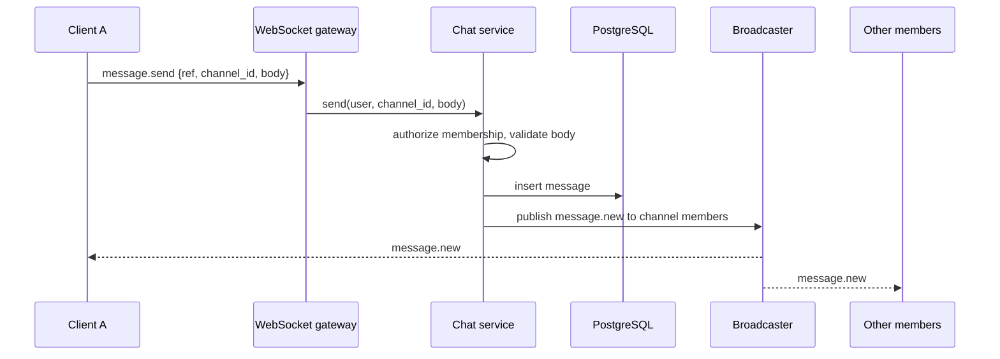
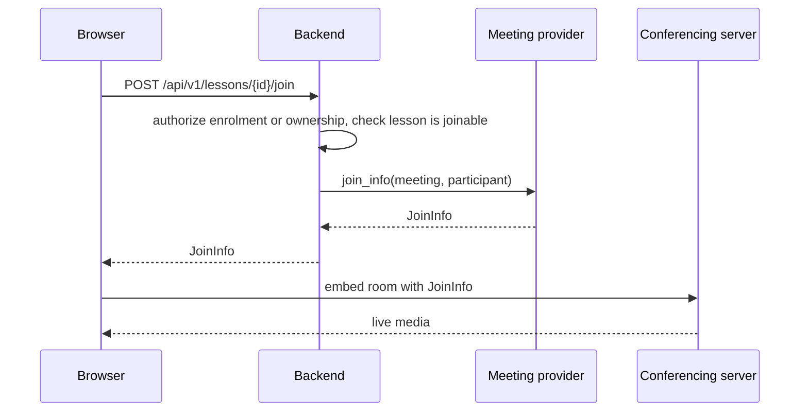

# Realtime and video specification

Covers the two live features: **chat and notifications** over one WebSocket, and **video lessons**
through an embedded conferencing provider (Jitsi Meet, with BigBlueButton behind the same
interface). The REST entry points are in the [API specification](api.md); the entities are in the
[data model](data-model.md).

## Chat

### Principle

The database is the source of truth; the WebSocket is a delivery channel. Every message is persisted
first, then fanned out to connected sockets. A client that was disconnected recovers missed
messages from the REST history endpoint, never from the socket.

### Connection

- One WebSocket per browser tab at `WSS /api/v1/ws`. The URL carries no credentials.
- The first client frame must be `{"type": "auth", "payload": {"access_token": "<JWT>"}}` within a
  bounded time; otherwise the server closes the socket with code `4401`. An expired token closes
  with `4401` as well, and the client reconnects after refreshing its token.
- After authentication the gateway registers the socket in the connection registry
  (`user_id → set of sockets`; a user may have several tabs) and removes it on every close path,
  including errors and abrupt disconnects.
- The server resolves channel membership from enrolment and direct-channel membership. The client
  never subscribes to arbitrary channels.

### Frame format

Typed JSON frames. Frame types and close codes are enums in `ovc.domain`; payloads are Pydantic
models in `ovc.schemas`.

```json
{ "type": "message.new", "payload": { "id": "...", "channel_id": "...", "sender_id": "...", "body": "...", "created_at": "..." } }
```

| Direction | Types |
|---|---|
| Client → server | `auth`, `message.send`, `typing.start`, `typing.stop`, `ping` |
| Server → client | `message.new`, `message.updated`, `message.deleted`, `typing`, `presence`, `notification`, `pong`, `error` |

An `error` frame carries the same `{"code", "message", "request_id"}` object as the
[REST error body](api.md#conventions) plus the offending frame's client-chosen `ref`, and the
socket stays open unless the error is an authentication failure.

### Send path



`POST /api/v1/channels/{id}/messages` calls the same service method, so both entry points persist
and fan out identically.

### Authorization

Every inbound frame is authorized against channel membership in the service, regardless of what
the client sends. A frame naming a channel the user is not a member of gets an `error` frame with
the `not_found` code.

### Broadcaster and scaling

The broadcaster is an interface. The first implementation delivers to the in-process registry, so
the MVP runs one backend instance. Running several instances means adding a broadcaster backed by
PostgreSQL `LISTEN/NOTIFY` or a message broker; that change is local to the adapter.

### Presence and typing

Ephemeral, never persisted. A user is online while they have at least one authenticated socket.
`typing` frames expire on the client after a short timeout.

### Notifications

Services publish `notification` frames to individual users for events such as a graded submission,
a returned submission, a newly published assignment or a lesson about to start. A notification is a
hint to refetch; the client loads the actual state through the REST API.

## Video

### Approach

Embed the conferencing provider. Media (routing, screen share, recording) is entirely the
provider's job; the backend never relays media. The backend only:

1. creates a meeting for a lesson, with an opaque, server-generated room name;
2. authorizes a user to join that lesson's meeting;
3. returns what the browser needs to embed the room.

[ADR-0003](../../docs/decisions/0003-embedded-video-provider.md) records why OVC does not build its
own WebRTC stack.

### Provider interface

One interface in `ovc.adapters`, with a Jitsi, a BigBlueButton and a fake implementation, all checked
by the same contract tests:

```python
class MeetingProvider(Protocol):
    async def create_room(self, lesson_id: UUID) -> MeetingRoom: ...
    async def join_info(self, meeting: Meeting, participant: Participant) -> JoinInfo: ...
    async def end_room(self, meeting: Meeting) -> None: ...
```

`Participant` carries only a display name and a `moderator` flag; no email, user identifier or other
personal data reaches the provider.

- **Jitsi:** the room name is 128 bits of randomness, unrelated to course or lesson identifiers.
  `JoinInfo` is `{provider: "jitsi", domain, room_name, token}`. With a token-gated deployment the
  backend signs a short-lived Jitsi token (`OVC_JITSI_APP_ID`, `OVC_JITSI_APP_SECRET`) carrying the
  display name and moderator flag; without one, `token` is `null` and the room is protected only by
  its unguessable name.
- **BigBlueButton:** `create_room` calls the BigBlueButton `create` API; `join_info` returns
  `{provider: "bbb", join_url}`, a checksum-signed join URL with the moderator or attendee role;
  `end_room` calls `end`.
- **Fake:** records created, joined and ended rooms in memory and returns deterministic join info.
  Used by every integration and end-to-end test.

### Join flow



### Authorization rules

- Only the course teacher (moderator) and its enrolled students (attendees) obtain `JoinInfo`.
- A lesson is joinable from a bounded time before `starts_at` until it is ended or cancelled.
- Room names are never derived from client input. With a token-gated deployment a leaked room name
  is useless without a backend-signed token.
- Only the course teacher ends a lesson; ending sets the lesson status to `ended` and ends the room
  where the provider supports it.

### Frontend lifecycle

- The video feature mounts the embed after a successful join and disposes of the embed instance on
  leave and on unmount, so no connection outlives the page.
- Lesson status (`scheduled` → `live` → `ended`, or `cancelled`) belongs to OVC, not to the provider.
  A lesson becomes `live` when its teacher first joins.

### Configuration

`OVC_MEETING_PROVIDER` selects `jitsi`, `bbb` or `fake`; the remaining variables are listed in
[configuration](../architecture/detailed.md#configuration). Local development may use the public
Jitsi instance without tokens; production uses a self-hosted token-gated Jitsi or BigBlueButton.
