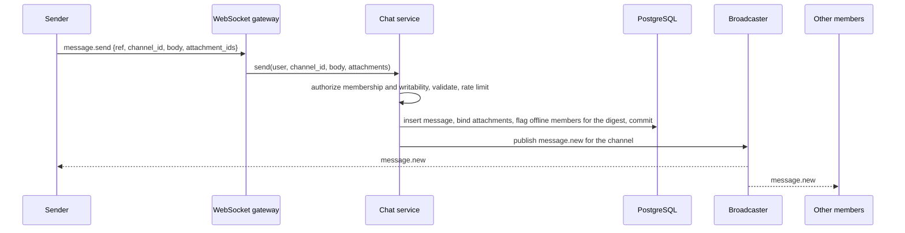
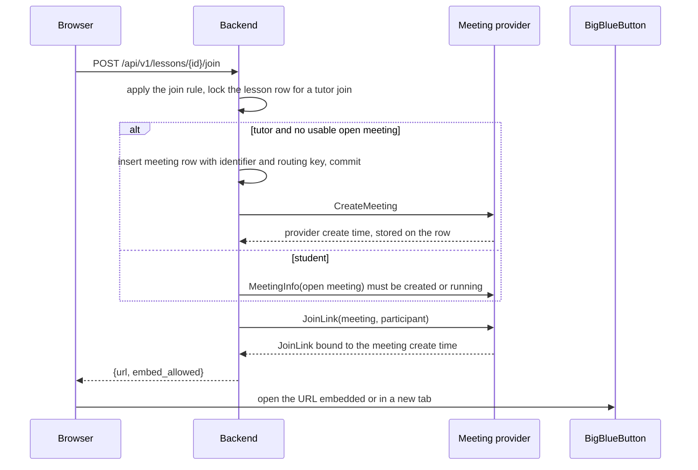
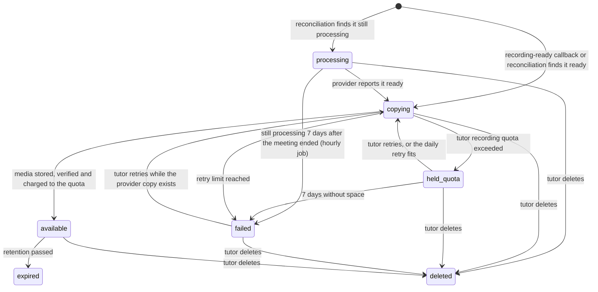

# Realtime and video specification

Covers chat, live updates and in-app notifications over one WebSocket (FR-12, FR-13.1), and video lessons and recordings through BigBlueButton (FR-5). Decisions: [ADR-0003](../../docs/decisions/0003-embedded-video-provider.md), [ADR-0004](../../docs/decisions/0004-bigbluebutton-primary-provider.md). Provider facts: [BigBlueButton research](../research/bigbluebutton-2026-10-20.md).

## Chat

### Channels

| Kind | Members | Created | Read-only when |
|---|---|---|---|
| `direct` | the tutor and the student of one relationship | when the relationship first becomes active | the relationship is ended; writable again on reactivation |
| `group` | the tutor and the current members of one group | with the group | the group is archived |

- There are no student-to-student direct channels.
- A member removed from a group loses access to its channel, including its history.
- A student whose relationship ended keeps read access to the direct channel.
- Posting to a read-only channel is refused with `channel_read_only`.

### Messages

- **Body:** 1 to 4,000 characters of plain text. It is rendered as text with `http` and `https` links detected; no other scheme becomes a link, and nothing is rendered as HTML.
- **Attachments:** up to 10 from the [chat context](files.md#contexts-and-limits). Images get a preview.
- **Editing and deleting:**
  - the author edits their message within 24 hours, marked "edited"; later edits are refused with `edit_window_passed`;
  - the author deletes it at any time, shown as "message deleted";
  - the tutor deletes any message in their direct and group channels, including attachments, to free storage;
  - every edit and delete requires current membership and a writable channel (`channel_read_only` otherwise).
- **Rate limits:** at most 30 messages per minute per user across channels, and at most 200 MB of chat attachments per student per tutor per day; beyond that the server refuses with `rate_limited`. These limits are counted in memory per API instance.
- **History** is paginated by keyset `(created_at, id)`, newest first, 50 per page.
- **Unread state:**
  - each channel stores its latest message identifier, and each member a read marker (the last read message), which moves when the client reports reading;
  - `GET /channels` computes unread counts in one aggregate query, capped at 99 per channel and shown as "99+".

### Principle

The database is the source of truth; the WebSocket is a delivery channel. Every message is committed first, then published. A reconnecting client recovers missed messages from the history route, never from the socket.

### Connection

- **Endpoint:** one WebSocket per browser tab at `WSS /api/v1/ws`. The URL carries no credentials, and the gateway accepts only connections whose `Origin` is the OVC origin: `coder/websocket` is configured with that exact origin in `OriginPatterns`, never a wildcard that could admit the conferencing subdomain, and `InsecureSkipVerify` is never set.
- **Authentication:**
  - the first client frame must be `{"type": "auth", "payload": {"access_token": "<JWT>"}}` within 5 seconds;
  - otherwise, or with an invalid or expired token, the server closes with code `4401`;
  - at most 500 unauthenticated sockets per instance are accepted;
  - the client refreshes its token and reconnects with exponential backoff and random jitter.
- **Registry:**
  - after authentication, the gateway registers the socket in the connection registry, which `internal/realtime` owns, and removes it on every close path;
  - **presence is persisted:** while a user has a socket, the gateway extends `user.online_until` to now plus 90 seconds about once a minute, batching these updates per instance. When the user's last socket on the instance closes, it sets `online_until` and `last_seen_at` to now. `last_seen_at` is always a past instant: the time of the last connection activity. Every process and instance can therefore tell who is online.
- **Bounds:**
  - **outbound:** each socket has a bounded queue of 256 frames or 1 MiB. A socket whose queue overflows is closed with `4429`, and the client reconnects and refetches; this is the contract that replaces delivery guarantees for slow consumers. Each frame is serialised once for all its recipients.
  - **inbound:** frames are at most 16 KiB (`SetReadLimit(16384)` on every connection), and at most 20 frames per second per socket are accepted; typing frames are coalesced to one per channel every 2 seconds. Violations get an `error` frame, and repeated violations close the socket with `4429`.
  - **liveness:** the server pings every 25 seconds and closes a socket with no pong for 60 seconds.
  - **database access:** each inbound frame uses its own short database session; no session is held per connection.
- **Membership:**
  - resolved by the server when each frame is published, from a per-instance cache that the broadcaster invalidates on every membership change, so removed members and ended relationships stop receiving immediately;
  - clients never subscribe to arbitrary channels.
- **Revocation:** sockets of a revoked session, a blocked account or a deleted account are closed with `4401` ([roles and accounts](accounts.md#roles-and-accounts)).

### Frame format

Typed JSON frames; types and close codes are enums in `internal/domain`, and payloads are structs in `internal/schemas`.

| Direction | Types |
|---|---|
| Client → server | `auth`, `message.send`, `message.read`, `typing.start`, `typing.stop`, `ping` |
| Server → client | `message.new`, `message.updated`, `message.deleted`, `read.updated`, `typing`, `presence`, `notification.new`, `entity.changed`, `pong`, `error` |

- An `error` frame carries `{"code", "message", "request_id", "ref"}`, where `ref` echoes the client's frame reference. The socket stays open unless the error is an authentication failure.
- `entity.changed` carries `{kind, id}` with `kind` one of `lesson`, `issue`, `submission`, `recording`, `channel`, `relationship`.

### Send path



- `POST /api/v1/channels/{id}/messages` calls the same service method.
- **The digest flag:** members whose `online_until` has passed get it set in the same transaction ([message digest](notifications.md#message-digest)).

### Presence and typing

- A user is online while their `online_until` is in the future.
- Presence changes are sent only to users who share a writable channel with them, debounced to at most one change per user every 5 seconds.
- Typing frames are relayed to the channel's other connected members and expire on the client after 5 seconds.
- Typing is never persisted.

### In-app notifications and live updates

- Services publish `notification.new` to individual users after a notification row is committed ([notifications](notifications.md#channels)).
- Services publish `entity.changed` when an entity visible to the user changes, for example a lesson becoming live.
- The client refetches the entity through REST; frames never carry the authoritative state.

### Broadcaster

- The broadcaster is an interface in `internal/adapters`, so services can publish without importing the gateway.
- **The production implementation** uses PostgreSQL `NOTIFY` after commit, with a small payload of identifiers (payloads are limited to 8,000 bytes).
- **Delivery:**
  - the publishing API instance delivers to its local sockets directly from the frame it already holds;
  - every other instance, and every publication from the worker or `ovc-admin`, is received on a dedicated listening connection per API instance, owned by `internal/realtime`;
  - that instance loads the referenced rows in batches (`id = ANY(…)`) on a pool session, never on the listening connection, then delivers.
- So worker notifications and revocations reach connected users, and several API instances work later.
- **Tests** use the same implementation against the test database; an in-process fake checked by the same contract tests is allowed in unit and contract tests only.

## Video

In the MVP, rooms are created with `record=false` and without the recording-ready callback URL, the recording-ready callback route is not registered, and the provider interface's recording methods, the `recording` kind of `entity.changed` and every recording job wait for recordings, which come [after the MVP](../../docs/roadmap.md#after-the-mvp) by the owner's decision of 2026-10-22; the recording parts of this section describe that later design. MVP rooms also send `autoStartRecording=false` and `allowStartStopRecording=false`. The checks that prove it: the adapter test against the in-process BigBlueButton API (see contract tests below) asserts the create parameters in every run; an integration test proves the recording-ready callback route answers `404`; the slice 7 probe confirms that a moderator sees no start-recording control and that `getRecordings` with `state=any` is empty after a meeting; and scenario 1 of the pilot asserts that the lesson page shows no Recordings block. The conferencing host is deployed with `disableRecordingDefault=true` and with meeting event retention turned off, so it keeps neither recordings nor raw meeting events; the slice 7 probe confirms both settings and their names.

### Approach

BigBlueButton carries the media; OVC never relays it. OVC:

1. creates a meeting for a lesson when the tutor joins;
2. authorizes each join and issues a join link;
3. tracks lesson status;
4. receives recordings and serves them itself.

### Provider interface

One interface in `internal/adapters`, with a BigBlueButton implementation and a fake:

```go
type MeetingProvider interface {
    CreateMeeting(ctx context.Context, meeting Meeting, presentationURL *string) (ProviderCreateTime, error)
    MeetingInfo(ctx context.Context, meeting Meeting) (MeetingInfo, error)
    JoinLink(ctx context.Context, meeting Meeting, participant Participant) (JoinLink, error)
    EndMeeting(ctx context.Context, meeting Meeting) error
    ListRecordings(ctx context.Context, meeting Meeting) ([]ProviderRecording, error)
    FetchRecordingMedia(ctx context.Context, recording ProviderRecording) (io.ReadCloser, error)
    DeleteRecording(ctx context.Context, recording ProviderRecording) error
}
```

- **`MeetingInfo`** distinguishes three cases from `getMeetingInfo`:
  - `not_found`: no meeting with that identifier exists;
  - `created`: it exists with no participants yet;
  - `running`: participants are connected.

  `isMeetingRunning` is not used: it reports false until the first participant connects, and that would confuse "created" with "ended".
- **`Participant`** carries the user's account name, a stable opaque per-lesson participant identifier (sent as `userID`) and a role (`moderator` or `viewer`).
- **What the provider never receives:** no email, account identifier or other personal data.
- **Meeting identifiers** are random, server-generated values, never derived from client input.
- **Checksums** are computed only by the backend with SHA-256 or stronger. The server's `supportedChecksumAlgorithms` excludes SHA-1, and the shared secret never leaves the backend.
- **`meta_*` values** never contain a secret or personal data, because meeting users may see them.
- **Contract tests:** the fake runs in every test run. The BigBlueButton adapter runs the same contract tests only against the remote test server, with an opt-in command; a run that was not performed is reported as `unverified`. In every test run, the BigBlueButton adapter is also tested against an in-process `httptest.Server` that answers as the BigBlueButton API and captures each request: in the MVP it asserts that `create` carries `record=false`, `autoStartRecording=false` and `allowStartStopRecording=false`, carries `meetingEndedURL` and no `meta_bbb-recording-ready-url`, and is signed with an accepted checksum; the opt-in remote run also asserts that `getMeetingInfo` reports recording off.

### Join flow



- **Join rule:** who may join is the [join rule](schedule.md#join-rule).
- **Several meetings per lesson:** a lesson can have several meetings over its life, at most one open at a time.
- **On a tutor join:**
  1. Under the lesson row lock, the request inspects the open meeting:
     - a meeting in state `creating` that is less than one minute old means another request is creating it; this request waits up to 10 seconds for it to become `open`, then reuses it;
     - an `open` meeting is reused when `MeetingInfo` reports `created` or `running`;
     - on `not_found` the meeting is closed with reason `provider_not_found`;
     - with no usable meeting, a new row is inserted in state `creating` (identifier and routing key set), and the transaction commits.
  2. Outside the transaction, `CreateMeeting` runs and returns the provider create time. The row becomes `open` with that time, the lesson becomes `live` if it was `scheduled`, and `entity.changed` is emitted.
  3. If the provider fails, the row is closed with reason `provider_error`, the lesson status is unchanged, and the response is `503 provider_unavailable`. A `creating` row older than one minute is treated as failed and closed.
- **On a student join:**
  - the student gets `lesson_not_live` unless the lesson is `live` and its open meeting is `created` or `running`;
  - a `not_found` answer closes the meeting with `provider_not_found` and emits `entity.changed`;
  - a successful student or tutor join sets the meeting's `first_join_at` if it is empty.
- **`room_open`:** `GET /lessons/{id}` returns `room_open`, which is true while the lesson is `live` and has an `open` meeting. It changes with an `entity.changed` frame whenever a meeting opens or closes.
- **Restart the room:** `POST /lessons/{id}/restart-room` (tutor, live lessons) ends the open meeting through the provider, closes it with reason `tutor_restart`, and starts a new one exactly as a tutor join does. Every earlier join link stops working.
- **The join link:**
  - created per request and returned only in the response body of a `POST`;
  - never stored or logged by OVC, and the client navigates to it immediately and does not keep it;
  - bound to the meeting's create time, so it stops working when that meeting ends, but not single-use within the meeting;
  - it does appear in the conferencing host's access logs and, for a new tab, in browser history: an accepted residual risk ([T-25](../../docs/threat-model.md#threats-and-controls)).

  The slice 7 probe checks whether `redirect=false` with a session token can replace the link.
- **Meeting creation** sets:
  - `record=true`, tutor-controlled recording (after the MVP; MVP rooms use `record=false`);
  - `meetingExpireIfNoUserJoinedInMinutes=10`, and `endWhenNoModerator` with a 15-minute delay;
  - `logoutURL` back to the lesson page;
  - the recording-ready callback URL (after the MVP) and `meetingEndedURL`, each with the per-meeting routing key in its path;
  - the presentation, when the lesson has attached PDF materials, from the first of them in attachment order, as a signed storage URL valid for 5 minutes (the provider fetches it at creation).

  The routing key is not a secret, because `meta_*` values may be visible to participants.

### Embedding

- **Hosting and headers:**
  - the client is served from a subdomain of the OVC site;
  - the BigBlueButton web server sends `Content-Security-Policy: frame-ancestors` admitting only the OVC origin;
  - OVC pages send `frame-ancestors 'none'` and admit the subdomain in `frame-src`.
- **The iframe** carries `allow="camera; microphone; display-capture; fullscreen; autoplay"` and a title naming the lesson.
- **`embed_allowed`:**
  - comes from the `OVC_BBB_EMBED_ENABLED` setting and is returned both by `GET /lessons/{id}` and by the join response, so the page knows it before the click;
  - it stays false until the slice 7 probe records success in the [research file](../research/bigbluebutton-2026-10-20.md#embedding-the-client);
  - the end-to-end harness can override it per test deployment.
- **Client join states** are in [the lesson page](../design/web/pages.md#lesson).

### Callbacks

- **Recording ready** (`POST /integrations/bbb/{routing_key}/recording-ready`):
  - the JWT in `signed_parameters` is verified first: `HS256` only, with the shared secret;
  - then its `meeting_id` must equal the provider meeting identifier of the routing key's meeting;
  - **responses:**

    | Answer | When |
    |---|---|
    | `401` | Invalid signature, or a mismatched or unknown meeting, so unknown routing keys are not revealed |
    | `410` | The recording is already `expired` or `deleted` in OVC |
    | `200` | The recording row is new or still `processing`: it is set to `copying` and a copy job is enqueued |
    | `200` | Any other state: the callback is a no-op |

- **Meeting ended** (`GET /integrations/bbb/{routing_key}/ended`):
  - unsigned by the provider, so it is only a hint;
  - it is ignored for meetings created less than 2 minutes ago or with no recorded join, and debounced to one check per meeting per minute;
  - OVC then calls `MeetingInfo` and closes the meeting only on `not_found`; if the meeting still exists, the worker checks again after 2 minutes, at most three times;
  - `recordingmarks` is recorded for diagnostics only and never settles reconciliation, because the hint is unauthenticated;
  - it never ends the lesson ([lesson status](schedule.md#lesson-status-and-join-window));
  - it always answers `200`.
- **Retries:** the provider's retry behavior on non-2xx answers is an open probe item. Reconciliation makes OVC independent of it.

### Recordings

After the MVP ([roadmap](../../docs/roadmap.md#after-the-mvp)); the MVP's rooms record nothing.



**Provider states** from `getRecordings`:

| Provider state | OVC action |
|---|---|
| `processing` | Create or keep the row in `processing` |
| `processed`, `published`, `unpublished` | Move a `processing` row to `copying` and enqueue a copy |
| `deleted` | A row not yet `available` becomes `failed` with reason `provider_deleted` |

- **Reconciliation:**
  - every 30 minutes the worker calls `ListRecordings` with `state=any` for meetings ended within the last 7 days that are not yet settled, in batches of 20, at most 4 at a time, with timeouts;
  - a meeting is settled when one of these holds:
    - its recordings are all past `processing`;
    - two consecutive results are empty at least 2 hours after it ended;
    - 7 days have passed;
  - lessons ended by the status job set their open meeting's `ended_at`, so they are reconciled too.
- **Copy:**
  - each copy is an outbox job with idempotency key `(recording, attempt generation)`; the generation increases on every tutor or daily retry;
  - the worker streams the rendered media into OVC object storage under a random key with 8 MiB multipart parts, computing its own SHA-256 and size, and renews its lease every 5 minutes while streaming;
  - when the provider reports a size, the quota is checked before transferring;
  - the copy commits with a conditional update of the tutor's usage (`usage + size ≤ quota`) and of the recording state (still `copying`), and then:
    - **success:** sets `available`, writes a `provider_call` outbox row to delete the provider copy, and emits `entity.changed`;
    - **quota exceeded:** sets `held_quota` and writes a `storage_delete` row for the copied object in the same transaction;
    - **deleted meanwhile:** writes a `storage_delete` row for the copied object;
    - **failure:** aborts the multipart upload;
  - when the outbox row goes `dead`, the dispatcher sets the recording `failed` and notifies the tutor with `recording.failed`.
- **The copy path is conditional on the recordings probe, run when recordings are planned after the MVP,** finding a rendered single-file format. If there is none, the fallback is a protected-recordings load balancer in front of BigBlueButton. Playback then returns its one-time URL, and the states above apply without `copying`. This is an open question that blocks the recordings plan after the MVP ([open questions](../architecture/detailed.md#open-implementation-questions)).
- **Provider copies are always deleted through `provider_call` outbox rows:**
  - after a successful copy;
  - when a tutor deletes a recording in any state;
  - when a recording has been `held_quota` for 7 days;
  - when a `failed` recording has not been retried for 7 days.

  Deleting the raw provider data is an open probe item. As a deployment requirement, the BigBlueButton web server serves `/playback/` and `/presentation/` to nobody but the worker's address.
- **Audience:** the lesson's tutor and roster. Access survives the end of a relationship until the recording expires.
- **Playback:** `GET /api/v1/recordings/{id}/playback` authorizes the caller as tutor or roster member and returns `{url, expires_at}` with a 5-minute signed storage URL, which the client sets as the video source.
  - The URL may expire while the browser is still fetching ranges. When the media element reports a network error or the URL is about to expire, the client requests the route again, swaps the source, and resumes at the current position.
  - No other route reaches the media.
- **Retention:**
  - each meeting records the tutor's retention setting when it is created;
  - a recording's `expires_at` is its availability time plus that retention;
  - the worker deletes expired media, sets `expired` and subtracts the size from usage;
  - the tutor may delete earlier, which also subtracts the size.

### Authorization rules

- Join links go only to people allowed by the [join rule](schedule.md#join-rule): the tutor as moderator, students as viewers.
- Callback routes act only as described under [callbacks](#callbacks).

### Configuration

`OVC_MEETING_PROVIDER` is `bbb` or `fake`. `OVC_BBB_EMBED_ENABLED` gates embedding. The other variables are in [configuration](../architecture/detailed.md#configuration). There is no local BigBlueButton on developer machines; live checks use a remote test server, and end-to-end tests use the fake provider's test room ([development](../../docs/development.md#end-to-end-test-harness)).
