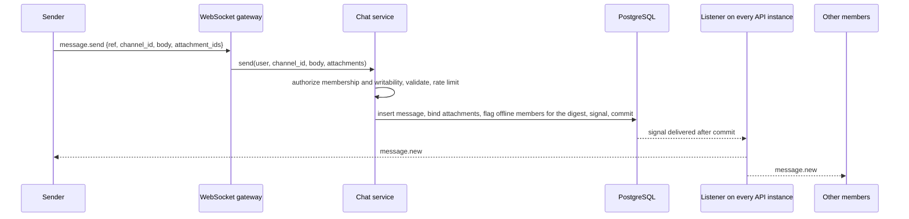
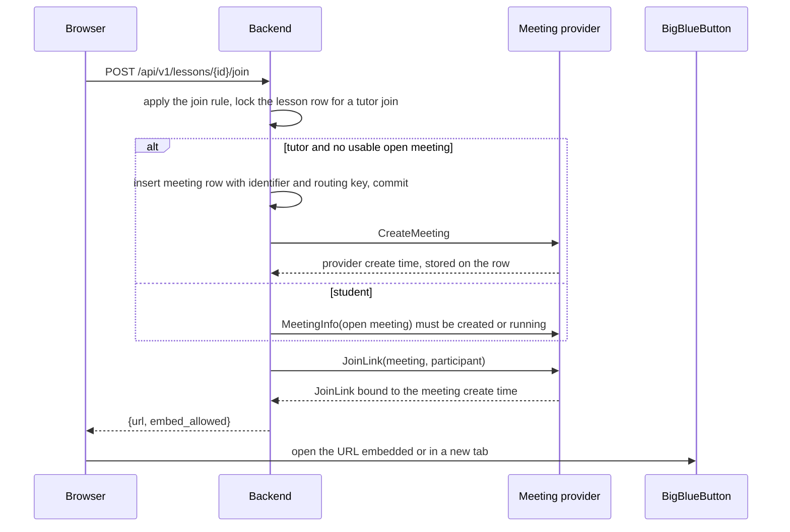
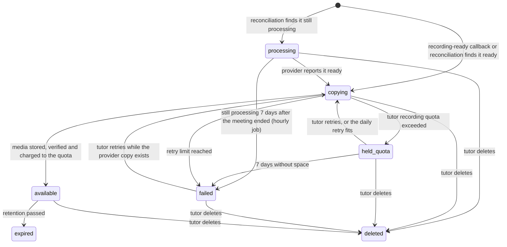

# Realtime and video specification

Covers chat, live updates and in-app notifications over one WebSocket (FR-12, FR-13.1), and video lessons and recordings through BigBlueButton (FR-5). Decisions: [ADR-0003](../../docs/decisions/0003-embedded-video-provider.md), [ADR-0004](../../docs/decisions/0004-bigbluebutton-primary-provider.md). Provider facts: [BigBlueButton research](../research/bigbluebutton-2026-10-20.md).

## Chat

### Channels

| Kind | Members | Created | Read-only when |
|---|---|---|---|
| `direct` | the tutor and the student of one relationship | when the relationship first becomes active, or provisional (from slice 6, [ADR-0014](../../docs/decisions/0014-students-join-through-their-tutor.md)) | the relationship is ended; writable again on reactivation |
| `group` | the tutor and the current members of one group | with the group | the group is archived |

- There are no student-to-student direct channels.
- A `provisional` relationship reaches only its `direct` channel, never a group channel; the student's membership ends when the link is removed or a reclaim drops it, and the messages written during the provisional period are erased when a reclaim drops it ([ADR-0014](../../docs/decisions/0014-students-join-through-their-tutor.md)).
- A member removed from a group loses access to its channel, including its history.
- A student whose relationship ended keeps read access to the direct channel.
- Posting to a read-only channel is refused with `channel_read_only`.

### Messages

- **Body:** 1 to 4,000 characters of plain text. It is rendered as text with `http` and `https` links detected; no other scheme becomes a link, and nothing is rendered as HTML.
- **Attachments:** up to 10 from the [chat context](files.md#contexts-and-limits). Images get a preview.
- **Editing and deleting:**
  - the author edits their message within 24 hours, marked "edited"; later edits are refused with `edit_window_passed`;
  - the author deletes it at any time, shown as "message deleted";
  - the tutor deletes any message in their direct and group channels, including attachments, to free storage;
  - every edit and delete requires current membership and a writable channel (`channel_read_only` otherwise).
- **Rate limits:** at most 30 messages per minute per user across channels, and at most 200 MB of chat attachments per student per tutor per day; beyond that the server refuses with `rate_limited`. These limits are counted in memory per API instance.
- **History** is paginated by keyset `(created_at, id)`, newest first, 50 per page.
- **Unread state:**
  - each channel stores its latest message identifier, and each member a read marker (the last read message), which moves when the client reports reading;
  - `GET /channels` computes unread counts in one aggregate query, capped at 99 per channel and shown as "99+".

### Principle

The database is the source of truth; the WebSocket is a delivery channel. Every change is committed first; the signal that announces it is written inside the same transaction and delivered only once that transaction commits ([broadcaster](#broadcaster)). Frames carry identifiers only, never the authoritative state: a client refetches through REST, which enforces scope again. A reconnecting client recovers missed data through REST, never from the socket (NFR-4.3).

Slice 4 builds the connection, authentication and revocation, the broadcaster, and the frames `ready`, `notification.new`, `entity.changed`, `pong` and `error` from the server and `auth` and `ping` from the client; chat frames, presence and typing arrive with slice 6. The [slice 4 plan](../plans/slice-4.md#3-decisions-the-plan-proposes) records the alternatives and reasons behind the rules below.

### Connection

- **Endpoint:** one WebSocket per browser tab at `GET /api/v1/ws`, audience `user, unverified ok`, authenticated by its first frame. The URL carries no credential, and the gateway reads no cookie.
- **Before the upgrade:**
  - the route is registered outside huma but passes the same outer handlers as every other route: recovery, request identifier, security headers and the access record, which names the route template only;
  - it requires exactly one `Origin` header, equal to the normalised `OVC_PUBLIC_URL` in scheme, host and port, compared by the same plain `net/http` function that the sign-in, refresh and confirmation routes use over every `Origin` value; a missing, foreign or repeated `Origin` answers `403 forbidden`, and an `Origin` that merely equals the request's `Host` is foreign unless it equals the OVC origin;
  - a request that is not a WebSocket upgrade answers `400 bad_request`; a full unauthenticated budget (below) answers `503 service_unavailable` with `Retry-After: 5`; each of these answers carries the API error body and `Cache-Control: no-store`;
  - only then is `coder/websocket` asked to accept the upgrade, with `OriginPatterns` holding the OVC host only and never `InsecureSkipVerify`, as a second check. The library's own origin rule is weaker than OVC's (for example it accepts a missing `Origin`, matches the host without the scheme and refuses with a plain-text `403`); the gateway's own check decides, so the contract does not depend on the library's behaviour, which is confirmed against the pinned version and recorded in the [stack table](../architecture/detailed.md#stack-per-component) when the dependency is added.
- **After the upgrade:** the read and write deadlines of the HTTP request are cleared; the gateway sets its own deadlines per frame.
- **Authentication:** the first client frame must be `auth` within 5 seconds of the upgrade (an injected duration that tests shorten); [authentication and revocation](#authentication-and-revocation) has the rules.
- **Registry:** `internal/realtime` owns the connection registry: a socket is registered under its account and session when its `auth` frame has a valid token, and removed on every close path.
- **Limits:**
  - at most 500 unauthenticated sockets per instance and 20 per client address (the trusted client address of `OVC_TRUSTED_PROXY_CIDRS`, as for every per-IP limit); the next upgrade answers `503`;
  - at most 20 authenticated sockets per account per instance; the 21st `auth` closes with `4429`, and the client backs off up to 60 seconds. Residual: a stolen access token can fill its account's 20 slots until the token lapses or the session is revoked.
- **Bounds:**
  - **outbound:** each socket has a FIFO queue of at most 256 frames or 1 MiB, frames held while the socket is suspended included; an enqueue that would exceed either closes the socket with `4429` instead of waiting; the writer writes with a 10-second deadline and closes with `4429` when it passes. A slow socket therefore never delays the listener or another socket ([ADR-0009](../../docs/decisions/0009-owner-approved-exceptions-and-visibility.md), item 3). Each frame is serialised once and the same bytes are enqueued for every recipient socket on the instance;
  - **inbound:** text frames only, and a binary frame closes with `1003`; a frame over 16 KiB closes with `1009`, which the library sends on its read limit (`SetReadLimit(16384)`); a malformed frame, an unknown type or a type reserved for slice 6 gets an `error` frame (`bad_request`) and the socket stays open; more than 20 frames in a second get `error` frames (`rate_limited`), and five violations within 10 seconds close with `4429`; any frame other than `auth` before authentication closes with `4401`. From slice 6, typing frames are coalesced to one per channel every 2 seconds;
  - **`ref`:** a client frame reference must match `^[A-Za-z0-9._-]{1,64}$`, the request identifier's character set, or the frame is malformed; `ref` values are echoed in `pong` and `error` frames and never logged;
  - **liveness:** the server pings every 25 seconds and closes a socket without a pong for 60 seconds;
  - **database access:** a socket holds no database session; each lookup it needs runs on a short pool session.
- **Shutdown:** on shutdown the gateway closes every socket with `1001` before the HTTP server's 40-second drain.
- **Goroutines:** every reader, writer, re-check and listener goroutine starts through `core.Go`, which recovers and logs a panic ([observability](observability.md#output-and-failure-behavior)).
- **The client** (`frontend/src/lib/realtime`):
  - one reconnecting client per tab, owned by the session epoch: it connects while the session is signed in and is closed and discarded when the epoch changes;
  - it sends `auth` with the in-memory access token, refreshed first when it expires within 30 seconds, and sends every new access token the session obtains in-band as another `auth` frame on the open socket;
  - it reconnects with exponential backoff from 1 to 30 seconds with full jitter, and waits up to 60 seconds after `4429`; after every `ready` that follows a reconnect (not an in-band re-authentication) it refetches the visible data ([live refetch mapping](../architecture/detailed.md#live-refetch-mapping));
  - on `4401` it refreshes once: a new token reconnects, and a refused refresh ends the session with the reason the refresh reports ([navigation](../design/web/navigation.md#rules));
  - it sends `ping` every 30 seconds and reconnects when no `pong` arrives within 10 seconds;
  - the socket factory is injected, and the fake socket of the component tests is checked against the frames the real gateway emits by the same contract test as the client's parser ([frame format](#frame-format)).
- **Chat membership** (slice 6): resolved by the server when each chat frame is published, from a per-instance cache that the broadcaster invalidates on every membership change, so removed members and ended relationships stop receiving immediately; clients never subscribe to arbitrary channels.

### Authentication and revocation

- **`auth`:** the access token is verified as on REST (signature, expiry, claims). The socket is then registered under its account and session, **suspended** and tagged with the listener's current generation ([broadcaster](#broadcaster)), before the session lookup. The lookup checks that the session is neither revoked nor expired and that the account is `active` or `unverified`. `ready` is sent, and the socket starts receiving, only when:
  - the lookup passed;
  - the listener's generation is unchanged;
  - every `recheck` for the account that arrived after the registration was followed by a passing lookup: a `recheck` that arrives during authentication triggers one more lookup after the first, and when that lookup passes and the generation is still unchanged the socket gets `ready`, so another session's sign-out does not close an authenticating socket.

  Otherwise the socket closes with `4401` (a failed lookup) or `1013` (a changed generation). A revocation committed while a socket authenticates is therefore never missed: its `recheck` finds the registered socket. A full per-account budget closes with `4429`, and a lost listener closes with `1013` until `LISTEN` is re-established.
- **In-band `auth`:** a later `auth` frame with a valid token for the same session and the same account verifies its token every time, shares the socket's one-per-second session lookup (below) and reuses its result within that second, because the session must be the same, keeps the later of the recorded and the new token expiry and is answered with `ready`; an `auth` for another session or another account closes with `4401`.
- **Token lapse:** the gateway records the access token's `exp` at `auth`. When the recorded expiry plus a grace of 30 seconds passes without a fresh token, the socket closes with `4401`, so a socket never lives longer than its access token.
- **Inbound frames after `auth`** repeat the session and account lookup, but one socket performs at most one lookup per second and frames within that second reuse its result; a failure closes with `4401`. `ping` is answered with `pong` echoing `ref`.
- **Revocation:** every path that revokes a session or ends an account signals a `recheck` for the account inside its own transaction, through the database triggers of the [data model](data-model.md#revocation-triggers): sign-out (`POST /auth/logout`), sign out everywhere, refresh-token reuse, the same-browser confirmation (the other sessions), a reclaim (every session, the squatter's included), a password reset, a password change (the other sessions), account deletion, an operator block through `ovc-admin` in its own process, the 7-day cleanup of an unconfirmed account and the purge. On a `recheck`:
  - the listener marks that account's local sockets suspended at once and hands the account to the re-check worker; the listener itself never waits for a query;
  - at most one re-check per account runs at a time, and signals that arrive meanwhile make it run once more afterwards;
  - while suspended, frames for those sockets are queued and count against the outbound bound, so an overflow closes with `4429`;
  - one query with a 2-second timeout re-reads their sessions and the account; failing sockets close with `4401`, and the others deliver their queued frames in order and resume;
  - a failed query closes the account's sockets with `1012`, and each reconnect authenticates afresh.
- **Bound:** a `recheck` is delivered at commit, so a revoked session's sockets close with `4401` within 5 seconds while the listener is alive; a listener that has been silent for 5 seconds is detected by its missing heartbeat, and every local socket is then closed with `1012` ([broadcaster](#broadcaster)).
- **Sweep:** every 60 seconds the gateway re-checks the session and account of every local socket in one batched query and closes with `4401` those whose session expired or was revoked, or whose account is no longer `active` or `unverified`, matching the per-frame lookup, as defence in depth.
- **Narrowing on lost scope:** ending a relationship, removing a provisional or reclaim-pending student, a dropped reclaim link and a tutor's or a student's deletion close no socket of the other party (the deleted account's own sockets close through the trigger on its state). Their transactions decide the recipients of `entity.changed` from relationship rows they hold locked ([authorization of frames](#authorization-of-frames)), so the student of a removed or dropped link gets one last `relationship` frame, refetches My tutors, which no longer lists the tutor, and gets nothing about that relationship afterwards; after an ending, frames reach the former student only when the student's projection changes again (a reactivation, `account_closed_until`). Sockets close only when a session or the account itself ends, or when the access token lapses without a fresh one.

### Frame format

Typed JSON text frames: `{"type": <enum>, "ref"?: string, "payload"?: object}`, with unknown properties refused. Types and close codes are enums in `internal/domain`, and payloads are structs in `internal/schemas`. They are not published through OpenAPI, because generating schemas for them would need reflection in hand-written code: the frontend mirrors them by hand in `frontend/src/lib/realtime/frames.ts` with a strict parser, and a contract test drives every server frame type and close code through the real backend and parses each frame with that parser, so a field the gateway adds, renames or removes fails it. On the Go side, `TestEveryFrameTypeHasAGatewayTest` fails when a frame type or close code of the enums has no gateway test that produces it.

| Direction | Type | Payload | Notes |
|---|---|---|---|
| client → server | `auth` | `{access_token}` | first frame, within 5 seconds of the upgrade; later, a fresh token of the same session; the token is never logged |
| client → server | `ping` | — | re-checks the session and account (at most once per second); answered with `pong` |
| server → client | `ready` | `{}` | after a successful `auth`, first or in-band |
| server → client | `notification.new` | `{id}` | a notification row was inserted for this account |
| server → client | `entity.changed` | `{kind, id}` | refetch the entity through REST |
| server → client | `pong` | — | echoes `ref` |
| server → client | `error` | `{code, message, request_id, ref}` | `request_id` is the inbound frame's identifier and `ref` echoes the client's reference; the socket stays open |

- **`entity.changed` kinds:** `relationship`, `join_request` and `notification` from slice 4; `lesson` from slice 5, `channel` from slice 6, `issue` and `submission` from slice 9, and `recording` after the MVP.
- **Reserved for slice 6:** client frames `message.send`, `message.read`, `typing.start` and `typing.stop`, and server frames `message.new`, `message.updated`, `message.deleted`, `read.updated`, `typing` and `presence`. Until then a reserved client type gets an `error` frame like an unknown one.

**Close codes:**

| Code | Meaning | Client |
|---|---|---|
| `1000` | the client closed | — |
| `1001` | server shutdown | reconnects with backoff |
| `1003` | a binary frame | reconnects with backoff |
| `1009` | a frame over 16 KiB | reconnects with backoff |
| `1012` | the listener was lost or a re-check failed | reconnects with backoff |
| `1013` | the listener is not back yet | reconnects later, with backoff |
| `4401` | authentication failed, the token lapsed, or the session or account no longer allows the socket | refreshes once, then reconnects or ends the session |
| `4429` | slow consumer, repeated frame violations, or too many sockets of the account | reconnects after up to 60 seconds |

Close reasons are fixed short strings, never data.

### Authorization of frames

Inbound frames in slice 4 (`auth`, `ping`) carry no identifier, so nothing is resolved in a client-chosen scope, and clients never subscribe. Outbound recipients are decided in the producer's transaction, from rows it holds locked: a transaction that names a student as a frame recipient reads the relationship row with at least `FOR SHARE`, which conflicts with the `FOR UPDATE` and `FOR NO KEY UPDATE` locks that ending, removal and dropping a reclaim link take, so a producer waiting behind a removal sees the row discarded and names no former student ([lock order](accounts.md#locks-and-the-session-re-check)). A student gets a frame only when the student's own view changes, so the timing and presence of frames never tell a student that a tutor blocked them or suppressed their request, nor that a tutor edited private notes.

| Frame | Recipients |
|---|---|
| `notification.new` | the recipient of the inserted row only |
| `entity.changed relationship` | the tutor on every committed change of the card; the linked student account only when the student-visible projection of the relationship changes: the `MyTutor` fields that come from the relationship row (`state`, `colour`, `ended_at`, `ended_by`, `account_closed_until`), including the change that removes the relationship from the student's view (removal, a dropped reclaim link); never another tutor of the same student. Tutor-only edits (notes, the card name, the card email) send the student nothing |
| `entity.changed join_request` | the tutor only for requests inside the tutor's scope at commit (never held, suppressed, closed by an unblock or of an operator-blocked account); the student only when the student's `SentJoinRequest` changes through a decision: accept, and decline, which sends the same frame with or without a block; the student's own code entry sends one identical frame to the student's other sockets whether the request was created, existing, held or suppressed |
| `entity.changed notification` | the recipient's own sockets, after a read change, so other tabs update the badge |
| `recheck`, `heartbeat` signals | not frames: they close or keep sockets, or prove the listener alive |

- Creation, release, suppression, un-suppression, the closing by an unblock, a repeated decline that adds a block, expiry (which the student's list derives from times) and an operator block send the student nothing distinguishable.
- Every frame also reaches the acting account's other sockets, within the same rules.
- `entity.changed` to students when a tutor edits their own profile (name, bio, subjects) waits until a page needs it; students see the change on their next fetch.
- Tutor deletion locks no student's user row and sends its `relationship` frames in signals of at most 100 recipients each.
- Denial tests connect a second tutor who shares the student and prove that no frame about the first tutor's relationship or requests reaches it, and prove that a student's frames are identical whether or not the tutor blocked them.

### Send path

Chat (slice 6) follows the same path as every other producer:



- `POST /api/v1/channels/{id}/messages` calls the same service method.
- **The digest flag:** members whose `online_until` has passed get it set in the same transaction ([message digest](notifications.md#message-digest)).

### Presence and typing

Slice 6 adds these with chat; slice 4 keeps presence only in each API instance's registry, which the test control route `POST /__test__/presence` reports as `{online, sockets}` ([development](../../docs/development.md#end-to-end-test-harness)).

- **Persisted presence** (slice 6): while a user has a socket, the gateway extends `user.online_until` to now plus 90 seconds about once a minute, batching these updates per instance. When the user's last socket on the instance closes, it sets `online_until` and `last_seen_at` to now. `last_seen_at` is always a past instant: the time of the last connection activity. Every process and instance can therefore tell who is online. The columns arrive with presence frames and the message digest, their only consumers.
- A user is online while their `online_until` is in the future.
- Presence changes are sent only to users who share a writable channel with them, debounced to at most one change per user every 5 seconds.
- Typing frames are relayed to the channel's other connected members and expire on the client after 5 seconds.
- Typing is never persisted.

### In-app notifications and live updates

- A producer that inserts a notification row signals `notification.new` to its recipient in the same transaction, only when the row was actually inserted ([notifications](notifications.md#channels)).
- A producer that changes an entity a user sees signals `entity.changed` to the recipients of the [authorization rules](#authorization-of-frames), for example when a card changes or a request is decided, and from slice 5 when a lesson becomes live.
- The client refetches the entity through REST; frames never carry the authoritative state.

### Broadcaster

- **Signals are written inside the committing transaction.** A producer issues `SELECT pg_notify($1, $2)` with bound parameters through the `Signals` repository in `internal/repositories`, as a statement of its own transaction; revocation signals come from database triggers ([revocation triggers](data-model.md#revocation-triggers)). PostgreSQL delivers a notification only when that transaction commits, in commit order, and never for a rolled-back one, so no crash between commit and publish can lose a signal. Every API instance, the producing one included, delivers from its own listening connection; there is no direct local path.
- **Payload:** versioned JSON on the channel `ovc_realtime`, `{"v": 1, "k": "recheck" | "notification" | "entity" | "heartbeat", "u": [user ids], "e": kind, "i": id}`, at most 7,900 bytes and 100 recipients; a producer with more recipients sends several signals. The trigger-built `recheck` payloads use the same form. PostgreSQL collapses identical notifications within one transaction, so revoking every session of an account sends one signal.
- **Kinds:**
  - `recheck {u}` asks every instance to re-check the sockets of those accounts;
  - `notification {u: [recipient], i}` delivers `notification.new`;
  - `entity {u, e, i}` delivers `entity.changed`;
  - `heartbeat {i}` keeps the listener's liveness; `i` carries the sending instance's identifier, and it is written through the `Signals` repository like every other signal.
- **Signals carry no authority.** The listener parses every payload strictly into its typed form and drops anything else with `realtime.signal.rejected`. A forged or replayed `recheck` can only make an instance check sockets, which closes nothing that is still valid; a forged `notification` or `entity` signal carries only identifiers whose content REST authorises again. Only database roles can `NOTIFY`.
- **Recipients are decided by the producer**, which already holds the rows and the scope rules under its locks; the listener never resolves recipients again at delivery, which would read state from a later moment.
- **Listening:** each API instance holds one dedicated listening connection, owned by an adapter in `internal/adapters` and consumed by `internal/realtime`. The listener handles notifications one at a time, never waits for a query and enqueues frames without blocking; each socket's queue is FIFO, so one socket sees frames in commit order.
- **Liveness fails closed:**
  - the listening connection uses TCP keepalives and, where the driver and the platform support it (Linux in production), `tcp_user_timeout`; whether the pinned `pgx` exposes it is confirmed when the listener is built, and detection does not depend on it, because the heartbeat below detects a silent connection;
  - each instance sends itself a `heartbeat` signal every 2 seconds on its pool through the `Signals` repository, and the listener is lost when it has received none of its own heartbeats for 5 seconds, when the connection errors or when `LISTEN` fails;
  - a lost listener closes every local socket with `1012`, and closes new sockets after `auth` with `1013` until `LISTEN` is established again; the listener reconnects with backoff from 1 to 30 seconds and increments its generation, which authenticating sockets compare ([authentication](#authentication-and-revocation)).
- **A full notification queue fails notifying commits.** A listener that stops consuming lets PostgreSQL's notification queue fill, and every transaction that notifies then fails at commit, sign-outs and producers included; the listener never waits on a socket or a query, and the heartbeat detects and reconnects a stalled listener. Every notifying transaction also takes PostgreSQL's notification lock at commit, after all its row locks, so sign-outs, purge batches, producers and heartbeats serialise on it; the slice review measures both.
- **No in-process fake.** Publishing is a database statement, so tests use the real listener against the test database; tests of the listener's liveness (its heartbeat and the detection of a silent connection) may put an in-process TCP forwarder in front of the test PostgreSQL, built by `internal/testdb` from the checked test database endpoint and listening only on `127.0.0.1`, that relays every byte unchanged and can only stop relaying, in both directions at once and permanently, as AGENTS.md and [ADR-0009](../../docs/decisions/0009-owner-approved-exceptions-and-visibility.md) item 8 allow.
- **The worker and `ovc-admin`** signal through the same statements and triggers in their own transactions, so their changes and revocations reach connected users; several API instances work later without a change to this path.

## Video

In the MVP, rooms are created with `record=false` and without the recording-ready callback URL, the recording-ready callback route is not registered, and the provider interface's recording methods, the `recording` kind of `entity.changed` and every recording job wait for recordings, which come [after the MVP](../../docs/roadmap.md#after-the-mvp) by the owner's decision of 2026-10-22; the recording parts of this section describe that later design. MVP rooms also send `autoStartRecording=false` and `allowStartStopRecording=false`. The checks that prove it: the adapter test against the in-process BigBlueButton API (see contract tests below) asserts the create parameters in every run; an integration test proves the recording-ready callback route answers `404`; the slice 7 probe confirms that a moderator sees no start-recording control and that `getRecordings` with `state=any` is empty after a meeting; and scenario 1 of the pilot asserts that the lesson page shows no Recordings block. The conferencing host is deployed with `disableRecordingDefault=true` and with meeting event retention turned off, so it keeps neither recordings nor raw meeting events; the slice 7 probe confirms both settings and their names.

### Approach

BigBlueButton carries the media; OVC never relays it. OVC:

1. creates a meeting for a lesson when the tutor joins;
2. authorizes each join and issues a join link;
3. tracks lesson status;
4. receives recordings and serves them itself.

### Provider interface

One interface in `internal/adapters`, with a BigBlueButton implementation and a fake:

```go
type MeetingProvider interface {
    CreateMeeting(ctx context.Context, meeting Meeting, presentationURL *string) (ProviderCreateTime, error)
    MeetingInfo(ctx context.Context, meeting Meeting) (MeetingInfo, error)
    JoinLink(ctx context.Context, meeting Meeting, participant Participant) (JoinLink, error)
    EndMeeting(ctx context.Context, meeting Meeting) error
    ListRecordings(ctx context.Context, meeting Meeting) ([]ProviderRecording, error)
    FetchRecordingMedia(ctx context.Context, recording ProviderRecording) (io.ReadCloser, error)
    DeleteRecording(ctx context.Context, recording ProviderRecording) error
}
```

- **`MeetingInfo`** distinguishes three cases from `getMeetingInfo`:
  - `not_found`: no meeting with that identifier exists;
  - `created`: it exists with no participants yet;
  - `running`: participants are connected.

  `isMeetingRunning` is not used: it reports false until the first participant connects, and that would confuse "created" with "ended".
- **`Participant`** carries the user's account name, a stable opaque per-lesson participant identifier (sent as `userID`) and a role (`moderator` or `viewer`).
- **What the provider never receives:** no email, account identifier or other personal data.
- **Meeting identifiers** are random, server-generated values, never derived from client input.
- **Checksums** are computed only by the backend with SHA-256 or stronger. The server's `supportedChecksumAlgorithms` excludes SHA-1, and the shared secret never leaves the backend.
- **`meta_*` values** never contain a secret or personal data, because meeting users may see them.
- **Contract tests:** the fake runs in every test run. The BigBlueButton adapter runs the same contract tests only against the remote test server, with an opt-in command; a run that was not performed is reported as `unverified`. In every test run, the BigBlueButton adapter is also tested against an in-process `httptest.Server` that answers as the BigBlueButton API and captures each request: in the MVP it asserts that `create` carries `record=false`, `autoStartRecording=false` and `allowStartStopRecording=false`, carries `meetingEndedURL` and no `meta_bbb-recording-ready-url`, and is signed with an accepted checksum; the opt-in remote run also asserts that `getMeetingInfo` reports recording off.

### Join flow



- **Join rule:** who may join is the [join rule](schedule.md#join-rule).
- **Several meetings per lesson:** a lesson can have several meetings over its life, at most one open at a time.
- **On a tutor join:**
  1. Under the lesson row lock, the request inspects the open meeting:
     - a meeting in state `creating` that is less than one minute old means another request is creating it; this request waits up to 10 seconds for it to become `open`, then reuses it;
     - an `open` meeting is reused when `MeetingInfo` reports `created` or `running`;
     - on `not_found` the meeting is closed with reason `provider_not_found`;
     - with no usable meeting, a new row is inserted in state `creating` (identifier and routing key set), and the transaction commits.
  2. Outside the transaction, `CreateMeeting` runs and returns the provider create time. The row becomes `open` with that time, the lesson becomes `live` if it was `scheduled`, and `entity.changed` is emitted.
  3. If the provider fails, the row is closed with reason `provider_error`, the lesson status is unchanged, and the response is `503 provider_unavailable`. A `creating` row older than one minute is treated as failed and closed.
- **On a student join:**
  - the student gets `lesson_not_live` unless the lesson is `live` and its open meeting is `created` or `running`;
  - a `not_found` answer closes the meeting with `provider_not_found` and emits `entity.changed`;
  - a successful student or tutor join sets the meeting's `first_join_at` if it is empty.
- **`room_open`:** `GET /lessons/{id}` returns `room_open`, which is true while the lesson is `live` and has an `open` meeting. It changes with an `entity.changed` frame whenever a meeting opens or closes.
- **Restart the room:** `POST /lessons/{id}/restart-room` (tutor, live lessons) ends the open meeting through the provider, closes it with reason `tutor_restart`, and starts a new one exactly as a tutor join does. Every earlier join link stops working.
- **The join link:**
  - created per request and returned only in the response body of a `POST`;
  - never stored or logged by OVC, and the client navigates to it immediately and does not keep it;
  - bound to the meeting's create time, so it stops working when that meeting ends, but not single-use within the meeting;
  - it does appear in the conferencing host's access logs and, for a new tab, in browser history: an accepted residual risk ([T-25](../../docs/threat-model.md#threats-and-controls)).

  The slice 7 probe checks whether `redirect=false` with a session token can replace the link.
- **Meeting creation** sets:
  - `record=true`, tutor-controlled recording (after the MVP; MVP rooms use `record=false`);
  - `meetingExpireIfNoUserJoinedInMinutes=10`, and `endWhenNoModerator` with a 15-minute delay;
  - `logoutURL` back to the lesson page;
  - the recording-ready callback URL (after the MVP) and `meetingEndedURL`, each with the per-meeting routing key in its path;
  - the presentation, when the lesson has attached PDF materials, from the first of them in attachment order, as a signed storage URL valid for 5 minutes (the provider fetches it at creation).

  The routing key is not a secret, because `meta_*` values may be visible to participants.

### Embedding

- **Hosting and headers:**
  - the client is served from a subdomain of the OVC site;
  - the BigBlueButton web server sends `Content-Security-Policy: frame-ancestors` admitting only the OVC origin;
  - OVC pages send `frame-ancestors 'none'` and admit the subdomain in `frame-src`.
- **The iframe** carries `allow="camera; microphone; display-capture; fullscreen; autoplay"` and a title naming the lesson.
- **`embed_allowed`:**
  - comes from the `OVC_BBB_EMBED_ENABLED` setting and is returned both by `GET /lessons/{id}` and by the join response, so the page knows it before the click;
  - it stays false until the slice 7 probe records success in the [research file](../research/bigbluebutton-2026-10-20.md#embedding-the-client);
  - the end-to-end harness can override it per test deployment.
- **Client join states** are in [the lesson page](../design/web/pages.md#lesson).

### Callbacks

- **Recording ready** (`POST /integrations/bbb/{routing_key}/recording-ready`):
  - the JWT in `signed_parameters` is verified first: `HS256` only, with the shared secret;
  - then its `meeting_id` must equal the provider meeting identifier of the routing key's meeting;
  - **responses:**

    | Answer | When |
    |---|---|
    | `401` | Invalid signature, or a mismatched or unknown meeting, so unknown routing keys are not revealed |
    | `410` | The recording is already `expired` or `deleted` in OVC |
    | `200` | The recording row is new or still `processing`: it is set to `copying` and a copy job is enqueued |
    | `200` | Any other state: the callback is a no-op |

- **Meeting ended** (`GET /integrations/bbb/{routing_key}/ended`):
  - unsigned by the provider, so it is only a hint;
  - it is ignored for meetings created less than 2 minutes ago or with no recorded join, and debounced to one check per meeting per minute;
  - OVC then calls `MeetingInfo` and closes the meeting only on `not_found`; if the meeting still exists, the worker checks again after 2 minutes, at most three times;
  - `recordingmarks` is recorded for diagnostics only and never settles reconciliation, because the hint is unauthenticated;
  - it never ends the lesson ([lesson status](schedule.md#lesson-status-and-join-window));
  - it always answers `200`.
- **Retries:** the provider's retry behavior on non-2xx answers is an open probe item. Reconciliation makes OVC independent of it.

### Recordings

After the MVP ([roadmap](../../docs/roadmap.md#after-the-mvp)); the MVP's rooms record nothing.



**Provider states** from `getRecordings`:

| Provider state | OVC action |
|---|---|
| `processing` | Create or keep the row in `processing` |
| `processed`, `published`, `unpublished` | Move a `processing` row to `copying` and enqueue a copy |
| `deleted` | A row not yet `available` becomes `failed` with reason `provider_deleted` |

- **Reconciliation:**
  - every 30 minutes the worker calls `ListRecordings` with `state=any` for meetings ended within the last 7 days that are not yet settled, in batches of 20, at most 4 at a time, with timeouts;
  - a meeting is settled when one of these holds:
    - its recordings are all past `processing`;
    - two consecutive results are empty at least 2 hours after it ended;
    - 7 days have passed;
  - lessons ended by the status job set their open meeting's `ended_at`, so they are reconciled too.
- **Copy:**
  - each copy is an outbox job with idempotency key `(recording, attempt generation)`; the generation increases on every tutor or daily retry;
  - the worker streams the rendered media into OVC object storage under a random key with 8 MiB multipart parts, computing its own SHA-256 and size, and renews its lease every 5 minutes while streaming;
  - when the provider reports a size, the quota is checked before transferring;
  - the copy commits with a conditional update of the tutor's usage (`usage + size ≤ quota`) and of the recording state (still `copying`), and then:
    - **success:** sets `available`, writes a `provider_call` outbox row to delete the provider copy, and emits `entity.changed`;
    - **quota exceeded:** sets `held_quota` and writes a `storage_delete` row for the copied object in the same transaction;
    - **deleted meanwhile:** writes a `storage_delete` row for the copied object;
    - **failure:** aborts the multipart upload;
  - when the outbox row goes `dead`, the dispatcher sets the recording `failed` and notifies the tutor with `recording.failed`.
- **The copy path is conditional on the recordings probe, run when recordings are planned after the MVP,** finding a rendered single-file format. If there is none, the fallback is a protected-recordings load balancer in front of BigBlueButton. Playback then returns its one-time URL, and the states above apply without `copying`. This is an open question that blocks the recordings plan after the MVP ([open questions](../architecture/detailed.md#open-implementation-questions)).
- **Provider copies are always deleted through `provider_call` outbox rows:**
  - after a successful copy;
  - when a tutor deletes a recording in any state;
  - when a recording has been `held_quota` for 7 days;
  - when a `failed` recording has not been retried for 7 days.

  Deleting the raw provider data is an open probe item. As a deployment requirement, the BigBlueButton web server serves `/playback/` and `/presentation/` to nobody but the worker's address.
- **Audience:** the lesson's tutor and roster. Access survives the end of a relationship until the recording expires.
- **Playback:** `GET /api/v1/recordings/{id}/playback` authorizes the caller as tutor or roster member and returns `{url, expires_at}` with a 5-minute signed storage URL, which the client sets as the video source.
  - The URL may expire while the browser is still fetching ranges. When the media element reports a network error or the URL is about to expire, the client requests the route again, swaps the source, and resumes at the current position.
  - No other route reaches the media.
- **Retention:**
  - each meeting records the tutor's retention setting when it is created;
  - a recording's `expires_at` is its availability time plus that retention;
  - the worker deletes expired media, sets `expired` and subtracts the size from usage;
  - the tutor may delete earlier, which also subtracts the size.

### Authorization rules

- Join links go only to people allowed by the [join rule](schedule.md#join-rule): the tutor as moderator, students as viewers.
- Callback routes act only as described under [callbacks](#callbacks).

### Configuration

`OVC_MEETING_PROVIDER` is `bbb` or `fake`. `OVC_BBB_EMBED_ENABLED` gates embedding. The other variables are in [configuration](../architecture/detailed.md#configuration). There is no local BigBlueButton on developer machines; live checks use a remote test server, and end-to-end tests use the fake provider's test room ([development](../../docs/development.md#end-to-end-test-harness)).
