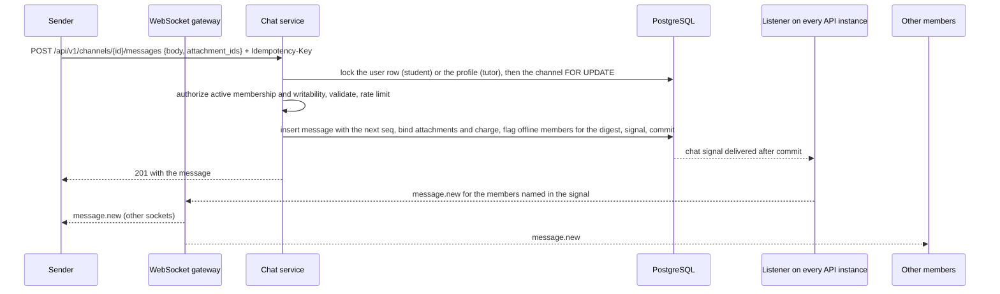
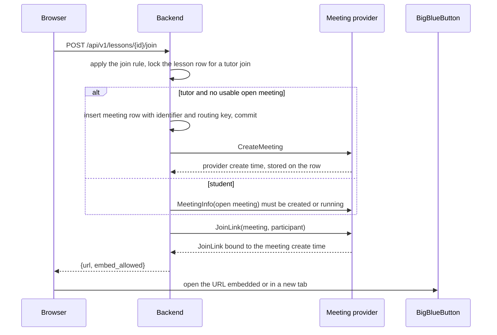
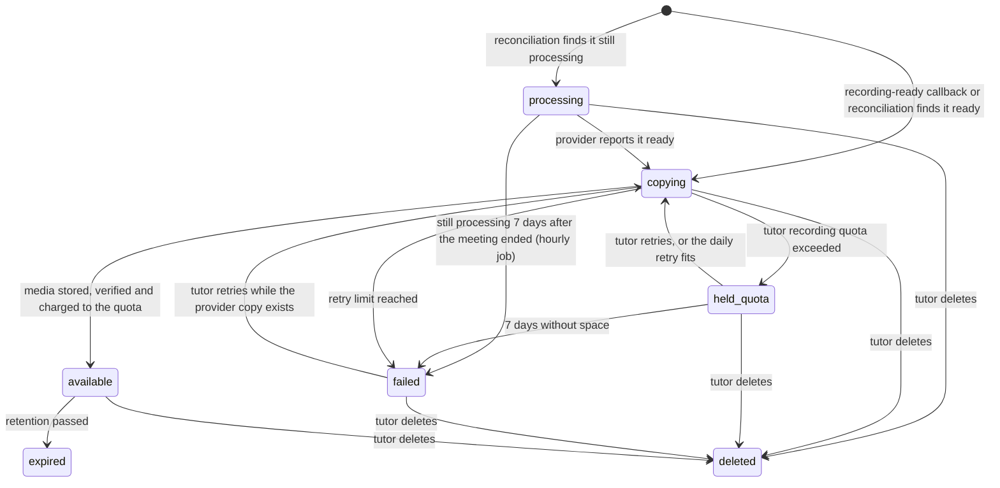

# Realtime and video specification

Covers chat, live updates and in-app notifications over one WebSocket (FR-12, FR-13.1), and video lessons and recordings through BigBlueButton (FR-5). Decisions: [ADR-0003](../../docs/decisions/0003-embedded-video-provider.md), [ADR-0004](../../docs/decisions/0004-bigbluebutton-primary-provider.md). Provider facts: [BigBlueButton research](../research/bigbluebutton-2026-10-20.md).

## Chat

### Channels

Slice 6 builds chat; the [slice 6 plan](../plans/slice-6.md#3-decisions-the-plan-proposes) records the alternatives and reasons behind the rules below.

| Kind | Members | Created | Read-only when |
|---|---|---|---|
| `direct` | the tutor and the student of one relationship, while it is `provisional`, `active` or `ended` | in the transaction that first makes the relationship `provisional` or `active` (invitation sign-up, signed-in acceptance, accepting a join request), never for an `invited` card ([ADR-0014](../../docs/decisions/0014-students-join-through-their-tutor.md)); reactivation reuses it, so the history survives ending and reactivation | the relationship is ended (`read_only_since` set to `ended_at`); writable again on reactivation |
| `group` | the tutor and the current members of one group | in the transaction that creates the group | the group is archived (`read_only_since` set to `archived_at`); writable again on unarchiving |

- There are no student-to-student direct channels.
- **Membership is stored:** `channel_member` rows mirror the relationship and the group, and every path that changes those states updates them in its own transaction, after locking the channel `FOR UPDATE` ([lock order](accounts.md#locks-and-the-session-re-check)): linking, confirmation, the reclaim and the owner's choice, removal, stopping studying, ending, reactivation, group creation, adding and removing members, student and tutor deletion, the 7-day cleanup, the immediate purge of an unconfirmed account, `reclaim.expire` and the purge. Slice 6's migration backfills a channel and its member rows for every relationship that is `provisional`, `active`, `ended` (read-only since its `ended_at`) or `reclaim_pending`, and for every group (an archived one read-only since its `archived_at`).
- **One active-member predicate:** "an active member of a channel" is a member row that is not suspended, of a channel that is neither discarded nor pending erasure. Every access path reads members through this one repository predicate: the chat routes, unread counts, the read marker, an idempotency replay, author deletes, both upload sessions, downloads, frame and signal recipients, presence and typing recipients and `online`, the digest flag and the digest. Deletion and purge lookups do not apply it: they find every member row of the account or channel, suspended ones included, so none survives a purge or an erasure.
- **A provisional link** reaches only its `direct` channel, never a group channel (an unconfirmed account belongs to no group), with text messages only ([upload flow](files.md#upload-flow)).
- **While a link is `reclaim_pending`** the tutor's member row stays and the student's row is suspended (`suspended_since` set), so the account reaches nothing of the channel and is shown to no one; the channel stays writable for the tutor, whose messages wait for the student. The reclaim transaction also sets the channel's `provisional_through_seq` to its `last_seq`: every message up to it was written during the provisional period.
- **Keeping a reclaimed link** (the owner's decision of 2026-10-29, pending owner review) locks the channel, clears the suspension, sets the restored row's `last_read_seq` to just before the first message up to `provisional_through_seq` whose sender is not the account (or leaves it at `provisional_through_seq` when there is none), so those messages and everything after them count as unread, and sets `digested_through_seq` to the channel's `last_seq`, so no digest lists the past. Every message whose sender is the account and whose `seq` is at most `provisional_through_seq` carries `sent_before_reclaim: true` for both roles, derived at read time, and is shown with the fixed cue "Sent before the account was reclaimed": a boolean, never the squatter's chosen name, avatar or other account data. A link confirmed from the account's own browser is not a reclaim and sets no boundary.
- **A discarded link** (a removal, stopping studying on a provisional link, the 7-day cleanup, the immediate purge of an unconfirmed account, a dropped reclaim link, `reclaim.expire`, a tutor deletion) loses both member rows, and its whole channel, both parties' messages included, is erased through the deferred erasure below (the owner's decision of 2026-10-29, pending owner review).
- **Deferred erasure:** a discarding transaction deletes the channel's member rows, sets `discarded_at` (never cleared) and `erase_pending_since` on the channel under its `FOR UPDATE` lock, marks the channel's `pending` chat uploads `deleted` with their `storage_delete` queued (an `uploading` row is left to its own request, whose second session finds the membership gone and discards the object, and to `uploads.expire`), and sends the last `entity.changed channel`. From that commit on no member reaches the channel, `GET /files` refuses its files, and no upload or binding can name it. The `chat.erase_channels` job runs every minute (an empty run is one partial-index probe; the owner's decision of 2026-10-29, pending owner review), within a 20-second budget, and erases each pending channel in batches of 500 messages per transaction under the charge locks (the tutor's profile, the channel), releasing charges and queueing `storage_delete`, then clears `erase_pending_since`. Until its next run, at most a minute later, the bodies and files exist but are reachable by no one.
- **A member removed from a group** loses the group channel, including its history, and their `pending` uploads to it are marked `deleted` with their deletion queued in the same transaction. **A new or re-added group member** sees the whole history, including messages written while away, with the new row's `last_read_seq` and `digested_through_seq` set to the channel's `last_seq`, so nothing counts as unread and no digest lists the past (the owner's decision of 2026-10-29, pending owner review).
- **An ended relationship** keeps both member rows: the student keeps read access to the direct channel.
- **Tutor deletion** ends relationships and archives groups, so their channels become read-only through the same statements, and discards provisional and reclaim-pending links, whose channels are erased.
- **Author writes** (send, edit, a chat upload) in a read-only channel are refused with `409 channel_read_only`; deletes stay allowed; reading and moving the read marker stay allowed.

### Labels per role

Every name a chat response, a digest and a frame-triggered refetch shows. A fixed label travels as a `label_kind` code beside a `null` label, as lessons do.

| Field | Tutor | Student |
|---|---|---|
| Direct channel label | the card's own display name, also while `provisional` (never the account name a possibly squatting account chose), with `unconfirmed: true` and the cue "Email not confirmed" while the link is provisional | the tutor's account name and the relationship colour |
| Group channel label | the group's name and colour | the group's name, with the tutor's account name and the relationship colour as its tutor label |
| Sender of a message | the card's display name for a student of the tutor; "You" for the tutor's own | the tutor's account name; another student's account name, on that student's messages only; "You" for the student's own |
| Group members in the conversation header | card display names | none: the header shows the group's name and tutor label only |
| Typing indicator | the card's display name | the tutor's account name; for another student "Someone is typing…" |
| Presence | every member's, in writable channels only | the tutor's only, in a writable channel only; never another student's |
| Sender whose account is `deleted` | `label_kind: deleted_user` ("Deleted user"), body kept until the purge | the same |
| Sender purged | `label_kind: deleted_user`, body erased ("Message removed") | the same |

Students see other students only on those students' messages: no member list, no presence and anonymous typing (the owner's decision of 2026-10-29, pending owner review).

### Messages

- **Body:** 1 to 4,000 Unicode code points of plain text, stored as entered after refusing NUL and the control characters other than line feed and tab (`422 validation_failed`); a message with at least one attachment may have an empty body, and a whitespace-only body counts as empty. It is rendered as text with line breaks kept by CSS, in an element isolated with `dir="auto"`; nothing is rendered as HTML.
- **Links:** `http` and `https` addresses become links built from the parsed URL with `rel="noopener noreferrer nofollow"` and `target="_blank"`, showing the text as typed; an address with user information (`user@` or `user:password@` before the host) or containing a Unicode format character stays plain text; no other scheme becomes a link.
- **Attachments:** up to 10 from the [chat context](files.md#contexts-and-limits), bound by the send. Pictures get a preview.
- **Sequence:** each message gets `seq`, the channel's `last_seq + 1`, assigned under the channel's `FOR UPDATE` lock in the send transaction, and the send moves the channel's `last_activity_at`.
- **Sending:** `POST /channels/{id}/messages` with `{body, attachment_ids}` and an `Idempotency-Key`; the web client sends only through this route, never over the WebSocket. The key, 1 to 64 characters of `^[A-Za-z0-9._-]{1,64}$`, is stored as `message.client_key`, unique per sender and channel while the sender exists; a repeated key is authorized again (the caller must still be an active member, otherwise `404`) and answers the first message as the caller now sees it, creating nothing and consuming no rate slot; the key is never logged. A send also moves the sender's own read marker to the new message.
- **Editing and deleting:**
  - the author edits their message within 24 hours of `created_at` with `{body, version}`, marked "edited" (`edited_at`, `version` incremented); later edits are refused with `edit_window_passed` and a stale `version` with `conflict`; attachments are not edited; editing needs a writable channel; a deleted or erased message, or one the caller did not write, answers `404` like a random identifier;
  - the author deletes their message at any time in any channel they are an active member of, read-only ones included; the tutor deletes any message in their direct and group channels, read-only ones included (the owner's decision of 2026-10-29, pending owner review); a delete therefore never answers `channel_read_only`;
  - a delete sets `deleted_at`, erases the body and removes the message's attachment references in the same transaction, under the charge locks, which releases a quota charge with the last reference and queues each object's `storage_delete`; it is idempotent, and the message stays in the list as the placeholder "Message deleted".
- **Rate limits:** at most 30 message writes (sends, edits and deletes together) per minute per user across channels; a replayed send and a refused request count nothing; the attachment limits are in the [upload flow](files.md#upload-flow); beyond any limit the server refuses with `429 rate_limited` and `Retry-After`. These limits are counted in memory per API instance, through an injected clock and counter, and a restart resets them.
- **History** is keyset paginated on `seq`, newest first, 50 per page by default and at most 100; `?after_seq=` returns up to `limit` (at most 100) newer messages oldest first, for catching up after a frame, with `next_cursor` `null`; a request with both `cursor` and `after_seq` answers `422 validation_failed` at `query.after_seq`.
- **Unread state:**
  - each channel stores `last_seq`, and each member `last_read_seq`, which moves forward only when the client reports reading (`POST /channels/{id}/read` with `{seq}`, clamped to `last_seq`), at most once a second from a visible conversation;
  - a channel's unread count is `last_seq − last_read_seq`, capped at 99 and shown as "99+", with no aggregate over messages; deleted and erased messages count, because they stay in the list as placeholders;
  - `GET /channels/unread` answers the number of channels with unread messages (at most 100) from one indexed query over the caller's member rows, for the sidebar badge;
  - a read-marker move takes no tutor profile lock and signals `read.updated` to the caller's own other sockets only; no other member learns it (no read receipts).
- **Session and profile locks:** every chat write by a student (send, edit, delete, read marker, a chat upload's creation and completion) locks the student's user row first and re-checks the session; every chat write by a tutor except a read-marker move takes the tutor's profile lock first and answers `401 unauthenticated` when the tutor is no longer `active` ([locks and the session re-check](accounts.md#locks-and-the-session-re-check)).
- **Deleted and purged senders:** from an account's deletion until its purge its messages show "Deleted user" with their bodies; the purge erases or deletes them ([account deletion](accounts.md#account-deletion)).

### Principle

The database is the source of truth; the WebSocket is a delivery channel. Every change is committed first; the signal that announces it is written inside the same transaction and delivered only once that transaction commits ([broadcaster](#broadcaster)). Frames carry identifiers only, never the authoritative state: a client refetches through REST, which enforces scope again. A reconnecting client recovers missed data through REST, never from the socket (NFR-4.3).

Slice 4 builds the connection, authentication and revocation, the broadcaster, and the frames `ready`, `notification.new`, `entity.changed`, `pong` and `error` from the server and `auth` and `ping` from the client; chat frames, presence and typing arrive with slice 6, whose typing and presence frames are the one exception to identifier-only frames: they carry an account identifier and, for presence, a boolean, because typing has no stored state to refetch and presence is persisted only as times; their recipients are authorized like every other frame, and the client refetches presence through REST on every `ready`. The [slice 4 plan](../plans/slice-4.md#3-decisions-the-plan-proposes) records the alternatives and reasons behind the rules below.

### Connection

- **Endpoint:** one WebSocket per browser tab at `GET /api/v1/ws`, audience `user, unverified ok`, authenticated by its first frame. The URL carries no credential, and the gateway reads no cookie.
- **Before the upgrade:**
  - the route is registered outside huma but passes the same outer handlers as every other route: recovery, request identifier, security headers and the access record, which names the route template only;
  - it requires exactly one `Origin` header, equal to the normalised `OVC_PUBLIC_URL` in scheme, host and port, compared by the same plain `net/http` function that the sign-in, refresh and confirmation routes use over every `Origin` value; a missing, foreign or repeated `Origin` answers `403 forbidden`, and an `Origin` that merely equals the request's `Host` is foreign unless it equals the OVC origin;
  - a request that is not a WebSocket upgrade answers `400 bad_request`; a full unauthenticated budget (below) answers `503 service_unavailable` with `Retry-After: 5`; each of these answers carries the API error body and `Cache-Control: no-store`;
  - only then is `coder/websocket` asked to accept the upgrade, with `OriginPatterns` holding the OVC host only and never `InsecureSkipVerify`, as a second check. The library's own origin rule is weaker than OVC's (for example it accepts a missing `Origin`, matches the host without the scheme and refuses with a plain-text `403`); the gateway's own check decides, so the contract does not depend on the library's behaviour, which is confirmed against the pinned version and recorded in the [stack table](../architecture/detailed.md#stack-per-component) when the dependency is added.
- **After the upgrade:** the read and write deadlines of the HTTP request are cleared; the gateway sets its own deadlines per frame.
- **Authentication:** the first client frame must be `auth` within 5 seconds of the upgrade (an injected duration that tests shorten); [authentication and revocation](#authentication-and-revocation) has the rules.
- **Registry:** `internal/realtime` owns the connection registry: a socket is registered under its account and session when its `auth` frame has a valid token, and removed on every close path.
- **Limits:**
  - at most 500 unauthenticated sockets per instance and 20 per client address (the trusted client address of `OVC_TRUSTED_PROXY_CIDRS`, as for every per-IP limit), counted with the sign-in throttle's bucketing: an IPv4-mapped IPv6 address counts as its IPv4 address and an IPv6 address by its /64 ([sessions and passwords](accounts.md#sessions-and-passwords)); the next upgrade answers `503`;
  - at most 20 authenticated sockets per account per instance; the 21st `auth` closes with `4429`, and the client backs off up to 60 seconds. Residual: a stolen access token can fill its account's 20 slots until the token lapses or the session is revoked;
  - a socket holds its unauthenticated slot from the upgrade until it gets `ready` or closes, and counts against its account's 20 from the moment its `auth` frame carries a valid token, while it is still authenticating.
- **Bounds:**
  - **outbound:** each socket has a FIFO queue of at most 256 frames or 1 MiB, frames held while the socket is suspended included; an enqueue that would exceed either closes the socket with `4429` instead of waiting; the writer writes with a 10-second deadline and closes with `4429` when it passes. A slow socket therefore never delays the listener or another socket ([ADR-0009](../../docs/decisions/0009-owner-approved-exceptions-and-visibility.md), item 3). Each frame is serialised once and the same bytes are enqueued for every recipient socket on the instance;
  - **inbound:** text frames only, and a binary frame closes with `1003`; a frame over 16 KiB closes with `1009`, which the library sends on its read limit (`SetReadLimit(16384)`); a malformed frame or an unknown type gets an `error` frame (`bad_request`) and the socket stays open; more than 20 frames in a second get `error` frames (`rate_limited`), and five violations within 10 seconds close with `4429`, where only frames refused for their rate count as violations; any frame other than `auth` before authentication closes with `4401`. From slice 6, typing frames count toward the 20 frames per second and are coalesced in memory, per socket, account and channel, to at most one relayed frame every 2 seconds on the injected scheduler, before any database work ([presence and typing](#presence-and-typing));
  - **`ref`:** a client frame reference must match `^[A-Za-z0-9._-]{1,64}$`, the request identifier's character set, or the frame is malformed; `ref` values are echoed in `pong` and `error` frames and never logged; the `error` frame for a frame whose `ref` is malformed carries `ref: null`, and a `ping` that carries a `payload` is malformed;
  - **liveness:** the server pings every 25 seconds and closes a socket without a pong for 60 seconds; such a socket, like one whose connection fails, gets no close frame, and its `ws.connection.closed` record names `1006`;
  - **database access:** a socket holds no database session; each lookup it needs runs on a short pool session.
- **Shutdown:** on shutdown the gateway closes every socket with `1001` before the HTTP server's 40-second drain.
- **Goroutines:** every reader, writer, re-check and listener goroutine starts through `core.Go`, which recovers and logs a panic ([observability](observability.md#output-and-failure-behavior)).
- **The client** (`frontend/src/lib/realtime`):
  - one reconnecting client per tab, owned by the session epoch: it connects while the session is signed in and is closed and discarded when the epoch changes;
  - it sends `auth` with the in-memory access token, refreshed first when it expires within 30 seconds by wall-clock time (the session reads the wall clock through its injected scheduler, because a monotonic clock may pause while the system sleeps), and sends every new access token the session obtains in-band as another `auth` frame on the open socket;
  - it reconnects with exponential backoff from 1 to 30 seconds with full jitter, and up to 60 seconds after `4429`; after `1012` it first waits the listener's first reconnect delay of 1 second and then the jittered backoff, so the clients of a lost listener do not reconnect while it is still down and meet `1013`; the backoff starts over only once a socket has answered a `pong`, so connections that close soon after `ready` keep backing off; after the first `ready` of every socket, the first connection included (not after an in-band re-authentication), it refetches the visible data that holds an answer or is being fetched, and after a reconnect also the visible data whose last fetch ended in an error (a reconnect is a `ready` that follows an earlier `ready` or a failed or refused attempt of the same client, or the first `ready` of a client created anew for a resume after `beforeunload` or a restore from the back-forward cache; only the page's first client and a client for a new session epoch start with a first connection, and a client created anew starts its backoff over), because frames committed while the socket authenticated were not delivered ([live refetch mapping](../architecture/detailed.md#live-refetch-mapping));
  - on `4401` it refreshes once: a new token reconnects, and a refused refresh ends the session with the reason the refresh reports ([navigation](../design/web/navigation.md#rules)); while the tab's own sign-out, sign out everywhere or account deletion is in flight, the refresh waits for it: when it ended the session nothing more happens, and when it failed the refresh runs as usual;
  - it sends `ping` every 30 seconds and reconnects when no `pong` arrives within 10 seconds;
  - the page closes it on `beforeunload`, before a reload or navigation (Firefox reports a socket the navigation interrupts as a console error), and connects again 2 seconds later if the page is still shown (a download, a `mailto:` link or a cancelled leave dialog), and only while the session is signed in, with the current epoch's token; repeated `beforeunload` events leave one pending resume; `pagehide` closes it and cancels the resume, and a `pageshow` from the back-forward cache restarts it (pending owner review);
  - the socket factory is injected, and the fake socket of the component tests is checked against the frames the real gateway emits by the same contract test as the client's parser ([frame format](#frame-format)).
- **Chat membership** (slice 6): every chat producer (send, edit, delete, read marker, typing) locks the channel `FOR SHARE`, or `FOR UPDATE` for a send and a charge release, and reads the active members under that lock; the frame recipients are those members, at most 100 per signal (a group channel has at most 31). Every path that removes a member also locks the channel, so a removed member or an ended relationship's student stops receiving at once. There is no per-instance membership cache, and the listener resolves nothing; clients never subscribe to arbitrary channels.

### Authentication and revocation

- **`auth`:** the access token is verified as on REST (signature, expiry, claims). The socket is then registered under its account and session, **suspended** and tagged with the listener's current generation ([broadcaster](#broadcaster)), before the session lookup. The lookup checks that the session is neither revoked nor expired and that the account is `active` or `unverified`. `ready` is sent, and the socket starts receiving, only when:
  - the lookup passed;
  - the listener's generation is unchanged;
  - every `recheck` for the account that arrived after the registration was followed by a passing lookup: a `recheck` that arrives during authentication triggers one more lookup after the first, and when that lookup passes and the generation is still unchanged the socket gets `ready`, so another session's sign-out does not close an authenticating socket.

  Otherwise the socket closes with `4401` (a failed lookup) or `1013` (a changed generation). A revocation committed while a socket authenticates is therefore never missed: its `recheck` finds the registered socket. Frames for the account are not delivered to a socket that is still authenticating; its client refetches after `ready`. A session lookup that fails, at `auth`, on an inbound frame or in a re-check, closes with `1012`. A full per-account budget closes with `4429`, and a lost listener closes with `1013` until `LISTEN` is re-established.
- **In-band `auth`:** a later `auth` frame with a valid token for the same session and the same account verifies its token every time, shares the socket's one-per-second session lookup (below) and reuses its result within that second, because the session must be the same, keeps the later of the recorded and the new token expiry and is answered with `ready`; an `auth` for another session or another account closes with `4401`.
- **Token lapse:** the gateway records the access token's `exp` at `auth`. When the recorded expiry plus a grace of 30 seconds passes without a fresh token, the socket closes with `4401`, so a socket never lives longer than its access token.
- **Inbound frames after `auth`** repeat the session and account lookup, but one socket performs at most one lookup per second and frames within that second reuse its result; a failure closes with `4401`. `ping` is answered with `pong` echoing `ref`.
- **Revocation:** every path that revokes a session or ends an account signals a `recheck` for the account inside its own transaction, through the database triggers of the [data model](data-model.md#revocation-triggers): sign-out (`POST /auth/logout`), sign out everywhere, refresh-token reuse, the same-browser confirmation (the other sessions), a reclaim (every session, the squatter's included), a password reset, a password change (the other sessions), account deletion, an operator block through `ovc-admin` in its own process, the 7-day cleanup of an unconfirmed account and the purge. On a `recheck`:
  - the listener marks that account's local sockets suspended at once and hands the account to the re-check worker; the listener itself never waits for a query;
  - at most one re-check per account runs at a time, and signals that arrive meanwhile make it run once more afterwards;
  - while suspended, frames for those sockets are queued and count against the outbound bound, so an overflow closes with `4429`;
  - one query with a 2-second timeout re-reads their sessions and the account; failing sockets close with `4401`, and the others deliver their queued frames in order and resume;
  - a failed query closes the account's sockets with `1012`, and each reconnect authenticates afresh.
- **Bound:** a `recheck` is delivered at commit, so a revoked session's sockets close with `4401` within 5 seconds while the listener is alive; a listener that has been silent for 5 seconds is detected by its missing heartbeat, and every local socket is then closed with `1012` ([broadcaster](#broadcaster)).
- **Sweep:** every 60 seconds the gateway re-checks the session and account of every local socket in one batched query and closes with `4401` those whose session expired or was revoked, or whose account is no longer `active` or `unverified`, matching the per-frame lookup, as defence in depth.
- **Narrowing on lost scope:** ending a relationship, removing a provisional or reclaim-pending student, a dropped reclaim link and a tutor's or a student's deletion close no socket of the other party (the deleted account's own sockets close through the trigger on its state). Their transactions decide the recipients of `entity.changed` from relationship rows they hold locked ([authorization of frames](#authorization-of-frames)), so the student of a removed or dropped link gets one last `relationship` frame, refetches My tutors, which no longer lists the tutor, and gets nothing about that relationship afterwards; after an ending, frames reach the former student only when the student's projection changes again (a reactivation, `account_closed_until`). Sockets close only when a session or the account itself ends, or when the access token lapses without a fresh one.

### Frame format

Typed JSON text frames: `{"type": <enum>, "ref"?: string, "payload"?: object}`, with unknown properties refused. Types and close codes are enums in `internal/domain`, and payloads are structs in `internal/schemas`. They are not published through OpenAPI, because generating schemas for them would need reflection in hand-written code: the frontend mirrors them by hand in `frontend/src/lib/realtime/frames.ts` with a strict parser, and a contract test drives every server frame type and close code through the real backend and parses each frame with that parser, so a field the gateway adds, renames or removes fails it. On the Go side, `TestEveryFrameTypeHasAGatewayTest` fails when a frame type or close code of the enums has no gateway test that produces it.

| Direction | Type | Payload | Notes |
|---|---|---|---|
| client → server | `auth` | `{access_token}` | first frame, within 5 seconds of the upgrade; later, a fresh token of the same session; the token is never logged |
| client → server | `ping` | — | re-checks the session and account (at most once per second); answered with `pong` |
| server → client | `ready` | `{}` | after a successful `auth`, first or in-band |
| server → client | `notification.new` | `{id}` | a notification row was inserted for this account |
| server → client | `entity.changed` | `{kind, id}` | refetch the entity through REST |
| server → client | `pong` | — | echoes `ref` |
| server → client | `error` | `{code, message, request_id, ref}` | `request_id` is the inbound frame's identifier and `ref` echoes the client's reference; the socket stays open |
| client → server | `typing.start`, `typing.stop` | `{channel_id}` | slice 6; from an active member of a writable channel; anything else answers an `error` frame (`not_found` or `channel_read_only`) and the socket stays open |
| server → client | `message.new` | `{channel_id, message_id, seq}` | slice 6; refetch through REST |
| server → client | `message.updated`, `message.deleted` | `{channel_id, message_id}` | slice 6; refetch through REST |
| server → client | `read.updated` | `{channel_id}` | slice 6; refetch the unread counts |
| server → client | `typing` | `{channel_id, user_id}` | slice 6; `user_id` is `null` in the frames a student receives about another student |
| server → client | `presence` | `{user_id, online}` | slice 6 |

- **`entity.changed` kinds:** `relationship`, `join_request` and `notification` from slice 4; `lesson` from slice 5, `channel` from slice 6, `issue` and `submission` from slice 9, and `recording` after the MVP.
- **Slice 6 frames:** the client sends messages and read markers only through REST, so `message.send` and `message.read` are not frame types, and a client that sends them gets an `error` frame like any unknown type; until each chat frame lands, its client type gets an `error` frame like an unknown one. Each change that makes the gateway emit a frame or an `entity.changed` kind adds it to `frontend/src/lib/realtime/frames.ts`, its strict parser and the realtime contract test in the same change, so no deployed bundle drops its socket on a frame its parser does not know.

**Close codes:**

| Code | Meaning | Client |
|---|---|---|
| `1000` | the client closed | — |
| `1001` | server shutdown | reconnects with backoff |
| `1003` | a binary frame | reconnects with backoff |
| `1009` | a frame over 16 KiB | reconnects with backoff |
| `1012` | the listener was lost or a re-check failed | reconnects after 1 second plus the jittered backoff |
| `1013` | the listener is not back yet | reconnects later, with backoff |
| `4401` | authentication failed, the token lapsed, or the session or account no longer allows the socket | refreshes once, then reconnects or ends the session |
| `4429` | slow consumer, repeated frame violations, or too many sockets of the account | reconnects after up to 60 seconds |

Close reasons are fixed short strings, never data.

### Authorization of frames

Inbound frames in slice 4 (`auth`, `ping`) carry no identifier, so nothing is resolved in a client-chosen scope, and clients never subscribe; from slice 6 `typing.start` and `typing.stop` carry a channel identifier, resolved within the caller's active memberships under the channel lock, with `not_found` outside them. Chat recipients are decided under the channel lock instead of the relationship locks: every path that removes a recipient also locks the channel, which gives the same guarantee with one lock per message instead of one per relationship. Outbound recipients are decided in the producer's transaction, from rows it holds locked: a transaction that names a student as a frame recipient reads the relationship row with at least `FOR SHARE`, which conflicts with the `FOR UPDATE` and `FOR NO KEY UPDATE` locks that ending, removal and dropping a reclaim link take, so a producer waiting behind a removal sees the row discarded and names no former student ([lock order](accounts.md#locks-and-the-session-re-check)). A student gets a frame only when the student's own view changes, so the timing and presence of frames never tell a student that a tutor blocked them or suppressed their request, nor that a tutor edited private notes.

| Frame | Recipients |
|---|---|
| `notification.new` | the recipient of the inserted row only |
| `entity.changed relationship` | the tutor on every committed change of the card; the linked student account only when the student-visible projection of the relationship changes: the `MyTutor` fields that come from the relationship row (`state`, `colour`, `ended_at`, `ended_by`, `account_closed_until`), including the change that removes the relationship from the student's view (removal, a dropped reclaim link); never another tutor of the same student. Tutor-only edits (notes, the card name, the card email) send the student nothing |
| `entity.changed join_request` | the tutor only for requests inside the tutor's scope at commit (never held, suppressed, closed by an unblock or of an operator-blocked account); the student only when the student's `SentJoinRequest` changes through a decision: accept, and decline, which sends the same frame with or without a block; the student's own code entry sends one identical frame to the student's other sockets whether the request was created, existing, held or suppressed |
| `entity.changed notification` | the recipient's own sockets, after a read change, so other tabs update the badge |
| `entity.changed lesson` (from slice 5; the web client accepts the kind from the schedule's first change and refetches nothing for it until the Schedule pages add lesson queries) | the tutor on every committed change of the lesson; each student of the current audience (for a `scheduled` lesson) or of the roster (otherwise) when a field they see changes: the time, the duration, the title, the description or the status; recipients are named under the relationship locks of the [schedule](schedule.md#locks-and-jobs), never another tutor of the same student. Ending a relationship, a removal and leaving a group send the student who lost the lesson one frame per affected lesson only when it stays visible to them (a frozen roster), and nothing for lessons they no longer see, which they lose on their next fetch. A series operation sends one frame per affected lesson, chunked under the limit of 100 recipients per signal |
| `entity.changed channel` (from slice 6) | every active member, read under the channel lock, when what that member sees of the channel changes: becoming read-only or writable, a member added or removed (to the tutor and to the member who joined or left only, never to the other students, who see no member list), the start of an erasure, and the channel's label (a group rename or recolour, an account name change of a member, as the [label table](#labels-per-role) shows it). The member who left gets one last frame and then nothing about the channel; message changes use the message frames; a student's frames never reveal another tutor's channels |
| `message.new`, `message.updated`, `message.deleted` (from slice 6) | the channel's active members read under the channel lock, the sender's other sockets included |
| `read.updated` (from slice 6) | the reader's own other sockets only |
| `typing` (from slice 6) | the channel's other connected active members, read under the channel's `FOR SHARE` lock; a student receives `user_id: null` about another student, the tutor the account |
| `presence` (from slice 6) | the accounts that share a writable channel with the account (presence is hidden in read-only channels, as `online: null` in REST, the owner's decision of 2026-10-29, pending owner review): a student's presence reaches only the tutors of those channels, never another student, and a tutor's presence the students of the tutor's writable channels. The one stated exception to recipients decided under locks: they are read without locks in a short transaction, because presence reveals only whether someone is connected, and a recipient removed concurrently can receive at most one such frame |
| `recheck`, `heartbeat` signals | not frames: they close or keep sockets, or prove the listener alive |

- Creation, release, suppression, un-suppression, the closing by an unblock, a repeated decline that adds a block, expiry (which the student's list derives from times) and an operator block send the student nothing distinguishable.
- Every frame also reaches the acting account's other sockets, within the same rules.
- `entity.changed` to students when a tutor edits their own profile (name, bio, subjects) waits until a page needs it; students see the change on their next fetch.
- Tutor deletion locks no student's user row and sends one `relationship` signal per relationship it ends or removes, naming only that relationship's student, so every signal stays far under the limit of 100 recipients, and issues them together, one statement per 1,000 signals, so the deletion's statements do not grow with its relationships; a student's purge sends the tutor one `relationship` frame per card that loses the student.
- Denial tests connect a second tutor who shares the student and prove that no frame about the first tutor's relationship or requests reaches it, and prove that a student's frames are identical whether or not the tutor blocked them.

### Send path

Chat (slice 6) follows the same path as every other producer:



- The web client sends only through REST; the WebSocket carries `typing.start` and `typing.stop` from the client and nothing else of chat (the owner's decision of 2026-10-29, pending owner review).
- **The digest flag:** the send inserts a `digest_pending` row, `ON CONFLICT DO NOTHING`, for each active member whose `online_until` has passed, in the same transaction, without locking any user row ([message digest](notifications.md#message-digest)).

### Presence and typing

Slice 6 adds these with chat; slice 4 keeps presence only in each API instance's registry, which the test control route `POST /__test__/presence` reports as `{online, sockets}`, counting the sockets that got `ready` ([development](../../docs/development.md#end-to-end-test-harness)).

- **Persisted presence** (slice 6) keeps the account summary in `user_presence` and per-process leases in `user_presence_instances` ([data model](data-model.md#presence-and-digest-bookkeeping)), never on user rows. Each API generates its own named UUID once through the injected random source, never reuses it after restart and neither accepts it from clients nor exposes it in browser payloads. About once a minute an instance extends only its own lease to the greater of its old deadline and business time plus 90 seconds; real activity instants are monotonic. Closing its last socket deletes only its own lease. The summary preserves the greatest real activity instant as `last_seen_at`; its online deadline is the greatest retained lease deadline, or, on close, the greatest closing instant and retained deadlines. Cleanup never creates future online time or erases historical last-seen. All changes lock existing users `FOR KEY SHARE` in identifier order, then initialize and lock summaries in identifier order, then modify leases and recompute summaries. Purged users are skipped. Short operator and purge transactions holding `FOR UPDATE` may delay presence, an approved exception without changing those locks; `FOR SHARE` and `FOR NO KEY UPDATE` do not block it.
- **Readiness and failure:** reserve an account entry before its first durable lease write, persist lease and summary before initial `ready`, then recheck socket closure, session/account revocation and listener generation. Database work never holds the gateway mutex. Failure or timeout closes with reconnectable behavior and no `ready`; authentication invalidated after persistence releases its unused lease through the close path. Desired state is serialized and coalesced per local account with generations, at most four concurrent writers and a cancellation-aware five-second end-to-end deadline including admission. A hard total of 4096 entries includes authenticating, active and pending-release accounts; capacity refusal happens before `ready`, and accepted pending releases are never evicted to admit another account. An entry is freed only after confirmed release or confirmed deletion and completion or definitive cancellation of older writes; uncertain commit outcomes remain pending. A closed socket is no longer live even if release fails. Failed releases retain one pending entry per account, emit safe diagnostics and retry on the injected one-minute cycle, not an unbounded loop. Shutdown cancels scheduling, drains releases within its deadline and reports incomplete release; remaining leases expire normally.
- **Time sources:** summary consumers and lease activity use the injected business clock. Extension cycles, five-second debounce and typing coalescing use the injected scheduler; operation and cleanup execution deadlines use monotonic time, independent of frozen business time. Both Set and Advance through `POST /__test__/clock` extend this API's live leases before a successful response, including Set of the same instant. A failed flush returns a structured failure and can leave the clock changed, requiring explicit local recovery. This acknowledges only local persistence. A multi-instance test controller sets the same absolute instant on every API and waits for every response before assertions, sends or worker/digest execution; none may run during the intermediate interval. This is not a distributed clock barrier.
- An account is online while the summary's `online_until` is in the future. A missing row means never connected and offline with no last-seen. A crashed instance contributes only until its 90-second lease expires; no expiration frame is promised, and REST refetch supplies current state. `chat.expire_presence` runs once a minute with at most 500 expired leases per transaction and a 20-second monotonic execution deadline including SQL and locks. Candidate selection uses the expiry index without locking leases ahead of users and summaries; expiry is rechecked under the locks so renewal and purge are safe.
- **Presence frames** report committed account-wide state, never merely the instance's socket state. A close cannot announce offline while another unexpired lease remains. Debounce stays per instance and account, at most once per five seconds before recipient work, not a cluster-wide rate guarantee. Deferred emissions lock the summary again, read the current aggregate and call `pg_notify` in that same transaction before releasing the lock, ordering signal commits; an already committed offline frame can still arrive after a later online commit, followed by that online frame in listener commit order. Recipients retain the existing lock-free, one-late-frame exception and privacy rules; signals are chunked at 100 recipients. The client refetches REST on every `ready`.
- **Typing:** `typing.start {channel_id}` and `typing.stop {channel_id}` from an active member of a writable channel. The gateway coalesces them in memory first and drops the frames in between before any database work: `typing.start` and `typing.stop` share one window per socket, account and channel, and a frame inside an open window gets no answer. A frame that passes is checked in a short transaction that locks the channel `FOR SHARE`; a `typing.start` then reads the members and writes the `typing` signal inside that transaction, so it is delivered when the transaction commits, while a `typing.stop` is checked the same way and relays nothing, because the `typing` frame carries no state and the client's indicator expires on its own. The producer splits the recipients into those who receive the typing account and the students who receive `user_id: null` because the typing account is another student, and the signal carries both lists, so the listener decides nothing. The client hides an indicator 5 seconds after the last frame, and the dots stop with reduced motion.
- Typing is never persisted.
- **The test control route** `POST /__test__/presence` reports local `{online, sockets}`, counting ready sockets; successful local offline acknowledges release of this instance's lease only, never global offline. An uncommitted release returns a structured failure rather than a successful false assertion of durable closure. Global presence assertions read REST or the database separately.

The account presence summary never places `online_until` before its recorded `last_seen_at`: a late operation sampled before a newer connection activity or an expired-lease cleanup cannot backdate the start of the account offline period.

### In-app notifications and live updates

- A producer that inserts a notification row signals `notification.new` to its recipient in the same transaction, only when the row was actually inserted ([notifications](notifications.md#channels)).
- A producer that changes an entity a user sees signals `entity.changed` to the recipients of the [authorization rules](#authorization-of-frames), for example when a card changes or a request is decided, from slice 5 when a lesson is created, edited, cancelled or ended by the status job, and from slice 7 when it becomes live.
- The client refetches the entity through REST; frames never carry the authoritative state.

### Broadcaster

- **Signals are written inside the committing transaction.** A producer issues `SELECT pg_notify($1, $2)` with bound parameters through the `Signals` repository in `internal/repositories`, as a statement of its own transaction: `notification` signals one per statement, and `entity` signals, one or many, in statements of up to 1,000 payloads each, `SELECT pg_notify($1, payload) FROM unnest($2::text[])`, with the channel and the encoded payloads bound; revocation signals come from database triggers ([revocation triggers](data-model.md#revocation-triggers)). PostgreSQL delivers a notification only when that transaction commits, in commit order, and never for a rolled-back one, so no crash between commit and publish can lose a signal. Every API instance, the producing one included, delivers from its own listening connection; there is no direct local path.
- **Payload:** versioned JSON on the channel `ovc_realtime`, `{"v": 1, "k": "recheck" | "notification" | "entity" | "heartbeat", "u": [user ids], "e": kind, "i": id}`, from slice 6 also the `chat`, `typing` and `presence` kinds below, at most 7,900 bytes and 100 recipients; a producer with more recipients sends several signals. The trigger-built `recheck` payloads use the same form. PostgreSQL collapses identical notifications within one transaction, so revoking every session of an account sends one signal.
- **Kinds:**
  - `recheck {u}` asks every instance to re-check the sockets of those accounts;
  - `notification {u: [recipient], i}` delivers `notification.new`;
  - `entity {u, e, i}` delivers `entity.changed`;
  - `heartbeat {i}` keeps the listener's liveness; `i` carries the sending instance's identifier; it is the one signal not written through the `Signals` repository: the listener sends it on its own listening connection with the same bound `SELECT pg_notify($1, $2)` and payload form, and it carries no business data;
  - from slice 6, `chat {u, e, c, i, s}` delivers a message or read frame: `{"v": 1, "k": "chat", "u": [members], "e": "message.new" | "message.updated" | "message.deleted" | "read.updated", "c": channel, "i": message | null, "s": seq | null}`, written in the producing transaction; an unknown `e` is rejected;
  - from slice 6, `typing {u, n, c, a}` delivers `typing`: `{"v": 1, "k": "typing", "u": [recipients shown the account], "n": [students shown null], "c": channel, "a": account}`, written inside the typing check's short transaction under the channel lock; a payload that names an account in both lists is rejected;
  - from slice 6, `presence {u, a, o}` delivers `presence`: `{"v": 1, "k": "presence", "u": [recipients], "a": account, "o": online}`, written with `pg_notify` in the same transaction that locks the summary and reads the current aggregate and lock-free recipient scope, chunked at 100 recipients.
- **Notification rate** (slice 6): at 2,000 connected users, presence changes at most once per instance and account every 5 seconds and typing at most once per account and channel every 2 seconds make an estimated 100 to 250 notifications a second in a busy minute, each taking PostgreSQL's notification lock at commit; the slice review measures it beside the commit latency of sends and sign-outs, and if it shows contention, the fallback is local delivery of typing on a single instance, which needs a specification amendment.
- **Signals carry no authority.** The listener parses every payload strictly into its typed form and drops anything else with `realtime.signal.rejected`. A forged or replayed `recheck` can only make an instance check sockets, which closes nothing that is still valid; a forged `notification` or `entity` signal carries only identifiers whose content REST authorises again. Only database roles can `NOTIFY`.
- **Recipients are decided by the producer**, which already holds the rows and the scope rules under its locks; the listener never resolves recipients again at delivery, which would read state from a later moment.
- **Listening:** each API instance holds one dedicated listening connection, owned by an adapter in `internal/adapters` and consumed by `internal/realtime`. The listener handles notifications one at a time, never waits for a query and enqueues frames without blocking; each socket's queue is FIFO, so one socket sees frames in commit order.
- **Liveness fails closed:**
  - the listening connection uses TCP keepalives and, on Linux (production), `TCP_USER_TIMEOUT` of 10 seconds; the pinned `pgx` parses no `tcp_user_timeout` parameter, so the listener sets both through its own dialer ([confirmed 2026-10-25](../research/backend-libraries-2026-10-21.md#notes)), and detection does not depend on them, because the heartbeat below detects a silent connection;
  - each instance sends itself a `heartbeat` signal every 2 seconds on its listening connection, between waits for notifications, never on the connection pool, so requests holding every pooled connection cannot delay it; notifications that arrive while a heartbeat is being sent are buffered by the connection and handled next; a heartbeat write is bounded only by the 5 seconds of silence, because cancelling a statement closes the connection; because the listener receives its own heartbeat on the connection that sent it, the heartbeat assumes that the listener and the producers reach the same PostgreSQL server, which holds for the single self-hosted database; the listener is lost when it has received none of its own heartbeats for 5 seconds, when the connection errors or when `LISTEN` fails; a heartbeat that cannot be written is not a loss by itself, only the 5 seconds of silence it causes, whose loss record then names the write failure's kind;
  - the loss is reported when it is detected, before the dropped connection is closed: the silence timer marks the listener lost and tells its consumer even while the consumer is still handling an earlier signal, so a consumer that blocks or is slow never keeps the listener reported as live, and the consumer's callbacks may therefore run concurrently: a generation's loss can even be reported before that generation's connect callback has returned, so the consumer decides liveness only from the listener's state (its generation and live flag), never from the order of the callbacks; a consumer or heartbeat that panics loses the listener too, which then reconnects;
  - the reconnect backoff returns to 1 second only after a connection has received one of its own heartbeats, so a connection that is lost at once keeps backing off up to 30 seconds;
  - a lost listener closes every local socket with `1012`, and closes new sockets after `auth` with `1013` until `LISTEN` is established again; the listener reconnects with backoff from 1 to 30 seconds and increments its generation, which authenticating sockets compare ([authentication](#authentication-and-revocation)).
- **A full notification queue fails notifying commits.** A listener that stops consuming lets PostgreSQL's notification queue fill, and every transaction that notifies then fails at commit, sign-outs and producers included; the listener never waits on a socket or a query, and the heartbeat detects and reconnects a stalled listener. Every notifying transaction also takes PostgreSQL's notification lock at commit, after all its row locks, so sign-outs, purge batches, producers and heartbeats serialise on it; the slice review measures both.
- **No in-process fake.** Publishing is a database statement, so tests use the real listener against the test database; tests of the listener's liveness (its heartbeat and the detection of a silent connection) may put an in-process TCP forwarder in front of the test PostgreSQL, built by `internal/testdb/forwarder` from the checked test database endpoint and listening only on `127.0.0.1`, that relays every byte unchanged, passes an end of stream from one side on to the other as a half-close, and can only stop relaying, in both directions at once and permanently, as AGENTS.md and [ADR-0009](../../docs/decisions/0009-owner-approved-exceptions-and-visibility.md) item 8 allow.
- **The worker and `ovc-admin`** signal through the same statements and triggers in their own transactions, so their changes and revocations reach connected users; several API instances work later without a change to this path.

## Video

In the MVP, rooms are created with `record=false` and without the recording-ready callback URL, the recording-ready callback route is not registered, and the provider interface's recording methods, the `recording` kind of `entity.changed` and every recording job wait for recordings, which come [after the MVP](../../docs/roadmap.md#after-the-mvp) by the owner's decision of 2026-10-22; the recording parts of this section describe that later design. MVP rooms also send `autoStartRecording=false` and `allowStartStopRecording=false`. The checks that prove it: the adapter test against the in-process BigBlueButton API (see contract tests below) asserts the create parameters in every run; an integration test proves the recording-ready callback route answers `404`; the slice 7 probe confirms that a moderator sees no start-recording control and that `getRecordings` with `state=any` is empty after a meeting; and scenario 1 of the pilot asserts that the lesson page shows no Recordings block. The conferencing host is deployed with `disableRecordingDefault=true` and with meeting event retention turned off, so it keeps neither recordings nor raw meeting events; the slice 7 probe confirms both settings and their names.

### Approach

BigBlueButton carries the media; OVC never relays it. OVC:

1. creates a meeting for a lesson when the tutor joins;
2. authorizes each join and issues a join link;
3. tracks lesson status;
4. receives recordings and serves them itself.

### Provider interface

One interface in `internal/adapters`, with a BigBlueButton implementation and a fake:

```go
type MeetingProvider interface {
    CreateMeeting(ctx context.Context, meeting Meeting, presentationURL *string) (ProviderCreateTime, error)
    MeetingInfo(ctx context.Context, meeting Meeting) (MeetingInfo, error)
    JoinLink(ctx context.Context, meeting Meeting, participant Participant) (JoinLink, error)
    EndMeeting(ctx context.Context, meeting Meeting) error
    ListRecordings(ctx context.Context, meeting Meeting) ([]ProviderRecording, error)
    FetchRecordingMedia(ctx context.Context, recording ProviderRecording) (io.ReadCloser, error)
    DeleteRecording(ctx context.Context, recording ProviderRecording) error
}
```

- **`MeetingInfo`** distinguishes three cases from `getMeetingInfo`:
  - `not_found`: no meeting with that identifier exists;
  - `created`: it exists with no participants yet;
  - `running`: participants are connected.

  `isMeetingRunning` is not used: it reports false until the first participant connects, and that would confuse "created" with "ended".
- **`Participant`** carries the user's account name, a stable opaque per-lesson participant identifier (sent as `userID`) and a role (`moderator` or `viewer`).
- **What the provider never receives:** no email, account identifier or other personal data.
- **Meeting identifiers** are random, server-generated values, never derived from client input.
- **Checksums** are computed only by the backend with SHA-256 or stronger. The server's `supportedChecksumAlgorithms` excludes SHA-1, and the shared secret never leaves the backend.
- **`meta_*` values** never contain a secret or personal data, because meeting users may see them.
- **Contract tests:** the fake runs in every test run. The BigBlueButton adapter runs the same contract tests only against the remote test server, with an opt-in command; a run that was not performed is reported as `unverified`. In every test run, the BigBlueButton adapter is also tested against an in-process `httptest.Server` that answers as the BigBlueButton API and captures each request: in the MVP it asserts that `create` carries `record=false`, `autoStartRecording=false` and `allowStartStopRecording=false`, carries `meetingEndedURL` and no `meta_bbb-recording-ready-url`, and is signed with an accepted checksum; the opt-in remote run also asserts that `getMeetingInfo` reports recording off.

### Join flow



- **Join rule:** who may join is the [join rule](schedule.md#join-rule).
- **Several meetings per lesson:** a lesson can have several meetings over its life, at most one open at a time.
- **On a tutor join:**
  1. Under the lesson row lock, the request inspects the open meeting:
     - a meeting in state `creating` that is less than one minute old means another request is creating it; this request waits up to 10 seconds for it to become `open`, then reuses it;
     - an `open` meeting is reused when `MeetingInfo` reports `created` or `running`;
     - on `not_found` the meeting is closed with reason `provider_not_found`;
     - with no usable meeting, a new row is inserted in state `creating` (identifier and routing key set), and the transaction commits.
  2. Outside the transaction, `CreateMeeting` runs and returns the provider create time. The row becomes `open` with that time, the lesson becomes `live` if it was `scheduled`, and `entity.changed` is emitted.
  3. If the provider fails, the row is closed with reason `provider_error`, the lesson status is unchanged, and the response is `503 provider_unavailable`. A `creating` row older than one minute is treated as failed and closed.
- **On a student join:**
  - the student gets `lesson_not_live` unless the lesson is `live` and its open meeting is `created` or `running`;
  - a `not_found` answer closes the meeting with `provider_not_found` and emits `entity.changed`;
  - a successful student or tutor join sets the meeting's `first_join_at` if it is empty.
- **`room_open`:** `GET /lessons/{id}` returns `room_open`, which is true while the lesson is `live` and has an `open` meeting. It changes with an `entity.changed` frame whenever a meeting opens or closes.
- **Restart the room:** `POST /lessons/{id}/restart-room` (tutor, live lessons) ends the open meeting through the provider, closes it with reason `tutor_restart`, and starts a new one exactly as a tutor join does. Every earlier join link stops working.
- **The join link:**
  - created per request and returned only in the response body of a `POST`;
  - never stored or logged by OVC, and the client navigates to it immediately and does not keep it;
  - bound to the meeting's create time, so it stops working when that meeting ends, but not single-use within the meeting;
  - it does appear in the conferencing host's access logs and, for a new tab, in browser history: an accepted residual risk ([T-25](../../docs/threat-model.md#threats-and-controls)).

  The slice 7 probe checks whether `redirect=false` with a session token can replace the link.
- **Meeting creation** sets:
  - `record=true`, tutor-controlled recording (after the MVP; MVP rooms use `record=false`);
  - `meetingExpireIfNoUserJoinedInMinutes=10`, and `endWhenNoModerator` with a 15-minute delay;
  - `logoutURL` back to the lesson page;
  - the recording-ready callback URL (after the MVP) and `meetingEndedURL`, each with the per-meeting routing key in its path;
  - the presentation, when the lesson has attached PDF materials, from the first of them in attachment order, as a signed storage URL valid for 5 minutes (the provider fetches it at creation).

  The routing key is not a secret, because `meta_*` values may be visible to participants.

### Embedding

- **Hosting and headers:**
  - the client is served from a subdomain of the OVC site;
  - the BigBlueButton web server sends `Content-Security-Policy: frame-ancestors` admitting only the OVC origin;
  - OVC pages send `frame-ancestors 'none'` and admit the subdomain in `frame-src`.
- **The iframe** carries `allow="camera; microphone; display-capture; fullscreen; autoplay"` and a title naming the lesson.
- **`embed_allowed`:**
  - comes from the `OVC_BBB_EMBED_ENABLED` setting and is returned both by `GET /lessons/{id}` and by the join response, so the page knows it before the click;
  - it stays false until the slice 7 probe records success in the [research file](../research/bigbluebutton-2026-10-20.md#embedding-the-client);
  - the end-to-end harness can override it per test deployment.
- **Client join states** are in [the lesson page](../design/web/pages.md#lesson).

### Callbacks

- **Recording ready** (`POST /integrations/bbb/{routing_key}/recording-ready`):
  - the JWT in `signed_parameters` is verified first: `HS256` only, with the shared secret;
  - then its `meeting_id` must equal the provider meeting identifier of the routing key's meeting;
  - **responses:**

    | Answer | When |
    |---|---|
    | `401` | Invalid signature, or a mismatched or unknown meeting, so unknown routing keys are not revealed |
    | `410` | The recording is already `expired` or `deleted` in OVC |
    | `200` | The recording row is new or still `processing`: it is set to `copying` and a copy job is enqueued |
    | `200` | Any other state: the callback is a no-op |

- **Meeting ended** (`GET /integrations/bbb/{routing_key}/ended`):
  - unsigned by the provider, so it is only a hint;
  - it is ignored for meetings created less than 2 minutes ago or with no recorded join, and debounced to one check per meeting per minute;
  - OVC then calls `MeetingInfo` and closes the meeting only on `not_found`; if the meeting still exists, the worker checks again after 2 minutes, at most three times;
  - `recordingmarks` is recorded for diagnostics only and never settles reconciliation, because the hint is unauthenticated;
  - it never ends the lesson ([lesson status](schedule.md#lesson-status-and-join-window));
  - it always answers `200`.
- **Retries:** the provider's retry behavior on non-2xx answers is an open probe item. Reconciliation makes OVC independent of it.

### Recordings

After the MVP ([roadmap](../../docs/roadmap.md#after-the-mvp)); the MVP's rooms record nothing.



**Provider states** from `getRecordings`:

| Provider state | OVC action |
|---|---|
| `processing` | Create or keep the row in `processing` |
| `processed`, `published`, `unpublished` | Move a `processing` row to `copying` and enqueue a copy |
| `deleted` | A row not yet `available` becomes `failed` with reason `provider_deleted` |

- **Reconciliation:**
  - every 30 minutes the worker calls `ListRecordings` with `state=any` for meetings ended within the last 7 days that are not yet settled, in batches of 20, at most 4 at a time, with timeouts;
  - a meeting is settled when one of these holds:
    - its recordings are all past `processing`;
    - two consecutive results are empty at least 2 hours after it ended;
    - 7 days have passed;
  - lessons ended by the status job set their open meeting's `ended_at`, so they are reconciled too.
- **Copy:**
  - each copy is an outbox job with idempotency key `(recording, attempt generation)`; the generation increases on every tutor or daily retry;
  - the worker streams the rendered media into OVC object storage under a random key with 8 MiB multipart parts, computing its own SHA-256 and size, and renews its lease every 5 minutes while streaming;
  - when the provider reports a size, the quota is checked before transferring;
  - the copy commits with a conditional update of the tutor's usage (`usage + size ≤ quota`) and of the recording state (still `copying`), and then:
    - **success:** sets `available`, writes a `provider_call` outbox row to delete the provider copy, and emits `entity.changed`;
    - **quota exceeded:** sets `held_quota` and writes a `storage_delete` row for the copied object in the same transaction;
    - **deleted meanwhile:** writes a `storage_delete` row for the copied object;
    - **failure:** aborts the multipart upload;
  - when the outbox row goes `dead`, the dispatcher sets the recording `failed` and notifies the tutor with `recording.failed`.
- **The copy path is conditional on the recordings probe, run when recordings are planned after the MVP,** finding a rendered single-file format. If there is none, the fallback is a protected-recordings load balancer in front of BigBlueButton. Playback then returns its one-time URL, and the states above apply without `copying`. This is an open question that blocks the recordings plan after the MVP ([open questions](../architecture/detailed.md#open-implementation-questions)).
- **Provider copies are always deleted through `provider_call` outbox rows:**
  - after a successful copy;
  - when a tutor deletes a recording in any state;
  - when a recording has been `held_quota` for 7 days;
  - when a `failed` recording has not been retried for 7 days.

  Deleting the raw provider data is an open probe item. As a deployment requirement, the BigBlueButton web server serves `/playback/` and `/presentation/` to nobody but the worker's address.
- **Audience:** the lesson's tutor and roster. Access survives the end of a relationship until the recording expires.
- **Playback:** `GET /api/v1/recordings/{id}/playback` authorizes the caller as tutor or roster member and returns `{url, expires_at}` with a 5-minute signed storage URL, which the client sets as the video source.
  - The URL may expire while the browser is still fetching ranges. When the media element reports a network error or the URL is about to expire, the client requests the route again, swaps the source, and resumes at the current position.
  - No other route reaches the media.
- **Retention:**
  - each meeting records the tutor's retention setting when it is created;
  - a recording's `expires_at` is its availability time plus that retention;
  - the worker deletes expired media, sets `expired` and subtracts the size from usage;
  - the tutor may delete earlier, which also subtracts the size.

### Authorization rules

- Join links go only to people allowed by the [join rule](schedule.md#join-rule): the tutor as moderator, students as viewers.
- Callback routes act only as described under [callbacks](#callbacks).

### Configuration

`OVC_MEETING_PROVIDER` is `bbb` or `fake`. `OVC_BBB_EMBED_ENABLED` gates embedding. The other variables are in [configuration](../architecture/detailed.md#configuration). There is no local BigBlueButton on developer machines; live checks use a remote test server, and end-to-end tests use the fake provider's test room ([development](../../docs/development.md#end-to-end-test-harness)).
