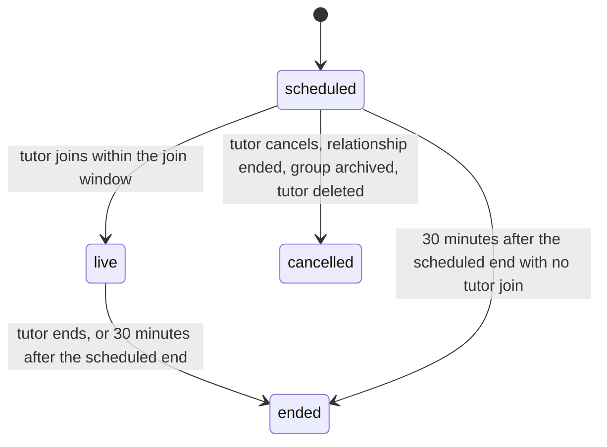

# Schedule specification

Behavior for FR-4. Decisions: [ADR-0007](../../docs/decisions/0007-recurring-lessons.md) (series and occurrences) and [ADR-0006](../../docs/decisions/0006-background-worker-and-email.md) (worker). Routes are in the [API](api.md#schedule).

## Lessons and series

- **A lesson** has:
  - a tutor;
  - exactly one audience: one relationship (a one-to-one lesson) or one group;
  - a title, defaulting to "Lesson" plus the student's or group's name;
  - an optional description;
  - a start instant in UTC, and a duration of 15 to 240 minutes in 5-minute steps; the end instant is start plus duration;
  - attached library materials and linked issues;
  - the timezone it is shown in as the tutor-side time: the series timezone for occurrences, the tutor's timezone at creation for one-off lessons;
  - a status, a schedule revision incremented by every change to time or duration, a roster, and an optional series with its occurrence date.
- **The current audience** applies while a lesson is `scheduled`, whether or not its start has passed:
  - for a one-to-one lesson, the relationship's student while the relationship is active, or, from slice 5, `provisional` ([ADR-0014](../../docs/decisions/0014-students-join-through-their-tutor.md));
  - for a group lesson, the group's current members.
- **The roster** is frozen when a lesson leaves `scheduled`:
  - becoming `live`, cancelled, or ended by the status job, it records the current audience at that moment;
  - a group member who joins a live group lesson is added to its roster in the join transaction.
- **What each set decides:**
  - a `scheduled` lesson is visible to its current audience;
  - every other lesson is visible to its roster only;
  - the roster also decides who may watch recordings ([recordings](realtime-and-video.md#recordings)).

  Adding a member to a group therefore never reveals the group's past or cancelled lessons, and cancelled lessons stay visible to the students who were expecting them.
- **Scheduling limits:** a lesson cannot be scheduled or moved to start in the past (`lesson_in_past`), or for an invited or ended relationship or an archived group (`audience_not_active`); from slice 5 a one-to-one lesson may also be scheduled for a `provisional` relationship, never a group lesson ([ADR-0014](../../docs/decisions/0014-students-join-through-their-tutor.md)). Occurrences of a new series whose start would be in the past are skipped and not counted.
- **A series** has:
  - a tutor and one audience;
  - one or more weekdays and a local start time;
  - a duration;
  - the IANA timezone of the tutor at creation, kept for the life of the series;
  - a first date and an end: either an end date at most 18 months later, or a count of 1 to 100 lessons whose last lesson falls within 18 months;
  - a title, a description and materials, copied into each occurrence as it is created.

## Recurrence and timezones

- **Occurrences** are lesson rows keyed by `(series, occurrence_date)`, where the occurrence date is the original local date in the series timezone. The key is unique and never changes, even when an occurrence is moved to another day.
- **Materialisation:**
  - a series with a count, or one ending within 12 weeks, is materialised completely on creation;
  - longer series are materialised 12 weeks ahead, and the worker extends the horizon daily;
  - extension, splitting and "cancel following" all lock the series row (`FOR UPDATE`) and re-read the series end inside that transaction, so they never race;
  - extension inserts only keys that do not exist yet and skips series whose audience is no longer active or that have ended.
- **Start instant:** each occurrence's start is computed in the series timezone from its date and the local start time, following RFC 5545.
  - A local time that does not exist on that date, because clocks jump forward, is shifted forward by the length of the gap. In a timezone that skips 02:00–03:00, 02:30 becomes 03:30.
  - A local time that occurs twice, because clocks fall back, uses the earlier instant.
  - Go's `time.Date` does not guarantee which instant it returns in either case, so the schedule code applies both rules itself.
  - Unit tests name both cases explicitly.
- **Display:** times are shown in the viewer's timezone. The lesson page also shows the series timezone (for a one-off lesson, the tutor's timezone when the lesson was created) when it differs:
  - a tutor on a one-to-one lesson sees the student's timezone instead;
  - group lessons show the tutor-side timezone to students and no second time to the tutor.
- Changing a profile timezone moves no existing lesson or series.

## Join rule

The single rule every join, page and specification refers to:

- **The tutor** may join their lesson while it is in the join window and not cancelled. The first join makes it `live`; a later join reuses or restarts the meeting ([join flow](realtime-and-video.md#join-flow)).
- **A student** may join only while the lesson is `live` and all of these hold:
  - their relationship with the tutor is `active`, or, for a one-to-one lesson only, `provisional` (from slice 5, [ADR-0014](../../docs/decisions/0014-students-join-through-their-tutor.md));
  - for a one-to-one lesson, they are its student; for a group lesson, they are a current member of the group (a member not yet in the roster is added to it).

Ending a relationship or removing a member therefore stops further joins immediately. A student already connected, or holding an earlier join link, can stay until the meeting ends. The lesson page then offers the tutor "Restart the room", which ends the open meeting and starts a new one, so every earlier join link stops working ([join flow](realtime-and-video.md#join-flow), [threat T-21](../../docs/threat-model.md#threats-and-controls)).

## Editing and cancelling

| Action | Scope | Effect |
|---|---|---|
| Edit time, date, duration, title, description, materials | This lesson | The occurrence takes the new values and records them as overridden fields; later series edits leave overridden fields alone |
| Edit time, duration, title, description, materials | This and following | See the split rules below |
| Change weekdays | — | Not offered as an edit: the tutor cancels this and following lessons and creates a new series |
| Cancel | This lesson | Status `cancelled`; the row stays |
| Cancel | This and following | Future occurrences from this one are cancelled and the series ends before this occurrence |
| Delete | — | Not offered; cancelled lessons remain in history |

**Splitting a series** at an occurrence for "this and following" covers every occurrence whose occurrence date is on or after the selected occurrence's date:

1. The original series ends before that date: its end becomes an end date of the previous day, and a count is converted into that end date. Splitting at the first occurrence leaves the original series with no occurrences; it is marked ended.
2. A new series starts at that date with the new values. It keeps the original series timezone and weekdays. Its count is the number of covered occurrences, including cancelled ones, or it inherits the original end date. Its `materialised_until` is copied.
3. **Covered rows** move to the new series in place, keeping their identifiers, links, recordings and sent emails. New values are applied only to covered rows that are editable (`scheduled` and not yet started):
   - the selected occurrence takes every new value;
   - each following occurrence takes a changed field only where it has not overridden that field;
   - live, ended and cancelled rows keep their values.
4. The request generates an operation identifier, carried in the payload of the aggregated notification rows and their idempotency keys; it is not stored elsewhere.

**Rules for all edits:**

- **Read-only lessons:** past, live and ended lessons cannot be edited or cancelled. A `scheduled` lesson whose start has passed is read-only too. Every edit carries the schedule revision the client saw and is a conditional update on `status = 'scheduled' AND starts_at > now AND schedule_revision = <seen>`. It loses with `not_editable` to a concurrent first join, or with `conflict` to a concurrent edit. The tutor can still attach materials and link issues to any lesson.
- **Overridden fields** are recorded per field: start time, date, duration, title, description and materials.
- **Notifications:**
  - moving (start or duration) or cancelling one lesson emits `lesson.moved` or `lesson.cancelled` to its audience;
  - an edit or cancellation of "this and following" emits one aggregated `lesson.series_changed` per recipient, listing the affected lessons ([notifications](notifications.md#events)).

## Overlap warnings

**When it runs:** a tutor creates or moves a lesson or a series (`POST /lessons` and `PATCH /lessons/{id}`).

**How it is checked:**

- Both sides are expanded virtually up to each series' end: the new or moved occurrences, and the tutor's existing lessons plus every occurrence of the tutor's series beyond its materialised horizon.
- The rows being moved, including a split's own covered rows, are excluded.
- Cancelled lessons are ignored, and lessons that only touch (one ends exactly when the other starts) do not overlap.
- One range query loads the tutor's lessons and series in the affected period, and an in-memory sweep finds intersections.
- Overlaps with a student's lessons from other tutors are never checked or revealed.

**Response:** if any overlap exists, nothing is saved and the API returns `409` with code `lesson_overlap` and the conflicting lessons (title, start, end). The client asks the tutor to confirm, then repeats the request with `allow_overlap: true`.

## Lesson status and join window

- **The join window** opens 10 minutes before the start and closes when the lesson ends. Who may join is defined by the [join rule](#join-rule).
- **Before the tutor joins**, the lesson page and Home show students that the room opens when their tutor joins, and update live through the [realtime channel](realtime-and-video.md#in-app-notifications-and-live-updates).
- **When the conferencing meeting ends on the provider side** (the tutor's connection dropped, or no moderator remained), the lesson does not end. It stays `live`, students see "the room opens when your tutor joins" again, and the tutor's rejoin starts a new meeting.
- **"Took place"** means the lesson has `live_at`; a lesson ended without it is shown as "did not take place".
- **Status job:** a worker job runs every minute.
  - It ends `live` lessons 30 minutes after their scheduled end, enqueues an end-meeting provider call through the outbox, and emits `entity.changed`.
  - It ends `scheduled` lessons with no tutor join at the same moment, freezing their roster.
  - Each end is a conditional update on the expected status and takes the lesson row lock, so it never races a tutor join.
- **Ending by the tutor** (`POST /lessons/{id}/end`) sets the lesson `ended` and enqueues the end-meeting provider call through the outbox.

## Calendar queries

- `GET /calendar?from=&to=` returns the caller's lessons that intersect the range; the range is at most 62 days. The query bound is `starts_at < to AND starts_at > from − 240 minutes` plus the exact intersection filter, so it uses the start-time indexes.
- **For a tutor:** their own lessons.
- **For a student:**
  - a `UNION ALL` of `scheduled` lessons of their active relationships and current groups, and every other lesson whose roster includes them;
  - each branch uses an index that leads with the audience or student and includes the start time;
  - each item carries the tutor's name and the relationship colour;
  - a `tutor` filter is accepted.
- **Each item** has identifier, title, start, end, status, audience label and, for students, tutor label. Descriptions and materials come from the lesson detail route.
