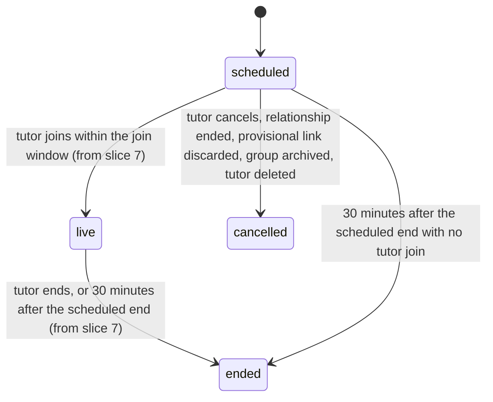

# Schedule specification

Behavior for FR-4. Decisions: [ADR-0007](../../docs/decisions/0007-recurring-lessons.md) (series and occurrences), [ADR-0006](../../docs/decisions/0006-background-worker-and-email.md) (worker) and [ADR-0014](../../docs/decisions/0014-students-join-through-their-tutor.md) (lessons of a provisional link). Routes are in the [API](api.md#schedule).

Slice 5 builds this specification without joining and without materials, as its [plan](../plans/slice-5.md#1-problem-outcome-and-scope) decides: the `live` state, the join window's join, meetings and the status job's end-meeting call arrive with video in slice 7, and lesson and series materials with the library in slice 8. The parts that wait are marked below.

## Lessons and series

- **A lesson** has:
  - a tutor;
  - exactly one audience: one relationship (a one-to-one lesson) or one group;
  - a title of 1 to 120 characters and an optional description of at most 2,000 characters, both plain text stored as entered ([text](#titles-and-descriptions));
  - a start instant in UTC, and a duration of 15 to 240 minutes in 5-minute steps; the end instant is start plus duration;
  - attached library materials (from slice 8) and linked issues (from slice 9);
  - the timezone it is shown in as the tutor-side time: the series timezone for occurrences, the tutor's profile timezone at creation for one-off lessons;
  - a status, a schedule revision incremented by every change to start or duration, a `version` incremented by every change of any field the tutor edits ([edits](#rules-for-all-edits)), a roster, and an optional series with its occurrence date;
  - for a cancelled lesson, when it was cancelled (`cancelled_at`) and why (`cancel_cause`: `tutor`, `relationship_ended`, `provisional_removed`, `group_archived` or `tutor_deleted`), set together with the status.
- **The current audience** applies while a lesson is `scheduled`, whether or not its start has passed:
  - for a one-to-one lesson, the relationship's student while the relationship is `active` or `provisional` ([ADR-0014](../../docs/decisions/0014-students-join-through-their-tutor.md));
  - for a group lesson, the group's current members; a provisional or reclaim-pending student is never a member.
- **The roster** is frozen when a lesson leaves `scheduled`:
  - becoming `live` (from slice 7), cancelled, or ended by the status job, it records the current audience at that moment;
  - a group member who joins a live group lesson is added to its roster in the join transaction (from slice 7);
  - a roster row is inserted only while its transaction holds the student's relationship row with at least `FOR SHARE` and has re-checked its state, so a roster insert that waits behind a student's purge finds the relationship discarded and inserts nothing;
  - every path that cancels or ends lessons because their audience changes (ending a relationship, archiving a group, deleting a tutor) freezes their rosters from the audience as it was before the change, in the same transaction, so cancelled lessons stay visible to the students who were expecting them;
  - when a provisional link is discarded (a removal, a student's "Stop studying" on it, a dropped reclaim link, the 7-day cleanup, the immediate purge of a deleted unconfirmed account, or a tutor deletion), its future one-to-one lessons are cancelled with the cause `provisional_removed` and its series end, silently, and the account's roster rows of every lesson of that link are deleted, whatever the lesson's status, so the account sees nothing more of that link ([T-44](../../docs/threat-model.md#threats-and-controls)).

### Visibility

One repository query shape per role answers "the lessons this caller may see", and every route and label that shows a lesson uses it: `GET /calendar`, `GET /lessons/{id}`, the student card, the group page, notification labels and links, and from slice 10 `GET /home`.

- **A tutor** sees their own lessons only.
- **A student** sees:
  - `scheduled` lessons whose current audience includes them: a one-to-one lesson of their `active` or `provisional` relationship, and a group lesson of a group they currently belong to;
  - every other lesson whose roster includes them.
- **Everything else answers `not_found`**, like a random identifier: another tutor's lesson, a scheduled lesson of an ended, `reclaim_pending` or discarded relationship, a scheduled lesson of a group the student left, and any lesson of a discarded provisional link.
- Adding a member to a group therefore never reveals the group's past or cancelled lessons, and removing a member changes no lesson row: membership alone decides ([groups](accounts.md#groups)).
- **An unconfirmed student** reaches only the one-to-one lessons of their provisional relationship, because an unconfirmed account belongs to no group and holds no other relationship; `GET /calendar` and `GET /lessons/{id}` are therefore open to unconfirmed accounts, and write nothing. An unconfirmed tutor has no lessons, because scheduling requires a confirmed tutor.
- The roster also decides who may watch recordings ([recordings](realtime-and-video.md#recordings)), after the MVP.

### Labels per role

Every name, colour and timezone that a lesson response, a notification row or an email shows follows one table, so card display names never reach students and a deleted or possibly squatting account's chosen name never reaches the tutor ([T-34](../../docs/threat-model.md#threats-and-controls), [T-44](../../docs/threat-model.md#threats-and-controls)):

| Field | Tutor | Student |
|---|---|---|
| Audience label, one-to-one | the card's own display name, also for a card discarded by the student's purge; the fixed label `removed_student` ("Removed student") for a card discarded by a removal, a dropped link or a tutor deletion | the fixed label `individual` ("Individual lesson") |
| Audience label, group | the group's name | the group's name while the student is a current member; the fixed label `group` ("Group lesson") for a roster lesson of a group the student no longer belongs to |
| Audience colour | the group's colour for a group lesson, the relationship colour for a one-to-one lesson | the relationship colour of that tutor, for one-to-one and group lessons alike |
| Members | the card display names of the current audience or the frozen roster, never account names; a member whose account is `deleted` keeps the card name and carries the fixed label `deleted_account` ("Deleted account") beside it | none: students see the group's name and the tutor, never a member list or card names |
| Tutor name and colour | — | the tutor's account name and the relationship colour while My tutors lists the relationship, otherwise `null` |
| Second timezone | the student's profile timezone of a one-to-one lesson while the relationship is `active` or `provisional`, otherwise `null`; `null` for group lessons | the lesson's tutor-side timezone |
| Email lesson label | the card's display name or the group's name | "Individual lesson", or the group label as in the audience row above, and the tutor's account name |

**Fixed labels travel as codes.** Wherever the table names a fixed label, the response carries `label: null` and `label_kind` naming it (`individual`, `group`, `removed_student` or `deleted_account`), and the interface renders its own text by key, as it renders `label_deleted` on notification rows ([states](../design/web/states.md#lessons)); `label_kind` is `null` wherever `label` holds a name. A member list entry is the one exception to `label: null`: it keeps the card name in `label` and adds `label_kind: deleted_account` for a deleted account. Emails are rendered on the server and write the fixed texts in the recipient's language.

### Titles and descriptions

- A title holds no control characters and a description none other than line breaks; anything else answers `422 validation_failed` (`invalid`) at `body.title` or `body.description`.
- Titles and descriptions are plain text everywhere ([T-14](../../docs/threat-model.md#threats-and-controls)): the interface renders them as text in their own element isolated with `dir="auto"`, so a title's direction never reorders the text around it, keeping the line breaks of a description with CSS (`white-space: pre-line`), never through an HTML sink; emails drop bidirectional controls and zero-width characters from titles in subjects and bodies alike, escape them in HTML bodies and collapse runs of whitespace and line breaks in plain text; subjects and headers also remove CR and LF and encode with RFC 2047.
- The New lesson dialog prefills the title with "Lesson" for a one-to-one lesson and with "Lesson" and the group's name for a group lesson, never with the card's display name, which is the tutor's own and never reaches students; it is editable, with the hint "Students see the title"; the server requires a title and stores what it receives, so the tutor sees exactly what students will see.
- Restricted Markdown in descriptions waits for the builder's renderer in slice 8, and only if a later decision asks for it.

### Scheduling limits

- **Audience:** a lesson cannot be scheduled or moved to start in the past (`422 lesson_in_past`): a one-off lesson whose start is not after now, and a series only when no occurrence remains after skipping past occurrences (a counted series skips them uncounted). An `invited`, `ended` or `reclaim_pending` relationship and an archived group answer `409 audience_not_active`; a relationship or group outside the tutor's scope, and a discarded relationship, answer `404 not_found`. A one-to-one lesson or series may be scheduled for a `provisional` relationship; a group never contains a provisional student. Occurrences of a new series whose start would be in the past are skipped and not counted.
- **Per-tutor caps:** a tutor has at most 100 series that have not ended (`ended_at` is null and the end date or the last counted occurrence is not past) and at most 3,000 future `scheduled` lessons. Creating or splitting beyond either answers `422 validation_failed` (`body`, `too_many`), counted under the tutor's profile lock. Horizon extension is exempt, because it only keeps each series 12 weeks ahead, so a tutor has at most about 12,100 future lessons.
- **Write rate:** at most 120 lesson write attempts (creations, edits, cancellations) per tutor per hour, with the rate-limit purpose `lesson_writes_hour`; beyond that `429 rate_limited` with `Retry-After`. The slot is reserved in its own committed step, under the tutor's profile lock, after the `403` and the replay of a repeated `Idempotency-Key` and before every check of the service, and is not released when the request is later refused, so refused attempts count; the schema checks (`400`, `422`) come before it and use no slot, a replay found at admission and a `429` itself use none either, and a request that races its still-uncommitted first request with the same key may use one. Creations count from slice 5's first change, edits and cancellations from the change that adds them (owner's decision of 2026-10-27).
- **Refusal order of `POST /lessons`:** `403 email_not_verified` for an unconfirmed tutor; then the schema checks (`400`, `422`); then a repeated `Idempotency-Key` returns the first result; then `429 rate_limited`; then the audience in the tutor's scope (`404`, then `409 audience_not_active`); then the body (`422 validation_failed`, `lesson_in_past`); then the caps (`422 validation_failed` with `too_many`); then `409 conflict` when a group's members changed twice ([locks](#locks-and-jobs)); then `409 lesson_overlap`. `PATCH /lessons/{id}` and `POST /lessons/{id}/cancel` resolve the lesson within the tutor's scope (`404`) before any other answer.
- **The tutor's state:** every lesson write takes the tutor's profile lock first and answers `401 unauthenticated`, changing nothing, when the tutor is no longer `active` under it ([accounts](accounts.md#locks-and-the-session-re-check)).

### Series

- **A series** has:
  - a tutor and one audience;
  - one or more weekdays and a local start time;
  - a duration;
  - the IANA timezone of the tutor at creation, kept for the life of the series;
  - a first date and an end: either an end date at most 18 months later, or a count of 1 to 100 lessons whose last lesson falls within 18 months;
  - a title and a description, and from slice 8 materials, copied into each occurrence as it is created;
  - `materialised_until`, the series it was split from, and `ended_at` once no occurrence is left.

## Recurrence and timezones

- **Occurrences** are lesson rows keyed by `(series, occurrence_date)`, where the occurrence date is the original local date in the series timezone. The key is unique and never changes, even when an occurrence is moved to another day.
- **Local input:** `POST /lessons` takes a local date and a local start time (`HH:MM`). The server converts them in the tutor's profile timezone at that moment for a one-off lesson, and stores them in the series timezone for a series. The client never converts a local time into an instant for saving; the calendar's range bounds are the only instants it computes.
- **Occurrence dates:** weekdays are ISO weekdays (1 Monday to 7 Sunday); the occurrences are the dates on or after the first date that fall on a chosen weekday, and the first date need not be one of them; the 18-month bound of an end date or of a count's last lesson is measured from the first date.
- **Materialisation:**
  - a series with a count, or one ending within 12 weeks of its creation, is materialised completely on creation;
  - longer series are materialised through the creation time plus 12 weeks, and the worker extends the horizon daily;
  - extension, splitting and "cancel following" all lock the series row (`FOR UPDATE`) and re-read the series end inside that transaction, so they never race;
  - extension inserts only keys that do not exist yet and skips series whose audience is no longer active or that have ended, and series of a tutor who is not `active` (for example blocked by the operator); a skipped tutor's series are not ended and are extended again after an unblock; these exclusions (the tutor `active`, the audience active, the series not ended) apply in the candidate query, before its limit, so skipped series never take the places of others; it takes candidates in batches of 200 series, starting from the series with the oldest `materialised_until`, each series in its own transaction, and keeps taking batches within its run's time budget until no candidate is left, so every active series keeps its 12-week horizon at the scale of NFR-3.1; it never materialises an occurrence that starts before the run's `now`, so a series extended again after a long block gains no past occurrences.
- **Start instant:** each occurrence's start is computed in the series timezone from its date and the local start time, following RFC 5545, by the pure package `internal/domain/schedule`, which does no I/O.
  - A local time that does not exist on that date, because clocks jump forward, is shifted forward by the length of the gap. In a timezone that skips 02:00–03:00, 02:30 becomes 03:30.
  - A local time that occurs twice, because clocks fall back, uses the earlier instant.
  - Both rules are computed from the zone's transitions, because Go's `time.Date` does not guarantee which instant it returns in either case.
  - Unit tests name both rules in two zones with daylight saving, in a zone with a 30-minute shift, and on a date on which a zone changed its standard offset.
- **Zone data:** the server uses the host's zone database and imports `time/tzdata` as the fallback when the host has none; the deployment pins its base image, so the version is known. A browser's zone data can differ from the server's, which affects only the display of instants in zones whose rules changed between the two versions.
- **Display:** times are shown in the viewer's profile timezone. The lesson page also shows the other party's timezone when it differs (`other_timezone` of `GET /lessons/{id}`):
  - the tutor of a one-to-one lesson sees the student's profile timezone while the relationship is `active` or `provisional`;
  - a student sees the lesson's tutor-side timezone;
  - the tutor of a group lesson sees no second time.
- **City names:** the second time reads `time.other_zone` with the city of the zone, in English and in the Russian genitive, from one timezone city table kept as two identical copies, `frontend/src/lib/time/timezone-cities.json` (loaded only with the lesson page's code) and `backend/internal/core/timezonecities/timezone-cities.json` (for emails); `TestTimezoneCityTablesAreIdentical` compares them byte for byte, a frontend unit test checks that every zone the test engine's `Intl.supportedValuesOf('timeZone')` lists has an entry, and any other zone the server accepts falls back to the `UTC±hh:mm` form under the key `time.other_offset`, which a backend test covers for a zone missing from the table ([states](../design/web/states.md#time-and-scores)).
- Changing a profile timezone moves no existing lesson or series.

## Join rule

From slice 7; in slice 5 nobody joins a lesson. The single rule every join, page and specification refers to:

- **The tutor** may join their lesson while it is in the join window and not cancelled. The first join makes it `live`; a later join reuses or restarts the meeting ([join flow](realtime-and-video.md#join-flow)).
- **A student** may join only while the lesson is `live` and all of these hold:
  - their relationship with the tutor is `active`, or, for a one-to-one lesson only, `provisional` ([ADR-0014](../../docs/decisions/0014-students-join-through-their-tutor.md));
  - for a one-to-one lesson, they are its student; for a group lesson, they are a current member of the group (a member not yet in the roster is added to it).

Ending a relationship or removing a member therefore stops further joins immediately. A student already connected, or holding an earlier join link, can stay until the meeting ends. The lesson page then offers the tutor "Restart the room", which ends the open meeting and starts a new one, so every earlier join link stops working ([join flow](realtime-and-video.md#join-flow), [threat T-21](../../docs/threat-model.md#threats-and-controls)).

## Editing and cancelling

| Action | Scope | Effect |
|---|---|---|
| Edit time, date, duration, title, description, materials (from slice 8) | This lesson | The occurrence takes the new values and records them as overridden fields; later series edits leave overridden fields alone |
| Edit time, duration, title, description, materials (from slice 8) | This and following | See the split rules below; a new date is refused |
| Change weekdays | — | Not offered as an edit: the tutor cancels this and following lessons and creates a new series |
| Cancel | This lesson | Status `cancelled` with `cancel_cause` `tutor`; the row stays |
| Cancel | This and following | Future occurrences from this one are cancelled and the series ends before this occurrence |
| Delete | — | Not offered; cancelled lessons remain in history |

**Bodies:**

- `PATCH /lessons/{id}` takes `{scope, version, date?, start?, duration_minutes?, title?, description?, allow_overlap?}` with at least one changed field. `date` and `start` are local values in the lesson's tutor-side timezone. `date` with `scope: following` answers `422 validation_failed` (`not_allowed`), because weekday changes are not offered, and `scope: following` on a lesson without a series answers `422 validation_failed` (`not_allowed`).
- `POST /lessons/{id}/cancel` takes `{scope, version}`; a malformed body answers `422 validation_failed`, and `scope: following` on a lesson without a series answers `422 validation_failed` (`not_allowed`), as for `PATCH`. A repeated cancellation of a lesson that is already `cancelled`, whatever its cause, answers `200` with the current state without checking `version`, and so does a repeated "cancel following" whose series already ends before the occurrence.

**Splitting a series** at an occurrence for "this and following" covers every occurrence whose occurrence date is on or after the selected occurrence's date:

1. The original series ends before that date: its end becomes an end date of the previous day, and a count is converted into that end date. Splitting at the first occurrence leaves the original series with no occurrences; it is marked ended (`ended_at`).
2. A new series starts at that date with the new values. It keeps the original series timezone and weekdays. Its count is the number of covered occurrences, including cancelled ones, or it inherits the original end date. Its `materialised_until` is copied, and it records the series it was split from.
3. **Covered rows** move to the new series in place, by `series_id`, keeping their identifiers, links, recordings and sent emails. New values are applied only to covered rows that are editable (`scheduled` and not yet started):
   - the selected occurrence takes every new value;
   - each following occurrence takes a changed field only where it has not overridden that field, and a new start time applies on the occurrence's current local date (its moved date when it was moved);
   - live, ended and cancelled rows keep their values.
4. **Locks:** the split locks the series row `FOR UPDATE`, re-reads its end, and then locks the covered rows in identifier order. A split counts toward the per-tutor caps.
5. The request generates an operation identifier, carried in the outbox payload of each recipient's `lesson.series_changed` email, together with the identifiers of the affected lessons (at most 100), and in the idempotency keys of its email and in-app rows; it is not stored elsewhere ([notifications](notifications.md#events)).

### Rules for all edits

- **Read-only lessons:** past, live and ended lessons cannot be edited or cancelled. A `scheduled` lesson whose start has passed is read-only too. Every edit carries the `version` the client saw and is a conditional update on `status = 'scheduled' AND starts_at > now AND version = <seen>`. It loses with `409 not_editable` to a lesson that has left `scheduled` or started, and with `409 conflict` otherwise. The tutor can still attach materials (from slice 8) and link issues (from slice 9) to any lesson.
- **Two counters:** `version` increments on every change of any edited field, so two concurrent title edits conflict; `schedule_revision` increments only on start or duration changes and keys reminders and `lesson.moved`.
- **Overridden fields** are recorded per field: start time, date, duration, title, description and materials.
- **Notifications:**
  - moving (start or duration) or cancelling one lesson emits `lesson.moved` or `lesson.cancelled` to its audience; other edits notify no one;
  - an edit or cancellation of "this and following" emits one aggregated `lesson.series_changed` per recipient, listing the affected lessons ([notifications](notifications.md#events));
  - a lesson scheduled or moved inside a reminder window gets only the reminders still ahead of it; no other email stands in for a missed one.

## Overlap warnings

**When it runs:** a tutor creates or moves a lesson or a series (`POST /lessons` and `PATCH /lessons/{id}`).

**How it is checked:**

- Both sides are expanded virtually up to each series' end: the new or moved occurrences, and the tutor's existing lessons plus every occurrence of the tutor's series beyond its materialised horizon; the per-tutor caps bound both.
- The rows being moved, including a split's own covered rows, are excluded.
- Cancelled lessons are ignored, and lessons that only touch (one ends exactly when the other starts) do not overlap.
- One range query loads the tutor's lessons in the affected period and one the tutor's series that have not ended, and an in-memory sweep finds intersections.
- Overlaps with a student's lessons from other tutors are never checked or revealed.

**Response:** if any overlap exists, nothing is saved and the API returns `409` with code `lesson_overlap`; `details` is `{lessons: [{title, starts_at, ends_at}], more}`: at most 20 conflicting lessons, earliest first, without identifiers (occurrences beyond a series' horizon have none), and `more`, the number left out. The client asks the tutor to confirm, then repeats the request with `allow_overlap: true`.

## Lesson status and join window

- **The join window** opens 10 minutes before the start and closes when the lesson ends. Who may join is defined by the [join rule](#join-rule).
- **In slice 5**, without joining, the lesson page shows: before the window, "Room opens at {time}" to both roles; inside the window, the status word "Starting soon", "The room opens when your tutor joins" to students, and the time and status without a join area to the tutor. Every past lesson of slice 5 ends as "did not take place".
- **Before the tutor joins**, the lesson page and Home show students that the room opens when their tutor joins, and update live through the [realtime channel](realtime-and-video.md#in-app-notifications-and-live-updates).
- **When the conferencing meeting ends on the provider side** (the tutor's connection dropped, or no moderator remained), the lesson does not end. It stays `live`, students see "the room opens when your tutor joins" again, and the tutor's rejoin starts a new meeting.
- **"Took place"** means the lesson has `live_at`; a lesson ended without it is shown as "did not take place".
- **Status job:** a worker job runs every minute.
  - It ends `scheduled` lessons with no tutor join 30 minutes after their scheduled end, freezing their roster, and emits `entity.changed`.
  - From slice 7 it also ends `live` lessons at the same moment and enqueues an end-meeting provider call through the outbox.
  - It ends up to 500 lessons per run, oldest scheduled end first, each in its own transaction.
  - Each end is a conditional update on the expected status and takes the lesson row lock after the audience's locks ([locks and jobs](#locks-and-jobs)), so it never races a tutor join or an ending.
- **Ending by the tutor** (`POST /lessons/{id}/end`, from slice 7) sets the lesson `ended` and enqueues the end-meeting provider call through the outbox.

## Locks and jobs

The general [lock order](accounts.md#locks-and-the-session-re-check) places series (identifier order) and then lessons (identifier order) after groups. Every path that names students, as audience, roster or frame recipients, holds their relationships with at least `FOR SHARE` before any group, series or lesson. The rule per path:

- **Creating, editing and cancelling:** the tutor's profile, then the audience's relationships (`FOR SHARE`; for a group, its members read first without locks), then the group (`FOR SHARE`), then the series, then the lessons. The members read under the group lock must equal the locked set; otherwise the request retries once with the new set and then answers `409 conflict`, changing nothing.
- **The effects of tutoring paths** (ending, removal, member changes, archiving, tutor deletion) are in [accounts](accounts.md#locks-and-the-session-re-check).
- **The worker jobs** (status, reminders, horizon extension): one transaction per lesson, or per series for the extension. Each reads the audience without locks, then locks the relationships (`FOR SHARE`), the group (`FOR SHARE`), the series and the lesson, re-reads the membership and the lesson's state, and handles the lesson only when the audience under the locks equals the one it locked; otherwise it retries once in the same run and leaves the lesson to the next run after that.
- **Budgets:** the reminder job selects lessons 50 at a time through the partial `(starts_at)` index of scheduled lessons, within a 20-second budget per run ([reminders](notifications.md#reminders)); the status job and horizon extension have the bounds above, horizon extension within a time budget per run. Tests inject the budgets through constructors.

## Calendar queries

- **`GET /calendar?from=&to=&tutor=`** returns the caller's lessons that intersect the range, under the [visibility](#visibility) rule. `from` and `to` are RFC 3339 instants; `to − from` is at most 62 days plus one day of margin on each side, so a month view whose local midnights the client computes always fits. The query bound is `starts_at < to AND starts_at > from − 240 minutes` plus the exact intersection filter, so it uses the start-time indexes.
- **For a tutor:** their own lessons; a `tutor` parameter answers `422 validation_failed` (`not_allowed`).
- **For a student:**
  - a `UNION ALL` of the `scheduled` lessons of their `active` and `provisional` relationships and current groups, and every other lesson whose roster includes them;
  - each branch uses an index that leads with the audience or student and includes the start time;
  - the `tutor` filter takes only the identifier of a relationship the student's My tutors lists (`active`, `provisional` or `ended`); any other identifier, a discarded or `reclaim_pending` one included, answers `404` like a random one.
- **Each item** is `{id, title, starts_at, ends_at, status, timezone, audience: {kind, label, label_kind, colour}, tutor: {name, colour} | null}`, with `kind` `one_to_one` or `group`, labelled and coloured by the [label table](#labels-per-role). At most 1,000 items per response, ordered by start, with `truncated: true` beyond. The response sends `Cache-Control: no-store`. Descriptions and materials come from the lesson detail route.

## Lesson detail

- **`GET /lessons/{id}`** has one schema for both roles, because one path cannot carry two response schemas, and every field's value per role follows the [label table](#labels-per-role): the lesson's `id`, `title`, `description`, `starts_at`, `ends_at`, `duration_minutes`, `status`, `timezone`, `series_id`, the `version` an edit sends back, `cancelled_at` for a cancelled lesson, `other_timezone` or `null`, `audience: {kind, label, label_kind, colour, members}` (`members` a list of `{label, label_kind}` for the tutor of a group lesson, an empty list for the tutor of a one-to-one lesson, and `null` for students) and `tutor: {name, colour}` for students and `null` for the tutor. `room_open` and `embed_allowed` arrive with joining in slice 7. The response sends `Cache-Control: no-store`.
- A contract test proves that no student response carries a card display name, a member list or a tutor-only field.

## Lessons on the tutoring pages

- **The student card:** `GET /students/{id}` gains `next_lessons` (the card's next three lessons), and `GET /students/{id}/lessons?cursor=` lists the card's lesson history, newest first, keyset paginated on `(starts_at, id)`.
- **The group page:** `GET /groups/{id}` gains `next_lessons` (the group's next five lessons), and for the owning tutor `future_lesson_count` (the group's future `scheduled` lessons) and `has_open_series` (whether a series of the group has not ended), which the archive confirmation shows ([pages](../design/web/pages.md#groups-and-group-page)).
- **Lists:** each item of `GET /students` and `GET /groups` gains `next_lesson` or `null`, read in one batched query per page.
- A second tutor sharing the student gets `not_found` for the first tutor's card and group and sees none of the first tutor's lessons.
